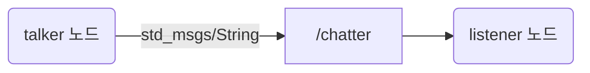

# 장 문서 규칙

이 파일은 모든 장 문서가 따르는 형식과 규칙을 정합니다. 학습자는 각 장이 어떤 순서로 구성되는지 확인하는 용도로 읽으면 되고, 장을 작성하는 사람은 아래 규칙을 반드시 지켜야 합니다.

## 1. 우선순위

1. ROS 2의 구조를 정확히 이해하고 체감하는 것이 첫째 목표입니다. 실습은 무엇이 어떤 이름과 타입으로 연결되는지가 눈에 보이도록 구성합니다.
2. 로봇이 원하는 대로 움직이는 것은 둘째 목표입니다. 실습이 실패하더라도 원인을 추적하면서 배울 수 있도록, 관찰 명령과 확인 방법을 함께 적습니다.
3. 학습자는 모든 명령과 코드를 직접 입력합니다. 한 번에 입력할 분량이 지나치게 길어지지 않도록 실습을 잘게 나눕니다.

## 2. 저작권 규칙

원서는 저작권이 있는 출판물입니다. 이 가이드는 번역본이 아니며, 다음 규칙을 지킵니다.

- 원서는 각 장에 어떤 목표, 개념, 실습이 있는지 확인하는 용도로만 읽습니다.
- 원서 문장을 번역하지 않습니다. 원서 문단의 순서를 따라가면서 표현만 바꿔 쓰는 것도 하지 않습니다. 설명은 처음부터 새로, 짧게 씁니다.
- 원서 문장을 인용하지 않습니다. 원서의 설명이 필요하면 "원서 PDF p.123"처럼 쪽 번호로 안내합니다.
- 원서의 rospy·roscpp 코드를 옮겨 적지 않습니다. 같은 목표를 이루는 ROS 2 코드를 새로 작성합니다. 파일 이름이나 토픽 이름처럼 실습을 원서와 대응시키는 데 필요한 이름은 원서와 같게 써도 됩니다.
- 원서의 그림과 표는 옮기지 않습니다. 필요하면 구조를 새로 그린 다이어그램(8절의 mermaid 그림 또는 텍스트 그림)을 씁니다.

## 3. 장 문서 형식

파일 이름은 `chNN_<영문_슬러그>.md`입니다. (예: `ch07_wander_bot.md`)
아래 순서를 지키고, 해당 내용이 없는 절은 "해당 없음"이라고 한 줄로 적습니다.

````markdown
# N장. 한국어 제목

- 원서: Chapter N. English Title, PDF p.A~B (인쇄 쪽 = PDF 쪽 - 20)
- 선행 조건: 앞 장에서 만든 패키지, 미리 실행해 둘 것
- 새로 설치할 것: 없음 또는 `sudo apt install ...` (학습자가 직접 실행)

## 이 장에서 체감할 구조
3줄 이내로, 이 장을 마치면 머릿속에 남아야 할 연결 구조를 적습니다. 그 아래에 구조 전체를 보여 주는 mermaid 그림을 하나 붙입니다(8절).

## 1. 목표와 개념
원서가 이 장에서 이루려는 목표와 필요한 개념만 짧게 새로 씁니다.
개념 옆에 그림과 짧은 코드 예시를 두고, 끝에 "코드와 폴더 구조"와 "실무 메모"를 둡니다(8절).

## 2. 원서(ROS 1)와 달라지는 점
| 원서 (ROS 1) | ROS 2 Jazzy | 이유와 주의점 |
|---|---|---|

## 3. 실습
### 실습 N-1. 제목
> **미검증 실습**: 실행해 확인하지 못한 부분이 있는 실습에만 붙입니다(9-2).
**준비**: 열어 둘 터미널과, 각 터미널에서 이미 실행 중이어야 하는 것
**직접 입력**: 명령 또는 코드 전체 (파일이면 전체 경로를 먼저 적음)
**줄 단위 해설**: 코드가 있을 때 `| 줄 | 설명 |` 표로 씁니다. 사소한 줄은 묶어도 됩니다.
**관찰**: 무엇을 보면 되는지, 출력이 어떤 모양이어야 하는지
**생각해 볼 질문**: 1~2개. 답은 5절에 둡니다.

## 4. 일부러 망가뜨려 보기
| 바꿀 것 | 예상 증상 | 원인을 확인하는 명령 |
|---|---|---|

## 5. 확인 질문
<details><summary>Q1. 질문</summary>

답

</details>

## 6. 원서 대조 메모
원서의 오류, ROS 1에만 있는 내용, ROS 2에서 생략하거나 바꾼 부분과 그 이유를 적습니다.

## 7. 이 문서의 검증 상태
<details><summary>검증 기록 펼치기</summary>

- 확인함: 무엇을 어떤 방법으로 확인했는지
- 확인 못 함: 무엇이 남았는지

</details>
````

## 4. 공통 실습 환경

- Windows 11 + WSL2 Ubuntu 24.04, ROS 2 Jazzy (`/opt/ros/jazzy`), 실물 로봇 없이 시뮬레이션만 씁니다.
- 워크스페이스는 `~/rosbook_ws`이고, 패키지는 `~/rosbook_ws/src/` 아래에 만듭니다.
- `~/.bashrc`는 터미널을 열 때마다 `/opt/ros/jazzy/setup.bash`와 `~/rosbook_ws/install/setup.bash`를 source 하고, `TURTLEBOT3_MODEL=waffle_pi`, `GALLIUM_DRIVER=d3d12`, `RMW_IMPLEMENTATION=rmw_cyclonedds_cpp`를 설정합니다.
- RMW는 Cyclone DDS입니다. 이 WSL(`networkingMode=mirrored`)에서는 Fast DDS로 프로세스 사이에 데이터가 전달되지 않기 때문입니다. 이유는 `appendix_wsl_environment.md`의 "왜 Fast DDS 대신 Cyclone DDS를 쓰나요"에서 설명하므로, 장 문서는 이 설정을 전제로 쓰고 Fast DDS 전용 설정(XML 프로파일, `FASTDDS_` 환경 변수)을 쓰지 않습니다. RMW를 직접 바꿔 보는 실험은 2장에서만 다룹니다.
- 이 WSL에서는 daemon이 없으면 `ros2` CLI가 약 2분 동안 멈춘 뒤 실패합니다(`appendix_wsl_environment.md`의 daemon 절). 장 문서는 daemon이 떠 있다고 전제하고, `ros2 daemon status`를 쓰지 않습니다. daemon을 다시 띄울 때는 `ros2 daemon stop` 직후에 `ros2 daemon start`를 안내하고, daemon을 내린 채로 끝나는 순서는 쓰지 않습니다. 다른 `ROS_DOMAIN_ID`의 노드를 CLI로 볼 때는 그 도메인에 daemon이 없으므로 `--no-daemon`을 붙입니다.
- 이 PC(WSL2 mirrored)에서만 생기는 문제와 그 이유는 장 본문에 길게 쓰지 않고 `appendix_wsl_environment.md`에 모은 뒤, 장에서는 한두 문장과 링크로 안내합니다.
- 빌드 명령은 `cd ~/rosbook_ws && colcon build --symlink-install --packages-select <패키지>`입니다.
  새 패키지를 처음 빌드했거나 새 실행 파일을 추가했다면, 이미 열려 있던 터미널에서 `source ~/rosbook_ws/install/setup.bash`를 다시 실행해야 합니다.
- TurtleBot3 시뮬은 `ros2 launch turtlebot3_gazebo turtlebot3_world.launch.py`로 띄웁니다.
- TurtleBot3 시뮬의 `/cmd_vel` 타입은 `geometry_msgs/msg/TwistStamped`입니다. 원서가 쓰는 `Twist`와 다릅니다.
- 시뮬 토픽을 다루는 노드와 rviz2, rqt 도구는 `use_sim_time:=true`로 실행합니다.

## 5. 패키지와 파일 이름

| 장 | 패키지 | 빌드 타입 | 비고 |
|---|---|---|---|
| 2~5, 20~21 | `basics` | ament_python | 원서의 basics 패키지에 대응합니다. 실행 파일 이름은 원서 스크립트 이름에서 `.py`를 뺀 것입니다. |
| 3~5, 19 | `basics_interfaces` | ament_cmake | 3장에서 `msg/Complex.msg`, 4장에서 `srv/WordCount.srv`, 5장에서 `action/Timer.action`, 19장에서 `action/Talk.action`을 차례로 추가합니다. |
| 6 | (없음) | | TurtleBot3 시뮬을 띄우고 관찰만 하므로 패키지를 만들지 않습니다. |
| 7 | `wander_bot` | ament_python | |
| 8 | `teleop_bot` | ament_python | |
| 9~10 | `nav_bot` | ament_python | 지도 파일은 `~/rosbook_ws/maps/`에 저장합니다. |
| 11 | `chess_bot` | ament_python | |
| 12 | `follow_bot` | ament_python | |
| 13 | `patrol` | ament_python | |
| 14 | `stockroom_bot` | ament_python | |
| 15 | `sensors_actuators` | ament_python | |
| 16~17 | `tortoisebot` | ament_python | |
| 18 | `cougarbot`, `cougarbot_moveit_config` | ament_cmake | `cougarbot_moveit_config`는 MoveIt Setup Assistant가 만듭니다. |
| 19 | `talk_bot` | ament_python | |
| 23 | `basics_cpp` | ament_cmake | |

`basics_interfaces`의 기본 형태는 다음과 같습니다. 3장에서 만들고 4장과 5장에서 확장합니다.

- 생성 명령: `ros2 pkg create --build-type ament_cmake --license Apache-2.0 basics_interfaces`
- `package.xml`: `<buildtool_depend>rosidl_default_generators</buildtool_depend>`, `<exec_depend>rosidl_default_runtime</exec_depend>`, `<member_of_group>rosidl_interface_packages</member_of_group>`를 추가합니다. 5장의 `Timer.action`은 `builtin_interfaces/Duration`을 쓰므로 `<depend>builtin_interfaces</depend>`, `find_package(builtin_interfaces REQUIRED)`, `DEPENDENCIES builtin_interfaces`를 추가합니다. `action_msgs` 의존은 따로 넣지 않아도 빌드됩니다(5장 검증 결과).
- `CMakeLists.txt`: `find_package(rosidl_default_generators REQUIRED)`와 `rosidl_generate_interfaces(${PROJECT_NAME} "msg/Complex.msg" ...)`를 씁니다. 4장과 5장은 이 목록에 파일을 한 줄씩 추가합니다.

## 6. rclpy 코드 기본 형태

모든 장의 Python 노드는 아래 형태를 기본으로 씁니다. 장마다 다른 형태를 쓰면 학습자가 무엇이 본질이고 무엇이 취향인지 구분하기 어려워지기 때문입니다.

```python
import rclpy
from rclpy.executors import ExternalShutdownException
from rclpy.node import Node


class MyNode(Node):
    def __init__(self):
        super().__init__('my_node')
        # publisher, subscription, timer, parameter 선언


def main(args=None):
    rclpy.init(args=args)
    node = MyNode()
    try:
        rclpy.spin(node)
    except (KeyboardInterrupt, ExternalShutdownException):
        pass
    finally:
        node.destroy_node()
        rclpy.try_shutdown()


if __name__ == '__main__':
    main()
```

- 현재 시각은 `self.get_clock().now()`로 얻습니다. `use_sim_time:=true`로 실행하면 이 값이 `/clock`을 따릅니다.
- 로그는 `self.get_logger().info()` 계열을 씁니다. `print()`를 쓰지 않는 이유는 21장에서 다룹니다.
- 실행 파일은 `setup.py`의 `entry_points['console_scripts']`에 등록합니다.
- import 순서는 `ament_flake8` 규칙을 따릅니다. 표준 라이브러리를 먼저 쓰고 빈 줄을 둔 뒤, 나머지를 모듈 이름의 알파벳순으로 씁니다. 그래서 `from basics_interfaces.srv import WordCount`가 `import rclpy`보다 앞에 옵니다.

## 7. 문체

- 한국어 합니다체로 씁니다. 문장은 서술어로 끝맺고, 조사를 생략하지 않습니다.
- 엠대시(—)를 쓰지 않습니다. 콜론이나 접속사로 문장 관계를 드러냅니다.
- ROS 용어는 정착된 표기를 그대로 씁니다 (노드, 토픽, 메시지 타입, QoS, publisher, subscriber 등). 처음 나올 때 한 번 짧게 풀이합니다.
- 비유가 도움이 되는 개념은 "비유:"로 시작하는 한 줄로 따로 적습니다. 본문 설명은 일반적인 용어로 씁니다.
- 코드 안의 주석은 꼭 필요한 곳에만 짧게 쓰고, 설명은 코드 아래 줄 단위 해설 표에 씁니다.

## 8. 설명 보강 규칙 (2026-10-30 추가)

설명 구간(이 장에서 체감할 구조, 1절)만 읽어도 구조가 머릿속에 그려지도록, 그림과 짧은 코드 예시, 코드와 폴더 구조, 실무 메모를 둡니다. 실습(3절)은 직접 입력하는 곳이고, 1절의 예시는 읽기만 하는 곳입니다.

### 8-1. 바꾸는 범위

이 범위는 2026-10-30의 설명 보강 작업에 정한 것입니다. 2~6절에서 발견한 결함은 9절의 규칙대로 고치고 7절에 기록합니다.

- 바꿔도 되는 곳: "이 장에서 체감할 구조"와 "1. 목표와 개념"입니다. 1절의 기존 문단은 지우지 않습니다. 구조를 더 잘 드러내도록 문장을 다듬거나 이어 붙이는 것은 됩니다.
- 7절에는 8-6의 한 줄만 덧붙입니다. 기존 줄은 바꾸지 않습니다.
- 맨 위 머리말(제목, 원서, 선행 조건, 새로 설치할 것)과 2~6절은 한 글자도 바꾸지 않습니다. 실습 코드와 순서는 검증을 마친 상태이기 때문입니다. 2~6절에서 잘못을 발견하면 고치지 말고 보고합니다.

### 8-2. 그림 (mermaid)

GitHub는 ` ```mermaid ` 코드 블록을 그림으로 그려 줍니다. 모든 그림은 이 형식으로 새로 그립니다.

- "이 장에서 체감할 구조"에는 장 전체의 연결 구조를 그린 그림을 하나 둡니다. 이미 있는 텍스트 그림은 같은 내용의 mermaid 그림으로 바꿉니다.
- 1절에는 그림이 이해를 크게 돕는 개념 옆에 1~3개를 둡니다. 그림 바로 위나 아래에 "그림에서 볼 것"을 한두 문장으로 적습니다.
- 그림 하나에 상자는 12개 이하로 둡니다. 더 많으면 두 그림으로 나눕니다.
- 그림 종류는 내용에 맞게 고릅니다.
  - 노드와 토픽의 연결: `flowchart LR` 또는 `flowchart TB`
  - 요청과 응답, 목표와 피드백처럼 시간 순서가 중요한 주고받기: `sequenceDiagram`
  - lifecycle 상태, 상태 기계: `stateDiagram-v2`
- `flowchart`의 모양 규칙은 모든 장에서 같게 씁니다.

  | 대상 | 모양 | 문법 예 |
  |---|---|---|
  | 노드 | 둥근 상자 | `talker("talker 노드")` |
  | 토픽 | 네모 상자 | `chatter["/chatter"]` |
  | 서비스 | 육각형 | `wc{{"/word_count 서비스"}}` |
  | 액션 | 평행사변형 | `timer[/"/timer 액션"/]` |
  | 파일, 설정, 외부 프로그램 | 원통 | `yaml[("params.yaml")]` |
  | 데이터나 메시지의 흐름 | 실선 화살표 | `talker --> chatter` |
  | 설정, 디스커버리, 호출 같은 보조 관계 | 점선 화살표 | `a -.-> b` |

- 문법 안전 규칙(GitHub에서 그림이 깨지지 않게 하는 규칙입니다):
  - 상자 id는 영문 소문자, 숫자, `_`만 씁니다. 화면에 보일 글자는 모두 큰따옴표 안에 씁니다.
  - `end`, `call`, `click`, `style`, `class`, `default`, `graph`, `subgraph`처럼 mermaid가 예약한 낱말은 id로 쓰지 않습니다. 23장 그림이 `call` 이라는 id 때문에 그려지지 않은 적이 있습니다.
  - 화살표 글자는 `-->|"글자"|` 형식으로 씁니다.
  - 따옴표 안에 큰따옴표, `#`, `;`, 백틱을 쓰지 않습니다. 줄바꿈이 필요하면 `<br/>`만 씁니다.
  - `style`, `classDef`, `click`, `%%{init}%%`, 새 모양 문법(`@{ shape: ... }`)은 쓰지 않습니다.
  - `sequenceDiagram`의 참가자는 `participant c as 클라이언트 노드`처럼 id를 영문으로 두고, 메시지 글자에 `;`와 `#`를 쓰지 않습니다.

예:



### 8-3. 코드 예시

- 1절에서 개념을 설명한 문단 바로 아래에, 그 개념이 코드나 명령에서 어떻게 보이는지 1~4줄짜리 예시를 둡니다. 형식은 "예:" 한 줄, 코드 블록, 그리고 무엇을 볼지 한 문장입니다.
- 예시는 되도록 그 장 3절의 코드와 명령에서 그대로 가져옵니다. 이름도 실습과 같게 씁니다. 실습에 없는 API나 명령을 쓸 때는 `/opt/ros/jazzy` 아래의 소스나 헤더에서 이름을 확인한 것만 씁니다.
- 코드 블록에는 언어를 적습니다(`python`, `bash`, `xml`, `yaml`, `cmake`, `cpp`, `text`).

예:

```python
self.pub = self.create_publisher(String, 'chatter', 10)
```

`'chatter'` 앞에 `/`가 없으므로 상대 이름이고, 실행할 때 네임스페이스가 앞에 붙습니다.

### 8-4. 코드와 폴더 구조

- 그 장에서 패키지나 파일을 만들거나 바꾸면, 1절 끝에 `### 코드와 폴더 구조` 소제목을 두고 다음을 적습니다.
  - 그 장을 마친 뒤의 패키지 폴더 트리(` ```text ` 블록)와, 파일마다 맡은 일 한 줄, 그 파일을 만드는 실습 번호
  - 빌드 뒤 그 파일이 `install/` 아래 어디에 놓이는지 (새로 나온 경우만)
  - 노드 코드의 뼈대가 앞 장과 달라지는 점 (예: 콜백 그룹, 액션 서버, 상태 기계)
- 앞 장에서 이미 설명한 구조는 되풀이하지 않고 "N장의 구조에 X가 더해집니다"처럼 차이만 적습니다.
- 패키지를 만들지 않는 장은 이 소제목 대신, 그 장에서 다루는 외부 패키지나 실행 파일의 구성을 짧게 적습니다. 적을 것이 없으면 소제목을 두지 않습니다.

### 8-5. 실무 메모

- 1절 맨 끝에 `### 실무 메모` 소제목을 두고, 그 장의 내용이 실제 로봇 프로젝트에서 어떻게 쓰이는지 2~5개 항목으로 적습니다.
- 깊이 들어가지 않습니다. 이름 짓기, 파일 배치, 파라미터 관리, QoS 선택, 로그, 디버깅 습관처럼 현업에서 바로 쓰는 관례를 고릅니다. 근거가 되는 문서가 있으면 이름을 적습니다(예: REP 103, REP 105).
- 확실하지 않은 내용은 쓰지 않습니다.

### 8-6. 7절에 덧붙이는 줄

```markdown
- 설명 보강(2026-10-30): "이 장에서 체감할 구조"와 1절에 그림, 코드 예시, 코드와 폴더 구조, 실무 메모를 더했습니다. 머리말과 2~6절은 바꾸지 않았습니다. 1절의 코드 예시는 따로 실행하지 않았습니다.
```

## 9. 검증과 미검증 표시 (2026-10-31 추가)

학습자가 문서를 얼마나 믿어도 되는지 스스로 판단할 수 있도록, 확인한 것과 확인하지 못한 것을 본문에서 바로 보이게 합니다.

### 9-1. 학습자의 경로로 검증합니다

- 문서에 적힌 순서와 상태 그대로 실행해 확인합니다. 학습자는 같은 워크스페이스에서 장을 거듭하며 다시 빌드하므로, 깨끗한 워크스페이스에서만 확인한 결과는 학습자가 겪는 결과와 다를 수 있습니다.
- "일부러 망가뜨려 보기" 행의 증상이 이전 빌드가 남긴 파일에 따라 달라지면, 그 상태를 만드는 단계를 행에 적습니다. 예를 들어 `--symlink-install`로 빌드한 뒤 설치 규칙(`data_files`, `install(TARGETS ...)`)을 지우고 다시 빌드해도 `install/`에 전에 만든 링크가 남아 그대로 실행됩니다. 이런 행에는 `rm -rf ~/rosbook_ws/build/<패키지> ~/rosbook_ws/install/<패키지>` 단계를 넣습니다(20장, 23장).

### 9-2. 미검증 실습 표시

- 실습의 관찰 항목 가운데 실제로 실행해 확인하지 못한 것이 있으면, 실습 제목 바로 아래에 다음 형식의 인용문을 붙입니다. 확인하지 못한 범위를 구체적으로 적고, 일부만 확인하지 못했다면 무엇은 확인했는지도 적습니다.

  ```markdown
  > **미검증 실습**: 문서를 쓸 때 <확인하지 못한 부분>을 실제로 실행해 확인하지 못했습니다. 결과가 문서와 다르면 문서가 틀렸을 수 있으니, 7절의 검증 기록과 비교해 보세요.
  ```

- 4절 행의 증상을 실행해 확인하지 못했으면 "예상 증상" 칸 끝에 `(미검증)`을 붙입니다.
- 확인하지 못한 동작은 단정하지 않고 "~할 것으로 예상합니다"처럼 씁니다.

### 9-3. 7절에 기록을 덧붙입니다

- 결함을 고치거나 표시를 붙이면 7절 끝에 날짜를 적은 줄을 덧붙입니다. 근거는 실행 결과, 설치된 소스의 파일 이름, `checks/` 스크립트 이름으로 밝힙니다.

  ```markdown
  - 결함 수정(YYYY-MM-DD): 무엇이 왜 틀렸고 어떻게 고쳤는지, 그 근거
  - 미검증 표시(YYYY-MM-DD): 표시를 붙인 실습 번호와 4절 행
  ```

- 7절의 기존 줄은 사실이 틀렸을 때만 고칩니다. 확인 못 함 목록에 있던 항목을 확인했다면 그 줄을 지우고, 덧붙이는 줄에 확인한 결과를 적습니다.
- 7절은 제목만 보이게 두고 내용 전체를 `<details><summary>검증 기록 펼치기</summary>`와 `</details>`로 접습니다. 본문을 읽는 흐름을 끊지 않기 위해서입니다. GitHub가 접힌 내용의 Markdown을 그리도록, summary 줄 다음과 `</details>` 앞에 빈 줄을 둡니다.

### 9-4. 검증 스크립트 (`checks/`)

- 오해하기 쉬운 동작, 문서를 고치게 만든 동작, 버전에 따라 달라질 수 있는 동작은 `checks/`에 스크립트로 남깁니다.
- 스크립트는 `checks/common.sh`를 불러 임시 폴더와 전용 `ROS_DOMAIN_ID`를 쓰고, 학습자의 `~/rosbook_ws`를 건드리지 않습니다. 끝에 `ALL PASS` 또는 실패 개수를 출력합니다.
- 실행 방법과 스크립트 목록은 `checks/README.md`에 있습니다.

### 9-5. README 목차의 검증 상태

| 상태 | 뜻 |
|---|---|
| 검증됨 | 미검증 실습 표시가 없습니다. 4절의 일부 행에는 `(미검증)`이 있을 수 있습니다. |
| 일부 미검증 | 표시가 붙은 실습이 절반 이하이거나, 표시 대부분이 GUI 화면처럼 실습의 일부만 확인하지 못한 경우입니다. |
| 대부분 미검증 | 표시가 붙은 실습이 절반을 넘고, 시뮬레이션이나 GUI가 필요한 핵심 동작을 확인하지 못한 경우입니다. |

상태 옆 괄호에는 "표시가 붙은 실습 수/전체 실습 수"를 적습니다.
