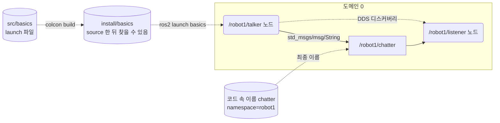
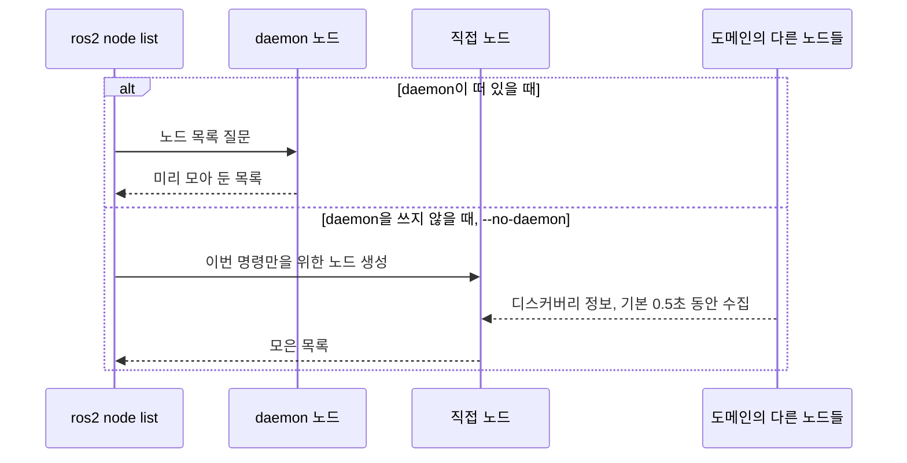
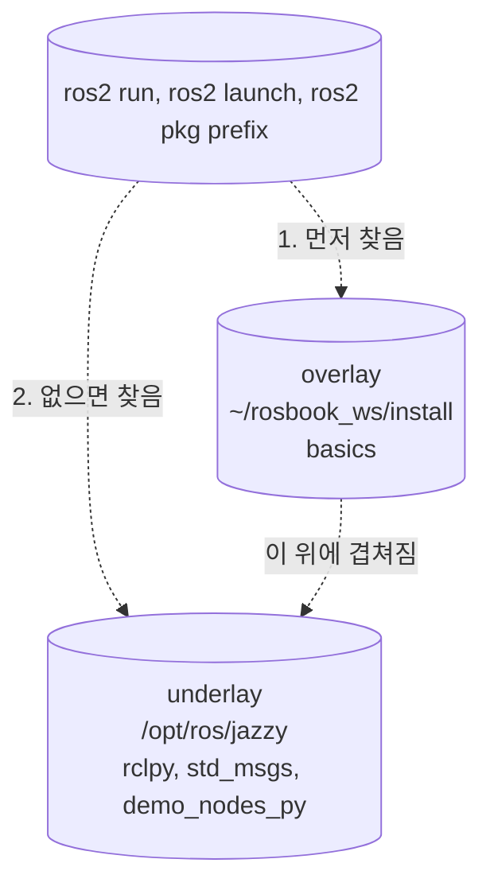
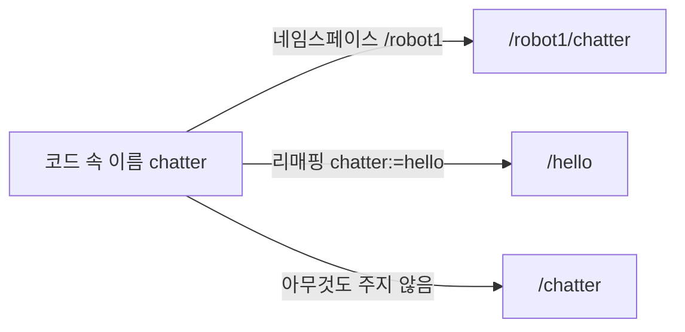

# 2장. 기본 도구와 개념

- 원서: Chapter 2. Preliminaries, PDF p.29~50 (인쇄 쪽 = PDF 쪽 - 20)
- 선행 조건: 1장 실습을 마쳐서 `ros2 run demo_nodes_py talker`와 `listener`가 연결되는 것을 확인했어야 합니다.
- 새로 설치할 것: 없음 (`demo_nodes_py`, `tf2_ros`, `tf2_tools`, `rqt_graph`, `rviz2`, graphviz가 이미 설치되어 있습니다)

## 이 장에서 체감할 구조
노드는 같은 도메인 안에서 DDS 디스커버리로 서로를 직접 찾아 ROS 그래프를 이루고, 메시지는 노드 사이를 곧장 오갑니다.
노드와 토픽의 최종 이름은 코드에 적힌 이름에 네임스페이스와 리매핑을 적용해서 실행할 때 정해집니다.
패키지는 워크스페이스에서 빌드되어 `install/`에 설치되고, `setup.bash`를 source 해야 ROS 2가 그 패키지를 찾습니다.



그림에서 볼 것: 메시지(실선)는 talker에서 listener로 곧장 갑니다. 두 노드는 그 전에 디스커버리(점선)로 서로를 찾습니다. 토픽의 최종 이름 `/robot1/chatter`는 코드 속 이름에 네임스페이스가 붙어 정해지고, 이 노드들을 띄우는 launch 파일은 빌드되어 `install/`에 있어야 `ros2 launch`가 찾습니다(실습 2-7). `ros2` 명령이 쓰는 daemon은 그래프 정보를 모아 두는 캐시라서 이 연결에 끼어들지 않습니다(1절).

## 1. 목표와 개념

원서 2장은 코드를 쓰기 전에 알아야 할 바탕을 한 번에 소개합니다. ROS 그래프(원서 PDF p.29~31), `roscore`(p.31~32), catkin 워크스페이스와 패키지(p.33~37), `rosrun`(p.37~41), 이름과 네임스페이스와 리매핑(p.42~43), `roslaunch`(p.43~44), 탭 완성(p.45), 좌표 변환 tf(p.45~48)입니다. 이 장은 같은 주제를 ROS 2 Jazzy에서 직접 확인합니다.

**ROS 그래프.** 실행 중인 노드를 점으로, 노드 사이의 메시지 흐름(토픽)을 선으로 그린 그림입니다. 노드 하나는 보통 프로세스 하나라서, 한 노드가 죽어도 나머지는 계속 돕니다. 노드를 같은 입출력의 다른 노드로 바꿔 끼우기도 쉽습니다.

예:

```bash
ros2 node info /listener
```

`Subscribers:` 아래의 `/chatter: std_msgs/msg/String`이 그래프에서 listener로 들어오는 선 하나입니다(실습 2-1).

**composition.** 노드를 컴포넌트(component)라는 형태로 작성하면, 컨테이너(container)라는 프로세스 하나에 노드 여러 개를 올려 실행할 수 있습니다. 이렇게 노드를 한 프로세스에 모으는 것을 composition이라고 합니다. 그래프에는 여전히 노드 여러 개로 보이지만, 운영체제에서 보면 프로세스는 하나입니다. Nav2도 기본으로 이렇게 노드들을 컨테이너 하나에 올려 시작합니다(10장, 17장). 프로세스를 여러 개 띄우는 부담이 줄어드는 대신, 컴포넌트 하나가 죽으면 같은 컨테이너에 있는 컴포넌트가 모두 함께 멈춥니다.

예:

```bash
ros2 run rclcpp_components component_container
ros2 component load /ComponentManager composition composition::Talker
```

첫 줄은 빈 컨테이너 프로세스를 띄우고, 둘째 줄은 다른 터미널에서 그 컨테이너 안에 talker 노드를 올립니다(실습 2-10).

**디스커버리.** ROS 2에는 `roscore`가 없습니다. 각 노드는 시작할 때 DDS 디스커버리로 자기 정보(노드 이름, 발행·구독하는 토픽과 타입, QoS)를 같은 도메인의 참여자들에게 알리고, 다른 참여자의 정보도 받아 둡니다. 이름과 타입과 QoS가 맞는 publisher와 subscriber가 서로를 발견하면 직접 연결합니다. `ROS_DOMAIN_ID`(기본값 0)가 다른 노드끼리는 서로를 발견하지 않습니다. `ROS_AUTOMATIC_DISCOVERY_RANGE`는 디스커버리 범위를 같은 컴퓨터(`LOCALHOST`)나 같은 네트워크(`SUBNET`) 등으로 정합니다.

예:

```bash
ROS_DOMAIN_ID=5 ros2 run demo_nodes_py listener
```

이 listener는 도메인 0의 talker를 발견하지 못하므로 아무것도 받지 못합니다(실습 2-2). 환경 변수 하나로 그래프가 둘로 나뉩니다.

**CLI.** CLI(Command Line Interface, 명령줄 인터페이스)는 창과 버튼 대신 터미널에 명령을 글자로 입력해서 프로그램을 다루는 방식입니다. ROS 2의 CLI는 `ros2`라는 명령 하나로 시작하고, 그 뒤에 무엇을 다룰지 고르는 하위 명령(`node`, `topic`, `service`, `pkg`, `launch`, `daemon` 등)과 무엇을 할지 고르는 동사(`list`, `info`, `echo` 등)를 붙입니다. 그래프를 그림으로 보는 GUI 도구도 있습니다. `rqt_graph`는 노드와 토픽의 연결을, `rviz2`는 좌표계와 센서 데이터를 3차원으로 보여 줍니다.

예:

```bash
ros2 node list -a
ros2 topic info -v /tf_static
```

`ros2` 다음의 `node`, `topic`이 하위 명령이고, `list`, `info`가 동사이고, `-a`, `-v`는 옵션입니다. `ros2 topic -h`처럼 `-h`를 붙이면 그 단계에서 쓸 수 있는 동사와 옵션을 보여 줍니다.

**ros2 daemon.** `ros2 node list` 같은 CLI 명령은 실행될 때마다 새로 디스커버리를 하면 그래프 정보가 다 모일 때까지 기다려야 합니다. 그래서 CLI는 처음 실행될 때 daemon이라는 백그라운드 노드를 띄워 두고, 그 노드가 모아 둔 그래프 정보를 물어봅니다. daemon은 CLI를 위한 캐시일 뿐이고, 노드끼리의 연결에는 끼어들지 않습니다. daemon을 꺼도 talker와 listener는 계속 통신합니다. 이 점이 `roscore`와 다릅니다. daemon은 2시간 동안 질문이 하나도 없으면 스스로 종료합니다.

CLI가 그래프 정보를 얻는 경로는 두 가지입니다. daemon이 떠 있으면 daemon에게 묻습니다. daemon이 없으면 daemon을 새로 띄워 두고, 이번 명령은 그 명령만을 위한 노드(직접 노드)를 만들어 처리합니다. `--no-daemon`을 붙이면 처음부터 직접 노드만 씁니다. daemon을 다시 띄워야 할 때(RMW를 바꾼 뒤, CLI 결과가 실제 상태와 다르게 보일 때)는 `ros2 daemon stop` 직후에 `ros2 daemon start`를 실행합니다. CLI가 daemon에게 묻는 방식과, 이 가이드의 WSL2 환경에서 daemon이 없을 때 생기는 문제는 [부록](appendix_wsl_environment.md)에 있습니다.



그림에서 볼 것: 위쪽 경로는 이미 모아 둔 정보를 꺼내므로 빠릅니다. 아래쪽 경로는 명령을 칠 때마다 노드를 새로 만들고 0.5초(`--spin-time`의 기본값) 동안 디스커버리를 기다리므로, 늦게 발견된 노드가 목록에서 빠질 수 있습니다.

예:

```bash
ros2 node list --no-daemon
```

실습 2-2에서 이 명령을 실행하면 같은 목록이 조금 늦게 나옵니다. 모든 명령이 daemon을 쓰는 것은 아닙니다. `ros2 topic pub`은 처음부터 직접 노드로 발행하고, `ros2 topic echo`는 그래프 정보를 물을 때는 daemon을 쓸 수 있지만, 구독은 직접 노드가 만듭니다. 메시지를 실제로 보내거나 받는 일은 daemon이 대신해 주지 않기 때문입니다.

**RMW.** ROS 2 노드는 DDS를 직접 부르지 않고 RMW(ROS MiddleWare) 인터페이스를 거칩니다. RMW 구현체(`rmw_fastrtps_cpp`, `rmw_cyclonedds_cpp` 등)는 환경 변수 `RMW_IMPLEMENTATION`으로 고르고, 노드 코드는 바꾸지 않습니다. 이 가이드의 환경은 Jazzy 기본값인 Fast DDS 대신 Cyclone DDS(`rmw_cyclonedds_cpp`)를 씁니다. 작성자의 WSL2 환경에서 Fast DDS로는 메시지가 안정적으로 전달되지 않았기 때문이고, 자세한 내용은 [부록](appendix_wsl_environment.md)에 있습니다. 이 사례 자체가 "통신 계층만 바꾸고 노드 코드는 그대로 쓴다"는 RMW 설계의 예입니다. 층으로 보면 노드 코드(rclpy, rclcpp) 아래에 공통 C 라이브러리 rcl이 있고, 그 아래의 rmw 인터페이스가 실제 DDS 구현을 부릅니다. `RMW_IMPLEMENTATION`이 고르는 것은 맨 아래의 DDS 구현뿐입니다. 층 그림은 부록의 "왜 Fast DDS 대신 Cyclone DDS를 쓰나요"에 있습니다.

예:

```bash
RMW_IMPLEMENTATION=rmw_fastrtps_cpp ros2 doctor --report | grep -A2 'RMW MIDDLEWARE'
```

명령 앞에 환경 변수를 붙이면 그 명령 하나만 다른 RMW로 실행됩니다(실습 2-3). 프로그램은 같고 출력의 `middleware name`만 바뀝니다.

**워크스페이스와 overlay.** 워크스페이스는 직접 만든 패키지를 모아 빌드하는 폴더입니다(`~/rosbook_ws`). `src/`에 소스를 두고 `colcon build`를 실행하면 `build/`, `install/`, `log/`가 생깁니다. `install/setup.bash`를 source 하면 이 워크스페이스가 `/opt/ros/jazzy` 위에 겹쳐집니다. 아래에 깔린 쪽(`/opt/ros/jazzy`)을 underlay, 위에 겹친 쪽(`~/rosbook_ws/install`)을 overlay라고 부릅니다. 같은 이름의 패키지가 양쪽에 있으면 overlay가 이깁니다.

비유: underlay는 공용 도서관이고 overlay는 내 책상 위 책꽂이입니다. 같은 제목의 책이 둘 다 있으면 책상 위의 것을 먼저 집습니다.



그림에서 볼 것: 패키지를 찾는 순서는 환경 변수 `AMENT_PREFIX_PATH`에 적힌 경로의 순서입니다. overlay를 나중에 source 하면 이 목록의 앞쪽에 붙으므로 먼저 찾아집니다.

예:

```bash
echo $AMENT_PREFIX_PATH
ros2 pkg prefix basics
```

실습 2-5에서 빌드하고 source 한 뒤에는 첫 줄의 맨 앞에 `.../rosbook_ws/install/basics`가 보이고, 둘째 줄은 그 경로를 출력합니다.

**이름, 네임스페이스, 리매핑.** 노드 이름과 토픽 이름은 파일 경로처럼 `/`로 구분합니다. 코드에 `chatter`처럼 `/` 없이 적은 이름은 상대 이름이라서 노드의 네임스페이스 아래에 붙습니다. 그래서 같은 노드를 네임스페이스만 바꿔 여러 벌 띄우면 이름이 겹치지 않습니다. 리매핑은 코드를 고치지 않고 실행할 때 이름을 바꾸는 기능입니다.



그림에서 볼 것: 코드에 적힌 이름은 하나인데, 실행할 때 준 인자에 따라 최종 이름이 셋 중 하나가 됩니다. 실행 중인 그래프에는 최종 이름만 보입니다.

예:

```bash
ros2 run demo_nodes_py talker --ros-args -r __ns:=/robot1
ros2 run demo_nodes_py talker --ros-args -r chatter:=hello
```

`--ros-args` 뒤의 `-r`이 이름을 바꾸는 인자입니다. 첫 줄은 노드와 토픽을 `/robot1` 아래로 옮기고, 둘째 줄은 토픽 이름만 바꿉니다(실습 2-6).

**launch 파일.** 노드 여러 개를 이름, 네임스페이스, 리매핑과 함께 한 번에 띄우는 설명서입니다. ROS 2에서는 Python, XML, YAML로 쓸 수 있고, 이 가이드는 Python을 씁니다.

예:

```python
Node(package='demo_nodes_py', executable='talker', namespace=robot)
```

`ros2 run demo_nodes_py talker --ros-args -r __ns:=/robot1` 한 줄이 launch 파일 안에서는 `Node(...)` 하나가 됩니다(실습 2-7, 실제 파일은 여러 줄로 나눠 씁니다).

**tf2.** 로봇의 각 부품(바퀴 중심, 레이저, 카메라)에는 자기 좌표계(frame)가 있습니다. tf2는 frame 사이의 위치와 방향(변환)을 `/tf`와 `/tf_static` 토픽으로 공유하고, 어느 노드든 두 frame 사이의 변환을 물어볼 수 있게 합니다. 변하지 않는 관계(몸체에 볼트로 고정한 레이저)는 `/tf_static`에, 계속 변하는 관계(움직이는 팔)는 `/tf`에 실립니다.

예:

```bash
ros2 run tf2_ros tf2_echo laser camera
```

실습 2-9에서는 `base_link`와 `laser`, `base_link`와 `camera`의 관계만 발행합니다. 그런데도 `laser`에서 `camera`까지의 변환이 나오는 것은 tf2가 `laser → base_link → camera`로 이어 붙여 계산하기 때문입니다.

### 코드와 폴더 구조

2장을 마치면 워크스페이스는 다음 모양입니다. `src/`만 직접 다루고, 나머지 셋은 `colcon build`가 만듭니다.

```text
~/rosbook_ws/
├── src/       직접 쓰는 소스. 패키지 폴더를 여기에 둡니다.
├── build/     colcon이 패키지별로 빌드하는 중간 작업 폴더입니다.
├── install/   빌드 결과가 설치되는 곳입니다. setup.bash가 여기에 있습니다.
└── log/       빌드할 때마다 남는 로그입니다. 빌드가 실패하면 여기를 봅니다.
```

`build/`, `install/`, `log/`는 지워도 `colcon build`로 다시 만들 수 있습니다. 소스는 `src/`에만 있습니다.

`basics` 패키지(ament_python)는 2장을 마친 시점에 다음과 같습니다. 각 파일의 자세한 역할은 실습 2-5의 표에 있습니다.

```text
~/rosbook_ws/src/basics/
├── package.xml          패키지 명세서: 이름, 라이선스, 의존성 (2-5에서 생성, 2-7에서 exec_depend 추가)
├── setup.py             설치 방법: 실행 파일 등록, launch 파일 설치 (2-5에서 생성, 2-7에서 data_files 수정)
├── setup.cfg            실행 파일을 lib/basics/에 설치하라는 설정 (2-5에서 생성, 고치지 않음)
├── resource/basics      ament 인덱스 등록용 빈 표시 파일 (2-5에서 생성)
├── basics/__init__.py   노드 코드(.py)를 담을 Python 모듈 폴더 (2-5에서 생성, 노드는 3장부터)
├── launch/talker_listener.launch.py   launch 파일 (2-7)
├── test/                flake8, pep257, 저작권 검사 (2-5에서 생성)
└── LICENSE              라이선스 전문 (2-5에서 생성)
```

`colcon build --symlink-install` 뒤에 `install/basics/` 아래의 주요 위치는 다음과 같습니다.

```text
~/rosbook_ws/install/basics/
├── lib/basics/                         실행 파일 자리. 3장에서 entry_points에 등록하면 생깁니다.
└── share/
    ├── ament_index/resource_index/packages/basics   "basics가 있다"는 표시
    └── basics/
        ├── package.xml
        └── launch/talker_listener.launch.py         src 쪽 파일을 가리키는 링크
```

`ros2 run basics <이름>`은 `lib/basics/`에서, `ros2 launch basics <파일>`은 `share/basics/launch/`에서 찾습니다. 이 두 자리를 정하는 것이 각각 `setup.cfg`와 `setup.py`의 `data_files`입니다.

3장부터 만드는 노드는 모두 CONVENTIONS.md 6절의 뼈대를 따릅니다. 노드는 `Node`를 상속한 클래스이고, publisher, subscription, timer는 생성자 `__init__`에서 만듭니다. `main`은 매번 같은 모양입니다.

```python
rclpy.init(args=args)
node = MyNode()
rclpy.spin(node)
rclpy.try_shutdown()
```

실제 코드는 `spin`을 `try`로 감싸 Ctrl-C를 처리하고 `finally`에서 `node.destroy_node()`를 부릅니다. 장마다 달라지는 것은 클래스 안쪽뿐이므로, 새 코드를 읽을 때는 `__init__`과 콜백부터 봅니다.

### 실무 메모

- Python 패키지는 처음부터 `colcon build --symlink-install`로 빌드하는 습관을 들입니다. 이미 설치된 `.py`나 launch 파일을 고칠 때는 다시 빌드하지 않아도 됩니다. 새 실행 파일이나 새 launch 파일을 추가했을 때는 다시 빌드합니다.
- 남의 패키지를 `src/`에 받아 왔다면, 빌드하기 전에 `cd ~/rosbook_ws && rosdep install --from-paths src --ignore-src -y`로 `package.xml`에 적힌 시스템 의존성을 한 번에 설치합니다. `--ignore-src`는 워크스페이스 안에 소스로 있는 패키지는 설치하지 말라는 뜻입니다. 그래서 `package.xml`의 의존성을 정확히 적는 것이 중요합니다.
- 같은 이름의 노드는 오류 없이 함께 실행되므로 더 위험합니다(실습 2-6). 같은 노드를 여러 개 띄울 때는 launch 파일에서 네임스페이스나 노드 이름을 처음부터 나눠 둡니다.
- 같은 네트워크에서 여러 사람이 ROS 2를 쓰면 서로의 노드가 보입니다. 사람이나 로봇마다 다른 `ROS_DOMAIN_ID`를 정해 `~/.bashrc`에 적어 두고, 혼자 실험할 때는 `ROS_AUTOMATIC_DISCOVERY_RANGE=LOCALHOST`로 같은 컴퓨터 안에만 머물게 합니다.
- 오래 쉬었다가 돌아왔을 때 `ros2` 명령이 멈추면 daemon부터 의심합니다. daemon은 2시간 동안 질문이 없으면 스스로 종료하고, 이 가이드의 WSL2 환경에서는 daemon이 없으면 CLI가 한참 멈춥니다([부록](appendix_wsl_environment.md)). Ctrl-C로 끊고 `ros2 daemon start`를 실행한 뒤 다시 입력합니다.
## 2. 원서(ROS 1)와 달라지는 점

| 원서 (ROS 1) | ROS 2 Jazzy | 이유와 주의점 |
|---|---|---|
| `roscore` 실행, `ROS_MASTER_URI` | 띄울 것 없음. `ROS_DOMAIN_ID`, `ROS_AUTOMATIC_DISCOVERY_RANGE` | 디스커버리가 분산되어 있습니다. 도메인 번호가 같아야 서로 보입니다. |
| `roscore`가 이름 서비스 | `ros2 daemon`은 CLI 전용 캐시 | daemon을 꺼도 노드 간 통신은 유지됩니다. |
| `roscore`의 파라미터 서버 | 노드마다 자기 파라미터 | 8장에서 다룹니다. |
| catkin, `catkin_make`, `devel/` | colcon, `colcon build`, `install/` | `--symlink-install`을 쓰면 Python 파일을 고칠 때마다 다시 빌드하지 않아도 됩니다. |
| `catkin_create_pkg my_pkg rospy` | `ros2 pkg create --build-type ament_python ...` | Python 패키지는 `setup.py`로 설치 내용을 정합니다. |
| `rosrun PACKAGE EXECUTABLE` | `ros2 run PACKAGE EXECUTABLE` | 실행 파일은 `setup.py`의 `entry_points`에 등록한 이름입니다. |
| `image:=right/image` | `--ros-args -r image:=right/image` | 리매핑 앞에 `--ros-args`를 붙입니다. |
| `__ns:=right` | `--ros-args -r __ns:=/right` | |
| `__name:=talker1` | `--ros-args -r __node:=talker1` | 이름이 `__node`로 바뀌었습니다. |
| 같은 이름의 노드를 띄우면 먼저 뜬 노드가 종료됨 | 둘 다 실행되고, CLI가 경고만 출력 | 실습 2-6에서 확인합니다. 같은 이름은 피해야 합니다. |
| XML `.launch` 파일, `roslaunch` | Python `.launch.py` 파일, `ros2 launch` | launch 파일을 `setup.py`의 `data_files`로 설치해야 `ros2 launch`가 찾습니다. |
| `rqt_graph` | `rqt_graph` | 이름은 같습니다. |
| `tf`, `tf/tfMessage`, `/tf` | `tf2`, `tf2_msgs/msg/TFMessage`, `/tf`와 `/tf_static` | 고정 변환은 `/tf_static`에 한 번만 발행됩니다. |

## 3. 실습

### 실습 2-1. 그래프를 그림으로 보기

> **미검증 실습**: 문서를 쓸 때 rqt_graph 창을 실제로 실행해 확인하지 못했습니다. 결과가 문서와 다르면 문서가 틀렸을 수 있으니, 7절의 검증 기록과 비교해 보세요.

**준비**: 터미널 3개. 터미널 A에서 `ros2 run demo_nodes_py talker`, 터미널 B에서 `ros2 run demo_nodes_py listener`를 실행해 둡니다.

**직접 입력** (터미널 C):

```bash
rqt_graph
```

**관찰**: 창이 하나 뜨고 `/talker` → `/chatter` → `/listener` 모양의 그림이 보입니다. 처음 띄우면 위쪽 드롭다운이 "Nodes only"라서 토픽 상자 없이 노드만 보일 수 있습니다. 그때는 드롭다운을 "Nodes/Topics (all)"로 바꿉니다. 왼쪽 위 새로고침 버튼을 누르면 현재 그래프로 다시 그립니다. 터미널 A에서 talker를 Ctrl-C로 끄고 새로고침해 보고, 다시 띄우고 새로고침해 봅니다.

모든 노드가 자동으로 만드는 `/rosout`(로그)과 `/parameter_events`(파라미터 변경 알림)는 기본 설정에서는 그림에 나오지 않습니다. "Hide:"라는 글자 뒤에 있는 체크 상자들이 처음에 켜져 있어서, 이런 토픽을 숨기기 때문입니다. "Debug"는 `/rosout` 같은 디버깅용 이름을, "Params"는 `/parameter_events`를, "Dead sinks"는 구독자가 없는 토픽을, "Leaf topics"는 연결이 하나뿐인 토픽을 숨깁니다. 드롭다운이 "Nodes/Topics (all)"인 상태에서 이 네 개의 체크를 모두 끄면 `/rosout`과 `/parameter_events`가 보입니다. 확인했으면 네 개를 다시 켜 둡니다. rqt는 체크 상태를 기억했다가 다음에 띄울 때 그대로 씁니다.

창을 닫은 뒤 같은 정보를 글자로 봅니다.

```bash
ros2 node info /listener
```

`Subscribers:` 아래에 `/chatter: std_msgs/msg/String`이 있고, `Service Servers:` 아래에 `/listener/get_parameters` 같은 파라미터 서비스가 자동으로 만들어져 있습니다.

**생각해 볼 질문**: rqt_graph 창에는 `rqt_graph` 자신도 노드로 보일 수 있습니다. 그림을 보여 주는 도구가 왜 그래프의 일부가 될까요?

### 실습 2-2. 디스커버리, 도메인, daemon

> **미검증 실습**: 문서를 쓸 때 daemon을 끄고 켜는 동안 listener가 계속 메시지를 받는지를 실제로 실행해 확인하지 못했습니다. 결과가 문서와 다르면 문서가 틀렸을 수 있으니, 7절의 검증 기록과 비교해 보세요.

**준비**: 터미널 A에서 talker, 터미널 B에서 listener가 실행 중이어야 합니다.

**직접 입력** (터미널 C):

```bash
ros2 node list -a
```

**관찰**: `-a`는 숨은 노드까지 모두 보여 달라는 옵션입니다. `/talker`, `/listener` 말고 다음과 같은 노드가 하나 더 보입니다. 끝의 16진수는 실행할 때마다 달라집니다.

```
/_ros2cli_daemon_0_f1c71c6e119f41ae9a53568e84163be4
/listener
/talker
```

이 노드가 daemon입니다. 이름이 `_`로 시작하는 노드는 숨은 노드로 취급되어 `-a` 없이는 보이지 않습니다. 이름의 각 부분이 무엇을 뜻하는지는 [부록](appendix_wsl_environment.md)에 있습니다. 이제 daemon을 껐다가 다시 켜 봅니다.

```bash
ros2 daemon stop
ros2 daemon start
```

**관찰**: daemon을 끄고 켜는 동안에도 터미널 B의 listener는 메시지를 계속 받습니다. daemon은 노드 간 연결에 관여하지 않기 때문입니다.

이번에는 daemon 없이 CLI가 직접 디스커버리를 하게 합니다.

```bash
ros2 node list --no-daemon
```

같은 결과가 나오지만, 디스커버리를 새로 하느라 조금 더 걸립니다. 실행 직후라 아직 다 발견하지 못하면 노드가 빠져 보일 수 있으니 한 번 더 실행해 봅니다.

마지막으로 도메인을 나눠 봅니다. 터미널 B의 listener를 Ctrl-C로 끄고 다음처럼 다시 띄웁니다.

```bash
ROS_DOMAIN_ID=5 ros2 run demo_nodes_py listener
```

**관찰**: 이 listener는 아무것도 받지 못합니다. 터미널 C에서 `ros2 node list`를 하면 `/talker`만 보이고, `ROS_DOMAIN_ID=5 ros2 node list`를 하면 `/listener`만 보입니다. 확인했으면 listener를 원래대로(`ROS_DOMAIN_ID` 없이) 다시 띄웁니다.

daemon은 도메인마다 따로 뜨므로, `ROS_DOMAIN_ID=5 ros2 node list`는 도메인 5용 daemon을 씁니다. 이 명령이 바로 끝나지 않고 멈추면 Ctrl-C로 끊고 `ROS_DOMAIN_ID=5 ros2 node list --no-daemon`으로 실행합니다. 이 가이드의 WSL2 환경에서 daemon이 없을 때 명령이 멈추는 이유는 [부록](appendix_wsl_environment.md)에 있습니다.

**생각해 볼 질문**: ROS 1에서 `roscore`를 끄면 이미 연결된 노드끼리는 어떻게 되었을까요? ROS 2에서 daemon을 끈 것과 무엇이 같고 무엇이 다를까요?

### 실습 2-3. RMW 확인하기

**준비**: 터미널 1개.

**직접 입력**:

```bash
ros2 doctor --report | grep -A2 'RMW MIDDLEWARE'
```

**관찰**:

```
   RMW MIDDLEWARE
middleware name    : rmw_cyclonedds_cpp
```

같은 명령을 환경 변수만 바꿔서 실행합니다.

```bash
RMW_IMPLEMENTATION=rmw_fastrtps_cpp ros2 doctor --report | grep -A2 'RMW MIDDLEWARE'
```

`middleware name : rmw_fastrtps_cpp`로 바뀝니다. 노드 프로그램도 같은 방식으로 RMW를 고릅니다. `demo_nodes_py`의 talker 코드는 한 줄도 바뀌지 않았지만, 실행할 때의 환경 변수에 따라 Cyclone DDS 위에서 돌 수도 있고 Fast DDS 위에서 돌 수도 있습니다.

`ros2 doctor --report` 전체 출력에는 OS, 네트워크 인터페이스, 현재 토픽 목록 등도 들어 있습니다. 한 번 전체를 훑어봅니다.

**생각해 볼 질문**: 한 노드는 Cyclone DDS로, 다른 노드는 Fast DDS로 띄우면 서로 통신될까요? 이 가이드에서는 왜 모든 터미널이 같은 값을 쓰도록 `~/.bashrc`에 정해 두었을까요?

### 실습 2-4. 워크스페이스와 overlay 확인하기

**준비**: 터미널 1개.

**직접 입력**:

```bash
ls ~/rosbook_ws
echo $AMENT_PREFIX_PATH
```

**관찰**: `~/rosbook_ws` 아래에 `build`, `install`, `log`, `src`가 있습니다. `AMENT_PREFIX_PATH`는 `:`로 구분된 경로 목록이고, 맨 끝이 `/opt/ros/jazzy`(underlay)입니다. 이 워크스페이스에 아직 패키지가 없다면 앞쪽에 `~/rosbook_ws/install/...` 경로가 없을 수 있습니다. 다음 실습에서 패키지를 만들고 나서 다시 확인합니다.

`~/.bashrc`가 터미널을 열 때마다 다음 두 줄의 일을 해 주고 있습니다. 직접 입력할 필요는 없고, 순서만 기억합니다.

```bash
source /opt/ros/jazzy/setup.bash          # underlay
source ~/rosbook_ws/install/setup.bash    # overlay
```

**생각해 볼 질문**: 두 줄의 순서를 바꾸면 어떻게 될까요?

### 실습 2-5. basics 패키지 만들기

**준비**: 터미널 1개.

**직접 입력**:

```bash
cd ~/rosbook_ws/src
ros2 pkg create --build-type ament_python --license Apache-2.0 basics
```

**관찰**: `creating ./basics/package.xml`, `creating ./basics/setup.py` 같은 줄이 이어집니다. 만들어진 파일을 봅니다.

```bash
find basics -type f | sort
```

```
basics/LICENSE
basics/basics/__init__.py
basics/package.xml
basics/resource/basics
basics/setup.cfg
basics/setup.py
basics/test/test_copyright.py
basics/test/test_flake8.py
basics/test/test_pep257.py
```

**파일별 역할**:

| 파일 | 역할 |
|---|---|
| `package.xml` | 패키지 이름, 버전, 관리자, 라이선스, 의존성을 적는 명세서입니다. colcon과 rosdep이 읽습니다. |
| `setup.py` | Python 패키지를 어떻게 설치할지 정합니다. 실행 파일 등록(`entry_points`)과 launch 파일 같은 추가 파일 설치(`data_files`)를 여기에 적습니다. |
| `setup.cfg` | 실행 파일을 `install/basics/lib/basics/`에 설치하라고 지정합니다. `ros2 run`이 그 위치에서 실행 파일을 찾습니다. 고칠 일이 거의 없습니다. |
| `basics/__init__.py` | 안쪽 `basics/` 폴더를 Python 모듈로 만듭니다. 노드 코드(`.py`)는 이 폴더에 둡니다. |
| `resource/basics` | 빈 표시 파일입니다. 설치되면 ament 인덱스에 "basics라는 패키지가 있다"고 등록하는 데 쓰입니다. |
| `test/` | 코드 스타일 검사(flake8, pep257)와 저작권 표기 검사입니다. `colcon test`로 실행합니다. |
| `LICENSE` | `--license Apache-2.0`으로 생성된 라이선스 전문입니다. |

`package.xml`을 열어 봅니다.

```bash
cat basics/package.xml
```

`<name>basics</name>`, `<license>Apache-2.0</license>`, `<build_type>ament_python</build_type>`이 보입니다. 관리자 이름과 이메일은 PC의 사용자 이름으로 채워져 있고, 지금은 그대로 둬도 됩니다.

이제 빌드하고 overlay를 다시 불러옵니다.

```bash
cd ~/rosbook_ws && colcon build --symlink-install --packages-select basics
source ~/rosbook_ws/install/setup.bash
ros2 pkg prefix basics
echo $AMENT_PREFIX_PATH
```

**관찰**: `Summary: 1 package finished`가 나오고, `ros2 pkg prefix basics`는 `/home/<사용자>/rosbook_ws/install/basics`를 출력합니다. `AMENT_PREFIX_PATH` 맨 앞에 `.../rosbook_ws/install/basics`가 붙었습니다. source 하기 전에 `ros2 pkg prefix basics`를 실행했다면 `Package not found`가 나왔을 것입니다.

**생각해 볼 질문**: 이미 열려 있던 다른 터미널에서 `ros2 pkg prefix basics`를 실행하면 어떻게 될까요?

### 실습 2-6. ros2 run과 이름 바꾸기

**준비**: 터미널 3개. 각 단계가 끝나면 실행 중인 노드를 Ctrl-C로 끄고 다음 단계로 갑니다. 확인 명령은 터미널 C에서 입력합니다.

**직접 입력 1: 토픽 리매핑**

터미널 A:

```bash
ros2 run demo_nodes_py talker --ros-args -r chatter:=hello
```

터미널 C:

```bash
ros2 topic list
```

**관찰**: `/chatter` 대신 `/hello`가 보입니다. talker 코드에 적힌 `chatter`라는 이름이 실행할 때 `hello`로 바뀌었습니다. 이 talker의 메시지를 받으려면 listener도 `--ros-args -r chatter:=hello`로 띄워야 합니다.

**직접 입력 2: 네임스페이스**

터미널 A:

```bash
ros2 run demo_nodes_py talker --ros-args -r __ns:=/robot1
```

터미널 C:

```bash
ros2 node list
ros2 topic list
```

**관찰**: 노드는 `/robot1/talker`, 토픽은 `/robot1/chatter`가 됩니다. 코드 속 `chatter`가 상대 이름이라서 네임스페이스 아래로 들어갔습니다. `/rosout`, `/parameter_events`는 절대 이름이라서 그대로입니다.

**직접 입력 3: 노드 이름 바꾸기 (talker 두 개, listener 하나)**

터미널 A:

```bash
ros2 run demo_nodes_py talker --ros-args -r __node:=talker1
```

터미널 B:

```bash
ros2 run demo_nodes_py talker --ros-args -r __node:=talker2
```

터미널 C:

```bash
ros2 run demo_nodes_py listener
```

**관찰**: listener에 같은 번호의 메시지가 두 번씩 찍힙니다. 두 talker가 같은 `/chatter`에 발행하고 있기 때문입니다. 새 터미널에서 `ros2 topic info /chatter`를 실행하면 `Publisher count: 2`, `Subscription count: 1`이 보입니다.

```
[INFO] [...] [listener]: I heard: [Hello World: 0]
[INFO] [...] [listener]: I heard: [Hello World: 0]
[INFO] [...] [listener]: I heard: [Hello World: 1]
[INFO] [...] [listener]: I heard: [Hello World: 1]
```

**직접 입력 4: 같은 이름의 노드 두 개**

터미널 A와 B에서 각각 이름을 바꾸지 않고 실행합니다.

```bash
ros2 run demo_nodes_py talker
```

터미널 C:

```bash
ros2 node list
```

**관찰**:

```
WARNING: Be aware that there are nodes in the graph that share an exact name, which can have unintended side effects.
/talker
/talker
```

ROS 1에서는 같은 이름의 노드가 뜨면 먼저 있던 노드가 종료되었지만, ROS 2에서는 둘 다 계속 실행되고 CLI가 경고만 합니다. 이름으로 노드를 찾는 기능(파라미터 설정, `ros2 node info`)이 어느 쪽을 가리킬지 알 수 없으므로 같은 이름은 피합니다.

**생각해 볼 질문**: talker 두 개를 각각 `__ns:=/robot1`, `__ns:=/robot2`로 띄우면 listener 하나가 두 메시지를 모두 받을 수 있을까요? 받게 하려면 listener를 어떻게 띄워야 할까요?

### 실습 2-7. launch 파일로 네임스페이스별 노드 띄우기

**준비**: 터미널 2개. 실습 2-5의 `basics` 패키지가 있어야 합니다.

**직접 입력 1: launch 파일**

```bash
mkdir -p ~/rosbook_ws/src/basics/launch
```

파일 `~/rosbook_ws/src/basics/launch/talker_listener.launch.py`:

```python
from launch import LaunchDescription
from launch_ros.actions import Node


def generate_launch_description():
    nodes = []
    for robot in ['robot1', 'robot2']:
        nodes.append(Node(
            package='demo_nodes_py',
            executable='talker',
            namespace=robot,
            output='screen',
        ))
        nodes.append(Node(
            package='demo_nodes_py',
            executable='listener',
            namespace=robot,
            output='screen',
        ))
    return LaunchDescription(nodes)
```

**줄 단위 해설**:

| 줄 | 설명 |
|---|---|
| 1 | `LaunchDescription`은 "이 launch에서 실행할 것들의 목록"을 담는 객체입니다. |
| 2 | `launch_ros.actions.Node`는 ROS 2 노드 하나를 실행하는 동작입니다. `ros2 run` 한 번에 해당합니다. |
| 5 | `ros2 launch`는 파일 안의 `generate_launch_description()` 함수를 찾아 호출합니다. 이 이름은 바꾸면 안 됩니다. |
| 6~7 | 같은 노드 묶음을 `robot1`, `robot2` 두 네임스페이스에 반복해서 만듭니다. launch 파일은 Python 코드라서 반복문을 쓸 수 있습니다. |
| 8~13 | talker를 `namespace=robot`으로 띄웁니다. 실습 2-6의 `-r __ns:=/robot1`과 같은 효과입니다. `output='screen'`은 노드의 로그를 이 터미널에 보여 달라는 뜻입니다. |
| 14~19 | listener도 같은 네임스페이스에 띄웁니다. 그래서 `robot1`의 listener는 `/robot1/chatter`만 듣습니다. |
| 20 | 모은 노드 목록을 돌려줍니다. |

**직접 입력 2: launch 파일 설치 설정**

`ament_python` 패키지는 `setup.py`에 적은 파일만 `install/`로 복사(또는 링크)합니다. launch 파일을 적지 않으면 `ros2 launch`가 찾지 못합니다.

파일 `~/rosbook_ws/src/basics/setup.py` 전체 (바뀐 줄은 1번 줄과 15번 줄입니다):

```python
from glob import glob

from setuptools import find_packages, setup

package_name = 'basics'

setup(
    name=package_name,
    version='0.0.0',
    packages=find_packages(exclude=['test']),
    data_files=[
        ('share/ament_index/resource_index/packages',
            ['resource/' + package_name]),
        ('share/' + package_name, ['package.xml']),
        ('share/' + package_name + '/launch', glob('launch/*.launch.py')),
    ],
    install_requires=['setuptools'],
    zip_safe=True,
    maintainer='pjw',
    maintainer_email='pjw@todo.todo',
    description='TODO: Package description',
    license='Apache-2.0',
    extras_require={
        'test': [
            'pytest',
        ],
    },
    entry_points={
        'console_scripts': [
        ],
    },
)
```

| 줄 | 설명 |
|---|---|
| 1 | 파일 이름 패턴으로 파일 목록을 만드는 `glob`을 가져옵니다. |
| 3 | 생성된 파일에 원래 있던 줄입니다. |
| 5 | 패키지 이름을 변수로 둡니다. 아래에서 여러 번 씁니다. |
| 10 | 안쪽 `basics/` 폴더 같은 Python 모듈을 찾아 설치합니다. |
| 11~16 | `data_files`는 (설치될 폴더, 넣을 파일 목록) 쌍의 목록입니다. 12~13줄은 ament 인덱스 등록용 표시 파일, 14줄은 `package.xml`입니다. |
| 15 | 추가한 줄입니다. `launch/` 안의 `.launch.py` 파일을 모두 `install/basics/share/basics/launch/`에 설치합니다. `ros2 launch basics ...`는 이 폴더를 찾습니다. |
| 19~22 | 패키지 메타데이터입니다. `maintainer` 값은 `ros2 pkg create`가 채운 값을 그대로 둡니다. |
| 28~31 | 실행 파일 등록 자리입니다. 3장에서 노드를 여기에 추가합니다. |

**직접 입력 3: 실행 의존성 추가**

이 launch 파일은 `launch`, `launch_ros`, `demo_nodes_py`가 있어야 실행됩니다. 빌드에는 필요 없고 실행에만 필요하므로 `exec_depend`로 적습니다.

파일 `~/rosbook_ws/src/basics/package.xml`에서 `<license>` 줄 아래에 다음 세 줄을 추가합니다.

```xml
  <exec_depend>launch</exec_depend>
  <exec_depend>launch_ros</exec_depend>
  <exec_depend>demo_nodes_py</exec_depend>
```

**직접 입력 4: 빌드와 실행**

터미널 A:

```bash
cd ~/rosbook_ws && colcon build --symlink-install --packages-select basics
source ~/rosbook_ws/install/setup.bash
ros2 launch basics talker_listener.launch.py
```

**관찰**: 프로세스 4개가 시작되고, 로그 앞에 프로세스 이름(`[talker-1]`)과 노드의 전체 이름(`robot1.talker`)이 붙습니다.

```
[INFO] [talker-1]: process started with pid [46075]
[INFO] [listener-2]: process started with pid [46076]
[INFO] [talker-3]: process started with pid [46077]
[INFO] [listener-4]: process started with pid [46078]
[talker-1] [INFO] [...] [robot1.talker]: Publishing: "Hello World: 0"
[listener-2] [INFO] [...] [robot1.listener]: I heard: [Hello World: 0]
[talker-3] [INFO] [...] [robot2.talker]: Publishing: "Hello World: 0"
[listener-4] [INFO] [...] [robot2.listener]: I heard: [Hello World: 0]
```

터미널 B:

```bash
ros2 node list
ros2 topic list
ros2 topic info /robot1/chatter
```

```
/robot1/listener
/robot1/talker
/robot2/listener
/robot2/talker
```

토픽 목록에는 `/robot1/chatter`와 `/robot2/chatter`가 따로 있고, `/robot1/chatter`의 publisher와 subscriber는 각각 1개입니다. 같은 프로그램 4개를 띄웠는데 두 쌍이 서로 섞이지 않습니다.

터미널 A에서 Ctrl-C를 한 번 누르면 launch가 띄운 노드 4개가 모두 종료됩니다.

`--symlink-install`로 빌드했기 때문에 `install/` 안의 launch 파일은 `src/`의 파일을 가리키는 링크입니다. 그래서 launch 파일 내용을 고친 뒤에는 다시 빌드하지 않아도 됩니다. 새 launch 파일을 추가했을 때는 링크를 새로 만들어야 하므로 다시 빌드합니다.

```bash
ros2 launch basics talker_listener.launch.py -s
```

`-s`는 이 launch 파일이 받는 인자를 보여 줍니다. 지금은 `No arguments.`입니다. 인자를 받는 launch 파일은 뒤 장에서 만듭니다.

**생각해 볼 질문**: launch 파일에서 `namespace=robot`을 지우고 실행하면 그래프가 어떻게 될까요?

### 실습 2-8. 탭 완성

> **미검증 실습**: 문서를 쓸 때 대화형 셸에서 탭 완성을 실제로 실행해 확인하지 못했습니다. 결과가 문서와 다르면 문서가 틀렸을 수 있으니, 7절의 검증 기록과 비교해 보세요.

**준비**: 터미널 1개.

**직접 입력**: 다음 줄들을 끝까지 치지 말고, `[Tab]` 자리에서 Tab 키를 누릅니다. 후보가 여럿이면 Tab을 두 번 누르면 목록이 나옵니다.

```bash
ros2 ru[Tab]
ros2 run demo_no[Tab]
ros2 run demo_nodes_py ta[Tab]
ros2 topic info /ch[Tab]
ros2 interface show std_msgs/msg/St[Tab]
```

**관찰**: 명령, 패키지 이름, 실행 파일 이름이 자동으로 채워집니다. 토픽 이름 완성은 그 토픽을 발행하는 노드가 실행 중일 때만 됩니다. `/opt/ros/jazzy/setup.bash`가 `ros2cli`의 `ros2-argcomplete.bash`를 불러오기 때문에 별도 설정 없이 동작합니다.

**생각해 볼 질문**: 실습 2-5에서 `basics`를 만든 직후, 이미 열려 있던 터미널에서 `ros2 run bas[Tab]`이 완성되지 않는다면 이유가 무엇일까요?

### 실습 2-9. tf2로 좌표계 관계 다루기

> **미검증 실습**: 문서를 쓸 때 rviz2 화면(직접 입력 5)과 `view_frames`가 만든 PDF의 내용(직접 입력 4)을 실제로 실행해 확인하지 못했습니다. 결과가 문서와 다르면 문서가 틀렸을 수 있으니, 7절의 검증 기록과 비교해 보세요.

**준비**: 터미널 3개.

**직접 입력 1: 고정 변환 발행**

로봇 몸체(`base_link`)의 중심에서 앞으로 0.1 m, 위로 0.2 m 떨어진 곳에 레이저(`laser`)가 왼쪽으로 90도 돌아간 채 붙어 있다고 가정합니다. 각도는 라디안이고, 1.5708은 약 90도입니다.

터미널 A:

```bash
ros2 run tf2_ros static_transform_publisher --x 0.1 --z 0.2 --yaw 1.5708 --frame-id base_link --child-frame-id laser
```

터미널 B (카메라는 몸체 중심 위 0.1 m, 회전 없음):

```bash
ros2 run tf2_ros static_transform_publisher --z 0.1 --frame-id base_link --child-frame-id camera
```

**관찰**: 터미널 A에 `Spinning until stopped - publishing transform`과 함께 이동량, 쿼터니언 회전값, `from 'base_link' to 'laser'`가 찍히고, 그 뒤로는 조용합니다. 고정 변환은 한 번만 발행하기 때문입니다.

**직접 입력 2: 토픽으로 확인**

터미널 C:

```bash
ros2 topic list -t
ros2 topic info -v /tf_static
ros2 topic echo /tf_static --once
ros2 interface show tf2_msgs/msg/TFMessage
```

**관찰**: `/tf_static [tf2_msgs/msg/TFMessage]`가 보입니다. `topic info -v`에서 publisher의 QoS는 `Durability: TRANSIENT_LOCAL`, `History (Depth): KEEP_LAST (1)`입니다. 한 번만 발행해도 나중에 접속한 노드가 그 값을 받을 수 있게 하는 설정이고, 3장에서 자세히 다룹니다. `echo` 출력의 `transforms:` 아래에서 `frame_id: base_link`, `child_frame_id: laser` 또는 `camera`, `translation`과 `rotation`을 찾습니다. 90도 회전은 쿼터니언으로 `z: 0.707..., w: 0.707...`처럼 표현됩니다.

**직접 입력 3: 두 frame 사이의 변환 묻기**

```bash
ros2 run tf2_ros tf2_echo base_link laser
```

**관찰**: 처음 한 줄은 `Waiting for transform ... frame does not exist`일 수 있습니다. 아직 `/tf_static`을 받기 전이라서 그렇고, 곧 1초마다 다음이 찍힙니다. Ctrl-C로 멈춥니다.

```
At time 0.0
- Translation: [0.100, 0.000, 0.200]
- Rotation: in Quaternion (xyzw) [0.000, 0.000, 0.707, 0.707]
- Rotation: in RPY (radian) [0.000, -0.000, 1.571]
- Rotation: in RPY (degree) [0.000, -0.000, 90.000]
```

이번에는 직접 발행한 적 없는 관계를 물어봅니다.

```bash
ros2 run tf2_ros tf2_echo laser camera
```

`Translation: [0.000, 0.100, -0.100]`, `RPY (degree) [0.000, 0.000, -90.000]`가 나옵니다. tf2가 `laser → base_link → camera`로 변환을 이어 붙여 계산했습니다. 레이저 좌표계는 90도 돌아가 있으므로, 레이저 기준으로 보면 카메라는 옆(y 방향)으로 0.1 m, 아래로 0.1 m에 있습니다.

**직접 입력 4: frame 트리 그림**

```bash
mkdir -p ~/tf_frames && cd ~/tf_frames
ros2 run tf2_tools view_frames
ls
```

**관찰**: 5초 동안 tf를 듣고 `frames_<날짜시각>.pdf`와 `.gv` 파일을 만듭니다. PDF에는 `base_link` 아래에 `laser`와 `camera`가 매달린 트리가 그려져 있습니다. WSL2를 쓴다면 Windows 탐색기에서 `\\wsl.localhost\Ubuntu\home\<사용자>\tf_frames`를 열어 PDF를 볼 수 있습니다. 글자로 보려면 `cat frames_*.gv`에서 `"base_link" -> "laser"` 줄을 찾습니다.

**직접 입력 5: rviz2에서 TF 보기**

터미널 A, B의 static_transform_publisher가 계속 실행 중이어야 합니다.

```bash
rviz2
```

1. 왼쪽 Displays 패널의 Global Options에서 Fixed Frame을 `base_link`로 바꿉니다. 목록에 없으면 직접 입력합니다.
2. 왼쪽 아래 Add 버튼을 누르고 By display type 탭에서 `TF`를 고른 뒤 OK를 누릅니다.
3. TF 항목을 펼쳐 Show Names를 켭니다.

**관찰**: 화면 가운데에 `base_link`, `laser`, `camera` 세 좌표축이 보입니다. 빨강이 x, 초록이 y, 파랑이 z입니다. `laser` 축의 빨간 화살표가 `base_link`의 초록 화살표 방향을 가리키는지 확인합니다. 시뮬레이션을 쓰지 않으므로 이 실습에서는 `use_sim_time`을 켜지 않습니다.

**생각해 볼 질문**: static_transform_publisher를 모두 끈 뒤에 `tf2_echo base_link laser`를 새로 실행하면 어떻게 될까요? 끄기 전에 이미 실행 중이던 `tf2_echo`는 어떻게 될까요?

### 실습 2-10. 노드 여러 개를 한 프로세스에 담기 (composition)

**준비**: 터미널 2개. 앞 실습에서 띄운 talker, listener, static_transform_publisher를 모두 Ctrl-C로 끕니다. 이 실습의 노드도 `/talker`, `/listener`라는 같은 이름을 쓰기 때문입니다.

**직접 입력 1: 빈 컨테이너 띄우기**

터미널 A:

```bash
ros2 run rclcpp_components component_container
```

**관찰**: 명령이 끝나지 않고 실행 상태로 남습니다. 이 프로세스가 컴포넌트를 담을 컨테이너이고, 컨테이너 자신도 `/ComponentManager`라는 노드입니다.

**직접 입력 2: 올릴 수 있는 컴포넌트 확인**

터미널 B:

```bash
ros2 component types | grep composition
ros2 component list
```

**관찰**: 첫 명령은 설치된 패키지 중 `composition` 패키지가 제공하는 컴포넌트를 보여 줍니다. 패키지 이름 아래에 `패키지::클래스` 형식의 이름이 나열됩니다.

```text
composition
  composition::Talker
  composition::Listener
  composition::NodeLikeListener
  composition::Server
  composition::Client
```

둘째 명령은 실행 중인 컨테이너와 그 안의 컴포넌트를 보여 줍니다. 아직 올린 것이 없으므로 `/ComponentManager` 한 줄만 나옵니다.

**직접 입력 3: talker와 listener 올리기**

터미널 B:

```bash
ros2 component load /ComponentManager composition composition::Talker
ros2 component load /ComponentManager composition composition::Listener
```

**관찰**: 명령마다 한 줄씩 다음이 나옵니다. 앞의 숫자는 컨테이너가 붙인 컴포넌트 번호이고, 끝은 노드 이름입니다.

```text
Loaded component 1 into '/ComponentManager' container node as '/talker'
Loaded component 2 into '/ComponentManager' container node as '/listener'
```

터미널 A에는 컨테이너가 라이브러리 파일을 읽어 들이는 로그와 talker의 로그가 찍히고, listener를 올린 뒤에는 listener의 로그도 같은 터미널에 이어집니다.

```text
[ComponentManager]: Load Library: /opt/ros/jazzy/lib/libtalker_component.so
[ComponentManager]: Found class: rclcpp_components::NodeFactoryTemplate<composition::Talker>
[talker]: Publishing: 'Hello World: 1'
[listener]: I heard: [Hello World: N]
```

위는 로그에서 눈여겨볼 줄만 골라 옮긴 것이고, `N` 자리에는 talker가 발행한 번호가 들어갑니다. 라이브러리 파일 `libtalker_component.so` 안의 `composition::Talker` 클래스로 노드를 만들었다는 뜻입니다.

**직접 입력 4: 그래프와 프로세스 비교**

터미널 B:

```bash
ros2 component list
ros2 node list
pgrep -af component_container
```

**관찰**: `ros2 component list`는 컨테이너 아래에 컴포넌트 두 개를 보여 줍니다.

```text
/ComponentManager
  1  /talker
  2  /listener
```

`ros2 node list`에는 `/ComponentManager`, `/listener`, `/talker` 세 노드가 보입니다. 그래프에서 보면 1장의 talker, listener와 다르지 않습니다. 그런데 `pgrep -af component_container`는 두 줄만 출력합니다. 첫 줄은 `ros2 run`이 띄운 Python 래퍼(`/usr/bin/python3 /opt/ros/jazzy/bin/ros2 run rclcpp_components component_container`)이고, 둘째 줄은 실제 컨테이너 프로세스(`/opt/ros/jazzy/lib/rclcpp_components/component_container`)입니다. talker나 listener라는 이름의 프로세스는 따로 없습니다. 노드 셋이 프로세스 하나 안에 들어 있습니다.

**직접 입력 5: 컴포넌트 하나 내리기**

터미널 B:

```bash
ros2 component unload /ComponentManager 1
ros2 component list
ros2 node list
```

**관찰**: `Unloaded component 1 from '/ComponentManager' container node`가 나오고, `ros2 component list`에는 `/ComponentManager` 아래에 `2  /listener`만 남습니다. `ros2 node list`에도 `/ComponentManager`와 `/listener`만 보입니다. 프로세스를 끄지 않고 그 안의 노드 하나만 내렸습니다. 확인했으면 터미널 A에서 Ctrl-C로 컨테이너를 끕니다.

**생각해 볼 질문**: talker와 listener를 각자의 프로세스로 띄울 때와 비교해, 한 컨테이너에 담으면 무엇을 얻고 무엇을 잃을까요?

## 4. 일부러 망가뜨려 보기

| 바꿀 것 | 예상 증상 | 원인을 확인하는 명령 |
|---|---|---|
| listener를 `--ros-args -r chatter:=chater`로 실행 (오타) | listener가 아무것도 받지 못하고, 오류도 나지 않습니다. | `ros2 topic list`에 `/chatter`와 `/chater`가 따로 보입니다. `ros2 topic info /chater`의 Publisher count는 0입니다. |
| listener만 `ROS_DOMAIN_ID=5`로 실행 | 아무것도 받지 못합니다. | `ros2 node list`와 `ROS_DOMAIN_ID=5 ros2 node list --no-daemon`의 결과를 비교합니다. |
| `ros2 daemon stop` 후 `ros2 daemon start` 없이 `ros2 node list` | CLI가 daemon을 새로 띄우고, 이번 명령은 직접 노드로 처리합니다. 이 가이드의 WSL2 환경에서는 대신 한참 멈췄다가 Traceback을 내고 끝납니다([부록](appendix_wsl_environment.md)). 어느 쪽이든 노드끼리는 계속 통신합니다. | Ctrl-C 후 `ros2 daemon start`, 다시 `ros2 node list`. |
| 1단계: `setup.py`에서 launch 파일 `data_files` 줄(15번 줄)을 지우고 같은 워크스페이스에서 다시 빌드합니다. 2단계: `cd ~/rosbook_ws && rm -rf build/basics install/basics`로 이 패키지의 빌드 결과를 지우고 다시 빌드합니다. | 1단계 뒤에는 `ros2 launch basics talker_listener.launch.py`가 여전히 성공합니다. 앞서 빌드할 때 만든 링크 `install/basics/share/basics/launch/talker_listener.launch.py`가 지워지지 않고 남아 `build/basics/launch/talker_listener.launch.py`를 가리키기 때문입니다. 설정을 지워도 예전 빌드 결과가 남아 있으면 문제가 드러나지 않습니다. 2단계 뒤에는 `file 'talker_listener.launch.py' was not found in the share directory of package 'basics' which is at '/home/<사용자>/rosbook_ws/install/basics/share/basics'`로 실패하고, `install/basics/share/basics/` 아래에 `launch` 폴더가 없습니다. 확인했으면 지운 줄을 되살리고 다시 빌드합니다. | 1단계 뒤와 2단계 뒤에 각각 `ls -l ~/rosbook_ws/install/basics/share/basics/launch/` |
| 빌드 후 `source ~/rosbook_ws/install/setup.bash`를 하지 않은 새 패키지 사용 | `Package 'basics' not found` | `echo $AMENT_PREFIX_PATH`, `ros2 pkg prefix basics` |
| `ros2 run demo_nodes_py talkr` (실행 파일 오타) | `No executable found` | `ros2 pkg executables demo_nodes_py` |
| launch 파일에서 두 listener의 `namespace`만 지움 | listener 두 개가 모두 `/listener`라는 같은 이름이 되고, 둘 다 `/chatter`를 기다리지만 talker는 `/robot1/chatter`, `/robot2/chatter`에 발행해서 아무것도 받지 못합니다. | `ros2 node list` (같은 이름 경고), `ros2 topic list` |
| `tf2_echo base_link lazer` (frame 이름 오타) | `Invalid frame ID "lazer" ... frame does not exist`가 계속 반복됩니다. | `ros2 run tf2_tools view_frames`, `ros2 topic echo /tf_static --once`로 실제 frame 이름을 확인합니다. |

## 5. 확인 질문

<details><summary>Q1. rqt_graph가 왜 그래프에 노드로 나타나나요?</summary>

rqt_graph도 그래프 정보를 얻으려고 ROS 2 노드를 하나 만들어 디스커버리에 참여하기 때문입니다. 관찰 도구도 그래프 바깥에서 들여다보는 것이 아니라 그래프에 들어와서 봅니다. `ros2` CLI의 daemon이 `_ros2cli_daemon_...`이라는 숨은 노드로 보이는 것도 같은 이유입니다.

</details>

<details><summary>Q2. roscore를 끄는 것과 ros2 daemon을 끄는 것은 무엇이 같고 무엇이 다른가요?</summary>

같은 점: 둘 다 이미 연결된 노드 사이의 메시지 흐름은 끊지 않습니다. ROS 1에서도 데이터는 노드끼리 직접 오갔기 때문입니다.
다른 점: ROS 1은 `roscore`가 없으면 새 노드가 다른 노드를 찾을 수 없어서, 새 연결을 만들 수 없습니다. ROS 2에서는 daemon이 없어도 노드들이 디스커버리로 서로를 찾으므로 새 노드도 정상적으로 연결됩니다. daemon이 없을 때 불편해지는 것은 `ros2` CLI뿐입니다.

</details>

<details><summary>Q3. 노드마다 다른 RMW를 쓰면 통신되나요? 왜 모든 터미널을 같은 값으로 맞추나요?</summary>

서로 다른 DDS 구현체도 같은 DDS 표준(RTPS 프로토콜)을 따르므로 통신되는 경우가 있지만, 기능과 설정 차이 때문에 항상 보장되지는 않습니다. 이 가이드에서는 이 점을 따로 검증하지 않았습니다. 문제가 생겼을 때 원인을 좁히려면 모든 노드와 도구가 같은 RMW를 쓰는 편이 안전하므로, `~/.bashrc`에서 한 번에 정해 둡니다.

</details>

<details><summary>Q4. underlay와 overlay를 source 하는 순서를 바꾸면 어떻게 되나요?</summary>

`setup.bash`는 나중에 source 한 것이 앞쪽(우선순위 높음)에 오도록 경로를 쌓습니다. 또 워크스페이스의 `install/setup.bash`는 그 워크스페이스를 빌드할 때 쓰인 underlay까지 함께 불러옵니다. 그래서 overlay를 먼저, `/opt/ros/jazzy`를 나중에 source 하면 underlay가 앞에 놓여서, 같은 이름의 패키지가 있을 때 내 패키지 대신 시스템 패키지가 쓰일 수 있습니다. 순서는 항상 underlay 먼저, overlay 나중입니다.

</details>

<details><summary>Q5. 이미 열려 있던 터미널에서 새 패키지가 안 보이는 이유는 무엇인가요?</summary>

환경 변수는 source 한 그 터미널(셸)에만 적용됩니다. 다른 터미널은 패키지를 만들기 전에 `~/.bashrc`로 불러온 `AMENT_PREFIX_PATH`를 그대로 들고 있어서 `install/basics`를 모릅니다. 그 터미널에서 `source ~/rosbook_ws/install/setup.bash`를 다시 실행하면 됩니다. 탭 완성이 안 되는 것도 같은 이유입니다.

</details>

<details><summary>Q6. robot1, robot2 네임스페이스의 talker를 listener 하나가 모두 들으려면 어떻게 하나요?</summary>

listener 하나는 토픽 하나만 구독하므로, 그대로는 둘 중 하나만 들을 수 있습니다. 예를 들어 `--ros-args -r chatter:=/robot1/chatter`로 띄우면 robot1의 talker만 듣습니다. 둘 다 들으려면 listener를 두 개 띄워 각각 리매핑하거나, 두 talker를 `-r chatter:=/chatter`처럼 같은 절대 이름으로 리매핑해서 한 토픽에 모아야 합니다.

</details>

<details><summary>Q7. launch 파일에서 namespace를 지우면 그래프가 어떻게 되나요?</summary>

`talker` 두 개와 `listener` 두 개가 모두 같은 이름(`/talker`, `/listener`)을 갖게 되고, 모두 `/chatter` 하나를 씁니다. 그래서 각 listener는 두 talker의 메시지를 모두 받아 같은 번호를 두 번씩 찍고, `ros2 node list`는 같은 이름 경고를 냅니다.

</details>

<details><summary>Q8. static_transform_publisher를 끈 뒤의 tf2_echo는 어떻게 되나요?</summary>

새로 실행한 `tf2_echo`는 `/tf_static`을 보내 줄 publisher가 없으므로 `frame does not exist`를 반복합니다. TRANSIENT_LOCAL은 publisher가 살아 있는 동안 지난 메시지를 보관해 주는 설정이라서, publisher가 종료되면 보관된 메시지도 사라집니다. 반면 끄기 전에 이미 변환을 받아 둔 `tf2_echo`는 자기 버퍼에 고정 변환을 가지고 있으므로 계속 같은 값을 출력합니다.

</details>

<details><summary>Q9. 노드 여러 개를 한 컨테이너에 담으면 무엇을 얻고 무엇을 잃나요?</summary>

얻는 것: 노드마다 프로세스를 따로 띄우지 않으므로 프로세스를 여러 개 띄우는 부담이 줄어듭니다. 또 실습 2-10처럼 실행 중인 컨테이너에 노드를 올리고 내리는 일을 프로세스를 새로 띄우지 않고 할 수 있습니다. 그래프에서는 노드가 따로 실행될 때와 똑같이 보이므로, 다른 노드는 상대가 컴포넌트인지 알 필요가 없습니다.
잃는 것: 프로세스가 하나이므로, 컴포넌트 하나가 죽으면 같은 컨테이너의 컴포넌트가 모두 함께 멈춥니다. 1절의 "노드 하나는 보통 프로세스 하나라서, 한 노드가 죽어도 나머지는 계속 돕니다"라는 성질을 포기하는 셈입니다. 또 `pgrep`이나 `top` 같은 운영체제 도구로는 어느 노드가 CPU나 메모리를 쓰는지 프로세스 단위로 나눠 볼 수 없습니다.

</details>

## 6. 원서 대조 메모

- 원서 p.31~32의 `roscore`, `ROS_MASTER_URI`, 포트 11311은 ROS 2에 없습니다. 대신 `ROS_DOMAIN_ID`로 시스템을 나눕니다. ROS 2 CLI의 daemon도 localhost의 포트를 쓰지만([부록](appendix_wsl_environment.md)), 노드 간 연결과는 무관합니다.
- 원서 p.32의 파라미터 서버는 ROS 2에서 노드별 파라미터로 바뀌었습니다. 8장에서 다룹니다.
- 원서 p.33~34의 `catkin_init_workspace`와 `devel/`은 colcon에 없습니다. colcon은 `src/`만 있으면 되고, 결과는 `install/`에 모입니다.
- 원서 p.35~36의 `package.xml` 예시는 format 1(`run_depend`)입니다. `ros2 pkg create`는 format 3을 만들고, 실행 의존성은 `exec_depend`로 적습니다.
- 원서 p.43은 같은 이름의 노드를 다시 띄우면 먼저 뜬 노드가 종료된다고 설명합니다. ROS 2 Jazzy에서는 두 노드가 함께 실행되고 CLI 경고만 나오는 것을 확인했습니다 (실습 2-6).
- 원서 p.43의 `__name:=`은 ROS 2에서 `-r __node:=`입니다. 원서 p.43의 `./camera __ns:=right`처럼 실행 파일을 직접 실행하는 방식 대신 `ros2 run ... --ros-args -r __ns:=/right`를 씁니다.
- 원서 p.44의 XML launch 파일 대신 Python launch 파일을 썼습니다. ROS 2도 XML launch를 지원하지만, 반복문 등을 쓸 수 있는 Python 형식을 이 가이드의 기본으로 정했습니다. 원서의 `roslaunch`가 `roscore`를 자동으로 띄우는 동작은 ROS 2에 해당하지 않습니다.
- 원서 p.48의 `tf/tfMessage`는 ROS 2에서 `tf2_msgs/msg/TFMessage`이고, 고정 변환은 `/tf_static`으로 분리되었습니다.
- 원서는 이 장에서 tf 도구를 이름으로만 소개하고 실행하지 않습니다. 이 가이드는 `static_transform_publisher`, `tf2_echo`, `view_frames`, rviz2로 직접 확인하는 실습을 추가했습니다.

## 7. 이 문서의 검증 상태

- 확인함 (2026-10-27, WSL2 Ubuntu 24.04, ROS 2 Jazzy, `RMW_IMPLEMENTATION=rmw_cyclonedds_cpp`, 검증용 `ROS_DOMAIN_ID=21`, `ROS_AUTOMATIC_DISCOVERY_RANGE=LOCALHOST`, 별도 검증 워크스페이스):
  - `ros2 node list -a`에 `/_ros2cli_daemon_21_<16진수>` 노드가 보임. `ros2 daemon start`, `ros2 daemon stop`은 각각 1초 안에 끝남.
  - daemon이 없을 때 `ros2 daemon status`가 60초 제한에, `ros2 node list`가 약 2분 17초 뒤 `TimeoutError`로 끝남. 같은 PC에서 닫힌 localhost 포트로의 TCP 연결이 100초 제한까지 멈추는 것도 확인함.
  - `ros2 doctor --report`의 `middleware name : rmw_cyclonedds_cpp`, `RMW_IMPLEMENTATION=rmw_fastrtps_cpp`로 바꿨을 때 `rmw_fastrtps_cpp`.
  - 다른 `ROS_DOMAIN_ID`에서 실행한 listener가 메시지 0건을 받음.
  - `ros2 pkg create --build-type ament_python --license Apache-2.0 basics`가 만드는 파일 목록과 `package.xml`, `setup.py`, `setup.cfg` 내용. 빈 패키지 빌드, source 전 `Package not found`, source 후 `AMENT_PREFIX_PATH` 변화.
  - `-r chatter:=hello`, `-r __ns:=/robot1`, `-r __node:=talker1`의 결과 이름, talker 두 개와 listener 하나의 수신(같은 번호 두 번), 같은 이름 노드 두 개의 경고 문구.
  - launch 파일 빌드와 실행: 노드 4개, `/robot1/chatter`와 `/robot2/chatter` 분리, 로그 형식, `-s` 출력. `--symlink-install`로 설치된 launch 파일이 `src/`를 가리키는 링크인 것. 이 장의 `setup.py`와 `package.xml`을 3장의 최종 형태로 빌드했을 때 `colcon test`가 통과함 (3 tests, 0 failures, 1 skipped).
  - 오류 문구: `No executable found`, `Package 'demo_nodes_pi' not found`, launch 파일이 share 폴더에 없다는 문구, 리매핑 오타 시 수신 0건.
  - `static_transform_publisher`의 `--x/--z/--yaw/--frame-id/--child-frame-id` 인자, `/tf_static`의 QoS(RELIABLE, KEEP_LAST 1, TRANSIENT_LOCAL), `topic echo` 출력, `tf2_echo base_link laser`와 `tf2_echo laser camera` 출력, `view_frames`가 `.gv`와 `.pdf`를 만들고 `.gv`에 `"base_link" -> "laser"`, `"base_link" -> "camera"`가 있는 것, frame 이름 오타 시 문구.
  - 탭 완성 스크립트 `ros2-argcomplete.bash`가 `ros2cli`의 환경 훅으로 등록되어 있는 것 (`package.dsv`).
  - `rqt_graph`, `rviz2` 실행 파일이 `/opt/ros/jazzy/bin`에 있는 것, graphviz 설치됨.
- 확인 못 함:
  - rqt_graph, rviz2 화면 (GUI). rqt_graph의 드롭다운과 체크 상자 이름, 기본값은 소스에서 확인했지만 화면은 띄워 보지 않았습니다. rviz2의 Fixed Frame 설정과 TF 표시 절차는 일반적인 사용법으로 적었고 이 PC에서 띄워 보지 않았습니다.
  - 탭 완성의 실제 동작 (대화형 셸이 필요).
  - `view_frames`의 PDF 내용과 Windows 탐색기 경로로 여는 방법.
  - daemon을 끄고 켜는 동안 listener가 계속 받는다는 점은 이번 검증 스크립트에서 따로 측정하지 않았습니다. daemon이 노드 연결에 관여하지 않는다는 설계에 근거한 설명입니다.
  - 서로 다른 RMW를 쓰는 노드끼리의 통신, 기본 도메인 0에서의 실행, 학습자의 `~/rosbook_ws`에서의 실제 빌드.
  - 끄기 전에 이미 변환을 받아 둔 `tf2_echo`가 계속 출력하는지 (Q8 뒷부분).
- 설명 보강(2026-10-30): "이 장에서 체감할 구조"와 1절에 그림, 코드 예시, 코드와 폴더 구조, 실무 메모를 더했습니다. 머리말과 2~6절은 바꾸지 않았습니다. 1절의 코드 예시는 따로 실행하지 않았습니다.
- 결함 수정(2026-10-31): 실습 2-1의 관찰을 고쳤습니다. rqt_graph는 기본 설정에서 "Hide:" 뒤의 Debug(`quiet`), Params, Dead sinks, Leaf topics 체크가 켜져 있어 `/rosout`과 `/parameter_events`를 숨기므로, 드롭다운만 바꾸면 이 토픽이 보이지 않습니다. 근거는 `/opt/ros/jazzy/lib/python3.12/site-packages/rqt_graph/` 아래 `dotcode.py` 54~56줄(`QUIET_NAMES`), 344~357줄(`_quiet_filter`, `quiet_filter_topic_edge`), 435~471줄(`_filter_leaf_topics`), 629~676줄(`_filter_hidden_topics`의 `parameter_events`), `ros_graph.py` 141~146줄(드롭다운 항목과 기본값 "Nodes only"), 241~263줄(체크 기본값과 저장된 설정 복원), `share/rqt_graph/resource/RosGraph.ui`의 체크 상자 글자입니다. 4절의 launch 파일 `data_files` 행을 고쳤습니다. 같은 워크스페이스에서 줄을 지우고 다시 빌드하면 `--symlink-install`이 만든 링크가 남아 `ros2 launch`가 계속 성공하고, `build/basics`와 `install/basics`를 지운 뒤 다시 빌드해야 share 폴더에 없다는 오류가 나는 것을 `checks/stale_launch_install.sh`로 `/tmp`의 검증 워크스페이스에서 확인했습니다. 1절에 composition 문단과 예시를, 3절에 실습 2-10을, 5절에 Q9를 더했습니다. 실습 2-10의 명령과 출력은 `checks/composition_demo.sh`로 다른 talker와 listener가 없는 상태에서 확인했습니다. Q9의 답은 따로 실행해 확인하지 않았습니다. 그 밖에 WSL2 환경에만 해당하는 설명(daemon의 포트와 숨은 노드 이름의 구조, daemon이 없을 때 약 2분 멈추는 현상, Fast DDS 문제)을 `appendix_wsl_environment.md`로 옮겼고, 실습 2-1, 2-2, 2-8, 2-9에 미검증 표시를 달았습니다. 4절의 daemon 행에 적은 일반 환경의 동작(daemon을 새로 띄우고 이번 명령은 직접 노드로 처리)은 `ros2cli/node/strategy.py` 30~40줄에서 확인했고, 따로 실행하지는 않았습니다.
