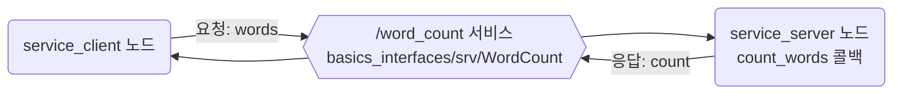
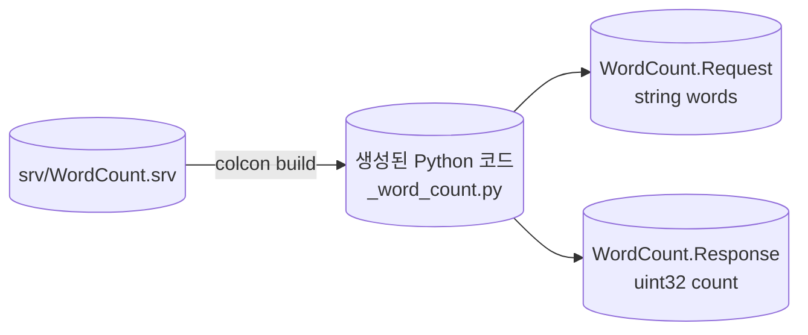
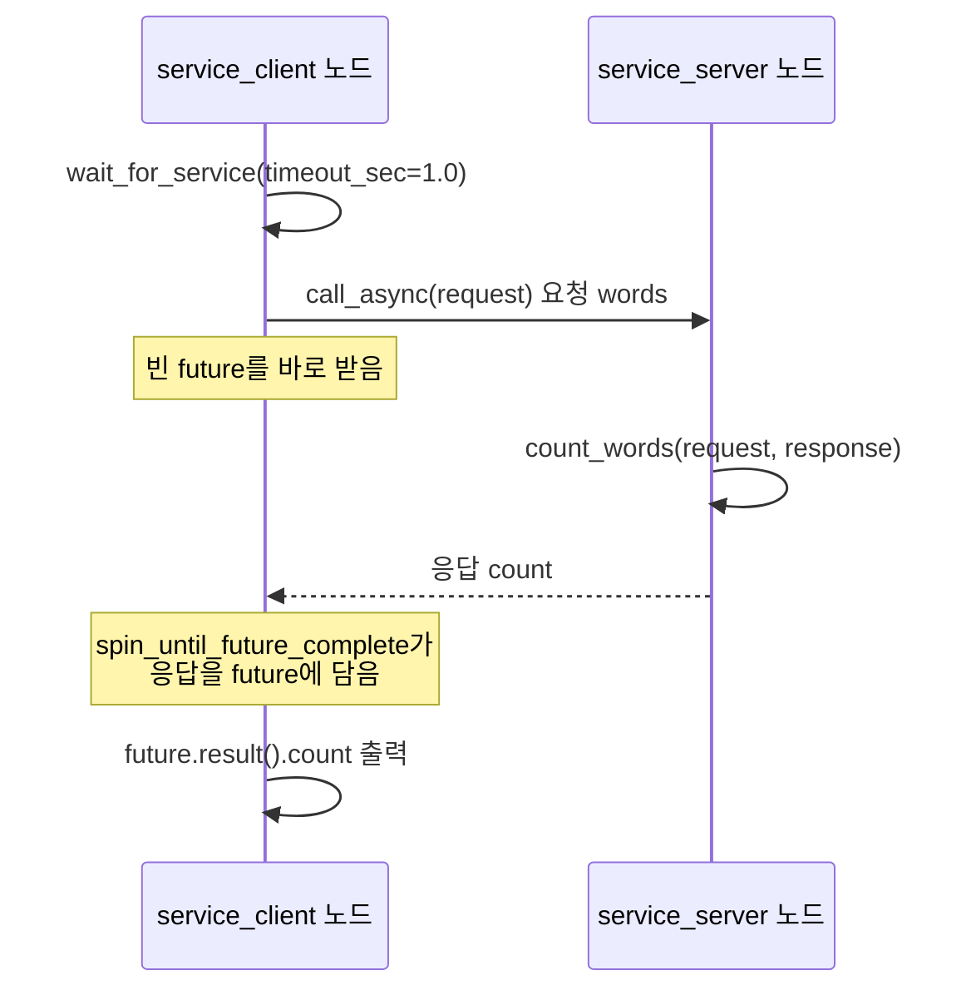
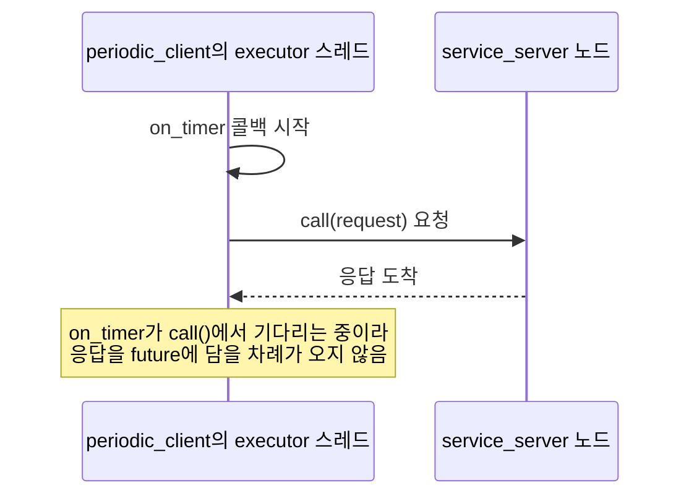

# 4장. 서비스

- 원서: Chapter 4. Services, PDF p.71~80 (인쇄 쪽 = PDF 쪽 - 20)
- 선행 조건: 3장에서 만든 `basics`(ament_python) 패키지와 `basics_interfaces`(ament_cmake, `msg/Complex.msg`) 패키지가 `~/rosbook_ws/src/`에 있고 빌드되어 있어야 합니다. README에 적힌 대로 `RMW_IMPLEMENTATION=rmw_cyclonedds_cpp` 설정이 `~/.bashrc`에 들어 있어야 합니다.
- 새로 설치할 것: 없음

## 이 장에서 체감할 구조

서비스는 이름(`/word_count`)과 타입(`basics_interfaces/srv/WordCount`)이 둘 다 맞아야 연결되는 요청-응답 통로입니다. 서버가 없으면 클라이언트는 기다릴 수밖에 없고, 응답은 executor가 돌아야 손에 들어옵니다.



그림에서 볼 것: 클라이언트와 서버 사이에는 서비스 이름과 타입 하나만 있습니다. 둘 중 하나라도 다르면 요청이 서버에 닿지 않습니다.

## 1. 목표와 개념

토픽은 보내는 쪽이 받는 쪽을 신경 쓰지 않는 일방통행입니다. 그런데 "이 문장의 단어 수를 세어 줘"처럼 물어보고 답을 받아야 하는 일도 있습니다. 이런 일에는 서비스를 씁니다.

- **서비스 서버**: 이름과 타입을 걸고 요청을 기다리다가, 요청이 오면 콜백을 실행해서 응답을 돌려줍니다.
- **서비스 클라이언트**: 같은 이름과 타입으로 요청을 보내고 응답을 받습니다.
- **서비스 타입(.srv)**: 요청 필드와 응답 필드를 `---` 한 줄로 나눠 적은 정의 파일입니다. 빌드하면 `WordCount.Request`와 `WordCount.Response` 두 메시지 클래스가 생깁니다.

예:

```python
self.srv = self.create_service(WordCount, 'word_count', self.count_words)
client = node.create_client(WordCount, 'word_count')
```

첫 줄은 서버(실습 4-2), 둘째 줄은 클라이언트(실습 4-4)입니다. 두 줄의 타입(`WordCount`)과 이름(`'word_count'`)이 같아야 연결됩니다.



그림에서 볼 것: `.srv` 파일 하나가 메시지 타입 두 개로 나뉩니다. `---` 위가 `Request`, 아래가 `Response`입니다. 3장의 `.msg`와 같은 rosidl 생성 과정을 거칩니다.

예:

```python
request = WordCount.Request()
response.count = len(request.words.split())
```

클라이언트는 `Request`를 직접 만들어 채우고(실습 4-4), 서버는 rclpy가 만들어 준 `Response`에 값만 채웁니다(실습 4-2).

**요청에서 응답까지의 순서.** 클라이언트는 서버가 보일 때까지 기다린 뒤 요청을 보냅니다. `call_async()`는 응답을 기다리지 않고 곧바로 future(나중에 응답이 담길 상자)를 돌려줍니다. 응답이 도착해서 future에 담기는 것은 클라이언트 쪽 executor가 돌 때입니다.



그림에서 볼 것: 요청을 보낸 시점과 응답을 꺼내는 시점이 떨어져 있습니다. 그 사이에 executor가 돌아야 응답이 future에 들어옵니다.

예:

```python
future = client.call_async(request)
rclpy.spin_until_future_complete(node, future)
response = future.result()
```

실습 4-4의 세 줄입니다. 가운데 줄이 executor를 돌리는 부분이고, 이 줄을 지우면 `future.result()`가 `None`입니다(4절).

**콜백 안에서 기다리면 멈춥니다.** executor가 스레드 하나로 콜백을 차례로 실행하는 동안, 한 콜백 안에서 동기 `call()`로 응답을 기다리면 응답을 받아 줄 스레드가 남지 않습니다. 실습 4-5에서 직접 겪습니다.



그림에서 볼 것: 서버는 응답을 보냈지만 클라이언트의 유일한 스레드가 자기 자신을 기다리고 있습니다. 콜백 안에서는 `call_async()`와 `add_done_callback()`을 씁니다.

예:

```python
future = self.client.call_async(request)
future.add_done_callback(self.on_response)
```

실습 4-5의 두 줄입니다. 콜백은 요청만 보내고 바로 끝나고, 응답은 executor가 `on_response`를 불러서 넘겨줍니다.

서비스는 금방 끝나는 일에 맞습니다. 끝나는 시간을 알 수 없거나, 중간 진행 상황을 알려 줘야 하거나, 도중에 취소할 수 있어야 하는 일은 5장의 액션을 씁니다.

비유: 토픽은 게시판에 글을 붙여 두는 것이고, 서비스는 담당자 창구에 서류를 내고 그 자리에서 답을 받는 것입니다.

이 장은 원서와 같은 예제, 즉 문자열을 받아 단어 수를 돌려주는 `word_count` 서비스를 ROS 2로 만듭니다. 원서의 전체 흐름은 PDF p.71~79에 있습니다.

### 코드와 폴더 구조

3장의 두 패키지에 서비스 정의 하나와 실행 파일 세 개가 더해집니다. 3장에서 만든 파일은 `...`로 줄였습니다.

```text
~/rosbook_ws/src/
├── basics_interfaces/
│   ├── CMakeLists.txt        "srv/WordCount.srv" 한 줄 추가 (실습 4-1)
│   ├── package.xml           바꾸지 않음
│   ├── msg/Complex.msg       3장
│   └── srv/
│       └── WordCount.srv     요청 words, 응답 count (실습 4-1)
└── basics/
    ├── package.xml           바꾸지 않음
    ├── setup.py              console_scripts에 세 줄 추가
    └── basics/
        ├── ...               3장의 노드들
        ├── service_server.py   /word_count 서버 (실습 4-2)
        ├── service_client.py   한 번 부르고 끝나는 클라이언트 (실습 4-4)
        └── periodic_client.py  타이머 콜백 안에서 부르는 클라이언트 (실습 4-5)
```

- 빌드 뒤 `WordCount.srv`는 `~/rosbook_ws/install/basics_interfaces/share/basics_interfaces/srv/`에, 생성된 Python 코드는 3장의 `msg/`와 나란히 `.../site-packages/basics_interfaces/srv/_word_count.py`에 놓입니다.
- 노드 뼈대는 3장과 같습니다. 서버는 `__init__`에서 `create_service()`를 부르고, 콜백이 `(request, response)`를 받아 `response`를 반환한다는 점만 다릅니다.
- `service_client`는 한 번 부르고 끝나는 프로그램이라 `Node`를 상속하지 않고 `main()` 안에서 노드를 만듭니다. `periodic_client`는 계속 도는 노드라서 3장과 같은 클래스 형태를 씁니다.

### 실무 메모

- 서비스는 금방 끝나는 조회와 설정(값 읽기, 모드 바꾸기, 초기화 요청)에 씁니다. 몇 초 이상 걸리거나 진행 상황과 취소가 필요한 일은 5장의 액션으로 만듭니다.
- 기다림에는 끝을 둡니다. `wait_for_service(timeout_sec=...)`처럼 시간을 정하고, 기다리는 동안 무엇을 기다리는지 로그로 남기면 이름 오타를 빨리 찾습니다. 기다림이 길어지면 먼저 `ros2 service list -t`로 이름과 타입을 확인합니다.
- 콜백 안에서는 동기 `call()`을 쓰지 않습니다. Jazzy rclpy의 `Client.call()` 설명에도 콜백 안에서 부르면 교착이나 시간 초과가 날 수 있다는 경고가 있습니다.
- 실패는 응답 필드로 알립니다. 표준 타입 `std_srvs/srv/Trigger`의 응답이 `bool success`와 `string message`인 것처럼, 직접 만드는 서비스에도 성공 여부와 이유를 담는 필드를 두는 경우가 많습니다.

## 2. 원서(ROS 1)와 달라지는 점

| 원서 (ROS 1) | ROS 2 Jazzy | 이유와 주의점 |
|---|---|---|
| `.srv`를 노드 코드와 같은 `basics` 패키지에 둠 | 인터페이스 전용 `basics_interfaces`(ament_cmake) 패키지에 둠 | ament_python 패키지는 인터페이스를 생성할 수 없습니다. 인터페이스 생성은 CMake 기반의 `rosidl`이 맡습니다. |
| `message_generation`, `add_service_files()`, `generate_messages()` | `rosidl_generate_interfaces()` 목록에 `"srv/WordCount.srv"` 한 줄 추가 | msg, srv, action을 한 목록에서 함께 처리합니다. |
| `from basics.srv import WordCount, WordCountResponse` | `from basics_interfaces.srv import WordCount`, 그리고 `WordCount.Request()`, `WordCount.Response()` | 요청과 응답 클래스가 서비스 클래스 안에 들어 있습니다. |
| 콜백 인자는 요청 하나, 응답 객체를 새로 만들거나 값, 리스트, 딕셔너리를 반환 | 콜백 인자는 `(request, response)`, 미리 만들어진 `response`를 채워서 반환 | ROS 2 rclpy는 응답 객체를 대신 만들어 넘겨 줍니다. 리스트나 딕셔너리를 반환하는 방식은 없습니다. |
| `rospy.ServiceProxy`를 함수처럼 호출 (동기) | `client.call_async()`로 future를 받고, executor를 돌려서 완료를 기다림 | 응답은 executor가 처리해야 도착합니다. 동기 `call()`도 있지만 콜백 안에서 쓰면 멈춥니다 (실습 4-5). |
| 서비스가 등록되기 전에 호출하면 예외 | `wait_for_service()`로 기다리거나 `service_is_ready()`로 확인 | 마스터가 없으므로 서버를 찾는 일도 디스커버리로 이루어집니다. |
| `rossrv show`, `rosservice list/info/type/call` | `ros2 interface show`, `ros2 service list/info/type/find/call` | `ros2 service info`는 노드 이름이나 URI 대신 서버 수와 클라이언트 수를 보여 줍니다. |
| `rosservice list`에 `/rosout/get_loggers` 같은 로깅 서비스가 보임 | 노드마다 파라미터 서비스 7개가 자동으로 생김 | 파라미터는 8장에서 다룹니다. 지금은 "노드가 기본으로 여는 서비스가 있다"만 기억하면 됩니다. |

## 3. 실습

### 실습 4-1. 서비스 타입 정의하고 빌드하기

**준비**: 터미널 1개.

**직접 입력**: 먼저 디렉터리를 만들고 정의 파일을 작성합니다.

```bash
mkdir -p ~/rosbook_ws/src/basics_interfaces/srv
```

파일: `~/rosbook_ws/src/basics_interfaces/srv/WordCount.srv`

```
string words
---
uint32 count
```

| 줄 | 설명 |
|---|---|
| 1 | 요청 필드입니다. 단어를 셀 문자열 하나를 받습니다. |
| 2 | `---`는 요청과 응답의 경계입니다. |
| 3 | 응답 필드입니다. 단어 수는 음수가 될 수 없으므로 부호 없는 32비트 정수를 씁니다. |

파일: `~/rosbook_ws/src/basics_interfaces/CMakeLists.txt`에서 3장에 만든 `rosidl_generate_interfaces` 블록에 한 줄을 추가합니다. 수정 후 블록은 다음과 같습니다.

```cmake
find_package(rosidl_default_generators REQUIRED)

rosidl_generate_interfaces(${PROJECT_NAME}
  "msg/Complex.msg"
  "srv/WordCount.srv"
)
```

`package.xml`은 3장에서 넣은 `rosidl_default_generators`, `rosidl_default_runtime`, `rosidl_interface_packages` 세 줄로 충분합니다. 서비스 때문에 추가할 것은 없습니다.

빌드하고 확인합니다.

```bash
cd ~/rosbook_ws && colcon build --symlink-install --packages-select basics_interfaces
source ~/rosbook_ws/install/setup.bash
ros2 interface show basics_interfaces/srv/WordCount
ros2 interface package basics_interfaces
```

**관찰**:

```
string words
---
uint32 count
```

`ros2 interface package`는 이 패키지가 가진 인터페이스를 모두 보여 줍니다. `basics_interfaces/msg/Complex`와 `basics_interfaces/srv/WordCount` 두 줄이 나와야 합니다. 타입 이름이 `패키지/srv/이름` 형태라는 점을 눈여겨봅니다.

**생각해 볼 질문**: Q1. 원서는 `.srv` 파일을 노드 코드와 같은 패키지에 두었습니다. 이 가이드는 왜 `basics_interfaces`라는 별도 패키지에 두었을까요?

### 실습 4-2. 서비스 서버 작성하기

**준비**: 터미널 1개.

**직접 입력**: 파일: `~/rosbook_ws/src/basics/basics/service_server.py`

```python
from basics_interfaces.srv import WordCount
import rclpy
from rclpy.executors import ExternalShutdownException
from rclpy.node import Node


class WordCountServer(Node):
    def __init__(self):
        super().__init__('service_server')
        self.srv = self.create_service(WordCount, 'word_count', self.count_words)

    def count_words(self, request, response):
        response.count = len(request.words.split())
        self.get_logger().info(f'"{request.words}" -> {response.count}')
        return response


def main(args=None):
    rclpy.init(args=args)
    node = WordCountServer()
    try:
        rclpy.spin(node)
    except (KeyboardInterrupt, ExternalShutdownException):
        pass
    finally:
        node.destroy_node()
        rclpy.try_shutdown()


if __name__ == '__main__':
    main()
```

**줄 단위 해설**:

| 줄 | 설명 |
|---|---|
| 1 | 4-1에서 생성된 서비스 타입을 가져옵니다. 모듈 경로는 `패키지.srv`입니다. import 순서는 ament의 flake8 검사(알파벳 순)에 맞춘 것입니다. |
| 2~4 | CONVENTIONS의 기본 형태와 같습니다. |
| 9 | 노드 이름을 `service_server`로 정합니다. |
| 10 | `create_service(타입, 이름, 콜백)`으로 서버를 엽니다. 이름에 `/`가 없으므로 노드의 네임스페이스 기준 상대 이름이고, 지금은 `/word_count`가 됩니다. |
| 12 | 서비스 콜백은 인자를 두 개 받습니다. `request`는 클라이언트가 보낸 값이고, `response`는 rclpy가 미리 만들어 둔 빈 응답입니다. |
| 13 | 공백 기준으로 나눈 조각 수를 응답 필드에 채웁니다. |
| 14 | 요청이 올 때마다 서버 쪽에 로그를 남겨서, 누가 언제 불렀는지 보이게 합니다. |
| 15 | 채운 응답을 반환하면 rclpy가 클라이언트에게 보냅니다. |
| 18~27 | 기본 형태 그대로입니다. `rclpy.spin()`이 돌아야 요청이 도착했을 때 콜백이 실행됩니다. |

파일: `~/rosbook_ws/src/basics/setup.py`의 `entry_points`에 한 줄을 추가합니다. 3장에서 넣은 줄은 그대로 둡니다.

```python
    entry_points={
        'console_scripts': [
            # 3장에서 넣은 줄들
            'service_server = basics.service_server:main',
        ],
    },
```

`~/rosbook_ws/src/basics/package.xml`은 고칠 것이 없습니다. 3장에서 넣은 `<depend>rclpy</depend>`와 `<depend>basics_interfaces</depend>`가 실행 의존까지 포함하기 때문입니다. `depend` 한 줄은 `build_depend`, `build_export_depend`, `exec_depend`를 모두 적은 것과 같습니다.

빌드하고 실행합니다.

```bash
cd ~/rosbook_ws && colcon build --symlink-install --packages-select basics
source ~/rosbook_ws/install/setup.bash
ros2 run basics service_server
```

**관찰**: 아무 출력 없이 멈춰 있으면 정상입니다. 요청을 기다리는 중입니다. 이 터미널은 계속 켜 둡니다.

**생각해 볼 질문**: Q2. 콜백이 `response`를 반환하지 않고 `None`을 반환하면 어떻게 될까요? (5절에 답이 있지만, 직접 바꿔서 확인해도 좋습니다.)

### 실습 4-3. 명령줄에서 서비스 들여다보고 호출하기

**준비**: 터미널 1에서 `ros2 run basics service_server`가 실행 중입니다. 터미널 2를 엽니다.

**직접 입력** (터미널 2):

```bash
ros2 service list
ros2 service list -t
ros2 service type /word_count
ros2 service info /word_count
ros2 service find basics_interfaces/srv/WordCount
ros2 node info /service_server
ros2 service call /word_count basics_interfaces/srv/WordCount "{words: 'one two three'}"
```

**관찰**: 검증 환경에서 나온 출력입니다.

```
$ ros2 service list
/service_server/describe_parameters
/service_server/get_parameter_types
/service_server/get_parameters
/service_server/get_type_description
/service_server/list_parameters
/service_server/set_parameters
/service_server/set_parameters_atomically
/word_count

$ ros2 service type /word_count
basics_interfaces/srv/WordCount

$ ros2 service info /word_count
Type: basics_interfaces/srv/WordCount
Clients count: 0
Services count: 1

$ ros2 service find basics_interfaces/srv/WordCount
/word_count

$ ros2 service call /word_count basics_interfaces/srv/WordCount "{words: 'one two three'}"
requester: making request: basics_interfaces.srv.WordCount_Request(words='one two three')

response:
basics_interfaces.srv.WordCount_Response(count=3)
```

- `ros2 service list`에는 우리가 만든 `/word_count` 말고도 `/service_server/...`로 시작하는 서비스 7개가 있습니다. 노드를 만들면 파라미터를 다루는 서비스가 자동으로 생깁니다.
- `ros2 node info /service_server`의 `Service Servers:` 항목에 같은 8개가 나옵니다. 서비스도 토픽처럼 "어느 노드가 어떤 이름과 타입으로 열었는지"로 그래프에 기록됩니다.
- `ros2 service call`을 하면 터미널 1의 서버가 `"one two three" -> 3` 로그를 찍습니다.
- `ros2 service call`의 인자는 YAML 형식입니다. 필드 이름(`words`)이 `.srv` 파일과 같아야 합니다.

**생각해 볼 질문**: Q3. `ros2 service info`의 `Clients count`가 0으로 나왔습니다. `ros2 service call`을 실행하는 동안에도 0일까요?

### 실습 4-4. 클라이언트 노드 작성하기, 그리고 서버가 없을 때

**준비**: 터미널 1의 서버는 그대로 둡니다. 터미널 2를 씁니다.

**직접 입력**: 파일: `~/rosbook_ws/src/basics/basics/service_client.py`

```python
import sys

from basics_interfaces.srv import WordCount
import rclpy
from rclpy.executors import ExternalShutdownException
from rclpy.node import Node
from rclpy.utilities import remove_ros_args


def main(args=None):
    rclpy.init(args=args)
    node = Node('service_client')
    client = node.create_client(WordCount, 'word_count')
    try:
        while not client.wait_for_service(timeout_sec=1.0):
            node.get_logger().info('word_count 서비스를 기다리는 중...')

        request = WordCount.Request()
        request.words = ' '.join(remove_ros_args(sys.argv)[1:])

        future = client.call_async(request)
        rclpy.spin_until_future_complete(node, future)

        response = future.result()
        node.get_logger().info(f'{request.words} -> {response.count}')
    except (KeyboardInterrupt, ExternalShutdownException):
        pass
    finally:
        node.destroy_node()
        rclpy.try_shutdown()


if __name__ == '__main__':
    main()
```

**줄 단위 해설**:

| 줄 | 설명 |
|---|---|
| 1 | 명령줄 인자를 읽으려고 `sys`를 가져옵니다. |
| 7 | `remove_ros_args`는 `--ros-args ...` 부분을 걸러 줍니다. 이 함수가 없으면 리매핑 인자까지 단어로 세게 됩니다. |
| 12 | 한 번 호출하고 끝나는 프로그램이라 Node를 상속하지 않고 바로 만듭니다. 노드 이름은 `service_client`입니다. |
| 13 | `create_client(타입, 이름)`으로 클라이언트를 만듭니다. 이름과 타입이 서버와 둘 다 같아야 연결됩니다. |
| 15~16 | `wait_for_service(timeout_sec=1.0)`는 서버가 보이면 `True`, 1초 안에 안 보이면 `False`를 돌려줍니다. 서버가 나타날 때까지 1초마다 로그를 찍으며 기다립니다. |
| 18~19 | 요청 객체를 만들고, 명령줄의 단어들을 공백으로 이어 붙여 넣습니다. |
| 21 | `call_async()`는 요청을 보내고 곧바로 future를 돌려줍니다. future는 "나중에 응답이 담길 상자"입니다. 이 시점에는 아직 비어 있습니다. |
| 22 | `spin_until_future_complete()`는 future가 채워질 때까지 이 노드의 executor를 돌립니다. 응답 메시지를 받아 future에 넣는 일은 executor가 합니다. |
| 24~25 | 채워진 응답을 꺼내서 출력합니다. |
| 26~30 | Ctrl+C로 기다리기를 끊어도 오류 없이 정리하고 끝납니다. |

`setup.py`의 `console_scripts`에 한 줄을 추가합니다.

```python
            'service_client = basics.service_client:main',
```

빌드하고 실행합니다. 새 실행 파일을 추가했으므로 빌드 뒤에 `source`를 다시 합니다.

```bash
cd ~/rosbook_ws && colcon build --symlink-install --packages-select basics
source ~/rosbook_ws/install/setup.bash
ros2 run basics service_client these are some words
```

**관찰 1 (서버가 있을 때)**:

```
[INFO] [...] [service_client]: these are some words -> 4
```

**직접 입력 2 (서버가 없을 때)**: 터미널 1에서 Ctrl+C로 서버를 끕니다. 터미널 2에서 클라이언트를 다시 실행합니다.

```bash
ros2 run basics service_client hello world
```

**관찰 2**: 1초마다 다음 줄이 계속 찍힙니다.

```
[INFO] [...] [service_client]: word_count 서비스를 기다리는 중...
```

이 상태에서 터미널 1에서 `ros2 run basics service_server`를 다시 실행합니다. 서버가 뜨고 1초 안팎에 클라이언트가 `hello world -> 2`를 찍고 끝납니다. 검증 환경에서는 서버를 실행하고 약 1초 뒤에 응답이 나왔습니다.

토픽의 subscriber는 publisher가 없어도 그냥 기다리면 되지만, 서비스 클라이언트는 서버가 없으면 요청을 보낼 곳이 없습니다. 그래서 `wait_for_service`로 서버를 먼저 확인합니다. 서버 이름에 오타가 있어도 똑같이 영원히 기다리므로, 기다림이 길어지면 `ros2 service list`로 이름부터 확인합니다.

**생각해 볼 질문**: Q4. 22번 줄 `rclpy.spin_until_future_complete(node, future)`를 지우면 어떻게 될까요?

### 실습 4-5. 콜백 안에서 서비스 부르기: 비동기는 되고 동기는 멈춘다

실제 로봇 노드는 한 번 부르고 끝나지 않습니다. 타이머나 구독 콜백 안에서 다른 노드의 서비스를 부르는 경우가 많습니다. 이때 생기는 대표적인 함정을 직접 겪어 봅니다.

**준비**: 터미널 1에서 `ros2 run basics service_server`가 실행 중입니다.

**직접 입력**: 파일: `~/rosbook_ws/src/basics/basics/periodic_client.py`

```python
from basics_interfaces.srv import WordCount
import rclpy
from rclpy.executors import ExternalShutdownException
from rclpy.node import Node


class PeriodicClient(Node):
    def __init__(self):
        super().__init__('periodic_client')
        self.client = self.create_client(WordCount, 'word_count')
        self.words = []
        self.timer = self.create_timer(1.0, self.on_timer)

    def on_timer(self):
        if not self.client.service_is_ready():
            self.get_logger().info('word_count 서비스가 아직 없습니다')
            return
        self.words.append('word')
        request = WordCount.Request()
        request.words = ' '.join(self.words)
        self.get_logger().info(f'요청 보냄: 단어 {len(self.words)}개')
        future = self.client.call_async(request)
        future.add_done_callback(self.on_response)

    def on_response(self, future):
        self.get_logger().info(f'응답 받음: count={future.result().count}')


def main(args=None):
    rclpy.init(args=args)
    node = PeriodicClient()
    try:
        rclpy.spin(node)
    except (KeyboardInterrupt, ExternalShutdownException):
        pass
    finally:
        node.destroy_node()
        rclpy.try_shutdown()


if __name__ == '__main__':
    main()
```

**줄 단위 해설**:

| 줄 | 설명 |
|---|---|
| 10 | 클라이언트를 노드의 멤버로 만들어 두고 계속 씁니다. |
| 12 | 1초마다 `on_timer`를 부르는 타이머입니다. |
| 15~17 | 콜백 안에서는 `wait_for_service`로 오래 기다리지 않습니다. 서버가 아직 없으면 이번 차례는 건너뜁니다. |
| 18~21 | 호출할 때마다 단어를 하나씩 늘린 문장을 만들어 보냅니다. |
| 22 | `call_async()`로 요청만 보내고 future를 받습니다. 콜백은 여기서 바로 끝납니다. |
| 23 | 응답이 도착해서 future가 채워지면 `on_response`를 부르도록 등록합니다. |
| 25~26 | executor가 응답을 받아 future를 채운 뒤에 이 함수가 실행됩니다. |
| 33 | `rclpy.spin()`이 타이머 콜백, 응답 수신, `on_response`를 모두 한 스레드에서 차례로 처리합니다. |

`setup.py`에 `'periodic_client = basics.periodic_client:main',`을 추가하고 빌드, source 후 실행합니다.

```bash
ros2 run basics periodic_client
```

**관찰 1**: 1초마다 요청과 응답이 짝을 이룹니다.

```
[INFO] [...] [periodic_client]: 요청 보냄: 단어 1개
[INFO] [...] [periodic_client]: 응답 받음: count=1
[INFO] [...] [periodic_client]: 요청 보냄: 단어 2개
[INFO] [...] [periodic_client]: 응답 받음: count=2
```

**직접 입력 2 (일부러 멈추게 하기)**: Ctrl+C로 끄고, 22~23번 줄을 동기 호출로 바꿉니다.

```python
        response = self.client.call(request)
        self.get_logger().info(f'응답 받음: count={response.count}')
```

`--symlink-install`로 빌드했으므로 Python 파일만 고쳤을 때는 다시 빌드하지 않아도 됩니다. 다시 실행합니다.

**관찰 2**: 검증 환경에서는 다음 한 줄만 나오고 더 이상 아무것도 찍히지 않았습니다.

```
[INFO] [...] [periodic_client]: 요청 보냄: 단어 1개
```

그런데 터미널 1의 서버는 `"word" -> 1` 로그를 찍었습니다. 서버는 응답을 보냈는데 클라이언트가 받지 못한 것입니다.

**왜 멈추는가**: `call()`은 "응답이 future에 담길 때까지 이 자리에서 기다린다"는 함수입니다. 그런데 응답을 받아 future에 넣는 일은 executor가 합니다. 이 노드의 executor는 스레드 하나로 콜백을 하나씩 실행하는데, 그 스레드가 지금 `on_timer` 안의 `call()`에서 기다리고 있습니다. 응답을 처리할 스레드가 없으니 future는 영원히 채워지지 않고, `call()`도 영원히 끝나지 않습니다. 이런 상태를 교착(deadlock)이라고 합니다.

비유: 혼자 일하는 직원이 "택배가 오면 일을 계속하겠다"며 책상에서 기다리는데, 택배를 받으러 현관에 나갈 사람도 그 직원뿐인 상황입니다.

해결 방법은 두 가지입니다. 이 실습처럼 `call_async()`와 `add_done_callback()`을 쓰는 것이 가장 단순합니다. 다른 방법은 5장에서 쓰는 `MultiThreadedExecutor`와 callback group으로 응답을 처리할 스레드를 따로 두는 것입니다. 확인이 끝나면 22~23번 줄을 원래대로 되돌립니다.

**생각해 볼 질문**: Q5. 실습 4-4의 `service_client`도 `call_async()`를 썼습니다. 거기서는 `add_done_callback()` 없이 어떻게 응답을 받았을까요?

## 4. 일부러 망가뜨려 보기

| 바꿀 것 | 예상 증상 | 원인을 확인하는 명령 |
|---|---|---|
| `ros2 service call`에 다른 타입을 줌: `ros2 service call /word_count std_srvs/srv/Trigger` | 검증 환경에서는 `waiting for service to become available...`만 나오고 계속 기다렸습니다. 오류 메시지는 나오지 않습니다. | `ros2 service type /word_count`로 실제 타입을 확인합니다. 이름이 같아도 타입이 다르면 다른 서비스로 취급됩니다. |
| 서비스 이름 오타: `ros2 service call /word_cout basics_interfaces/srv/WordCount "{words: 'a b'}"` | 위와 같이 `waiting for service...`에서 멈춥니다. | `ros2 service list`, `ros2 service find basics_interfaces/srv/WordCount` |
| 요청 필드 이름 오타: `"{word: 'a b'}"` | `Failed to populate field: 'WordCount_Request' object has no attribute 'word'` 후 바로 종료합니다. | `ros2 interface show basics_interfaces/srv/WordCount` |
| 요청 값의 타입을 다르게 줌: `"{words: 3}"` | 검증 환경에서는 오류 없이 `words='3'`으로 바뀌어 `count=1`이 돌아왔습니다. 필드 이름은 엄격히 검사하지만 값은 문자열로 바뀔 수 있다는 점을 기억합니다. | `ros2 service call` 출력의 `making request:` 줄에서 실제로 보낸 값을 확인합니다. |
| 서버를 끈 상태에서 클라이언트 실행 | `word_count 서비스를 기다리는 중...`이 1초마다 반복됩니다. | 다른 터미널에서 `ros2 service list` |
| 서버 콜백에서 `return response`를 지움 | 서버가 마지막 줄이 `TypeError`뿐인 트레이스백을 남기고 종료됩니다. 클라이언트는 응답을 받지 못하고 계속 기다립니다. (확인 질문 Q2 참고) | 서버 터미널의 로그 |
| `periodic_client`에서 `call_async()` 대신 `call()` | 첫 요청 뒤로 아무것도 찍히지 않습니다 (실습 4-5). | 서버 로그에 요청이 찍혔는지 확인해서, 멈춘 쪽이 클라이언트라는 것을 확인합니다. |
| `service_client.py`에서 `spin_until_future_complete` 줄 삭제 | `AttributeError: 'NoneType' object has no attribute 'count'` | future가 채워지기 전에 `future.result()`를 꺼냈기 때문입니다. 서버 로그에는 요청이 찍혀 있습니다. |

## 5. 확인 질문

<details><summary>Q1. 왜 .srv 파일을 별도 패키지 basics_interfaces에 두었나요?</summary>

ROS 2에서 msg, srv, action 정의를 코드로 생성하는 일은 `rosidl_generate_interfaces()`라는 CMake 함수가 합니다. `basics`는 ament_python 패키지라서 이 함수를 쓸 수 없습니다. 그래서 인터페이스만 담는 ament_cmake 패키지를 따로 두고, Python 노드 패키지는 그것을 `package.xml`의 의존으로 적어서 가져다 씁니다. 인터페이스를 따로 두면 C++ 노드(23장)나 다른 패키지에서도 같은 타입을 쓸 수 있다는 장점도 있습니다.

</details>

<details><summary>Q2. 서비스 콜백이 응답을 반환하지 않으면?</summary>

rclpy는 콜백의 반환값을 응답으로 보냅니다. `None`이 돌아오면 응답 메시지로 보낼 수 없어서 서버 쪽에서 오류가 나고, 클라이언트는 응답을 받지 못합니다.

실제로 실행하면 서버 터미널에 다음과 같은 트레이스백이 찍히고 서버 프로세스가 끝납니다. rclpy의 `send_response`가 응답 타입이 아닌 값을 받으면 메시지 없이 `TypeError`를 던지고, 이 예외가 `rclpy.spin()` 밖으로 나오기 때문입니다. 클라이언트(`ros2 service call`)는 `requester: making request: ...`를 출력한 뒤 응답을 받지 못한 채 계속 기다립니다.

```
  File ".../rclpy/service.py", line 75, in send_response
    raise TypeError()
TypeError
```

오류 문구에 `None`이나 콜백 이름이 나오지 않으므로, 서비스 서버가 마지막 줄이 `TypeError`뿐인 트레이스백을 남기면 콜백의 `return`부터 확인합니다.

원서는 "실패하면 None을 반환한다"는 rospy의 관례를 소개하지만(PDF p.75), ROS 2에서는 응답 타입에 성공 여부 필드(예: `bool success`, `string message`)를 넣어서 실패를 알리는 방식이 일반적입니다.

</details>

<details><summary>Q3. ros2 service call 실행 중에는 Clients count가 1이 될까요?</summary>

`ros2 service call`도 내부에서 노드와 클라이언트를 만들기 때문에, 실행 중인 동안에는 클라이언트로 집계됩니다. 다만 호출이 금방 끝나면 그 순간을 잡기 어렵습니다. 실습 4-5의 `periodic_client`를 켜 둔 채 `ros2 service info /word_count`를 실행하면 `Clients count: 1`을 쉽게 볼 수 있습니다.

</details>

<details><summary>Q4. spin_until_future_complete를 지우면?</summary>

`call_async()`는 요청을 보내기만 하고 바로 돌아옵니다. 응답 메시지를 받아 future에 넣는 일은 executor가 돌 때만 일어납니다. executor를 돌리지 않으면 future는 비어 있고 `future.result()`는 `None`을 돌려주므로, 다음 줄의 `response.count`에서 `AttributeError`가 납니다. 서버는 요청을 받아 응답까지 보냈다는 점이 핵심입니다. 응답은 네트워크에 도착해 있지만 꺼내 줄 executor가 없었습니다.

</details>

<details><summary>Q5. service_client는 add_done_callback 없이 어떻게 응답을 받았나요?</summary>

`service_client`의 `main()`은 콜백 안이 아니라 프로그램의 맨 바깥에서 실행됩니다. 그 자리에서 `spin_until_future_complete()`가 executor를 직접 돌리므로, executor가 응답을 받아 future를 채울 수 있습니다. 반면 `periodic_client`의 `on_timer`는 이미 `rclpy.spin()`이 돌리고 있는 executor 안에서 실행되는 콜백입니다. 그 안에서 다시 기다리면 executor가 막힙니다. "지금 이 코드가 executor 바깥에서 도는가, 안에서 도는가"를 구분하는 것이 rclpy에서 서비스를 다룰 때의 핵심입니다.

</details>

## 6. 원서 대조 메모

- 원서 PDF p.73~74의 생성 코드(genpy 클래스)는 ROS 1 전용이라 다루지 않았습니다. ROS 2에서 생성되는 코드는 `~/rosbook_ws/install/basics_interfaces/` 아래에 있지만, 직접 볼 일은 거의 없습니다.
- 원서 PDF p.76~77의 "응답을 값, 리스트, 딕셔너리로 반환하기"와 p.78~79의 "프록시를 여러 인자로 호출하기, 키워드 인자로 일부만 채우기"는 rospy 전용 편의 기능이라 ROS 2에는 대응하는 기능이 없습니다. ROS 2에서는 `WordCount.Request()`의 필드를 직접 채웁니다. 채우지 않은 필드는 타입의 기본값(문자열은 `''`, 숫자는 0)이 됩니다.
- 원서 p.76의 `rosservice info`는 서비스를 연 노드와 URI를 보여 줍니다. ROS 2의 `ros2 service info`는 타입과 서버, 클라이언트 수만 보여 줍니다. 어느 노드가 서버인지는 `ros2 node info <노드>`의 `Service Servers:` 항목으로 확인합니다.
- 원서 p.78은 서버가 없으면 클라이언트가 영원히 기다릴 수 있다는 한계를 지적합니다. ROS 2에서도 `wait_for_service()`에 timeout을 주지 않으면 같습니다. 이 가이드는 `timeout_sec=1.0`으로 기다리는 동안 로그를 남기게 해서, 무엇을 기다리는지 화면에 보이게 했습니다.
- 원서는 서비스를 동기 RPC로 설명합니다. ROS 2 rclpy에서는 호출 자체는 비동기(`call_async`)가 기본이고, 동기처럼 쓰려면 executor를 돌리는 위치를 신경 써야 합니다 (실습 4-5).

## 7. 이 문서의 검증 상태

<details><summary>검증 기록 펼치기</summary>

- 확인함 (2026-10-27, WSL2 Ubuntu 24.04, ROS 2 Jazzy, `RMW_IMPLEMENTATION=rmw_cyclonedds_cpp`, 별도 검증 워크스페이스와 `ROS_DOMAIN_ID=22`):
  - `basics_interfaces`에 `Complex.msg`와 `WordCount.srv`를 넣은 형태로 `colcon build` 성공, `ros2 interface show`와 `ros2 interface package` 출력.
  - `service_server`, `service_client`, `periodic_client`를 이 문서의 코드 그대로 빌드, 실행해서 3절의 출력을 얻었습니다. 3절의 출력은 그 실행에서 옮겼고 타임스탬프만 `...`로 줄였습니다.
  - `ros2 service list`, `list -t`, `type`, `info`, `find`, `call`, `ros2 node info` 출력. `periodic_client`를 켜 둔 동안 `ros2 service info`가 `Clients count: 1`을 보이는 것 (Q3).
  - 서버 없이 클라이언트를 실행하면 대기 로그가 반복되고, 나중에 서버를 띄우면 약 1초 뒤 응답을 받고 끝나는 것.
  - 타이머 콜백 안의 동기 `call()`이 첫 요청 뒤에 멈추고, 그때 서버는 요청을 처리했다는 것.
  - 4절의 타입 불일치, 이름 오타, 필드 이름 오타, 값 `3` 변환, `spin_until_future_complete` 삭제 결과.
  - `basics` 패키지의 ament flake8 검사(`colcon test`) 통과.
- 확인 못 함:
  - 기본 RMW(Fast DDS)에서의 동작. 이 WSL 환경에서는 Fast DDS로 프로세스 사이 통신이 되지 않아서 Cyclone DDS로만 검증했습니다.
  - 학습자의 실제 `~/rosbook_ws`에서의 빌드. 3장 담당자가 만든 `basics`와 `basics_interfaces`의 실제 내용은 보지 않았고, CONVENTIONS 5절의 형태를 같은 모양으로 직접 만들어 검증했습니다.
- 설명 보강(2026-10-30): "이 장에서 체감할 구조"와 1절에 그림, 코드 예시, 코드와 폴더 구조, 실무 메모를 더했습니다. 머리말과 2~6절은 바꾸지 않았습니다. 1절의 코드 예시는 따로 실행하지 않았습니다.
- 결함 수정(2026-10-31): Q2와 4절의 `return response` 삭제 행을 실행 결과에 맞췄습니다. `checks/service_returns_none.sh`에서 콜백이 `None`을 돌려주게 한 서버에 `ros2 service call`을 보내자, 서버는 `rclpy/service.py` 75번 줄의 `raise TypeError()`로 끝나는 트레이스백을 남기고 종료했고, 클라이언트는 `requester: making request: ...`만 출력한 채 10초 동안 응답을 받지 못했습니다.

</details>
