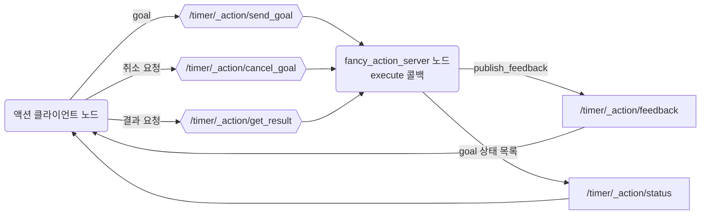
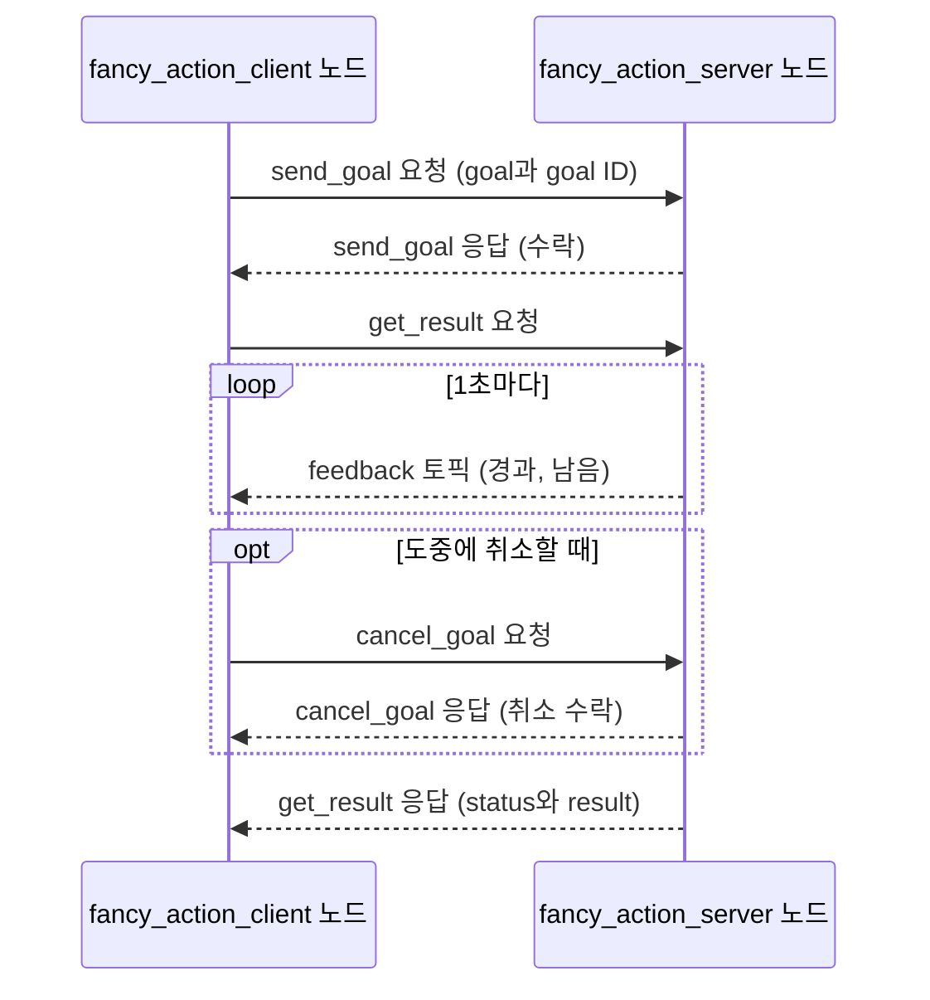
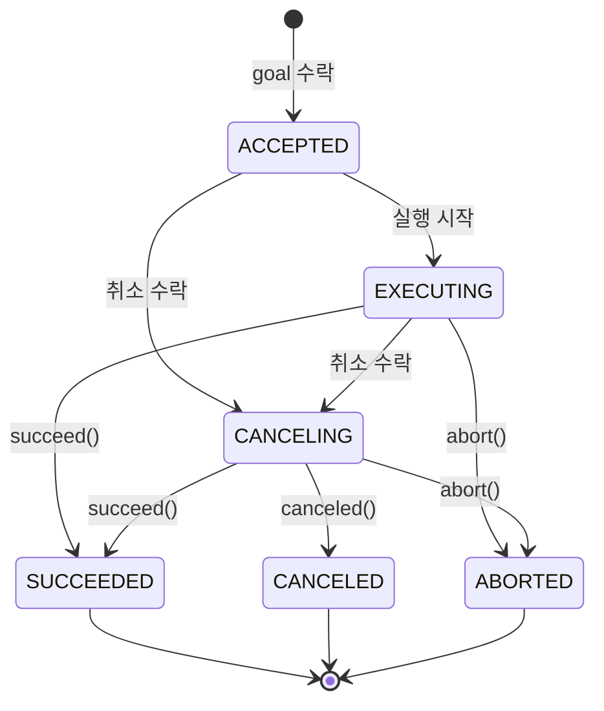
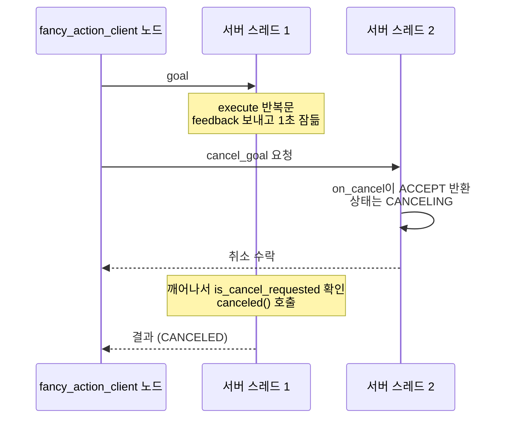

# 5장. 액션

- 원서: Chapter 5. Actions, PDF p.81~96 (인쇄 쪽 = PDF 쪽 - 20)
- 선행 조건: 4장까지 끝나서 `basics_interfaces`에 `Complex.msg`와 `WordCount.srv`가 들어 있고 빌드되어 있어야 합니다. README에 적힌 대로 `RMW_IMPLEMENTATION=rmw_cyclonedds_cpp` 설정이 `~/.bashrc`에 들어 있어야 합니다.
- 새로 설치할 것: 없음 (`rclpy.action`과 `action_msgs`는 ROS 2 기본 설치에 들어 있습니다)

## 이 장에서 체감할 구조

액션 하나(`/timer`)는 숨겨진 서비스 3개(goal 보내기, 결과 받기, 취소)와 숨겨진 토픽 2개(feedback, status)로 이루어집니다. 클라이언트는 goal을 보내고, 도중에 feedback을 받다가, 끝나면 결과와 상태(SUCCEEDED, CANCELED, ABORTED)를 받습니다.



그림에서 볼 것: 액션 `/timer` 하나를 열면 육각형(서비스) 3개와 네모(토픽) 2개가 함께 생깁니다. 답이 필요한 것은 서비스이고, 계속 흘려보내는 것은 토픽입니다. 이름에 `_action`이 들어 있어서 기본 목록에는 보이지 않습니다(실습 5-3).

## 1. 목표와 개념

4장의 서비스는 금방 끝나는 일에 맞습니다. "5초 기다렸다가 알려 줘", "저 지점까지 가" 같은 일은 다릅니다. 언제 끝날지 모르고, 그동안 진행 상황을 알고 싶고, 마음이 바뀌면 중간에 멈추고 싶습니다. 이런 일에 액션을 씁니다.

- **goal**: 클라이언트가 서버에게 맡기는 일입니다. 서버는 받을지(accept) 거절할지(reject) 정할 수 있습니다.
- **feedback**: 서버가 일하는 동안 여러 번 보내는 중간 보고입니다.
- **result**: 일이 끝났을 때 한 번 보내는 최종 결과입니다.
- **status**: goal이 어떻게 끝났는지를 나타내는 상태 값입니다. 성공(SUCCEEDED), 취소됨(CANCELED), 서버가 포기함(ABORTED)이 대표적입니다.
- **cancel**: 클라이언트가 진행 중인 goal을 그만두라고 요청하는 것입니다. 원서는 이것을 preempt라고 부릅니다. 서버는 요청을 받아들일지 정하고, 받아들였다면 실제로 멈추는 시점은 서버 코드가 정합니다.

비유: 서비스가 창구에서 바로 답을 받는 일이라면, 액션은 택배를 맡기는 일입니다. 접수(goal 수락), 배송 조회(feedback), 배송 완료 또는 반송(result와 status), 배송 취소 요청(cancel)이 따로 있습니다.

이 장은 원서와 같은 예제, 즉 지정한 시간만큼 기다리는 `timer` 액션을 만듭니다. 먼저 feedback도 취소도 없는 단순한 서버와 클라이언트를 만들고(원서 PDF p.84~88), 다음에 feedback, 취소, abort를 갖춘 서버와 클라이언트로 키웁니다(원서 PDF p.88~93).

**goal 하나가 오가는 순서.** 클라이언트는 future를 두 번 기다립니다. 처음에는 "서버가 goal을 받았는가", 다음에는 "goal이 어떻게 끝났는가"입니다. 그 사이에 feedback이 토픽으로 들어옵니다.



그림에서 볼 것: 결과 요청(`get_result`)은 goal이 수락되자마자 보내 두고, 응답은 일이 끝났을 때 옵니다. 취소 요청에 대한 응답은 "멈췄다"가 아니라 "취소를 받아들였다"는 뜻이고, 최종 상태는 `get_result` 응답에 담겨 옵니다.

예:

```python
send_future = client.send_goal_async(goal, feedback_callback=on_feedback)
goal_handle = send_future.result()
result_future = goal_handle.get_result_async()
cancel_future = goal_handle.cancel_goal_async()
```

실습 5-5 클라이언트에서 뽑은 네 줄입니다(사이의 `spin_until_future_complete` 줄은 뺐습니다). goal을 보내면 goal handle이 돌아오고, 결과 요청과 취소 요청은 모두 그 handle로 합니다.

**goal의 상태.** 서버는 goal마다 상태를 하나씩 들고 있고, 바뀔 때마다 `status` 토픽으로 알립니다. 상태 이름과 숫자는 `action_msgs/msg/GoalStatus`에 정의되어 있습니다.



그림에서 볼 것: 취소를 수락해도 goal은 CANCELING에 머물 뿐 끝나지 않습니다. 서버 코드가 `canceled()`를 불러야 CANCELED가 되고, 그 전에 `succeed()`를 부르면 SUCCEEDED로 끝납니다(실습 5-4의 52~56줄 해설). 끝난 세 상태에서는 더 이상 바뀌지 않습니다.

예:

```python
if goal_handle.is_cancel_requested:
    goal_handle.canceled()
```

실습 5-4 서버의 반복문 안에 있는 확인입니다. rclpy 소스에서 `is_cancel_requested`는 "지금 상태가 CANCELING인가"를 돌려주는 속성입니다.

**취소를 받으려면 스레드가 둘 이상이어야 합니다.** 4장 실습 4-5의 교착과 같은 구조입니다. `execute`가 `time.sleep()`으로 스레드 하나를 붙잡고 있는 동안, 다른 스레드가 취소 요청을 받아 `on_cancel`을 실행해야 goal 상태가 CANCELING으로 바뀝니다.



그림에서 볼 것: 스레드 2가 없으면 취소 요청은 스레드 1이 `execute`를 마칠 때까지 처리되지 않습니다. 그래서 4절의 단일 스레드 실험에서는 취소를 요청해도 SUCCEEDED가 나옵니다.

예:

```python
self.server = ActionServer(
    self, Timer, 'timer', self.execute,
    cancel_callback=self.on_cancel,
    callback_group=ReentrantCallbackGroup())
```

실습 5-4 서버의 생성 부분입니다. 이 서버는 `main()`에서 `rclpy.spin(node)` 대신 `MultiThreadedExecutor()`로 돕니다. `MultiThreadedExecutor`가 스레드를 여러 개 두고, `ReentrantCallbackGroup`은 이 액션 서버의 콜백들이 동시에 실행되어도 된다고 표시합니다. 콜백 그룹(callback group: 어떤 콜백끼리 동시에 실행해도 되는지 정하는 묶음)을 지정하지 않으면 노드의 기본 그룹에 들어가고, 기본 그룹은 한 번에 콜백 하나만 실행합니다. 콜백 그룹을 지정하지 않은 액션 서버에서도 취소가 동작하는 경우는 19장에서 다룹니다.

### 코드와 폴더 구조

4장의 구조에 액션 정의 하나와 실행 파일 네 개가 더해집니다. 4장까지 만든 파일은 `...`로 줄였습니다.

```text
~/rosbook_ws/src/
├── basics_interfaces/
│   ├── CMakeLists.txt        find_package(builtin_interfaces), "action/Timer.action",
│   │                         DEPENDENCIES builtin_interfaces 추가 (실습 5-1)
│   ├── package.xml           <depend>builtin_interfaces</depend> 추가 (실습 5-1)
│   ├── msg/ srv/             3장, 4장
│   └── action/
│       └── Timer.action      goal, result, feedback 세 부분 (실습 5-1)
└── basics/
    ├── package.xml           <exec_depend>action_msgs</exec_depend> 추가 (실습 5-5)
    ├── setup.py              console_scripts에 네 줄 추가
    └── basics/
        ├── ...                     3장, 4장의 노드들
        ├── simple_action_server.py   feedback과 취소가 없는 서버 (실습 5-2)
        ├── simple_action_client.py   goal 하나를 보내고 결과를 받는 클라이언트 (실습 5-2)
        ├── fancy_action_server.py    feedback, 취소, abort를 갖춘 서버 (실습 5-4)
        └── fancy_action_client.py    feedback을 받고 취소를 보내는 클라이언트 (실습 5-5)
```

- 빌드 뒤 생성된 Python 코드는 `.../site-packages/basics_interfaces/action/_timer.py` 하나에 들어갑니다. 이 파일 안에 `Timer`의 `Goal`, `Result`, `Feedback`과 실습 5-3에서 보는 `Timer_SendGoal`, `Timer_GetResult`, `Timer_FeedbackMessage`가 함께 만들어집니다.
- 액션 서버 노드의 뼈대는 4장의 서비스 서버와 다음이 다릅니다.

| | 서비스 서버 (4장) | 액션 서버 (5장) |
|---|---|---|
| 만들기 | `self.create_service(WordCount, 'word_count', self.count_words)` | `ActionServer(self, Timer, 'timer', self.execute, cancel_callback=...)` |
| 콜백이 받는 것 | `request`, `response` | `goal_handle` 하나 |
| 요청 읽기 | `request.words` | `goal_handle.request.time_to_wait` |
| 중간 보고 | 없음 | `goal_handle.publish_feedback(feedback)` |
| 끝내기 | `return response` | `succeed()`, `abort()`, `canceled()` 중 하나를 부르고 `return result` |
| executor | `rclpy.spin(node)` | 취소를 받으려면 `MultiThreadedExecutor` |

### 실무 메모

- 취소는 세 군데에서 처리합니다. `cancel_callback`으로 취소를 받아들이고, 실행 반복문 안에서 `is_cancel_requested`를 확인하고, 반복문을 빠져나온 뒤에도 한 번 더 확인합니다. 하나라도 빠지면 취소가 무시되거나 SUCCEEDED로 끝납니다.
- feedback 주기는 실행 반복문 한 바퀴의 길이가 정하고, 같은 길이가 취소에 반응하는 시간도 정합니다. 이 장의 서버는 1초 단위라서 2.5초에 보낸 취소가 3.0초에 처리되었습니다. 빨리 멈춰야 하는 액션(로봇 이동 등)은 반복 간격을 짧게 둡니다.
- 클라이언트는 상태를 보고 판단합니다. 취소를 요청했어도 SUCCEEDED가 올 수 있으므로, `response.status`를 `GoalStatus.STATUS_CANCELED` 같은 상수와 비교합니다.
- goal을 보내기 전에 `ros2 action info /timer`로 `Action servers:`가 1인지 확인하는 습관을 들입니다. 같은 이름의 서버가 둘이면 어느 쪽이 goal을 받을지 알 수 없습니다(13장).

## 2. 원서(ROS 1)와 달라지는 점

| 원서 (ROS 1) | ROS 2 Jazzy | 이유와 주의점 |
|---|---|---|
| 별도 라이브러리 `actionlib`, `actionlib_msgs` 의존 | `rclpy.action`이 rclpy에 들어 있음 | `package.xml`에 actionlib 의존을 넣지 않습니다. 검증한 빌드에서는 `basics_interfaces`에 `action_msgs` 의존을 따로 넣지 않아도 빌드되었습니다. |
| `.action` 파일의 `duration` 기본 타입 | `builtin_interfaces/Duration` | ROS 2 인터페이스에는 `duration`, `time` 기본 타입이 없습니다. `sec`(int32)와 `nanosec`(uint32) 두 필드를 가진 메시지를 씁니다. |
| 액션 하나가 토픽 5개(`goal`, `cancel`, `status`, `feedback`, `result`) | 숨겨진 서비스 3개(`send_goal`, `get_result`, `cancel_goal`)와 숨겨진 토픽 2개(`feedback`, `status`) | 요청과 응답이 짝을 이루는 부분은 서비스로 바뀌었습니다. 이름은 `/timer/_action/...` 형태이고 기본 목록에는 보이지 않습니다 (실습 5-3). |
| `SimpleActionServer`, `SimpleActionClient` | `ActionServer`, `ActionClient` 하나뿐 | Simple 버전이 없습니다. 원서의 `SimpleActionServer`는 새 goal이 오면 이전 goal을 선점(preempt)하지만, ROS 2의 기본 `ActionServer`는 여러 goal을 동시에 실행합니다 (4절). |
| `server.start()`를 불러야 시작, 생성자 `auto_start=False` 권장 | 만들자마자 동작 | 원서가 경고한 autostart 문제는 ROS 2에 없습니다. |
| `set_succeeded()`, `set_aborted()`, `set_preempted()`에 결과와 상태 문자열을 함께 넘김 | `goal_handle.succeed()`, `abort()`, `canceled()`로 상태를 정하고, `execute`가 결과 메시지를 반환 | 상태 문자열(status text) 기능은 없습니다. 이유를 알려 주려면 결과 메시지에 필드를 추가합니다. |
| 상태 값 `PREEMPTED=2`, `SUCCEEDED=3`, `ABORTED=4` (`actionlib_msgs/GoalStatus`) | `ACCEPTED=1`, `EXECUTING=2`, `CANCELING=3`, `SUCCEEDED=4`, `CANCELED=5`, `ABORTED=6` (`action_msgs/msg/GoalStatus`) | 숫자가 다르므로 숫자를 직접 쓰지 말고 `GoalStatus.STATUS_SUCCEEDED` 같은 상수를 씁니다. |
| `is_preempt_requested()` | `goal_handle.is_cancel_requested` (속성) | 취소를 받아들이려면 서버를 만들 때 `cancel_callback`을 주어야 합니다. 주지 않으면 기본값은 거절입니다. |
| 경과 시간을 `time.time()`으로 잼 | 경과 시간을 `self.get_clock().now()`(노드 시계)로 잼 | 노드 시계는 `use_sim_time` 설정을 따르므로 시뮬레이션 시간에서도 맞게 동작합니다 (4절). 기다리는 데는 원서처럼 `time.sleep()`을 씁니다. |
| `rostopic list`에 액션 토픽이 바로 보임 | `ros2 action list`, `ros2 action info`, `ros2 action send_goal` | 액션 전용 CLI가 있습니다. |

## 3. 실습

### 실습 5-1. 액션 타입 정의하고 빌드하기

**준비**: 터미널 1개.

**직접 입력**:

```bash
mkdir -p ~/rosbook_ws/src/basics_interfaces/action
```

파일: `~/rosbook_ws/src/basics_interfaces/action/Timer.action`

```
# goal: 클라이언트가 보내는 요청
builtin_interfaces/Duration time_to_wait
---
# result: 끝났을 때 서버가 한 번 보내는 결과
builtin_interfaces/Duration time_elapsed
uint32 updates_sent
---
# feedback: 진행 중에 서버가 여러 번 보내는 중간 보고
builtin_interfaces/Duration time_elapsed
builtin_interfaces/Duration time_remaining
```

| 줄 | 설명 |
|---|---|
| 1~2 | goal 부분입니다. 기다릴 시간 하나를 받습니다. |
| 3 | 첫 번째 `---`는 goal과 result의 경계입니다. |
| 4~6 | result 부분입니다. 실제로 걸린 시간과, 보낸 feedback 횟수입니다. |
| 7 | 두 번째 `---`는 result와 feedback의 경계입니다. |
| 8~10 | feedback 부분입니다. 지금까지 흐른 시간과 남은 시간입니다. |

주석(`#`)은 `ros2 interface show` 출력에도 그대로 나오므로, 각 부분의 역할을 적어 두면 나중에 읽기 좋습니다.

파일: `~/rosbook_ws/src/basics_interfaces/CMakeLists.txt`에서 `find_package(rosidl_default_generators REQUIRED)` 줄 아래에 `find_package` 한 줄을 추가하고, `rosidl_generate_interfaces` 블록에 두 줄을 추가합니다.

```cmake
find_package(builtin_interfaces REQUIRED)

rosidl_generate_interfaces(${PROJECT_NAME}
  "msg/Complex.msg"
  "srv/WordCount.srv"
  "action/Timer.action"
  DEPENDENCIES builtin_interfaces
)
```

파일: `~/rosbook_ws/src/basics_interfaces/package.xml`에서 `<buildtool_depend>rosidl_default_generators</buildtool_depend>` 줄 아래에 다음 한 줄을 추가합니다.

```xml
  <depend>builtin_interfaces</depend>
```

`Timer.action`은 다른 패키지(`builtin_interfaces`)에 있는 `Duration` 타입을 필드로 씁니다. 다른 패키지의 타입을 쓰면 그 사실을 세 곳에 적습니다.

| 위치 | 역할 |
|---|---|
| `package.xml`의 `<depend>` | colcon이 빌드 순서를 정하고, rosdep이 설치할 패키지를 고르는 근거입니다. |
| `find_package(builtin_interfaces REQUIRED)` | CMake가 그 패키지가 설치된 위치를 찾습니다. |
| `DEPENDENCIES builtin_interfaces` | 생성되는 코드가 그 패키지의 타입을 참조한다고 알려 줍니다. |

이 PC에서는 세 줄을 넣지 않아도 빌드됩니다. `builtin_interfaces`가 다른 의존성을 거쳐 이미 함께 들어오기 때문입니다. 그래도 직접 쓰는 패키지는 직접 선언해야, 그 간접 경로가 바뀌었을 때 빌드가 깨지지 않습니다.

```bash
cd ~/rosbook_ws && colcon build --symlink-install --packages-select basics_interfaces
source ~/rosbook_ws/install/setup.bash
ros2 interface show basics_interfaces/action/Timer
ros2 interface package basics_interfaces
```

**관찰**:

```
# goal: 클라이언트가 보내는 요청
builtin_interfaces/Duration time_to_wait
	int32 sec
	uint32 nanosec
---
# result: 끝났을 때 서버가 한 번 보내는 결과
builtin_interfaces/Duration time_elapsed
	int32 sec
	uint32 nanosec
uint32 updates_sent
---
# feedback: 진행 중에 서버가 여러 번 보내는 중간 보고
builtin_interfaces/Duration time_elapsed
	int32 sec
	uint32 nanosec
builtin_interfaces/Duration time_remaining
	int32 sec
	uint32 nanosec
```

`builtin_interfaces/Duration`이 `sec`와 `nanosec`으로 펼쳐져 보입니다. `ros2 interface package`에는 `basics_interfaces/action/Timer`가 추가됩니다.

**생각해 볼 질문**: Q1. 빌드하면 `Timer.Goal`, `Timer.Result`, `Timer.Feedback` 말고도 여러 타입이 생깁니다. 실습 5-3에서 그 이름들을 보게 됩니다. `ros2 interface show basics_interfaces/action/Timer_SendGoal`을 실행하면 어떻게 될까요?

### 실습 5-2. 단순한 액션 서버와 클라이언트

**준비**: 터미널 2개.

**직접 입력**: 파일: `~/rosbook_ws/src/basics/basics/simple_action_server.py`

```python
import time

from basics_interfaces.action import Timer
import rclpy
from rclpy.action import ActionServer
from rclpy.duration import Duration
from rclpy.executors import ExternalShutdownException
from rclpy.node import Node


class SimpleTimerServer(Node):
    def __init__(self):
        super().__init__('simple_action_server')
        self.server = ActionServer(self, Timer, 'timer', self.execute)

    def execute(self, goal_handle):
        start = self.get_clock().now()
        wait = Duration.from_msg(goal_handle.request.time_to_wait)
        self.get_logger().info(f'goal 받음: {wait.nanoseconds / 1e9:.1f}초')
        time.sleep(wait.nanoseconds / 1e9)

        goal_handle.succeed()
        result = Timer.Result()
        result.time_elapsed = (self.get_clock().now() - start).to_msg()
        result.updates_sent = 0
        return result


def main(args=None):
    rclpy.init(args=args)
    node = SimpleTimerServer()
    try:
        rclpy.spin(node)
    except (KeyboardInterrupt, ExternalShutdownException):
        pass
    finally:
        node.destroy_node()
        rclpy.try_shutdown()


if __name__ == '__main__':
    main()
```

**줄 단위 해설**:

| 줄 | 설명 |
|---|---|
| 1 | 기다리는 데 `time.sleep()`을 씁니다. |
| 3 | 5-1에서 생성된 액션 타입입니다. 모듈 경로는 `패키지.action`입니다. |
| 5 | `ActionServer`는 rclpy 안의 `rclpy.action`에 있습니다. |
| 6 | `Duration`은 `builtin_interfaces/Duration` 메시지와 서로 바꿀 수 있는 rclpy의 시간 길이 클래스입니다. |
| 14 | `ActionServer(노드, 타입, 이름, 실행 콜백)`으로 서버를 엽니다. 액션 이름은 `/timer`가 됩니다. goal을 받으면 기본 설정이 자동으로 수락하고 `execute`를 부릅니다. |
| 16 | `execute`는 goal 하나를 처리하는 함수입니다. `goal_handle`로 요청 내용을 읽고 상태를 정합니다. |
| 17 | 노드의 시계로 시작 시각을 기록합니다. |
| 18 | goal의 `time_to_wait` 메시지를 `Duration` 객체로 바꿉니다. |
| 20 | `nanoseconds`를 초로 바꿔서 그만큼 잠듭니다. |
| 22 | 상태를 SUCCEEDED로 정합니다. 이 호출이 없으면 rclpy가 경고를 남기고 ABORTED로 처리합니다. |
| 23~26 | 결과 메시지를 채워서 반환합니다. 시각끼리 빼면 `Duration`이 되고, `.to_msg()`로 메시지로 바꿉니다. |
| 29~38 | 기본 형태 그대로입니다. |

파일: `~/rosbook_ws/src/basics/basics/simple_action_client.py`

```python
from basics_interfaces.action import Timer
import rclpy
from rclpy.action import ActionClient
from rclpy.duration import Duration
from rclpy.executors import ExternalShutdownException
from rclpy.node import Node


def main(args=None):
    rclpy.init(args=args)
    node = Node('simple_action_client')
    client = ActionClient(node, Timer, 'timer')
    try:
        node.get_logger().info('timer 액션 서버를 기다리는 중...')
        client.wait_for_server()

        goal = Timer.Goal()
        goal.time_to_wait = Duration(seconds=5).to_msg()

        send_future = client.send_goal_async(goal)
        rclpy.spin_until_future_complete(node, send_future)
        goal_handle = send_future.result()
        if not goal_handle.accepted:
            node.get_logger().info('goal이 거절되었습니다')
            return

        result_future = goal_handle.get_result_async()
        rclpy.spin_until_future_complete(node, result_future)
        result = result_future.result().result
        elapsed = Duration.from_msg(result.time_elapsed).nanoseconds / 1e9
        node.get_logger().info(f'걸린 시간: {elapsed:.3f}초')
    except (KeyboardInterrupt, ExternalShutdownException):
        pass
    finally:
        node.destroy_node()
        rclpy.try_shutdown()


if __name__ == '__main__':
    main()
```

**줄 단위 해설**:

| 줄 | 설명 |
|---|---|
| 12 | `ActionClient(노드, 타입, 이름)`으로 클라이언트를 만듭니다. |
| 15 | 서버가 보일 때까지 기다립니다. timeout을 주지 않았으므로 서버가 없으면 계속 기다립니다. 바로 앞 줄의 로그가 무엇을 기다리는지 알려 줍니다. |
| 17~18 | goal 메시지를 만들고 5초를 넣습니다. |
| 20~22 | 1단계: goal을 보내고, 서버가 받았는지에 대한 답(goal handle)을 기다립니다. 액션 클라이언트는 이렇게 future를 두 번 기다립니다. |
| 23~25 | 서버가 goal을 거절하면 결과를 기다릴 필요가 없습니다. |
| 27~29 | 2단계: 결과를 요청하고 기다립니다. `result_future.result()`에는 `status`와 `result` 두 필드가 있고, 결과 메시지는 `.result` 쪽에 있습니다. |
| 30~31 | 메시지를 `Duration`으로 바꿔서 초 단위로 출력합니다. |

`setup.py`의 `console_scripts`에 두 줄을 추가합니다.

```python
            'simple_action_server = basics.simple_action_server:main',
            'simple_action_client = basics.simple_action_client:main',
```

`package.xml`의 의존은 3장에서 넣은 `rclpy`, `basics_interfaces`로 충분합니다.

```bash
cd ~/rosbook_ws && colcon build --symlink-install --packages-select basics_interfaces basics
source ~/rosbook_ws/install/setup.bash
```

터미널 1: `ros2 run basics simple_action_server`
터미널 2: `ros2 run basics simple_action_client`

**관찰**:

```
[INFO] [...] [simple_action_client]: timer 액션 서버를 기다리는 중...
[INFO] [...] [simple_action_client]: 걸린 시간: 5.011초
```

서버 터미널에는 `goal 받음: 5.0초`가 찍힙니다. 걸린 시간은 5초보다 몇 밀리초 깁니다. `time.sleep()`이 정확히 5초에 깨어나지 않고, 그 앞뒤 코드도 시간이 걸리기 때문입니다.

이번에는 명령줄에서 goal을 보냅니다 (서버는 그대로 둡니다).

```bash
ros2 action send_goal /timer basics_interfaces/action/Timer "{time_to_wait: {sec: 2}}"
```

```
Waiting for an action server to become available...
Sending goal:
     time_to_wait:
  sec: 2
  nanosec: 0

Goal accepted with ID: 61205ab300d3475b9f0e616fa0aa1cad

Result:
    time_elapsed:
  sec: 2
  nanosec: 803100
updates_sent: 0

Goal finished with status: SUCCEEDED
```

goal마다 고유 ID(UUID)가 붙는다는 점, 그리고 마지막 줄에 상태가 나온다는 점을 봅니다.

**생각해 볼 질문**: Q2. 이 서버가 5초를 기다리는 동안 다른 터미널에서 같은 goal을 하나 더 보내면, 두 번째 goal은 첫 번째가 끝난 뒤에 시작할까요, 바로 시작할까요?

### 실습 5-3. 액션의 속을 들여다보기: 숨겨진 서비스와 토픽

**준비**: 터미널 1에서 `simple_action_server`가 실행 중입니다.

**직접 입력** (터미널 2):

```bash
ros2 action list -t
ros2 action info /timer
ros2 node info /simple_action_server
ros2 topic list
ros2 topic list -t --include-hidden-topics
ros2 service list -t --include-hidden-services
ros2 topic info -v /timer/_action/status
```

**관찰**:

```
$ ros2 action list -t
/timer [basics_interfaces/action/Timer]

$ ros2 action info /timer
Action: /timer
Action clients: 0
Action servers: 1
    /simple_action_server

$ ros2 topic list
/parameter_events
/rosout

$ ros2 topic list -t --include-hidden-topics
/parameter_events [rcl_interfaces/msg/ParameterEvent]
/rosout [rcl_interfaces/msg/Log]
/timer/_action/feedback [basics_interfaces/action/Timer_FeedbackMessage]
/timer/_action/status [action_msgs/msg/GoalStatusArray]
```

`ros2 service list -t --include-hidden-services`에는 노드의 파라미터 서비스 7개 뒤에 다음 세 줄이 더 나옵니다.

```
/timer/_action/cancel_goal [action_msgs/srv/CancelGoal]
/timer/_action/get_result [basics_interfaces/action/Timer_GetResult]
/timer/_action/send_goal [basics_interfaces/action/Timer_SendGoal]
```

- 기본 `ros2 topic list`에는 액션 관련 토픽이 하나도 보이지 않습니다. 이름에 `_`로 시작하는 부분(`_action`)이 있으면 숨겨진 것으로 취급하기 때문입니다.
- 숨김 옵션을 켜면 액션 `/timer` 하나가 서비스 3개와 토픽 2개로 이루어져 있다는 것이 드러납니다. goal 보내기, 결과 받기, 취소처럼 요청에 대한 답이 필요한 부분은 서비스이고, feedback과 상태 목록처럼 계속 흘려보내는 부분은 토픽입니다.
- `ros2 node info /simple_action_server`는 이 다섯 개를 따로 늘어놓지 않고 `Action Servers:` 항목에 `/timer: basics_interfaces/action/Timer` 한 줄로 묶어서 보여 줍니다.
- `topic info -v`로 보면 status 토픽의 QoS는 `RELIABLE`, `KEEP_LAST (1)`, `TRANSIENT_LOCAL`입니다. 나중에 접속한 클라이언트도 마지막 상태 목록을 받을 수 있게 하려는 설정입니다. feedback 토픽은 `RELIABLE`, `KEEP_LAST (10)`, `VOLATILE`입니다.
- `Timer_SendGoal` 같은 타입 이름은 빌드 때 자동으로 생긴 것입니다. 검증 환경에서 `ros2 interface show basics_interfaces/action/Timer_SendGoal`은 `Interface 'action/Timer_SendGoal' not found in package 'basics_interfaces'`로 끝났습니다. 내용을 보려면 `ros2 interface show basics_interfaces/action/Timer`를 씁니다.

`rqt_graph`를 켜고 왼쪽 위 목록에서 `Nodes/Topics (all)`을 고른 뒤 숨김 항목을 보이게 하면 액션 토픽을 그림으로 볼 수 있습니다. 이 부분은 GUI라 검증하지 못했습니다.

**생각해 볼 질문**: Q3. 원서의 ROS 1 액션은 result도 토픽으로 보냈습니다. ROS 2에서 result를 서비스(`get_result`)로 바꾸면 어떤 점이 좋을까요?

### 실습 5-4. feedback, 취소, abort를 갖춘 서버

**준비**: 터미널 1의 `simple_action_server`를 Ctrl+C로 끕니다.

**직접 입력**: 파일: `~/rosbook_ws/src/basics/basics/fancy_action_server.py`

```python
import time

from basics_interfaces.action import Timer
import rclpy
from rclpy.action import ActionServer, CancelResponse
from rclpy.callback_groups import ReentrantCallbackGroup
from rclpy.duration import Duration
from rclpy.executors import ExternalShutdownException, MultiThreadedExecutor
from rclpy.node import Node


class FancyTimerServer(Node):
    def __init__(self):
        super().__init__('fancy_action_server')
        self.server = ActionServer(
            self, Timer, 'timer', self.execute,
            cancel_callback=self.on_cancel,
            callback_group=ReentrantCallbackGroup())

    def on_cancel(self, goal_handle):
        self.get_logger().info('취소 요청 받음')
        return CancelResponse.ACCEPT

    def execute(self, goal_handle):
        start = self.get_clock().now()
        wait = Duration.from_msg(goal_handle.request.time_to_wait)
        result = Timer.Result()
        result.updates_sent = 0

        if wait > Duration(seconds=60):
            result.time_elapsed = (self.get_clock().now() - start).to_msg()
            goal_handle.abort()
            self.get_logger().info('60초보다 길어서 abort')
            return result

        while self.get_clock().now() - start < wait:
            if goal_handle.is_cancel_requested:
                result.time_elapsed = (self.get_clock().now() - start).to_msg()
                goal_handle.canceled()
                self.get_logger().info('취소 완료')
                return result

            feedback = Timer.Feedback()
            elapsed = self.get_clock().now() - start
            feedback.time_elapsed = elapsed.to_msg()
            remaining = Duration(nanoseconds=wait.nanoseconds - elapsed.nanoseconds)
            feedback.time_remaining = remaining.to_msg()
            goal_handle.publish_feedback(feedback)
            result.updates_sent += 1
            time.sleep(1.0)

        result.time_elapsed = (self.get_clock().now() - start).to_msg()
        if goal_handle.is_cancel_requested:
            goal_handle.canceled()
            self.get_logger().info('취소 완료')
            return result
        goal_handle.succeed()
        self.get_logger().info('성공')
        return result


def main(args=None):
    rclpy.init(args=args)
    node = FancyTimerServer()
    executor = MultiThreadedExecutor()
    executor.add_node(node)
    try:
        executor.spin()
    except (KeyboardInterrupt, ExternalShutdownException):
        pass
    finally:
        node.destroy_node()
        rclpy.try_shutdown()


if __name__ == '__main__':
    main()
```

**줄 단위 해설**:

| 줄 | 설명 |
|---|---|
| 5 | `CancelResponse`는 취소 요청에 대한 답(`ACCEPT` 또는 `REJECT`)입니다. |
| 6 | `ReentrantCallbackGroup`은 같은 그룹의 콜백들이 동시에 실행되어도 된다는 표시입니다. |
| 8 | `MultiThreadedExecutor`는 여러 스레드로 콜백을 처리하는 executor입니다. |
| 15~18 | 5-2와 같은 서버에 취소 콜백과 callback group을 더했습니다. |
| 20~22 | 취소 요청이 오면 불리는 함수입니다. `ACCEPT`를 돌려주면 goal 상태가 CANCELING이 되고 `is_cancel_requested`가 `True`가 됩니다. 실제로 멈추는 것은 아직 아닙니다. |
| 27~28 | 결과 메시지를 미리 만들어 두고 feedback을 보낼 때마다 횟수를 셉니다. |
| 30 | `Duration`끼리는 크기 비교가 됩니다. |
| 30~34 | 60초보다 긴 goal은 시작하지 않고 `abort()`로 끝냅니다. abort는 "서버 사정으로 못 하겠다"는 뜻이고, 클라이언트가 원해서 멈추는 cancel과 구분됩니다. |
| 36 | 시각끼리 뺀 `Duration`이 기다릴 시간보다 작은 동안 반복합니다. |
| 37~41 | 반복마다 취소 요청이 왔는지 확인합니다. 왔으면 `canceled()`로 상태를 CANCELED로 정하고 지금까지의 결과를 반환합니다. 이 확인을 넣지 않으면 취소를 받아들여도 서버는 끝까지 실행합니다. |
| 43~47 | feedback 메시지를 채웁니다. rclpy의 `Duration`끼리는 뺄셈이 지원되지 않아서(`TypeError`), 나노초 정수로 빼서 새 `Duration`을 만듭니다. |
| 48 | feedback을 보냅니다. 내부적으로는 `/timer/_action/feedback` 토픽에 goal ID와 함께 발행됩니다. |
| 49~50 | 횟수를 세고 1초 쉽니다. 원서처럼 1초에 한 번 보고하는 구조입니다. |
| 52~56 | 반복문을 빠져나온 뒤에도 취소 요청을 한 번 더 확인합니다. 마지막 `time.sleep(1.0)` 도중에 취소가 수락되면, 깨어났을 때 이미 시간이 다 되어 반복문이 그대로 끝나기 때문입니다. 이 확인이 없으면 서버는 `succeed()`를 부르고, 액션의 상태 규칙이 CANCELING에서 SUCCEEDED로 가는 것을 허용하므로 클라이언트는 취소를 수락받고도 `SUCCEEDED`를 받습니다. 이 확인으로도 막지 못하는 틈은 남습니다. 53번 줄의 확인과 57번 줄의 `succeed()` 사이에 취소가 수락되면 여전히 `SUCCEEDED`가 나갑니다. 이것도 액션 규칙이 허용하는 결과이므로, 클라이언트는 취소를 요청했더라도 최종 상태를 보고 판단합니다. |
| 57~59 | 끝까지 기다렸고 취소 요청도 없었으면 성공으로 끝냅니다. |
| 65~68 | `rclpy.spin(node)` 대신 `MultiThreadedExecutor`로 돌립니다. `execute`가 `time.sleep()`으로 한 스레드를 붙잡고 있는 동안 다른 스레드가 취소 요청을 받아 `on_cancel`을 실행해야 하기 때문입니다. |

**왜 스레드가 여러 개 필요한가**: 4장 실습 4-5에서 본 교착과 같은 이유입니다. 스레드가 하나뿐이면 그 스레드는 `execute`의 반복문 안에 있으므로, 취소 요청 메시지를 처리할 스레드가 없습니다. 그러면 `is_cancel_requested`는 끝까지 `False`로 남습니다. 4절에서 직접 확인합니다.

비유: 혼자 요리하는 요리사는 주문 취소 전화를 받을 수 없습니다. 전화를 받는 직원(두 번째 스레드)이 있어야 "취소 들어왔어요"라는 쪽지를 요리사 옆에 둘 수 있고, 요리사는 한 단계마다 쪽지를 확인합니다.

`setup.py`에 `'fancy_action_server = basics.fancy_action_server:main',`을 추가합니다. 클라이언트까지 작성한 뒤 한 번에 빌드합니다.

**생각해 볼 질문**: Q4. `on_cancel`이 `CancelResponse.REJECT`를 돌려주면 클라이언트는 어떤 결과를 받을까요?

### 실습 5-5. feedback을 받고 취소를 보내는 클라이언트

**준비**: 실습 5-4의 서버 파일을 저장했습니다.

**직접 입력**: 파일: `~/rosbook_ws/src/basics/basics/fancy_action_client.py`

```python
import sys

from action_msgs.msg import GoalStatus
from basics_interfaces.action import Timer
import rclpy
from rclpy.action import ActionClient
from rclpy.duration import Duration
from rclpy.executors import ExternalShutdownException
from rclpy.node import Node
from rclpy.utilities import remove_ros_args

STATUS_NAMES = {
    GoalStatus.STATUS_SUCCEEDED: 'SUCCEEDED',
    GoalStatus.STATUS_CANCELED: 'CANCELED',
    GoalStatus.STATUS_ABORTED: 'ABORTED',
}


def to_sec(duration_msg):
    return Duration.from_msg(duration_msg).nanoseconds / 1e9


def main(args=None):
    rclpy.init(args=args)
    node = Node('fancy_action_client')
    log = node.get_logger()
    argv = remove_ros_args(sys.argv)
    wait_sec = float(argv[1]) if len(argv) > 1 else 5.0
    cancel_after = float(argv[2]) if len(argv) > 2 else None

    def on_feedback(msg):
        fb = msg.feedback
        log.info(f'[feedback] 경과 {to_sec(fb.time_elapsed):.2f}초, '
                 f'남음 {to_sec(fb.time_remaining):.2f}초')

    client = ActionClient(node, Timer, 'timer')
    try:
        client.wait_for_server()
        goal = Timer.Goal()
        goal.time_to_wait = Duration(seconds=wait_sec).to_msg()

        send_future = client.send_goal_async(goal, feedback_callback=on_feedback)
        rclpy.spin_until_future_complete(node, send_future)
        goal_handle = send_future.result()
        if not goal_handle.accepted:
            log.info('goal이 거절되었습니다')
            return

        result_future = goal_handle.get_result_async()
        if cancel_after is not None:
            rclpy.spin_until_future_complete(
                node, result_future, timeout_sec=cancel_after)
            if not result_future.done():
                log.info('취소를 요청합니다')
                cancel_future = goal_handle.cancel_goal_async()
                rclpy.spin_until_future_complete(node, cancel_future)

        rclpy.spin_until_future_complete(node, result_future)
        response = result_future.result()
        log.info(f'[result] 상태: {STATUS_NAMES.get(response.status, response.status)}')
        log.info(f'[result] 걸린 시간: {to_sec(response.result.time_elapsed):.3f}초')
        log.info(f'[result] feedback 횟수: {response.result.updates_sent}')
    except (KeyboardInterrupt, ExternalShutdownException):
        pass
    finally:
        node.destroy_node()
        rclpy.try_shutdown()


if __name__ == '__main__':
    main()
```

**줄 단위 해설**:

| 줄 | 설명 |
|---|---|
| 3 | 상태 상수를 담은 `GoalStatus` 메시지입니다. 숫자 대신 이름으로 비교하려고 씁니다. |
| 12~16 | 상태 숫자를 사람이 읽을 이름으로 바꾸는 표입니다. 표에 없는 값은 숫자 그대로 출력합니다. |
| 19~20 | `builtin_interfaces/Duration` 메시지를 초(float)로 바꾸는 도우미입니다. |
| 27~29 | 첫 번째 인자는 기다릴 초, 두 번째 인자(선택)는 몇 초 뒤에 취소할지입니다. |
| 31~34 | feedback이 올 때마다 불리는 함수입니다. 인자는 goal ID와 `feedback`을 담은 메시지이고, 우리가 정의한 필드는 `msg.feedback` 안에 있습니다. |
| 42 | `send_goal_async`에 `feedback_callback`을 넘기면, 이 goal의 feedback만 골라서 불러 줍니다. |
| 50~52 | 취소할 시각이 정해져 있으면 그 시간만큼만 결과를 기다립니다. `timeout_sec`이 지나면 결과가 없어도 돌아옵니다. 이렇게 기다리는 동안에도 executor가 돌므로 feedback 콜백이 실행됩니다. |
| 53~56 | 아직 결과가 없으면 취소를 요청하고, 서버가 취소 요청에 답할 때까지 기다립니다. |
| 58 | 결과가 올 때까지 기다립니다. 취소를 요청했더라도 결과는 이 경로로 옵니다. |
| 59~62 | `response.status`에 최종 상태가, `response.result`에 결과 메시지가 들어 있습니다. |

`setup.py`에 `'fancy_action_client = basics.fancy_action_client:main',`을 추가하고, `basics`의 `package.xml`에 `GoalStatus`를 쓰기 위한 의존을 추가합니다.

```xml
  <exec_depend>action_msgs</exec_depend>
```

```bash
cd ~/rosbook_ws && colcon build --symlink-install --packages-select basics
source ~/rosbook_ws/install/setup.bash
```

터미널 1: `ros2 run basics fancy_action_server`
터미널 2에서 세 가지를 차례로 실행합니다.

```bash
ros2 run basics fancy_action_client 5
ros2 run basics fancy_action_client 5 2.5
ros2 run basics fancy_action_client 500
```

**관찰 1 (성공)**:

```
[INFO] [...] [fancy_action_client]: [feedback] 경과 0.00초, 남음 5.00초
[INFO] [...] [fancy_action_client]: [feedback] 경과 1.00초, 남음 4.00초
[INFO] [...] [fancy_action_client]: [feedback] 경과 2.00초, 남음 3.00초
[INFO] [...] [fancy_action_client]: [feedback] 경과 3.00초, 남음 2.00초
[INFO] [...] [fancy_action_client]: [feedback] 경과 4.00초, 남음 1.00초
[INFO] [...] [fancy_action_client]: [result] 상태: SUCCEEDED
[INFO] [...] [fancy_action_client]: [result] 걸린 시간: 5.002초
[INFO] [...] [fancy_action_client]: [result] feedback 횟수: 5
```

**관찰 2 (2.5초 뒤 취소)**:

```
[INFO] [...] [fancy_action_client]: [feedback] 경과 0.00초, 남음 5.00초
[INFO] [...] [fancy_action_client]: [feedback] 경과 1.00초, 남음 4.00초
[INFO] [...] [fancy_action_client]: [feedback] 경과 2.00초, 남음 3.00초
[INFO] [...] [fancy_action_client]: 취소를 요청합니다
[INFO] [...] [fancy_action_client]: [result] 상태: CANCELED
[INFO] [...] [fancy_action_client]: [result] 걸린 시간: 3.001초
[INFO] [...] [fancy_action_client]: [result] feedback 횟수: 3
```

취소는 2.5초에 요청했는데 걸린 시간은 3.0초입니다. 서버는 `time.sleep(1.0)`에서 깨어나 다음 반복의 맨 앞에서야 취소 요청을 확인하기 때문입니다. 취소 요청은 "멈춰 달라는 부탁"이고, 언제 멈출지는 서버 코드가 정한다는 것을 숫자로 볼 수 있습니다. 서버 터미널에는 `취소 요청 받음`과 `취소 완료`가 0.5초쯤 간격을 두고 찍힙니다.

**관찰 3 (abort)**:

```
[INFO] [...] [fancy_action_client]: [result] 상태: ABORTED
[INFO] [...] [fancy_action_client]: [result] 걸린 시간: 0.000초
[INFO] [...] [fancy_action_client]: [result] feedback 횟수: 0
```

**직접 입력 2 (명령줄과 숨겨진 토픽)**: 서버는 그대로 두고, 터미널 2에서 feedback을 보여 주는 옵션으로 goal을 보냅니다.

```bash
ros2 action send_goal --feedback /timer basics_interfaces/action/Timer "{time_to_wait: {sec: 2}}"
```

결과 앞에 `Feedback:` 블록이 1초 간격으로 나오고, 마지막에 `Goal finished with status: SUCCEEDED`가 나옵니다. 검증 환경에서는 feedback이 두 번 나오고 `updates_sent: 2`였습니다.

터미널 3을 열고 숨겨진 토픽을 직접 구독한 상태에서, 터미널 2에서 위 명령을 다시 실행합니다.

```bash
ros2 topic echo /timer/_action/feedback
ros2 topic echo --once /timer/_action/status action_msgs/msg/GoalStatusArray
```

첫 번째 명령은 `goal_id`(16바이트 UUID 숫자 목록)와 `feedback`(우리가 정의한 두 필드)이 함께 들어 있는 메시지를 보여 줍니다. 액션 클라이언트는 이 `goal_id`로 자기 goal의 feedback만 골라냅니다. 두 번째 명령은 Ctrl+C로 첫 번째를 끈 뒤 실행합니다. 이미 끝난 goal들이 `status: 4`(SUCCEEDED) 등으로 담긴 목록이 나옵니다. status 토픽이 `TRANSIENT_LOCAL`이라 goal이 끝난 뒤에 구독해도 마지막 목록을 받습니다.

**생각해 볼 질문**: Q5. 관찰 2에서 클라이언트가 Ctrl+C로 그냥 꺼져 버리면(취소 요청 없이), 서버의 goal은 어떻게 될까요?

## 4. 일부러 망가뜨려 보기

| 바꿀 것 | 예상 증상 | 원인을 확인하는 명령 |
|---|---|---|
| 액션 이름 오타: `ros2 run basics fancy_action_client 5 --ros-args -r timer:=timr` | 아무 출력 없이 계속 기다립니다 (`wait_for_server()`에 timeout이 없음). | `ros2 action list -t`에서 서버의 실제 이름을 확인합니다. `ros2 action info /timr`에는 클라이언트만 1개 있습니다. |
| 서버를 끈 상태에서 `ros2 action send_goal /timer ...` | `Waiting for an action server to become available...`에서 멈춥니다. | `ros2 action list` |
| 타입 불일치: `ros2 action send_goal /timer` 뒤에 다른 액션 타입을 줌 | 이름이 같아도 타입이 다르면 같은 액션으로 연결되지 않아 서버를 기다립니다. (이 가이드에는 다른 액션 타입이 없어서 직접 확인하지는 않았습니다.) | `ros2 action info /timer -t`로 서버 쪽 타입을 확인합니다. |
| `fancy_action_server.py`의 `main`을 `rclpy.spin(node)`로 바꿔서 단일 스레드로 실행 | `fancy_action_client 5 2.5`에서 `취소를 요청합니다`를 찍은 뒤에도 feedback이 끝까지 오고, 결과는 `SUCCEEDED`입니다. 서버에는 `취소 요청 받음`이 찍히지 않습니다. | 서버 로그. 실습 5-4의 "왜 스레드가 여러 개 필요한가"를 다시 읽습니다. |
| 같은 서버에 goal 두 개를 1초 간격으로 보냄 (`fancy_action_client 4`를 두 터미널에서) | 원서의 `SimpleActionServer`처럼 앞 goal이 선점되지 않고, 두 goal 모두 `SUCCEEDED`로 끝납니다. | `ros2 topic echo --once /timer/_action/status action_msgs/msg/GoalStatusArray`에서 goal 두 개의 상태를 봅니다. 한 번에 하나만 받으려면 `ActionServer`의 `goal_callback`과 `handle_accepted_callback`으로 직접 정책을 만들어야 합니다. |
| 서버를 `--ros-args -p use_sim_time:=true`로 실행 (시뮬레이션 시계를 내보내는 `/clock` 없이) | feedback이 `경과 0.00초, 남음 3.00초`로 계속 반복되고 goal이 끝나지 않습니다. `self.get_clock().now()`가 `/clock`을 받기 전까지 0에 멈춰 있기 때문입니다. | `ros2 topic list`에 `/clock`이 없는 것을 확인합니다. 반대로 Gazebo 같은 시뮬레이터와 함께 쓰는 노드에서 `use_sim_time`을 빠뜨리면 시뮬레이터 시간과 노드 시간이 어긋납니다. |
| goal 실행 중 서버를 Ctrl+C로 종료 | 검증 환경에서는 서버 터미널에 `feedback publisher is invalid`가 들어 있는 `RCLError` traceback과 `Goal state not set, assuming aborted` 경고가 찍혔습니다. | 클라이언트는 결과를 받지 못하고 기다리게 됩니다. 실제 로봇에서는 서버가 죽었을 때를 대비해 클라이언트에 timeout을 둡니다. |
| `fancy_action_server.py`에서 반복문 뒤의 취소 확인(53~56줄)을 지우고 `fancy_action_client 3 2.5` 실행 | `취소를 요청합니다`가 찍히고 서버도 `취소 요청 받음`을 남기지만, 결과 상태는 `SUCCEEDED`입니다. 취소는 수락되었어도 서버가 마지막에 `succeed()`를 불렀기 때문입니다. | 서버 로그에 `취소 완료` 대신 `성공`이 찍히는지 봅니다. |
| `execute`에서 `goal_handle.succeed()` 줄 삭제 | rclpy가 경고를 남기고 상태를 ABORTED로 처리합니다. 위 Ctrl+C 실험에서 본 `Goal state not set, assuming aborted`와 같은 경고입니다. | 서버 로그와 클라이언트의 `[result] 상태:` 줄 |

QoS 불일치는 이 장의 코드로는 만들기 어렵습니다. 액션의 숨겨진 토픽 QoS는 rclpy가 정하고, 서버와 클라이언트가 같은 기본값을 쓰기 때문입니다. 토픽 QoS 불일치는 3장을 참고합니다.

## 5. 확인 질문

<details><summary>Q1. ros2 interface show basics_interfaces/action/Timer_SendGoal 은 어떻게 되나요?</summary>

검증 환경에서는 `Interface 'action/Timer_SendGoal' not found in package 'basics_interfaces'`로 끝났습니다. `Timer_SendGoal`, `Timer_GetResult`, `Timer_FeedbackMessage`는 `Timer.action` 하나에서 자동으로 만들어지는 타입이라, `ros2 interface`가 패키지의 인터페이스 목록으로 보여 주지 않습니다. 내용은 `ros2 interface show basics_interfaces/action/Timer`로 봅니다. 그 셋은 goal, result, feedback에 goal ID와 상태 같은 관리용 필드를 덧붙인 것입니다.

</details>

<details><summary>Q2. 단순 서버에 goal 두 개를 겹쳐 보내면?</summary>

`simple_action_server`는 `rclpy.spin()` 하나로 돌고 `execute`가 `time.sleep()`으로 스레드를 붙잡고 있으므로, 두 번째 goal은 첫 번째가 끝난 뒤에야 처리됩니다. 검증 환경에서 확인한 것은 `fancy_action_server`(여러 스레드) 쪽이고, 그쪽은 두 goal이 동시에 실행되어 둘 다 SUCCEEDED로 끝났습니다. 어느 쪽이든 ROS 2의 `ActionServer`는 원서의 `SimpleActionServer`처럼 이전 goal을 자동으로 선점하지 않습니다. 단순 서버의 순차 처리는 직접 두 터미널에서 확인해 보세요.

</details>

<details><summary>Q3. result를 서비스로 받으면 좋은 점은?</summary>

토픽으로 결과를 보내면, 결과가 나온 순간 구독하고 있지 않던 클라이언트는 결과를 놓칩니다. 또 모든 클라이언트가 모든 goal의 결과를 받은 뒤 자기 것을 골라야 합니다. 서비스(`get_result`)로 바꾸면 클라이언트가 자기 goal ID로 결과를 직접 요청하고, 서버는 그 요청에만 답합니다. goal 보내기(`send_goal`)도 서비스라서 "서버가 goal을 받았는지"를 응답으로 확실히 알 수 있습니다.

</details>

<details><summary>Q4. on_cancel이 REJECT를 돌려주면?</summary>

취소 요청에 대한 응답이 거절로 돌아오고, `is_cancel_requested`는 `False`로 남습니다. 서버는 그대로 끝까지 실행하므로 클라이언트는 결국 `SUCCEEDED` 결과를 받게 됩니다. `cancel_callback`을 아예 주지 않아도 기본 동작이 거절입니다. 이 경우는 검증 환경에서 직접 실행해 보지 않았습니다.

</details>

<details><summary>Q5. 클라이언트가 취소 없이 꺼지면?</summary>

서버는 클라이언트가 사라진 것을 goal 처리에 반영하지 않습니다. goal은 계속 실행되어 끝까지 가고, 결과는 받을 사람이 없게 됩니다. 로봇을 움직이는 액션이라면 클라이언트가 꺼져도 로봇은 계속 움직인다는 뜻입니다. 그래서 클라이언트는 끝내기 전에 진행 중인 goal을 취소하는 습관을 들이는 것이 좋습니다. 이 동작은 검증 환경에서 직접 실행해 보지 않았으므로, 서버 로그를 보며 직접 확인해 보세요.

</details>

## 6. 원서 대조 메모

- 원서 PDF p.82~83은 `.action` 파일에서 생성되는 메시지가 여러 개라는 점을 설명합니다. ROS 2에서도 여러 타입이 생기지만, 통신 구조가 서비스 3개와 토픽 2개로 바뀌었기 때문에 이름과 구성이 다릅니다 (실습 5-3).
- 원서 PDF p.84~86의 단순 서버는 `SimpleActionServer`와 `start()`를 씁니다. ROS 2에는 Simple 버전과 `start()`가 없습니다. 원서 p.86의 autostart 관련 경고도 해당하지 않습니다.
- 원서는 결과 상태와 함께 상태 문자열(text)을 보냅니다. ROS 2 액션에는 상태 문자열이 없으므로, 이 가이드의 서버는 이유를 서버 로그에만 남깁니다. 클라이언트에 이유를 전하려면 `Timer.action`의 result 부분에 `string message` 같은 필드를 추가합니다.
- 원서 PDF p.92~93의 상태 숫자 비교는 actionlib의 값을 씁니다. ROS 2의 `action_msgs/msg/GoalStatus` 값은 다르므로 이 가이드는 상수 이름을 씁니다 (2절 표).
- 원서 PDF p.89~90은 abort 기준으로 60초를 씁니다. 이 가이드도 같은 기준을 썼습니다.
- 원서 PDF p.92~93은 클라이언트 코드의 주석을 풀어서 goal을 보낸 뒤 잠시 기다렸다가 preempt하는 실험을 합니다. 이 가이드는 같은 실험을 클라이언트의 두 번째 명령줄 인자로 바꿨습니다.
- 원서 p.91은 고정 시간만큼 자는 방식이 정확한 타이머 구현은 아니라고 짚습니다. 이 가이드의 관찰 2(2.5초에 취소 요청, 3.0초에 종료)가 그 부정확함의 한 예입니다.
- 원서 PDF p.94의 정리 내용에 ROS 2에서는 "취소를 처리하려면 executor 스레드 구성을 신경 써야 한다"는 점이 더해집니다.

## 7. 이 문서의 검증 상태

- 확인함 (2026-10-27, WSL2 Ubuntu 24.04, ROS 2 Jazzy, `RMW_IMPLEMENTATION=rmw_cyclonedds_cpp`, 별도 검증 워크스페이스와 `ROS_DOMAIN_ID=22`):
  - `basics_interfaces`에 `Timer.action`을 추가해 깨끗한 빌드 성공, `ros2 interface show` 출력, `Timer_SendGoal` 등이 `not found`로 나오는 것. `builtin_interfaces` 의존 세 줄은 넣은 빌드와 넣지 않은 빌드 모두 성공했습니다.
  - 반복문 뒤 취소 확인을 넣은 `fancy_action_server`에서 3초 goal을 2.5초에 취소하면 `CANCELED`(걸린 시간 3.001초)로 끝나는 것. 취소를 수락한 뒤 `succeed()`를 부르면 클라이언트가 `SUCCEEDED`를 받는 것은 `example_interfaces/action/Fibonacci`로 만든 같은 구조의 서버로 확인했습니다.
  - 이 문서의 서버 2개, 클라이언트 2개를 코드 그대로 빌드, 실행해서 3절의 출력을 얻었습니다. 타임스탬프만 `...`로 줄였습니다.
  - `ros2 action list/info/type/send_goal`(`--feedback` 포함), `ros2 node info`, `--include-hidden-topics`, `--include-hidden-services`, 숨겨진 토픽 두 개의 `topic info -v` QoS, `topic echo` 출력.
  - 성공, 2.5초 뒤 취소, abort 세 경우의 결과 상태와 시간, feedback 횟수.
  - 4절의 이름 오타, 서버 없는 `send_goal`, 단일 스레드 서버에서 취소가 무시되는 것, goal 두 개 동시 실행, `use_sim_time:=true`에서 시간이 멈추는 것, goal 실행 중 서버 종료 시의 traceback.
  - rclpy `Duration`끼리 빼면 `TypeError`가 나는 것과 크기 비교는 되는 것.
  - `basics` 패키지의 ament flake8 검사(`colcon test`).
- 확인 못 함:
  - `rqt_graph`에서 액션 토픽 보기 (GUI).
  - 4절의 액션 타입 불일치, `succeed()` 삭제, 5절 Q2의 단순 서버 순차 처리, Q4의 `REJECT`, Q5의 클라이언트 강제 종료. 이 항목들은 rclpy 동작에 대한 설명이며 직접 실행하지 않았습니다.
  - 기본 RMW(Fast DDS)에서의 동작. 이 WSL 환경에서는 Fast DDS로 프로세스 사이 통신이 되지 않아서 Cyclone DDS로만 검증했습니다.
  - 학습자의 실제 `~/rosbook_ws`에서의 빌드.
- 설명 보강(2026-10-30): "이 장에서 체감할 구조"와 1절에 그림, 코드 예시, 코드와 폴더 구조, 실무 메모를 더했습니다. 머리말과 2~6절은 바꾸지 않았습니다. 1절의 코드 예시는 따로 실행하지 않았습니다.
