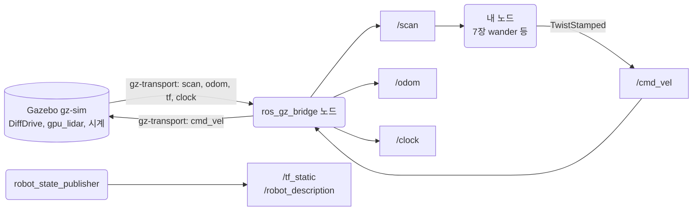
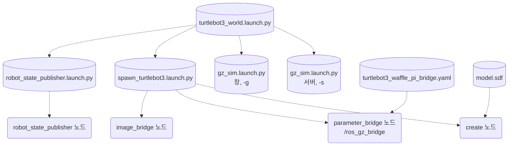
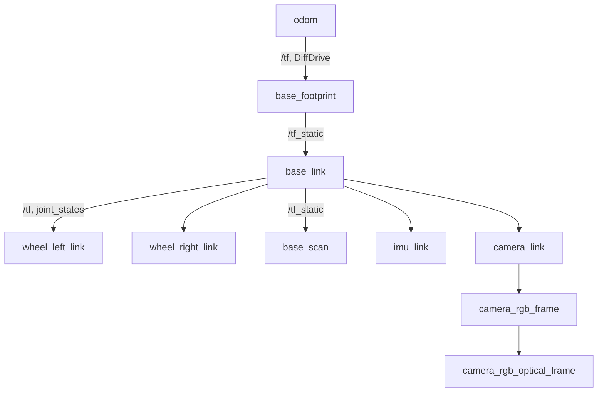

# 6장. 로봇과 시뮬레이터

- 원서: Chapter 6. Robots and Simulators, PDF p.97~118 (인쇄 쪽 = PDF 쪽 - 20)
- 선행 조건: 2~5장(토픽, 메시지 타입, 서비스, 액션)을 마쳤습니다. 이 장은 새 패키지를 만들지 않습니다.
- 새로 설치할 것: 없음 (`ros-jazzy-turtlebot3-gazebo`, `ros-jazzy-ros-gz`, `ros-jazzy-rviz2`, `ros-jazzy-rqt-graph`가 이미 설치되어 있습니다)

## 이 장에서 체감할 구조
로봇의 각 하위 시스템(구동, 센서, 자세 추정)은 결국 "토픽 이름 + 메시지 타입"으로 바깥에 드러납니다.
Gazebo는 ROS 노드가 아니며, 둘 사이는 `ros_gz_bridge`라는 별도 노드가 토픽 단위로 번역합니다.



그림에서 볼 것: Gazebo는 ROS 노드가 아니라 원통(외부 프로그램)입니다. ROS 쪽 토픽은 모두 `ros_gz_bridge` 노드에서 나오거나 그리로 들어갑니다. `/tf_static`과 `/robot_description`만 Gazebo와 무관하게 `robot_state_publisher`가 냅니다.

## 1. 목표와 개념
원서 6장은 코드를 거의 쓰지 않는 개념 장입니다. 로봇을 구동계, 센서, 계산 장치로 나누어 보고, 각 부분이 ROS에서 어떤 메시지 타입으로 표현되는지 정리한 뒤(원서 PDF p.98~108), 실제 로봇 몇 종(PR2, Fetch, Robonaut 2, TurtleBot, PDF p.108~112)과 시뮬레이터(Stage, Gazebo, PDF p.112~116)를 소개합니다.

이 가이드에서는 같은 목표를 "실행 중인 시뮬에서 직접 찾아보기"로 바꿉니다. 핵심 개념은 다음 다섯 가지입니다.

- **하위 시스템과 메시지 타입**: 바퀴 구동 명령은 `geometry_msgs/msg/TwistStamped`, 2D 레이저는 `sensor_msgs/msg/LaserScan`, 카메라는 `sensor_msgs/msg/Image`와 `CameraInfo`, 바퀴 엔코더로 추정한 위치는 `nav_msgs/msg/Odometry`, 관절 각도는 `sensor_msgs/msg/JointState`, 좌표계 사이 변환은 `tf2_msgs/msg/TFMessage`로 나옵니다. 타입이 정해져 있으므로 로봇이 바뀌어도 같은 노드를 그대로 쓸 수 있습니다.
- **브리지(bridge)**: Gazebo(현재 이름 Gazebo Sim, 명령은 `gz`)는 ROS와 다른 통신 계층(gz-transport)을 씁니다. `ros_gz_bridge` 패키지의 `parameter_bridge` 노드가 설정 파일에 적힌 토픽만 골라 양쪽 메시지를 변환합니다.
- **시뮬레이션 시간**: Gazebo는 자기 시계를 `/clock` 토픽으로 내보냅니다. 노드에 `use_sim_time:=true`를 주면 그 노드의 `get_clock().now()`가 벽시계 대신 `/clock`을 따릅니다.
- **좌표계 트리(TF)**: 움직이는 변환은 `/tf`, 로봇 몸체에 고정된 변환은 `/tf_static`으로 나갑니다. 로봇의 모양과 관절 구조는 URDF 문자열로 `/robot_description` 토픽에 실립니다.
- **QoS의 durability**: `/tf_static`과 `/robot_description`은 나중에 접속한 subscriber도 마지막 값을 받도록 TRANSIENT_LOCAL로 발행됩니다.

비유: 브리지는 두 나라 사이의 통역사입니다. 통역사 명단(yaml)에 없는 말은 건너가지 않습니다.

**브리지의 명단(yaml).** 명단은 항목마다 ROS 쪽 토픽 이름과 타입, Gazebo 쪽 토픽 이름과 타입, 방향을 적습니다. 방향이 `ROS_TO_GZ`이면 ROS의 메시지를 Gazebo로 넘기고, `GZ_TO_ROS`이면 반대입니다. 실습 6-3에서 읽는 파일의 `cmd_vel` 항목은 다음과 같습니다.

예:
```yaml
- ros_topic_name: "cmd_vel"
  gz_topic_name: "cmd_vel"
  ros_type_name: "geometry_msgs/msg/TwistStamped"
  gz_type_name: "gz.msgs.Twist"
  direction: ROS_TO_GZ
```

ROS 쪽 타입이 `TwistStamped`로 적혀 있으므로 `Twist`를 보내도 이 항목에는 전달되지 않습니다. 이 항목 하나가 `/cmd_vel`을 브리지의 subscriber로 만듭니다.

**launch 파일이 launch 파일을 부르는 구조.** `turtlebot3_world.launch.py` 하나가 Gazebo 서버와 창, 로봇 생성, 브리지, `robot_state_publisher`를 모두 띄웁니다. 직접 일을 하는 것이 아니라 다른 launch 파일을 포함(include)하는 방식입니다.



그림에서 볼 것: 점선은 "include" 또는 "읽는다"는 보조 관계입니다. 브리지와 image bridge는 `spawn_turtlebot3.launch.py` 안에서 시작되고, 브리지는 yaml을 설정으로 읽습니다. 실습 6-3에서 이 파일을 열어 같은 구조를 확인합니다.

예: 자식 launch 파일에 인자를 넘기는 부분입니다(`turtlebot3_world.launch.py`에서 가져왔습니다).
```python
IncludeLaunchDescription(
    PythonLaunchDescriptionSource(os.path.join(launch_file_dir, 'robot_state_publisher.launch.py')),
    launch_arguments={'use_sim_time': use_sim_time}.items())
```
`launch_arguments`로 `use_sim_time`이 자식 launch 파일로 전달되고, 거기서 `robot_state_publisher` 노드의 파라미터가 됩니다.

**시뮬레이션 시간 확인.** `/clock`은 브리지가 Gazebo의 시계를 내보낸 토픽이고, 노드가 이를 따르는지는 파라미터 하나로 정해집니다.

예:
```bash
ros2 param get /robot_state_publisher use_sim_time
```
`true`이면 그 노드의 `get_clock().now()`가 `/clock`을 따릅니다. 내 노드를 시뮬과 함께 쓸 때는 `--ros-args -p use_sim_time:=true`를 붙입니다.

**TF 트리.** TurtleBot3 Waffle Pi의 URDF는 `base_footprint`에서 시작해 `base_link` 아래에 바퀴와 센서가 매달린 구조입니다. URDF에는 `odom`이 없고, `odom`은 Gazebo의 DiffDrive가 `/tf`로 만들어 냅니다.



그림에서 볼 것: 상자는 토픽이 아니라 좌표계(frame)이고, 화살표는 "부모에서 자식으로의 변환"입니다. 움직이는 변환(`odom`→`base_footprint`, 바퀴)은 `/tf`로, 몸체에 고정된 변환은 `/tf_static`으로 나갑니다. 뒤쪽 보조 바퀴(caster) frame은 생략했습니다. LiDAR frame 이름이 `base_scan`이므로 `/scan` 메시지의 `header.frame_id`도 이 이름입니다.

예:
```bash
ros2 run tf2_ros tf2_echo odom base_scan
```
`odom`에서 `base_scan`까지 트리를 따라 내려가며 변환을 곱한 결과를 출력합니다. 중간 frame이 끊겨 있으면 이 명령이 변환을 찾지 못합니다.

**durability가 갈리는 토픽.** 한 번만 나오는 정보(`/tf_static`, `/robot_description`)는 TRANSIENT_LOCAL로, 계속 갱신되는 정보(`/tf`, `/scan`)는 VOLATILE로 나갑니다.

예:
```bash
ros2 topic info -v /tf_static
```
Publisher 항목의 Durability가 `TRANSIENT_LOCAL`입니다. 같은 명령을 `/tf`에 쓰면 `VOLATILE`이 나옵니다.

### 외부 패키지 구성: turtlebot3_gazebo
이 장은 패키지를 만들지 않으므로, 실습에서 계속 열어 보는 `turtlebot3_gazebo`의 설치된 모양을 봅니다. 위치는 `/opt/ros/jazzy/share/turtlebot3_gazebo/`입니다.

```text
turtlebot3_gazebo/
├── launch/    turtlebot3_world.launch.py (전체를 띄움), spawn_turtlebot3.launch.py,
│              robot_state_publisher.launch.py, empty_world / house / dqn_stage1~4 launch
├── models/    turtlebot3_waffle_pi/model.sdf 등 (Gazebo가 읽는 로봇 모델, 로봇 종류별 폴더)
├── params/    turtlebot3_waffle_pi_bridge.yaml 등 (브리지 명단, 로봇 종류별 파일)
├── rviz/      tb3_gazebo.rviz (8장에서 쓰는 rviz2 설정)
├── urdf/      turtlebot3_waffle_pi.urdf 등 (robot_state_publisher가 읽는 로봇 모델)
└── worlds/    turtlebot3_world.world 등 (Gazebo 월드)
```

- 같은 로봇이 SDF(`models/`)와 URDF(`urdf/`)로 두 번 적혀 있습니다. Gazebo는 SDF를, `robot_state_publisher`는 URDF를 읽습니다.
- launch 파일은 환경 변수 `TURTLEBOT3_MODEL`(여기서는 `waffle_pi`)로 `turtlebot3_<모델>`이라는 이름의 폴더와 파일을 고릅니다. 그래서 `~/.bashrc`의 이 값이 틀리면 엉뚱한 로봇이 뜨거나 파일을 찾지 못합니다.
- 이 폴더들은 패키지의 `share/` 아래에 설치된 것이므로, 2장에서 본 ament_python 패키지의 `share/<패키지>/launch/`와 같은 위치 규칙입니다.

### 실무 메모
- **`use_sim_time`은 시뮬을 바라보는 모든 노드에 줍니다.** 내 노드, rviz2, rqt 도구 하나라도 빠지면 그 노드만 벽시계를 써서 tf와 시각 비교가 어긋납니다. 헷갈리면 `ros2 param get <노드> use_sim_time`으로 노드마다 확인합니다.
- **토픽이 안 보이면 브리지 yaml부터 읽습니다.** Gazebo에 있는 토픽도 yaml에 없으면 ROS로 넘어오지 않습니다. 원본은 `/opt/ros` 아래 읽기 전용으로 두고, 바꿔 볼 때는 복사본을 만듭니다.
- **frame 이름은 관례를 따릅니다.** `odom`, `base_link` 같은 이름과 변환의 부모 자식 구조는 REP 105가 정합니다. 다른 로봇으로 바꿔도 같은 노드를 쓸 수 있는 이유 중 하나입니다.
- **launch 파일은 읽는 습관을 들입니다.** 외부 패키지의 launch 파일을 실행하기 전에 `ros2 launch turtlebot3_gazebo turtlebot3_world.launch.py --show-args`로 받는 인자를 보고, 파일을 열어 무엇을 포함하는지 확인하면 문제를 찾는 시간이 줄어듭니다.

## 2. 원서(ROS 1)와 달라지는 점
| 원서 (ROS 1) | ROS 2 Jazzy | 이유와 주의점 |
|---|---|---|
| Gazebo Classic + `gazebo_ros` 플러그인이 Gazebo 안에서 ROS 토픽을 직접 발행 (PDF p.116) | Gazebo Sim(gz) + 별도 노드 `ros_gz_bridge` | Gazebo 프로세스는 ROS 노드가 아닙니다. 브리지 노드를 끄면 토픽이 사라집니다. |
| 원서의 TurtleBot 시뮬은 Kinect 기반 가짜 레이저 | TurtleBot3 Waffle Pi의 360도 LiDAR(`hls_lfcd_lds`) | 각도 범위와 인덱스 의미가 달라집니다. 7장에서 다시 다룹니다. |
| `cmd_vel`은 `geometry_msgs/Twist` (PDF p.100) | TurtleBot3 Jazzy 시뮬은 `geometry_msgs/msg/TwistStamped` | 브리지 yaml에 TwistStamped로 적혀 있습니다. Twist를 보내면 아무 일도 일어나지 않습니다. |
| `/use_sim_time`은 파라미터 서버의 전역 값 | 노드마다 `use_sim_time` 파라미터 | 노드 하나라도 빠뜨리면 그 노드만 벽시계를 씁니다. |
| `roscore`가 이름을 중개 | 중개자 없이 DDS 탐색 | 이 가이드의 WSL 환경은 `RMW_IMPLEMENTATION=rmw_cyclonedds_cpp`를 씁니다([부록](appendix_wsl_environment.md) 참고). |
| Stage 시뮬레이터 (PDF p.113~114) | 이 가이드는 다루지 않음 | Jazzy용 Stage 바이너리가 없고, Gazebo만으로 이후 장을 모두 진행합니다. |

## 3. 실습

### 실습 6-1. 시뮬을 띄우고 노드와 토픽 목록 보기

> **미검증 실습**: 문서를 쓸 때 Gazebo 창과, Gazebo를 띄운 상태의 `ros2 node list` 목록을 실제로 실행해 확인하지 못했습니다. 결과가 문서와 다르면 문서가 틀렸을 수 있으니, 7절의 검증 기록과 비교해 보세요.

**준비**: 터미널 2개. 둘 다 `~/.bashrc`가 source 된 상태입니다.

**직접 입력** (터미널 1):
```bash
ros2 launch turtlebot3_gazebo turtlebot3_world.launch.py
```

**직접 입력** (터미널 2):
```bash
ros2 node list
ros2 topic list -t
```

**관찰**:
- Gazebo 창에 육각형 기둥들이 있는 월드와 Waffle Pi 로봇이 보입니다.
- `ros2 node list`에는 `/robot_state_publisher`, `/ros_gz_bridge`, 그리고 카메라 영상을 담당하는 image bridge 노드가 보입니다. Gazebo 자체는 목록에 없습니다.
- `ros2 topic list -t`에는 `/clock`, `/cmd_vel [geometry_msgs/msg/TwistStamped]`, `/scan`, `/odom`, `/imu`, `/joint_states`, `/tf`, `/tf_static`, `/robot_description`, `/camera/image_raw`, `/camera/camera_info`가 타입과 함께 나옵니다.

**생각해 볼 질문**: Gazebo가 시뮬레이션을 돌리고 있는데 왜 `ros2 node list`에는 Gazebo가 없을까요? (Q1)

### 실습 6-2. 하위 시스템과 토픽 짝짓기
**준비**: 실습 6-1의 시뮬이 실행 중입니다.

**직접 입력**: 아래 표를 공책에 옮겨 그리고, 빈칸을 `ros2 topic list -t`와 `ros2 interface show`로 채웁니다.

| 원서가 다루는 하위 시스템 | 원서 쪽 | 시뮬의 토픽 | 메시지 타입 | 방향(시뮬→ROS 또는 ROS→시뮬) |
|---|---|---|---|---|
| 바퀴 구동 명령 | PDF p.100 | | | |
| 카메라 영상 | PDF p.103 | | | |
| 카메라 보정 정보 | PDF p.103 | | | |
| 2D 레이저 | PDF p.105 | | | |
| 바퀴 엔코더 기반 위치 추정 | PDF p.106 | | | |
| 관절 상태 | PDF p.107 | | | |
| 관성 센서 | 원서에 별도 절 없음 | | | |
| 좌표계 변환 | PDF p.106 | | | |
| 시뮬레이션 시각 | PDF p.115 | | | |

필드를 확인할 때는 다음처럼 입력합니다.
```bash
ros2 interface show geometry_msgs/msg/TwistStamped
ros2 interface show sensor_msgs/msg/LaserScan
ros2 interface show nav_msgs/msg/Odometry
```

**관찰**:
- `TwistStamped`는 `header`(시각과 frame_id) 아래에 `twist`(linear, angular 각 3축)가 들어 있는 구조입니다.
- `LaserScan`에는 `angle_min`, `angle_max`, `angle_increment`, `range_min`, `range_max`, `ranges[]`가 있습니다. 7장에서 이 필드로 정면 거리를 구합니다.
- 원서가 소개하는 `PointCloud2`(PDF p.104)는 Waffle Pi 시뮬에 없습니다. 깊이 카메라가 없는 모델이기 때문입니다.

**생각해 볼 질문**: `Odometry` 메시지에는 `header.frame_id`와 `child_frame_id`가 둘 다 있습니다. 각각 무엇을 가리킬까요? (Q2)

### 실습 6-3. 브리지는 별도 노드다
**준비**: 시뮬 실행 중.

**직접 입력**:
```bash
cat /opt/ros/jazzy/share/turtlebot3_gazebo/params/turtlebot3_waffle_pi_bridge.yaml
ros2 node info /ros_gz_bridge
ros2 topic info -v /scan
ros2 topic info -v /cmd_vel
```

**관찰**:
- yaml에는 항목마다 `ros_topic_name`, `gz_topic_name`, `ros_type_name`, `gz_type_name`, `direction`이 있습니다. `cmd_vel`만 `ROS_TO_GZ`이고 나머지(`clock`, `joint_states`, `odom`, `tf`, `imu`, `scan`, `camera/camera_info`)는 `GZ_TO_ROS`입니다.
- `ros2 node info /ros_gz_bridge`의 Subscribers에는 `/cmd_vel` 하나, Publishers에는 yaml의 GZ_TO_ROS 토픽들이 나옵니다. 브리지가 평범한 ROS 노드라는 증거입니다.
- `topic info -v /scan`의 Publisher는 노드 이름 `ros_gz_bridge`, Reliability `RELIABLE`입니다.
- 카메라 영상 `/camera/image_raw`는 yaml에 없습니다. `ros_gz_image` 패키지의 image bridge 노드가 따로 담당합니다(`spawn_turtlebot3.launch.py` 안에서 실행됩니다).

```bash
cat /opt/ros/jazzy/share/turtlebot3_gazebo/launch/spawn_turtlebot3.launch.py
```
이 파일에서 `parameter_bridge`, `image_bridge`, 로봇을 월드에 넣는 `create` 실행이 각각 어디서 시작되는지 찾아봅니다.

**생각해 볼 질문**: yaml에서 `scan` 항목을 지우고 다시 실행하면 Gazebo의 LiDAR는 계속 동작할까요? ROS에서는 무엇이 달라질까요? (Q3)

### 실습 6-4. `gz topic -l`과 `ros2 topic list` 비교

> **미검증 실습**: 문서를 쓸 때 `gz topic -l` 전체 출력과 `gz topic -i -t /scan` 출력을 실제로 실행해 확인하지 못했습니다. 결과가 문서와 다르면 문서가 틀렸을 수 있으니, 7절의 검증 기록과 비교해 보세요.

**준비**: 시뮬 실행 중. 터미널 하나 더.

**직접 입력**:
```bash
gz topic -l
ros2 topic list
gz topic -i -t /scan
```

**관찰**:
- `gz topic -l`은 Gazebo 쪽 토픽을 보여 줍니다. ROS 쪽보다 훨씬 많습니다(월드 상태, 물리 통계, 장면 정보 등). 이 중 브리지 yaml에 적힌 것만 ROS로 넘어옵니다.
- `gz topic -i -t /scan`은 그 토픽의 Gazebo 쪽 publisher와 subscriber를 보여 줍니다. 브리지가 subscriber로 붙어 있는 것을 확인합니다.
- 같은 방법으로 `gz topic -i -t /odom`을 보면 DiffDrive 플러그인이 publisher이고 브리지가 subscriber입니다.
- `gz topic -e -t /stats -n 1`로 물리 통계를 한 번 출력하면 `real_time_factor`가 보입니다. 1.0에 가까우면 시뮬 시간이 실제 시간과 같은 속도로 흐르는 것입니다.

**생각해 볼 질문**: `gz topic -l`에는 있고 `ros2 topic list`에는 없는 토픽을 하나 고르고, ROS에서 보이게 하려면 무엇을 바꿔야 하는지 설명해 보세요. (Q4)

### 실습 6-5. `/clock`과 `use_sim_time`

> **미검증 실습**: 문서를 쓸 때 Gazebo를 띄운 상태의 `/clock` 관찰과 일시정지 때의 동작을 실제로 실행해 확인하지 못했습니다. 결과가 문서와 다르면 문서가 틀렸을 수 있으니, 7절의 검증 기록과 비교해 보세요.

**준비**: 시뮬 실행 중.

**직접 입력**:
```bash
ros2 topic echo /clock --once
ros2 topic hz /clock
ros2 param get /robot_state_publisher use_sim_time
ros2 param get /ros_gz_bridge use_sim_time
```

그다음 Gazebo 창 왼쪽 아래의 일시정지 버튼을 누르고, `ros2 topic echo /clock`을 다시 실행합니다. 확인이 끝나면 재생 버튼을 다시 누릅니다.

**관찰**:
- `/clock` 값은 Gazebo를 시작한 뒤 흐른 시뮬레이션 시간이라 몇 초에서 몇 분 정도의 작은 숫자입니다. 벽시계(1970년 기준 초)와 전혀 다릅니다.
- `robot_state_publisher`는 launch 파일에서 `use_sim_time`이 기본 `true`로 설정됩니다.
- 일시정지하면 `/clock`의 sec 값이 더 이상 증가하지 않습니다. `use_sim_time:=true`인 노드의 타이머도 이때 멈춥니다(7장에서 직접 확인합니다).

**생각해 볼 질문**: 내가 만든 노드를 `use_sim_time` 없이 실행하면, 그 노드가 메시지에 찍은 `header.stamp`와 `/scan`의 `header.stamp`는 어떤 관계가 될까요? (Q5)

### 실습 6-6. `/tf`, `/tf_static`, `/robot_description`

> **미검증 실습**: 문서를 쓸 때 시뮬에서 본 `/tf` publisher 목록, `tf2_echo odom base_scan` 값, `view_frames` PDF를 실제로 실행해 확인하지 못했습니다. 결과가 문서와 다르면 문서가 틀렸을 수 있으니, 7절의 검증 기록과 비교해 보세요.

**준비**: 시뮬 실행 중.

**직접 입력**:
```bash
ros2 topic info -v /tf_static
ros2 topic info -v /tf
ros2 topic echo /tf_static --once
ros2 topic echo /robot_description --once --field data | head -5
ros2 run tf2_ros tf2_echo odom base_scan
ros2 run tf2_tools view_frames
```

**관찰**:
- `/tf_static`의 publisher는 `robot_state_publisher` 하나이고 Durability가 `TRANSIENT_LOCAL`입니다. `/tf`의 publisher는 `robot_state_publisher`(바퀴 관절)와 `ros_gz_bridge`(Gazebo DiffDrive가 계산한 odom→base_footprint) 둘입니다.
- `/tf_static`의 frame_id가 `/base_footprint`, `/base_link`처럼 앞에 `/`가 붙어 있습니다. `robot_state_publisher.launch.py`가 `frame_prefix` 파라미터를 `/`로 넘기기 때문입니다(`ros2 param get /robot_state_publisher frame_prefix`로 확인). tf2는 이 앞 슬래시를 무시하고 이름을 맞추므로 `tf2_echo odom base_scan`은 정상으로 동작합니다.
- `tf2_echo odom base_scan`의 Translation은 시뮬을 띄운 뒤 로봇을 움직이지 않았다면 `[-0.064, 0.000, 0.132]` 근처입니다. DiffDrive는 시작할 때의 위치를 0으로 두고 바퀴 회전을 적분하므로, `odom` 좌표에서 로봇은 (0, 0)에서 출발합니다. 그래서 이 값은 base_footprint에서 base_scan까지의 고정 오프셋과 같습니다. x는 LiDAR 오프셋 -0.064이고, z는 0.132입니다(base_footprint→base_link 0.010 + base_link→base_scan 0.122).
- 이와 별개로 `odom` 원점 자체는 Gazebo 월드 좌표에서 로봇을 생성한 위치에 놓입니다. `turtlebot3_world.launch.py`가 넘기는 기본값은 `x_pose` -2.0, `y_pose` -0.5입니다. 따라서 Gazebo 창의 월드 좌표로는 로봇이 (-2.0, -0.5) 근처에 있지만, `odom` 좌표로는 (0, 0) 근처에 있습니다. `spawn_turtlebot3.launch.py`는 생성할 때 방향(yaw)을 주지 않으므로 두 좌표계의 축 방향은 같습니다. 로봇을 움직이면 두 좌표가 같은 양만큼 바뀌고, 바퀴 미끄러짐이 쌓이면 조금씩 어긋납니다.
- `view_frames`는 현재 디렉터리에 `frames_<날짜>.pdf`를 만듭니다. 트리의 뿌리가 `odom`이고 그 아래에 `base_footprint`, `base_link`, 센서 프레임들이 달린 구조를 확인합니다.
- `/robot_description`의 내용은 `<robot name="turtlebot3_waffle_pi">`로 시작하는 URDF XML입니다. URDF에는 `odom` 프레임이 없습니다. `odom`은 Gazebo의 DiffDrive가 `/tf`로 만들어 냅니다.

**생각해 볼 질문**: 시뮬을 띄우고 1분 뒤에 `ros2 topic echo /tf_static --once`를 실행해도 값이 바로 나옵니다. `/tf`와 무엇이 다를까요? (Q6)

### 실습 6-7. rqt_graph로 전체 그림 보기

> **미검증 실습**: 문서를 쓸 때 rqt_graph 화면을 실제로 실행해 확인하지 못했습니다. 결과가 문서와 다르면 문서가 틀렸을 수 있으니, 7절의 검증 기록과 비교해 보세요.

**준비**: 시뮬 실행 중.

**직접 입력**:
```bash
ros2 run rqt_graph rqt_graph --ros-args -p use_sim_time:=true
```

**관찰**: 왼쪽 위 콤보 상자를 "Nodes/Topics (all)"로 바꾸면 `/ros_gz_bridge`가 `/scan`, `/odom`, `/tf` 등으로 화살표를 내보내고 `/cmd_vel`을 받는 모습이 보입니다. 아직 `/cmd_vel`에 publisher가 없다는 것도 확인합니다. 7장과 8장에서 이 자리에 내 노드를 연결합니다.

**생각해 볼 질문**: 이 그래프에서 Gazebo는 어디에 나타나나요? 나타나지 않는다면 그 이유는 무엇인가요? (Q1과 같은 답입니다)

## 4. 일부러 망가뜨려 보기
| 바꿀 것 | 예상 증상 | 원인을 확인하는 명령 |
|---|---|---|
| 시뮬 실행 중 `ros2 topic pub -r 5 /cmd_vel geometry_msgs/msg/Twist "{linear: {x: 0.2}}"` (TwistStamped 대신 Twist) | 로봇이 움직이지 않습니다. 같은 토픽에 타입이 두 개 생깁니다. | `ros2 topic list -t`에 `/cmd_vel [geometry_msgs/msg/Twist, geometry_msgs/msg/TwistStamped]`, `ros2 topic info /cmd_vel`의 Type 목록, `ros2 topic echo /cmd_vel`은 "more than one type" 오류 |
| 토픽 이름 오타: `ros2 topic pub -r 5 /cmd_vell geometry_msgs/msg/TwistStamped "{twist: {linear: {x: 0.2}}}"` | 로봇이 움직이지 않습니다. 오류도 없습니다. | `ros2 topic info /cmd_vell`의 Subscription count: 0 |
| 브리지 노드만 종료: 다른 터미널에서 `pkill -INT -f parameter_bridge` | Gazebo는 계속 돌고 `gz topic -l`에도 `/scan`이 남지만, `ros2 node list`에서 `/ros_gz_bridge`가 사라지고 `/scan`, `/odom`이 더 이상 들어오지 않습니다. 시뮬을 다시 launch 하면 복구됩니다. (미검증) | `ros2 node list`, `ros2 topic hz /scan`, `gz topic -l` |
| `ros2 topic echo /robot_description --qos-durability volatile --once` | 아무것도 나오지 않고 멈춥니다(Ctrl-C로 종료). 기본 설정의 echo는 바로 나옵니다. | `ros2 topic info -v /robot_description`의 Durability |
| `ros2 topic echo /scan --qos-reliability best_effort --once`와 기본 echo 비교 | 둘 다 받습니다. publisher가 RELIABLE이면 best_effort subscriber와 호환되기 때문입니다. 반대 조합은 7장에서 봅니다. | `ros2 topic info -v /scan` |
| rviz2를 `use_sim_time` 없이 실행 (8장 실습 참고) | TF 관련 경고가 반복되고 레이저 점이 안 보이거나 깜박입니다. (미검증) | rviz2 왼쪽 아래 Global Status의 메시지 |

## 5. 확인 질문
<details><summary>Q1. Gazebo는 왜 ros2 node list에 없나요?</summary>

Gazebo Sim은 ROS 클라이언트 라이브러리를 쓰지 않는 독립 프로그램이고, 자기 통신 계층(gz-transport)으로 토픽을 주고받습니다. ROS 그래프에 나타나는 것은 그 사이를 잇는 `ros_gz_bridge`와 image bridge 노드뿐입니다. ROS 1의 `gazebo_ros`처럼 Gazebo 안에 ROS 노드를 넣는 방식이 아닙니다.

</details>

<details><summary>Q2. Odometry의 frame_id와 child_frame_id는?</summary>

`header.frame_id`는 위치(pose)를 표현하는 기준 좌표계로 여기서는 `odom`입니다. `child_frame_id`는 속도(twist)를 표현하는 로봇 몸체 좌표계로 여기서는 `base_footprint`입니다. 같은 관계가 `/tf`에도 odom→base_footprint 변환으로 나옵니다.

</details>

<details><summary>Q3. 브리지 yaml에서 scan을 지우면?</summary>

Gazebo 안의 LiDAR 센서는 그대로 동작하고 `gz topic -l`에도 계속 보입니다. 다만 ROS 쪽으로 번역해 주는 항목이 없으므로 `ros2 topic list`에서 `/scan`이 사라지고, `/scan`을 구독하는 노드는 아무것도 받지 못합니다. 원본 파일은 `/opt/ros` 아래라 수정하지 말고, 복사본을 만들어 `parameter_bridge`에 `-p config_file:=<복사본>`으로 넘겨 실험합니다.

</details>

<details><summary>Q4. Gazebo에만 있는 토픽을 ROS로 가져오려면?</summary>

브리지 yaml에 항목을 하나 추가합니다. ROS 토픽 이름, Gazebo 토픽 이름, 양쪽 타입, 방향(GZ_TO_ROS)을 적어야 하며, 두 타입 사이의 변환이 `ros_gz_bridge`에 구현되어 있어야 합니다. 지원 목록은 `ros2 run ros_gz_bridge parameter_bridge -h`의 안내와 패키지 README에 있습니다.

</details>

<details><summary>Q5. use_sim_time을 빠뜨린 노드의 stamp는?</summary>

내 노드는 벽시계(1970년 기준 약 17억 초)를 찍고, `/scan`은 시뮬 시간(몇십 초)을 찍습니다. 두 값의 차이가 수십 년이므로, 시각을 비교하는 tf2나 rviz2는 메시지를 "너무 오래됐다" 또는 "미래에서 왔다"고 판단해 버립니다.

</details>

<details><summary>Q6. /tf_static은 왜 늦게 접속해도 바로 받나요?</summary>

`/tf_static`의 publisher가 Durability를 TRANSIENT_LOCAL로 설정해, 마지막으로 보낸 메시지를 보관했다가 새로 붙은 subscriber에게 다시 보내 주기 때문입니다. 고정 변환은 한 번만 보내므로 이렇게 하지 않으면 나중에 켠 노드는 영원히 받지 못합니다. `/tf`는 VOLATILE이고 계속 새 값이 나오므로 보관할 필요가 없습니다.

</details>

## 6. 원서 대조 메모
- 원서의 하위 시스템 설명(PDF p.98~108)은 개념으로서 지금도 유효합니다. 다만 메시지 이름이 ROS 2에서 `패키지/msg/타입` 형식으로 바뀌었습니다.
- 원서는 TurtleBot 시뮬의 레이저를 Kinect 깊이 영상에서 만든 좁은 스캔으로 다룹니다. TurtleBot3 Waffle Pi는 360도 LiDAR라 각도 범위가 0에서 약 6.28 라디안이고 360개 샘플입니다. 이 차이는 7장의 정면 인덱스 계산에 직접 영향을 줍니다.
- 원서의 로봇 소개(PR2, Fetch, Robonaut 2, PDF p.108~112)와 Stage(PDF p.113~114)는 실습이 없으므로 이 가이드에서 생략했습니다. 관심 있으면 해당 쪽을 읽어 보면 됩니다.
- 원서는 `gazebo_ros`가 Gazebo 안에서 ROS 토픽을 직접 낸다고 설명합니다(PDF p.116). Jazzy의 Gazebo Sim에서는 이 역할을 별도 노드인 `ros_gz_bridge`가 맡습니다.
- 카메라 영상은 브리지 yaml이 아니라 `image_bridge` 노드가 담당한다는 점은 원서에 없는 내용입니다.

## 7. 이 문서의 검증 상태

<details><summary>검증 기록 펼치기</summary>

- 확인함:
  - 설치 버전: `apt-cache policy`로 `ros-jazzy-turtlebot3-gazebo` 2.3.7, `ros-jazzy-ros-gz-bridge` 1.0.24, `ros-jazzy-rviz2` 14.1.24, `ros-jazzy-rqt-graph` 1.5.6이 설치되어 있음을 확인했습니다.
  - 브리지 yaml 내용, `turtlebot3_world.launch.py`, `spawn_turtlebot3.launch.py`, `robot_state_publisher.launch.py`의 인자와 노드 구성을 파일을 직접 읽어 확인했습니다.
  - Gazebo 없이 `parameter_bridge`(같은 yaml)와 `robot_state_publisher` launch만 실행해 `ros2 topic list -t`, `ros2 node info /ros_gz_bridge`, `ros2 topic info -v /scan`(RELIABLE)과 `/cmd_vel`(TwistStamped, 브리지가 subscriber)을 확인했습니다. 브리지 로그의 "Creating GZ->ROS Bridge" 줄도 확인했습니다.
  - `/tf_static` frame_id의 앞 슬래시, `frame_prefix` 값 `/`, `/robot_description`이 기본 echo로는 늦게 접속해도 바로 나오고 `--qos-durability volatile`로는 나오지 않는 것을 확인했습니다(Cyclone DDS).
  - 가짜 `odom→base_footprint` 정적 변환을 주고 `tf2_echo odom base_scan`이 Translation `[-0.064, 0.000, 0.132]`를 내는 것을 확인했습니다.
  - Twist를 `/cmd_vel`에 보내면 타입이 두 개가 되고 echo가 "more than one type" 오류를 내는 것을 브리지만 띄운 상태에서 확인했습니다.
  - 상위 세션이 GPU 환경에서 시뮬을 띄워 `/stats`의 real_time_factor가 약 1.0이고, gz 쪽 `/odom`에 DiffDrive publisher와 브리지 subscriber가 함께 있음을 확인했습니다.
- 확인 못 함:
  - `robot_state_publisher`가 `/tf` publisher(VOLATILE)로 등록되는 것은 확인했지만, 가짜 `/joint_states`를 주었을 때 `/tf` echo에서 바퀴 변환을 받아 보지는 못했습니다(6초 안에 수신 없음, 원인 미확인).
  - Gazebo를 실제로 띄운 상태의 `ros2 node list` 정확한 목록(image bridge 노드 이름), `gz topic -l` 전체 출력, `gz topic -i -t /scan` 출력: 확인 못 함(시뮬 필요).
  - Gazebo 일시정지 시 `/clock` 정지, 실제 `tf2_echo odom base_scan` 값, 시뮬에서 `/tf`의 publisher가 브리지와 robot_state_publisher 둘인지: 확인 못 함(시뮬 필요).
  - `view_frames` PDF, rqt_graph 화면, rviz2 경고: 확인 못 함(GUI).
  - 브리지 노드만 끄는 실험의 정확한 증상: 확인 못 함(시뮬 필요).
- 설명 보강(2026-10-30): "이 장에서 체감할 구조"와 1절에 그림, 코드 예시, 코드와 폴더 구조, 실무 메모를 더했습니다. 머리말과 2~6절은 바꾸지 않았습니다. 1절의 코드 예시는 따로 실행하지 않았습니다.
- 결함 수정(2026-10-31): 실습 6-6에서 `tf2_echo odom base_scan`의 x가 생성 위치 -2.0을 포함한다고 쓴 설명을 고쳤습니다. 로봇이 움직이지 않았다면 Translation은 `[-0.064, 0.000, 0.132]` 근처이고, 생성 위치 (-2.0, -0.5)는 Gazebo 월드 좌표에서 `odom` 원점이 놓이는 곳이라고 나눠 적었습니다. 근거는 `turtlebot3_gazebo/models/turtlebot3_waffle_pi/model.sdf`의 DiffDrive 설정(`frame_id` odom, `child_frame_id` base_footprint, `tf_topic` /tf), 위치를 0에서 적분하는 DiffDrive 오도메트리 동작(`gz/math/DiffDriveOdometry.hh`에는 초기 위치를 정하는 함수가 없음), `turtlebot3_world.launch.py`의 `x_pose` -2.0, `y_pose` -0.5 기본값, `spawn_turtlebot3.launch.py`의 `create` 인자(yaw 없음), URDF의 `base_joint` 0.010과 `scan_joint` 0.122입니다. 시뮬은 실행하지 않았습니다. 실제 시뮬이 필요한 실습 6-1, 6-4, 6-5, 6-6, 6-7과 4절의 브리지 종료, rviz2 경고 행에 미검증 표시를 달았습니다.

</details>
