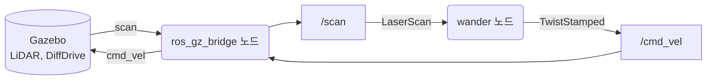
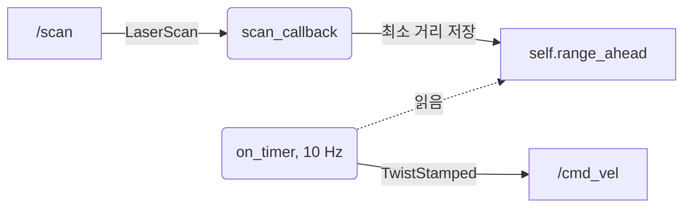
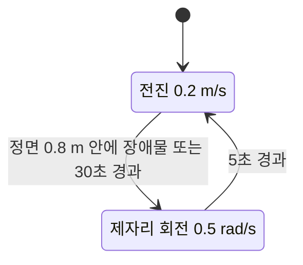

# 7장. Wander-bot

- 원서: Chapter 7. Wander-bot, PDF p.119~128 (인쇄 쪽 = PDF 쪽 - 20)
- 선행 조건: 6장을 마쳐 TurtleBot3 시뮬의 토픽 구성을 알고 있습니다. `~/rosbook_ws/src`가 있습니다.
- 새로 설치할 것: 없음

## 이 장에서 체감할 구조
내 노드 하나가 `/scan`(LaserScan)을 구독하고 `/cmd_vel`(TwistStamped)을 발행하면, 브리지를 거쳐 Gazebo의 로봇이 움직입니다.
노드 안에서는 "콜백이 최신 센서값을 저장하고, 타이머가 그 값으로 명령을 낸다"는 두 갈래 흐름이 돕니다.



그림에서 볼 것: 감지(`/scan`), 판단(`wander` 노드), 행동(`/cmd_vel`)이 한 바퀴 돌아 Gazebo로 되돌아오는 고리입니다. 내 코드는 가운데 노드 하나뿐이고 나머지는 6장에서 본 연결입니다.

## 1. 목표와 개념
원서 7장은 세 단계로 "장애물 앞에서 돌아서는 로봇"을 만듭니다. 시간에 따라 멈춤과 전진을 바꾸는 노드(PDF p.120~122), 레이저에서 정면 거리를 읽는 노드(PDF p.123~126), 둘을 합친 배회 노드(PDF p.126~127)입니다. 이 가이드도 같은 세 단계를 rclpy로 새로 작성합니다.

- **타이머 기반 루프**: ROS 1 예제는 `while` 루프와 `rate.sleep()`을 씁니다. rclpy에서는 `create_timer(주기, 콜백)`으로 주기 작업을 등록하고 `rclpy.spin()`이 콜백을 불러 줍니다. 구독 콜백과 타이머 콜백이 같은 실행기에서 차례로 돌기 때문에 공유 변수를 잠그지 않아도 됩니다.
- **시간 비교**: `self.get_clock().now()`는 `Time` 객체이고, `Duration(seconds=3.0)`을 더하거나 다른 `Time`과 대소 비교할 수 있습니다. `use_sim_time:=true`이면 이 시계가 `/clock`을 따릅니다.
- **레이저 인덱스와 각도**: `ranges[i]`의 방향은 `angle_min + i * angle_increment`입니다. 정면(0 라디안)의 인덱스는 `(0 - angle_min) / angle_increment`입니다. 센서마다 `angle_min`이 다르므로 "가운데 인덱스가 정면"이라고 가정하면 안 됩니다.
- **센서 데이터 QoS**: 센서 토픽은 최신 값이 중요하고 지난 값을 재전송할 이유가 적습니다. rclpy의 `qos_profile_sensor_data`는 BEST_EFFORT, KEEP_LAST 5, VOLATILE입니다. BEST_EFFORT subscriber는 RELIABLE publisher와도, BEST_EFFORT publisher와도 연결되므로 센서 구독에 쓰기 좋습니다.

비유: 구독 콜백은 계기판의 바늘을 갱신하는 사람이고, 타이머는 0.1초마다 계기판을 보고 핸들을 조작하는 운전자입니다.

**타이머가 루프를 대신합니다.** 주기 작업은 노드를 만들 때 한 번 등록하고, 이후 호출은 `spin`이 맡습니다.

예:
```python
self.timer = self.create_timer(0.1, self.on_timer)
```
0.1초마다 `on_timer`가 불리므로 10 Hz로 `/cmd_vel`이 나갑니다. `while` 루프가 없으니 같은 노드의 구독 콜백도 막히지 않고 돕니다.

**시간 비교는 `Time`과 `Duration`으로 합니다.**

예:
```python
self.light_change_time = self.get_clock().now() + Duration(seconds=3.0)
```
`now()`에 `Duration`을 더하면 3초 뒤의 `Time`이 되고, `if now > self.light_change_time:`처럼 비교할 수 있습니다. 이 시계가 `use_sim_time`을 따르므로 Gazebo를 멈추면 이 3초도 멈춥니다.

**한 노드 안의 두 갈래 흐름.** `wander` 노드에서는 구독 콜백과 타이머 콜백이 같은 객체의 변수 하나를 사이에 두고 만납니다. 콜백은 쓰기만, 타이머는 읽기만 합니다.



그림에서 볼 것: 이 그림의 `self.range_ahead`는 토픽이 아니라 노드 안의 변수입니다. 센서가 10 Hz로 오든 불규칙하게 오든, 명령은 타이머 주기대로 일정하게 나갑니다. 둘이 같은 실행기에서 차례로 불리므로 변수를 잠글 필요가 없습니다.

예:
```python
self.range_ahead = min(valid) if valid else msg.range_max
```
```python
if self.range_ahead < 0.8 or now > self.state_change_time:
```
첫 줄은 `scan_callback`의 마지막 줄이고, 둘째 줄은 `on_timer`가 그 값을 꺼내 쓰는 곳입니다.

**배회 노드의 상태.** `wander`의 판단은 전진과 회전 두 상태를 `driving_forward` 변수로 구분하고, 상태마다 "언제 바뀌는가"를 시각(`state_change_time`)으로 기억합니다.



그림에서 볼 것: 회전에서 전진으로 돌아올 때 앞이 아직 막혀 있으면 다음 주기에 곧바로 다시 회전합니다(실습 7-5 관찰). 그래서 회전이 끝나는 조건은 시간 하나뿐입니다.

**정면 인덱스는 메시지 안의 값으로 계산합니다.**

예:
```python
index = round((0.0 - msg.angle_min) / msg.angle_increment)
```
Waffle Pi는 `angle_min`이 0이라 `index`가 0이고, 실습 7-4의 가짜 스캔은 `angle_min`이 -0.5라 2가 나옵니다. 같은 식이 두 센서에서 모두 정면을 고릅니다.

**센서 구독에는 센서용 QoS를 씁니다.**

예:
```python
self.scan_sub = self.create_subscription(
    LaserScan, 'scan', self.scan_callback, qos_profile_sensor_data)
```
네 번째 인자가 숫자 `10` 대신 프로필입니다. 브리지가 내는 `/scan`은 RELIABLE이고 이 구독은 BEST_EFFORT인데도 연결되는 것을 `ros2 topic info -v /scan`으로 확인합니다.

### 코드와 폴더 구조
이 장에서 `~/rosbook_ws/src/wander_bot/` 패키지가 처음 생깁니다. ament_python 패키지의 기본 구조는 2장과 3장에서 설명했으므로, 이 장에서 더해지는 파일과 노드 코드의 달라진 점만 적습니다.

```text
wander_bot/
├── package.xml                      7-1  의존성 rclpy, geometry_msgs, sensor_msgs
├── setup.py                         7-1  생성, 7-2에서 entry_points에 노드 3개 등록
├── setup.cfg                        7-1  실행 파일 설치 위치 지정
├── resource/wander_bot              7-1  패키지 표식 파일
├── test/                            7-1  코드 스타일 검사 3개
└── wander_bot/
    ├── __init__.py                  7-1  빈 파일
    ├── red_light_green_light.py     7-2  시간만 보고 3초마다 정지와 전진
    ├── range_ahead.py               7-4  /scan 구독, 정면 거리 출력
    └── wander.py                    7-5  구독과 발행을 합친 배회 노드
```

- 빌드하면 실행 파일 세 개(`red_light_green_light`, `range_ahead`, `wander`)가 `install/wander_bot/lib/wander_bot/` 아래에 생기고, `ros2 run wander_bot wander`가 그것을 찾아 실행합니다. 이 위치는 3장에서 본 `install/basics/lib/basics/`와 같은 규칙입니다.
- 노드 파일은 단계마다 하나씩 늘어납니다. `red_light_green_light`는 발행만, `range_ahead`는 구독만, `wander`는 둘을 한 클래스에 합칩니다. 앞 장까지는 publisher 노드와 subscriber 노드가 따로였고, 처음으로 한 노드가 입력과 출력을 모두 가집니다.
- 3장 구조에 더해지는 것은 두 가지입니다. 하나는 구독 콜백과 타이머 콜백이 상태 변수를 공유하는 뼈대이고, 다른 하나는 `driving_forward`와 `state_change_time`으로 만든 상태 기계입니다. 노드의 `main`은 6절 기본 형태 그대로입니다.

### 실무 메모
- **센서 콜백은 짧게 끝냅니다.** 콜백이 오래 걸리면 같은 실행기의 타이머와 다른 콜백이 줄줄이 늦어집니다. 이 장의 `scan_callback`은 값을 계산해 저장만 하고, 명령은 타이머가 냅니다.
- **속도 명령은 일정한 주기로 내고, 멈춤도 명령으로 보냅니다.** 정지 상태에서도 0을 계속 보내야 받는 쪽이 "멈추라"는 뜻인지 "끊겼다"는 뜻인지 구분할 수 있습니다. 이 장의 노드는 종료할 때 0을 보내지 않으므로(4절), 실제 로봇을 다룰 때는 종료 처리에서 정지 명령을 내는 것이 관례입니다.
- **센서 구독은 `qos_profile_sensor_data`로 시작합니다.** 실제 센서 드라이버는 BEST_EFFORT로 내는 경우가 많고, 그러면 기본 QoS(RELIABLE)로 구독한 노드와는 연결되지 않습니다. 이 시뮬의 `/scan`은 RELIABLE이라 어느 쪽이든 연결되지만, 로봇을 바꿔도 되도록 센서용 프로필을 씁니다. 연결이 안 되면 `ros2 topic info -v`로 양쪽 Reliability부터 봅니다.
- **먼저 가짜 입력으로 시험합니다.** 이 장처럼 `ros2 topic pub`으로 가짜 `/scan`을 넣어 노드의 판단을 확인하고 나서 시뮬에 붙이면, 코드 문제와 시뮬 문제를 나눠서 찾을 수 있습니다.
- **고정 숫자는 한곳에 모읍니다.** 0.8 m, 30초, 0.2 m/s 같은 값이 코드 곳곳에 흩어져 있으면 바꾸기 어렵습니다. 다음 8장에서 이런 값을 파라미터로 뺍니다.

## 2. 원서(ROS 1)와 달라지는 점
| 원서 (ROS 1) | ROS 2 Jazzy | 이유와 주의점 |
|---|---|---|
| `geometry_msgs/Twist`를 `cmd_vel`에 발행 | `geometry_msgs/msg/TwistStamped` | TurtleBot3 Jazzy 브리지가 TwistStamped를 받습니다. 값은 `msg.twist.linear.x`처럼 한 단계 안쪽에 넣습니다. |
| `while not rospy.is_shutdown()` + `rospy.Rate(10)` | `create_timer(0.1, 콜백)` + `rclpy.spin()` | 루프를 직접 돌리면 구독 콜백이 처리되지 않습니다. |
| `rospy.Time.now()` | `self.get_clock().now()` | 노드 시계라서 `use_sim_time`을 따릅니다. |
| 정면 = `ranges[len(ranges)/2]` (Kinect 가짜 스캔) | 정면 인덱스를 `angle_min`, `angle_increment`로 계산 | Waffle Pi LiDAR는 0~6.28 라디안, 360개 샘플이라 정면이 인덱스 0입니다. |
| 구독 QoS 지정 없음 | `qos_profile_sensor_data` | 6.4절과 4절 참고. |
| `chmod +x` 후 `rosrun` | `setup.py`의 `console_scripts` 등록 후 `ros2 run` | ament_python 패키지는 설치 단계에서 실행 파일을 만듭니다. |
| 전진 속도 1 m/s (PDF p.126) | 0.2 m/s | 실물 Waffle Pi 최고 속도는 0.26 m/s입니다(`turtlebot3_teleop` 코드의 상수). |

## 3. 실습

### 실습 7-1. wander_bot 패키지 만들기
**준비**: 터미널 1개.

**직접 입력**:
```bash
cd ~/rosbook_ws/src
ros2 pkg create --build-type ament_python --license Apache-2.0 \
  --dependencies rclpy geometry_msgs sensor_msgs -- wander_bot
ls wander_bot wander_bot/wander_bot
```

**관찰**:
- `package.xml`, `setup.py`, `setup.cfg`, `resource/wander_bot`, `test/` 세 파일, 그리고 소스 디렉터리 `wander_bot/wander_bot/__init__.py`가 생깁니다.
- `package.xml`에는 `<depend>rclpy</depend>`, `<depend>geometry_msgs</depend>`, `<depend>sensor_msgs</depend>`가 이미 들어 있으므로 따로 고칠 것이 없습니다.
- `setup.py`의 `entry_points`에 `'console_scripts': [ ],`가 비어 있습니다. 노드를 만들 때마다 여기에 한 줄씩 추가합니다.

**생각해 볼 질문**: `--dependencies`에 `sensor_msgs`를 빠뜨리면 빌드는 될까요? 무엇이 문제가 될까요? (Q1)

### 실습 7-2. red_light_green_light: 시간으로 멈춤과 전진 바꾸기

> **미검증 실습**: 문서를 쓸 때 Gazebo 시뮬에서 로봇이 3초 전진하고 3초 정지하는 동작을 실제로 실행해 확인하지 못했습니다. 결과가 문서와 다르면 문서가 틀렸을 수 있으니, 7절의 검증 기록과 비교해 보세요.

**준비**: 실습 7-1의 패키지.

**직접 입력**: `~/rosbook_ws/src/wander_bot/wander_bot/red_light_green_light.py`
```python
from geometry_msgs.msg import TwistStamped
import rclpy
from rclpy.duration import Duration
from rclpy.executors import ExternalShutdownException
from rclpy.node import Node


class RedLightGreenLight(Node):
    def __init__(self):
        super().__init__('red_light_green_light')
        self.cmd_vel_pub = self.create_publisher(TwistStamped, 'cmd_vel', 1)
        self.driving_forward = False
        self.light_change_time = self.get_clock().now() + Duration(seconds=3.0)
        self.timer = self.create_timer(0.1, self.on_timer)

    def on_timer(self):
        now = self.get_clock().now()
        if now > self.light_change_time:
            self.driving_forward = not self.driving_forward
            self.light_change_time = now + Duration(seconds=3.0)
            self.get_logger().info('green' if self.driving_forward else 'red')

        msg = TwistStamped()
        msg.header.stamp = now.to_msg()
        if self.driving_forward:
            msg.twist.linear.x = 0.2
        self.cmd_vel_pub.publish(msg)


def main(args=None):
    rclpy.init(args=args)
    node = RedLightGreenLight()
    try:
        rclpy.spin(node)
    except (KeyboardInterrupt, ExternalShutdownException):
        pass
    finally:
        node.destroy_node()
        rclpy.try_shutdown()


if __name__ == '__main__':
    main()
```

**줄 단위 해설**:
| 줄 | 설명 |
|---|---|
| 1~5 | 메시지 타입, rclpy, 시간 간격 `Duration`, 종료 예외, `Node`를 가져옵니다. 가져오는 순서는 ament_flake8 검사 규칙(알파벳 순)에 맞춘 것입니다. |
| 10 | 노드 이름을 `red_light_green_light`로 정합니다. `ros2 node list`에 이 이름이 나옵니다. |
| 11 | `cmd_vel` 토픽에 TwistStamped publisher를 만듭니다. 이름 앞에 `/`가 없으므로 노드의 네임스페이스를 따릅니다(지금은 `/cmd_vel`). 큐 깊이 1은 오래된 명령을 쌓아 둘 필요가 없다는 뜻입니다. |
| 12~13 | 처음에는 정지 상태이고, 3초 뒤에 첫 신호 변경이 일어나도록 변경 시각을 정합니다. |
| 14 | 0.1초마다 `on_timer`를 부르는 타이머입니다. 이것이 ROS 1의 `Rate(10)` 루프를 대신합니다. |
| 17~21 | 현재 시각이 변경 시각을 지났으면 상태를 뒤집고 다음 변경 시각을 3초 뒤로 잡습니다. 상태가 바뀔 때만 로그를 남깁니다. |
| 23~27 | 매 주기마다 명령을 새로 만들어 보냅니다. stamp에 현재 시각을 넣고, 전진 상태면 0.2 m/s, 아니면 0(정지)을 보냅니다. 정지 명령도 계속 보내야 로봇이 "명령이 끊겼다"와 "멈추라"를 구분할 수 있습니다. |
| 30~43 | CONVENTIONS의 기본 `main` 형태입니다. |

`~/rosbook_ws/src/wander_bot/setup.py`의 `entry_points`를 다음처럼 고칩니다(이 장의 세 노드를 한 번에 등록해 둡니다).
```python
    entry_points={
        'console_scripts': [
            'red_light_green_light = wander_bot.red_light_green_light:main',
            'range_ahead = wander_bot.range_ahead:main',
            'wander = wander_bot.wander:main',
        ],
    },
```
아직 `range_ahead.py`, `wander.py`가 없어도 빌드는 성공합니다. 다만 그 실행 파일을 실행하면 모듈을 찾지 못한다는 오류가 납니다.

빌드합니다.
```bash
cd ~/rosbook_ws && colcon build --symlink-install --packages-select wander_bot
source ~/rosbook_ws/install/setup.bash
```

먼저 시뮬 없이 노드만 확인합니다(터미널 1, 2).
```bash
ros2 run wander_bot red_light_green_light
```
```bash
ros2 node info /red_light_green_light
ros2 topic hz /cmd_vel
ros2 topic echo /cmd_vel --field twist.linear.x
```

그다음 시뮬을 띄우고(터미널 1에서 `ros2 launch turtlebot3_gazebo turtlebot3_world.launch.py`), 터미널 2에서 시뮬 시간을 쓰도록 실행합니다.
```bash
ros2 run wander_bot red_light_green_light --ros-args -p use_sim_time:=true
```

**관찰**:
- 로그에 `green`, `red`, `green`이 약 3초 간격으로 나옵니다.
- `ros2 node info`의 Publishers에 `/cmd_vel: geometry_msgs/msg/TwistStamped`가 있습니다.
- `topic hz`는 약 10 Hz, `echo`는 0.0과 0.2가 번갈아 30줄씩 나옵니다.
- 시뮬에서는 로봇이 3초 전진, 3초 정지를 반복합니다. 앞에 기둥이 있으면 부딪힙니다. 이 노드는 센서를 보지 않기 때문입니다.

**생각해 볼 질문**: 시뮬 없이 `--ros-args -p use_sim_time:=true`를 붙여 실행하면 어떻게 될까요? (Q2)

### 실습 7-3. 모델 파일에서 LiDAR의 정면 찾기
**준비**: 터미널 1개.

**직접 입력**:
```bash
SDF=/opt/ros/jazzy/share/turtlebot3_gazebo/models/turtlebot3_waffle_pi/model.sdf
grep -n -A 25 'hls_lfcd_lds' $SDF | grep -E 'sensor|pose|update_rate|topic|samples|min_angle|max_angle|<min>|<max>|frame'
```

**관찰**:
- 센서 종류는 `gpu_lidar`, 토픽은 `scan`, 갱신 주기는 10 Hz, 프레임은 `base_scan`입니다. `pose`의 -0.064는 LiDAR가 로봇 중심보다 6.4 cm 뒤에 달려 있다는 뜻입니다.
- 같은 디렉터리에 `model-1_4_.sdf`도 있지만, `spawn_turtlebot3.launch.py`가 읽는 파일은 `model.sdf`입니다.
- `samples` 360, `min_angle` 0.0, `max_angle` 6.28입니다. 즉 `angle_min`이 0이고 반시계 방향으로 한 바퀴를 돕니다.
- 거리 범위는 0.12~3.5 m입니다. 이 범위를 벗어나면 `ranges`에 `inf`가 들어갑니다.
- 그러므로 정면(0 라디안)은 인덱스 0, 왼쪽(+90도)은 약 90, 뒤쪽은 약 180, 오른쪽은 약 270입니다. 원서처럼 가운데 인덱스(180)를 쓰면 로봇 **뒤쪽** 거리를 읽게 됩니다.

**생각해 볼 질문**: 정면 근처 ±15도를 보려면 어떤 인덱스들을 봐야 하나요? 인덱스가 음수가 되는 부분은 어떻게 처리할까요? (Q3)

### 실습 7-4. range_ahead: 정면 거리 읽기

> **미검증 실습**: 문서를 쓸 때 range_ahead 노드를 시뮬에 붙여 실행하는 부분(시뮬에서 `index 0 / 360`이 나오는 관찰 항목)을 실제로 실행해 확인하지 못했습니다. 결과가 문서와 다르면 문서가 틀렸을 수 있으니, 7절의 검증 기록과 비교해 보세요.

**준비**: 실습 7-2까지 빌드된 상태.

**직접 입력**: `~/rosbook_ws/src/wander_bot/wander_bot/range_ahead.py`
```python
import rclpy
from rclpy.executors import ExternalShutdownException
from rclpy.node import Node
from rclpy.qos import qos_profile_sensor_data
from sensor_msgs.msg import LaserScan


class RangeAhead(Node):
    def __init__(self):
        super().__init__('range_ahead')
        self.scan_sub = self.create_subscription(
            LaserScan, 'scan', self.scan_callback, qos_profile_sensor_data)

    def scan_callback(self, msg):
        index = round((0.0 - msg.angle_min) / msg.angle_increment)
        range_ahead = msg.ranges[index]
        self.get_logger().info(
            f'range ahead: {range_ahead:.2f} m (index {index} / {len(msg.ranges)})')


def main(args=None):
    rclpy.init(args=args)
    node = RangeAhead()
    try:
        rclpy.spin(node)
    except (KeyboardInterrupt, ExternalShutdownException):
        pass
    finally:
        node.destroy_node()
        rclpy.try_shutdown()


if __name__ == '__main__':
    main()
```

**줄 단위 해설**:
| 줄 | 설명 |
|---|---|
| 4 | 센서용 QoS 프로필을 가져옵니다(BEST_EFFORT, KEEP_LAST 5, VOLATILE). |
| 11~12 | `scan` 토픽을 LaserScan 타입으로 구독합니다. 네 번째 인자가 QoS입니다. 메시지가 오면 `scan_callback`이 불립니다. |
| 15 | 0 라디안 방향의 인덱스를 계산합니다. 각도는 `angle_min + i * angle_increment`이므로 이를 i에 대해 푼 식입니다. 소수 오차 때문에 `round`를 씁니다. |
| 16 | 그 인덱스의 거리입니다. 범위를 벗어나면 `inf`입니다. |
| 17~18 | 거리와 인덱스, 전체 샘플 수를 함께 찍어 계산이 맞는지 눈으로 확인합니다. |

빌드는 `--symlink-install`이므로 새 파일을 추가했어도 `setup.py`를 이미 고쳐 두었다면 다시 빌드만 하면 됩니다.
```bash
cd ~/rosbook_ws && colcon build --symlink-install --packages-select wander_bot
```

먼저 가짜 스캔으로 시험합니다. 터미널 1에서 노드를 실행합니다.
```bash
ros2 run wander_bot range_ahead
```
터미널 2에서 각도 -0.5~0.5 라디안, 다섯 칸짜리 스캔을 초당 5번 보냅니다.
```bash
ros2 topic pub -r 5 /scan sensor_msgs/msg/LaserScan \
  "{angle_min: -0.5, angle_increment: 0.25, range_min: 0.1, range_max: 10.0, ranges: [3.0, 2.0, 0.5, 2.0, 3.0]}"
```
터미널 3에서 연결 상태를 봅니다.
```bash
ros2 topic info -v /scan
```

그다음 가짜 publisher를 끄고 시뮬을 띄운 뒤 다시 실행합니다.
```bash
ros2 run wander_bot range_ahead --ros-args -p use_sim_time:=true
```

**관찰**:
- 가짜 스캔에서는 `range ahead: 0.50 m (index 2 / 5)`가 반복됩니다. 이 스캔은 가운데가 정면이라 인덱스 2가 나옵니다.
- `topic info -v`에서 publisher(`ros2 topic pub`)는 RELIABLE, subscriber(`range_ahead`)는 BEST_EFFORT입니다. 그래도 연결됩니다.
- 시뮬에서는 `index 0 / 360`이 나옵니다. 로봇 정면에 기둥이 있으면 그 거리가, 3.5 m 안에 아무것도 없으면 `inf`가 나옵니다.

**생각해 볼 질문**: 같은 코드가 두 센서에서 서로 다른 인덱스를 고르는데도 둘 다 정면을 가리킵니다. 원서의 "가운데 인덱스" 방식과 비교해 어떤 점이 나은가요? (Q4)

### 실습 7-5. wander: 피하면서 돌아다니기

> **미검증 실습**: 문서를 쓸 때 시뮬에서 로봇이 기둥 앞에서 멈추고 돌아서는 동작과 rqt_graph 화면을 실제로 실행해 확인하지 못했습니다. 결과가 문서와 다르면 문서가 틀렸을 수 있으니, 7절의 검증 기록과 비교해 보세요.

**준비**: 실습 7-4까지 빌드된 상태.

**직접 입력**: `~/rosbook_ws/src/wander_bot/wander_bot/wander.py`
```python
import math

from geometry_msgs.msg import TwistStamped
import rclpy
from rclpy.duration import Duration
from rclpy.executors import ExternalShutdownException
from rclpy.node import Node
from rclpy.qos import qos_profile_sensor_data
from sensor_msgs.msg import LaserScan


class Wander(Node):
    def __init__(self):
        super().__init__('wander')
        self.cmd_vel_pub = self.create_publisher(TwistStamped, 'cmd_vel', 1)
        self.scan_sub = self.create_subscription(
            LaserScan, 'scan', self.scan_callback, qos_profile_sensor_data)
        self.range_ahead = 1.0
        self.driving_forward = True
        self.state_change_time = self.get_clock().now() + Duration(seconds=30.0)
        self.timer = self.create_timer(0.1, self.on_timer)

    def scan_callback(self, msg):
        center = round((0.0 - msg.angle_min) / msg.angle_increment)
        half_width = round(math.radians(15.0) / msg.angle_increment)
        n = len(msg.ranges)
        front = [msg.ranges[(center + k) % n] for k in range(-half_width, half_width + 1)]
        valid = [r for r in front if msg.range_min <= r <= msg.range_max]
        self.range_ahead = min(valid) if valid else msg.range_max

    def on_timer(self):
        now = self.get_clock().now()
        if self.driving_forward:
            if self.range_ahead < 0.8 or now > self.state_change_time:
                self.driving_forward = False
                self.state_change_time = now + Duration(seconds=5.0)
                self.get_logger().info(f'spin (range ahead {self.range_ahead:.2f} m)')
        else:
            if now > self.state_change_time:
                self.driving_forward = True
                self.state_change_time = now + Duration(seconds=30.0)
                self.get_logger().info('drive forward')

        msg = TwistStamped()
        msg.header.stamp = now.to_msg()
        if self.driving_forward:
            msg.twist.linear.x = 0.2
        else:
            msg.twist.angular.z = 0.5
        self.cmd_vel_pub.publish(msg)


def main(args=None):
    rclpy.init(args=args)
    node = Wander()
    try:
        rclpy.spin(node)
    except (KeyboardInterrupt, ExternalShutdownException):
        pass
    finally:
        node.destroy_node()
        rclpy.try_shutdown()


if __name__ == '__main__':
    main()
```

**줄 단위 해설**:
| 줄 | 설명 |
|---|---|
| 15~17 | 한 노드 안에 publisher와 subscriber를 둘 다 둡니다. 센서 구독은 센서용 QoS입니다. |
| 18 | 첫 스캔이 오기 전에는 "앞이 1 m 비어 있다"고 가정합니다. |
| 19~20 | 처음에는 전진 상태이고, 최대 30초 전진하면 한 번 돌도록 시각을 잡습니다. 같은 방향으로 영원히 가는 것을 막는 장치입니다. |
| 24 | 정면 인덱스를 실습 7-4와 같은 방식으로 구합니다. |
| 25 | ±15도에 해당하는 인덱스 개수입니다. 1도 간격 LiDAR면 15입니다. |
| 27 | 정면 중심에서 좌우로 `half_width`칸씩 거리를 모읍니다. `% n`으로 음수 인덱스를 배열 끝으로 감아 돌립니다. 360도 스캔에서 인덱스 -1은 359(오른쪽 1도)입니다. |
| 28 | 센서 측정 범위 안의 값만 남깁니다. ROS의 LaserScan 규칙(REP 117)에서 `+inf`는 "범위 안에 아무것도 없음", `-inf`는 "너무 가까움", `NaN`은 "측정 오류"를 뜻하는데, 이 줄은 세 가지를 모두 버립니다. `NaN`은 어떤 비교에서도 거짓이 되므로 따로 처리하지 않아도 빠집니다. |
| 29 | 남은 값 중 최솟값을 정면 거리로 저장합니다. 모두 버려졌다면 아무것도 없다고 보고 `range_max`로 둡니다. |
| 33~37 | 전진 중에 0.8 m 안에 장애물이 보이거나 30초가 지나면 5초 동안 제자리 회전으로 바꿉니다. |
| 38~42 | 회전 중 5초가 지나면 다시 전진합니다. 이때 아직 앞이 막혀 있으면 다음 주기에 바로 다시 회전에 들어갑니다. |
| 44~50 | 상태에 맞는 명령을 매 주기 보냅니다. 전진은 0.2 m/s, 회전은 0.5 rad/s(반시계)입니다. |

**28번 줄의 한계**: `-inf`와 0.12 m 미만 값까지 버리기 때문에, 정면 물체가 0.12 m보다 가까이 있으면 이 코드는 "아무것도 없다"고 판단하고 전진합니다. 이 실습에서는 문제가 되지 않습니다. Waffle Pi는 LiDAR가 몸체 충돌 상자의 가운데에 있고 몸체 앞면이 LiDAR에서 0.133 m 앞에 있어서(`turtlebot3_waffle_pi.urdf`), 정면 물체가 0.12 m 안으로 들어오려면 이미 부딪힌 상태여야 하기 때문입니다. LiDAR가 몸체 앞쪽 끝에 달린 로봇이라면 `-inf`와 `range_min` 미만 값을 0 m로 보고 회전하는 쪽이 안전합니다.

빌드한 뒤, 먼저 가짜 스캔으로 시험합니다.
```bash
cd ~/rosbook_ws && colcon build --symlink-install --packages-select wander_bot
ros2 run wander_bot wander
```
터미널 2: 정면 0.5 m에 장애물이 있는 스캔
```bash
ros2 topic pub -r 5 /scan sensor_msgs/msg/LaserScan \
  "{angle_min: -0.5, angle_increment: 0.25, range_min: 0.1, range_max: 10.0, ranges: [3.0, 2.0, 0.5, 2.0, 3.0]}"
```
터미널 3:
```bash
ros2 topic echo /cmd_vel --field twist
```
터미널 2를 Ctrl-C로 끄고 앞이 비어 있는 스캔으로 바꿔 봅니다(`ranges: [3.0, 3.0, 3.0, 3.0, 3.0]`).

마지막으로 시뮬을 띄우고 실행합니다.
```bash
ros2 run wander_bot wander --ros-args -p use_sim_time:=true
```
다른 터미널에서 구조를 확인합니다.
```bash
ros2 node info /wander
ros2 run rqt_graph rqt_graph --ros-args -p use_sim_time:=true
```

**관찰**:
- 장애물 스캔에서는 로그에 `spin (range ahead 0.50 m)`이 나오고 echo의 `angular.z`가 0.5입니다. 5초 뒤 `drive forward`가 나오지만 앞이 여전히 막혀 있으므로 곧바로 다시 `spin`이 나옵니다.
- 빈 스캔으로 바꾸면 회전 5초가 끝난 뒤 `linear.x` 0.2로 전진합니다.
- 시뮬에서는 로봇이 기둥 0.8 m 앞에서 멈추고 돌다가 다시 나아갑니다.
- rqt_graph에서 `/ros_gz_bridge → /scan → /wander → /cmd_vel → /ros_gz_bridge`로 고리가 닫힌 것이 보입니다.

**생각해 볼 질문**: 회전 방향이 항상 반시계라서 생기는 문제는 무엇일까요? 스캔 정보로 회전 방향을 정하려면 무엇을 비교하면 될까요? (Q5)

## 4. 일부러 망가뜨려 보기
| 바꿀 것 | 예상 증상 | 원인을 확인하는 명령 |
|---|---|---|
| `wander.py`의 publisher 타입을 `Twist`로 바꾸고(가져오기, 생성, `msg.twist.` 접근도 맞춰 수정) 시뮬에서 실행 | 로봇이 움직이지 않습니다. 오류 메시지도 없습니다. | `ros2 topic list -t`에 `/cmd_vel [geometry_msgs/msg/Twist, geometry_msgs/msg/TwistStamped]`, `ros2 topic info -v /cmd_vel`에서 노드별 타입 |
| subscriber 토픽 이름을 `'scan'`에서 `'scna'`로 오타 | 로그가 `spin` 없이 계속 전진하고 30초마다만 돕니다. 기둥에 부딪힙니다. | `ros2 node info /wander`의 Subscribers에 `/scna`, `ros2 topic info /scna`의 Publisher count: 0 |
| 시뮬 실행 중 `wander`를 Ctrl-C로 종료 | 마지막 명령 이후 로봇이 어떻게 되는지 관찰합니다. 이 노드는 종료할 때 정지 명령을 보내지 않습니다. (미검증) | `ros2 topic hz /cmd_vel`(publisher가 사라짐), Gazebo 화면 |
| QoS 불일치: `range_ahead`의 QoS는 그대로 두고, 가짜 publisher를 `ros2 topic pub -r 5 --qos-reliability best_effort /scan ...`로 띄운 뒤 `ros2 topic echo /scan --qos-reliability reliable` | `range_ahead`는 받지만 reliable echo는 아무것도 받지 못하고 "offering incompatible QoS ... RELIABILITY" 경고를 냅니다. | `ros2 topic info -v /scan`의 각 Reliability |
| 반대로 `range_ahead.py`의 QoS를 `10`(기본 RELIABLE)으로 바꾸고 위의 best_effort 가짜 publisher 사용 | `range_ahead`가 아무 로그도 내지 않습니다. (미검증) | `ros2 topic info -v /scan` |
| 시뮬에서 `use_sim_time` 없이 `wander` 실행 | 겉보기에는 동작하지만 `/cmd_vel`의 stamp가 벽시계입니다. Gazebo를 일시정지해도 상태 전환 타이머가 계속 흘러 회전 시간이 어긋납니다. | `ros2 topic echo /cmd_vel --field header.stamp`와 `ros2 topic echo /clock --once` 비교 |
| `use_sim_time:=true`를 주고 시뮬 없이 실행 | 노드는 살아 있지만 `/cmd_vel`이 하나도 나오지 않습니다. `/clock`이 없어 시계가 0에 멈춰 타이머가 돌지 않기 때문입니다. | `ros2 topic hz /cmd_vel`, `ros2 topic info /clock` |

## 5. 확인 질문
<details><summary>Q1. --dependencies에서 sensor_msgs를 빠뜨리면?</summary>

ament_python 패키지는 빌드 때 파이썬 코드를 컴파일하지 않으므로 빌드는 성공하고, 내 PC처럼 sensor_msgs가 이미 설치된 곳에서는 실행도 됩니다. 문제는 `package.xml`이 실제 의존성을 말해 주지 않게 된다는 점입니다. 다른 PC에서 `rosdep install`로 의존성을 설치하거나 빌드 순서를 정할 때 sensor_msgs가 빠집니다.

</details>

<details><summary>Q2. 시뮬 없이 use_sim_time:=true로 실행하면?</summary>

`/clock`을 발행하는 노드가 없으므로 노드의 시계는 0에 머뭅니다. rclpy 타이머는 노드 시계를 기준으로 동작하므로 `on_timer`가 한 번도 불리지 않고, `/cmd_vel`도 발행되지 않습니다. 오류 메시지가 없어서 놓치기 쉬운 증상입니다.

</details>

<details><summary>Q3. ±15도의 인덱스와 음수 처리</summary>

Waffle Pi는 1도 간격이므로 정면 인덱스 0을 중심으로 -15~+15입니다. 음수 인덱스는 0~6.28 라디안 배열에서는 끝쪽(345~359)에 해당하므로 `(center + k) % n`으로 감아 돌립니다. 파이썬은 `ranges[-1]`도 마지막 원소를 돌려주지만, `% n`을 쓰면 인덱스가 배열 길이를 넘는 경우까지 같은 식으로 처리할 수 있습니다.

</details>

<details><summary>Q4. 각도로 인덱스를 계산하는 방식의 장점</summary>

메시지 안의 `angle_min`, `angle_increment`만 믿으므로 센서의 시야각, 샘플 수, 시작 각도가 달라져도 코드를 바꿀 필요가 없습니다. 가운데 인덱스 방식은 "스캔이 정면을 중심으로 좌우 대칭"이라는 가정이 숨어 있어서, 0부터 한 바퀴 도는 LiDAR에서는 뒤쪽을 읽게 됩니다.

</details>

<details><summary>Q5. 항상 같은 방향으로 회전할 때의 문제</summary>

구석에 들어가면 같은 쪽으로만 돌다가 같은 벽을 계속 다시 만날 수 있습니다. 왼쪽 구간(예: +30~+90도)과 오른쪽 구간(-90~-30도)의 최소 거리를 비교해 더 넓은 쪽으로 `angular.z`의 부호를 정하면 됩니다. 이 개선은 연습 과제로 남깁니다.

</details>

## 6. 원서 대조 메모
- **PDF p.121의 부등호 방향**: 원서 첫 예제는 신호 변경 시각을 현재 시각으로 초기화한 뒤 "변경 시각 > 현재 시각"일 때 신호를 바꿉니다. 이렇게 하면 시간이 흐를수록 현재 시각이 더 커지므로 조건이 처음부터 끝까지 거짓이 되어 신호가 한 번도 바뀌지 않습니다. 같은 초기화와 같은 비교를 rclpy로 옮겨 10초 돌렸을 때 신호 변경이 0번이었고, 비교를 "현재 시각 > 변경 시각"으로 바꾸면 3초마다 바뀌었습니다. 이 가이드의 코드는 바른 방향으로 썼습니다.
- PDF p.122의 본문은 신호가 바뀌는 간격을 코드의 3초와 다르게 설명합니다. 코드 쪽(3초)을 따랐습니다.
- PDF p.124의 각도 계산식은 `angle_max`를 샘플 수로 나눈 값을 간격처럼 씁니다. 메시지에 이미 `angle_increment`가 있으므로 `angle_min + i * angle_increment`가 맞습니다. 또 Python 3에서 `len(ranges)/2`는 실수가 되어 인덱스로 쓸 수 없으므로 `//`가 필요합니다.
- PDF p.126의 배회 예제는 스캔 전체의 최솟값을 정면 거리로 씁니다. 원서의 좁은 Kinect 스캔에서는 괜찮지만, 360도 LiDAR에서는 로봇 뒤나 옆의 벽까지 "정면 장애물"로 잡혀 전진을 거의 못 합니다. 이 가이드는 ±15도 구간만 봅니다.
- 같은 예제의 전진 속도 1 m/s는 Waffle Pi에는 큽니다. 0.2 m/s로 낮췄습니다.
- PDF p.128의 `chmod +x` 명령에 앞 예제의 파일 이름이 남아 있습니다. ROS 2 ament_python에서는 `chmod`가 필요 없습니다.
- 원서는 `rospy.Publisher`를 `init_node`보다 먼저 만듭니다. ROS 2에서는 노드 객체가 있어야 publisher를 만들 수 있으므로 순서가 항상 노드 생성 뒤입니다.

## 7. 이 문서의 검증 상태

<details><summary>검증 기록 펼치기</summary>

- 확인함:
  - `ros2 pkg create` 결과물과 생성된 `package.xml`, `setup.py`를 확인했고, 세 노드를 `~/guide_verify/C/ws`에서 `colcon build --symlink-install`로 빌드했습니다. `ament_flake8`, `ament_pep257` 검사에서 문제가 없었습니다.
  - Cyclone DDS 환경에서: `red_light_green_light`가 3초마다 green/red를 바꾸고 `/cmd_vel`을 10 Hz로 내며 echo에 0.0과 0.2가 나오는 것, `use_sim_time:=true`이고 `/clock`이 없으면 발행이 0건인 것을 확인했습니다.
  - 가짜 LaserScan으로 `range_ahead`가 `0.50 m (index 2 / 5)`를, angle_min 0인 스캔에서 인덱스 0을 고르는 것을 확인했습니다.
  - 가짜 LaserScan으로 `wander`가 정면 0.5 m에서 `angular.z` 0.5와 spin 로그를, 5초 뒤 drive forward 후 즉시 다시 spin을 내는 것, 빈 스캔에서 `linear.x` 0.2를 내는 것을 확인했습니다.
  - best_effort publisher와 reliable echo 사이의 "incompatible QoS ... RELIABILITY" 경고, best_effort echo는 수신하는 것을 Cyclone DDS에서 확인했습니다.
  - Twist와 TwistStamped가 `/cmd_vel`에 섞이면 타입이 두 개로 보이고 echo가 거부되는 것을 브리지만 띄워 확인했습니다.
  - 원서 p.121 방식의 초기화와 비교로는 신호 변경이 0번인 것을 실행으로 확인했습니다.
  - LiDAR 사양(360 샘플, 0~6.28, 0.12~3.5 m, 10 Hz)은 설치된 `model.sdf`에서 직접 읽었습니다.
  - headless TB3 시뮬의 `/scan`을 직접 받아, frame `base_scan`, 360개, `angle_min` 0.0, `angle_increment` 0.01749, `range_min` 0.12, `range_max` 3.5임을 확인했습니다. 스폰 직후 한 번 받은 스캔에서 `+inf`는 34개였고 `-inf`, `NaN`, 0.12 m 미만 값은 0개였습니다. 정면 인덱스 계산식에 넣으면 0이 나옵니다.
  - Waffle Pi의 몸체 충돌 상자(0.266 m, 중심 x -0.064)와 LiDAR 위치(x -0.064)를 설치된 URDF에서 읽었습니다.
- 확인 못 함:
  - 시뮬에서 로봇이 실제로 3초 전진/정지하는지, 기둥 앞에서 돌아서는지, `range_ahead` 노드를 시뮬에 붙여 실행한 결과: 확인 못 함. 스캔 형식만 위와 같이 확인했습니다.
  - `wander`를 강제 종료했을 때 TB3가 계속 움직이는지: TB3에서는 확인 못 함. 같은 `gz-sim-diff-drive-system`을 쓰는 16~17장 로봇의 검증에서는 publisher가 사라진 뒤에도 마지막 명령을 계속 수행했습니다.
  - rqt_graph 화면: 확인 못 함(GUI).
  - "QoS를 10으로 바꾼 range_ahead가 best_effort publisher를 못 받는다"는 행은 위 reliable echo 결과에서 유추했습니다. 노드 코드를 바꾼 실행은 하지 않았습니다.
- 설명 보강(2026-10-30): "이 장에서 체감할 구조"와 1절에 그림, 코드 예시, 코드와 폴더 구조, 실무 메모를 더했습니다. 머리말과 2~6절은 바꾸지 않았습니다. 1절의 코드 예시는 따로 실행하지 않았습니다.
- 미검증 표시(2026-10-31): 실습 7-2, 7-4, 7-5에 미검증 실습 표시를 붙였고, 4절의 `wander` Ctrl-C 종료 행과 `range_ahead` QoS를 10으로 바꾸는 행에 (미검증)을 붙였습니다.

</details>
