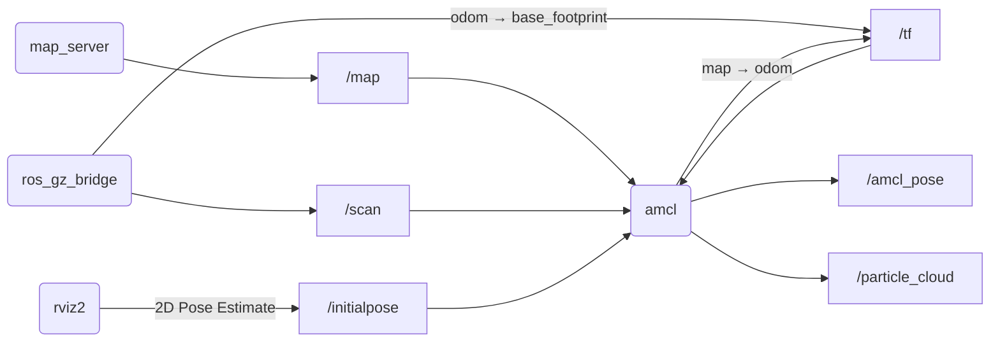
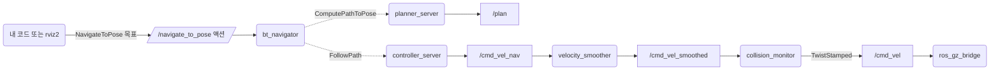
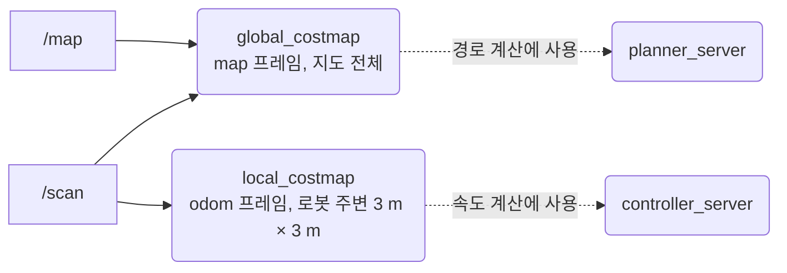
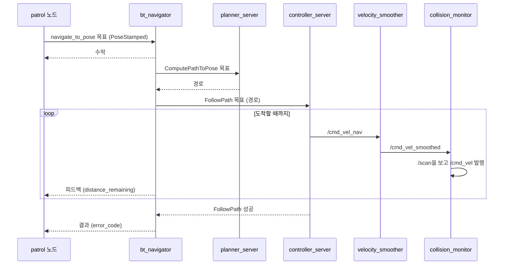
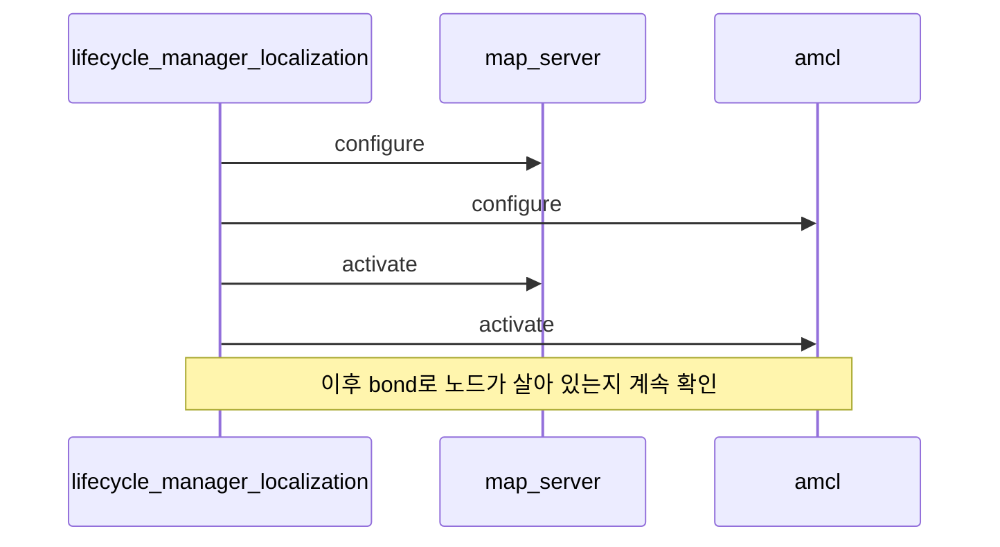

# 10장. 지도 위에서 스스로 움직이기 (Navigation)

- 원서: Chapter 10. Navigating About the World, PDF p.171~184 (인쇄 쪽 = PDF 쪽 - 20)
- 선행 조건: 5장(액션 클라이언트와 서버), 9장(`~/rosbook_ws/maps/tb3_world.yaml` 지도, `nav_bot` 패키지)
- 새로 설치할 것: 없음. `ros-jazzy-navigation2`, `ros-jazzy-nav2-bringup`, `ros-jazzy-nav2-simple-commander`, `ros-jazzy-turtlebot3-navigation2`가 설치되어 있어야 합니다. `apt-cache policy ros-jazzy-nav2-bringup ros-jazzy-nav2-simple-commander`로 확인합니다.

## 이 장에서 체감할 구조

내비게이션은 노드 하나가 아니라 lifecycle 노드 여러 개가 토픽, tf, 액션으로 이어진 묶음입니다. 사용자(rviz2 또는 내 코드)는 `navigate_to_pose` 액션 하나에 목표를 보내고, 그 뒤의 일은 각 노드가 나눠 맡습니다.

상자가 많아 두 그림으로 나눕니다. 첫 그림은 위치 추정 쪽입니다.



두 번째 그림은 경로 계획과 제어 쪽입니다.



그림에서 볼 것: 두 그림은 tf로만 이어집니다. amcl이 낸 `map → odom`을 planner_server와 controller_server가 tf로 읽고, 목표를 보내는 쪽은 `/navigate_to_pose` 액션 하나만 압니다.

## 1. 목표와 개념

원서 10장의 목표는 9장에서 만든 지도 위에서 로봇이 자기 위치를 알아내고, 목표 지점까지 장애물을 피해 스스로 가게 하는 것입니다. 마지막에는 rviz2 클릭 대신 코드로 목표를 연달아 보내는 순찰 프로그램을 만듭니다.

**위치 추정(localization)**: 지도는 이미 있으니, 지금 로봇이 지도 위 어디에 있는지만 알면 됩니다. 9장의 SLAM이 지도와 위치를 함께 추정했다면, 여기서는 지도를 고정해 두고 위치만 추정합니다.

**AMCL(Adaptive Monte Carlo Localization)**: "로봇이 여기 있을지도 모른다"는 후보 위치(파티클)를 수백~수천 개 뿌려 두고, 레이저 스캔이 지도와 잘 맞는 후보만 살아남게 하는 방법입니다. 로봇이 움직이면 모든 후보를 오도메트리만큼 같이 옮기고, 다시 스캔으로 걸러 냅니다. 처음에 대략 어디인지 알려 주면(초기 위치) 후보가 그 근처에 뿌려져 빨리 수렴합니다. AMCL의 결과는 9장 SLAM과 같은 `map → odom` 변환입니다. 그래서 다른 노드들은 위치를 SLAM이 냈는지 AMCL이 냈는지 모르고 tf만 봅니다.

비유: 눈을 가리고 아는 건물에 들어간 사람이 손으로 벽을 더듬으며 "이 모양의 모서리는 2층 계단 옆뿐이야"라고 후보를 줄여 가는 것과 비슷합니다.

예:

```bash
ros2 topic pub --once /initialpose geometry_msgs/msg/PoseWithCovarianceStamped "{header: {frame_id: map}, pose: {pose: {position: {x: 0.0, y: 0.0}, orientation: {w: 1.0}}}}"
```

실습 10-3의 명령입니다. rviz2의 2D Pose Estimate도 같은 토픽에 같은 타입을 발행합니다. `waffle_pi.yaml`의 amcl 설정이 `set_initial_pose: false`라서, 이 메시지가 오기 전까지 amcl은 `map → odom`을 내지 않습니다.

**costmap**: 경로를 계산하려면 지도의 0/100/-1 값만으로는 부족합니다. 로봇은 크기가 있으므로 벽 근처를 "들어가면 위험한 곳"으로 부풀려야 하고, 지도에 없는 새 장애물(사람, 상자)은 레이저로 바로 반영해야 합니다. 이를 담은 격자가 costmap이고, 전체 지도 크기의 global costmap(경로 계획용)과 로봇 주변만 보는 local costmap(제어용) 두 개가 있습니다.



그림에서 볼 것: `/map`은 global costmap에만 들어갑니다. local costmap은 레이저만으로 채우고 로봇을 따라 움직이므로, 지도에 없는 상자도 바로 반영합니다. 두 costmap은 각각 planner_server와 controller_server 안에서 돕니다.

예:

```yaml
      global_frame: map      # global_costmap
      plugins: ["static_layer", "obstacle_layer", "voxel_layer", "inflation_layer"]
      global_frame: odom     # local_costmap
      plugins: ["obstacle_layer", "voxel_layer", "inflation_layer"]
```

`/opt/ros/jazzy/share/turtlebot3_navigation2/param/waffle_pi.yaml`의 두 costmap 부분에서 두 줄씩 가져왔습니다. 지도 파일을 읽는 `static_layer`가 local costmap에는 없고, 장애물 주변을 위험 구역으로 부풀리는 `inflation_layer`는 둘 다 있습니다.

**Nav2의 역할 분담**:
- `planner_server`: global costmap 위에서 출발점부터 목표까지 경로를 계산합니다.
- `controller_server`: 경로를 따라가도록 매 순간 속도 명령을 계산합니다.
- `behavior_server`: 막혔을 때 제자리 회전, 후진 같은 복구 동작을 합니다.
- `bt_navigator`: 위 서버들을 행동 트리(Behavior Tree) 순서대로 호출하고, 바깥에 `navigate_to_pose` 액션을 제공합니다.
- `velocity_smoother`, `collision_monitor`: 속도 명령을 부드럽게 다듬고, 충돌 직전이면 줄이거나 멈춥니다.
- `lifecycle_manager_localization`, `lifecycle_manager_navigation`: 9장 실습 9-6처럼 위 노드들에 configure와 activate를 순서대로 보냅니다.

목표 하나가 처리되는 순서는 다음과 같습니다.



그림에서 볼 것: 내 코드가 직접 상대하는 것은 bt_navigator 하나입니다. bt_navigator 안쪽도 액션(`ComputePathToPose`, `FollowPath`, 둘 다 `nav2_msgs/action`의 타입)으로 서버들을 부르고, 속도 명령부터는 토픽으로 흐릅니다. 기본 행동 트리는 이동 중에도 경로를 1 Hz로 다시 계산합니다 (13장 실습 13-8).

lifecycle manager가 노드를 깨우는 순서는 다음과 같습니다. 위치 추정 쪽을 예로 듭니다.



그림에서 볼 것: 깨우는 순서는 `node_names` 목록의 순서입니다. `nav2_bringup/launch/localization_launch.py`의 목록은 `['map_server', 'amcl']`이고, `navigation_launch.py`의 목록은 `controller_server`, `smoother_server`, `planner_server`, `route_server`, `behavior_server`, `velocity_smoother`, `collision_monitor`, `bt_navigator`, `waypoint_follower`, `docking_server` 순서입니다. bt_navigator가 자신이 부를 서버들보다 뒤에 있어서, `navigate_to_pose`가 열릴 때는 서버들이 이미 준비되어 있습니다.

**액션으로 목표 보내기**: 목적지까지 가는 데는 시간이 걸리고, 그동안 남은 거리를 알려 주고, 중간에 취소할 수 있어야 합니다. 5장에서 배운 액션이 정확히 이 모양입니다. Nav2의 `navigate_to_pose` 액션 타입은 `nav2_msgs/action/NavigateToPose`이고, 목표는 `geometry_msgs/PoseStamped` 하나입니다.

예:

```python
self.client = ActionClient(self, NavigateToPose, 'navigate_to_pose')
future = self.client.send_goal_async(goal, feedback_callback=self.on_feedback)
future.add_done_callback(self.on_goal_response)
```

실습 10-1의 `patrol.py`에서 가져온 줄입니다. 5장의 액션 클라이언트와 같은 모양이고, 액션 이름과 타입만 Nav2의 것으로 바꿨습니다. 그래서 상대가 가짜 서버(10-1)이든 bt_navigator(10-5)이든 코드는 그대로입니다.

### 코드와 폴더 구조

9장의 `nav_bot` 패키지에 실행 파일 세 개가 더해집니다.

```text
~/rosbook_ws/src/nav_bot/
├── package.xml               9장에서 넣은 nav2_msgs, action_msgs, nav2_simple_commander 의존성 그대로
├── setup.py                  entry_points에 patrol, fake_nav_server, patrol_commander 추가 (10-1)
└── nav_bot/
    ├── map_info.py           9장 (9-2)
    ├── fake_nav_server.py    navigate_to_pose를 흉내 내는 액션 서버 (10-1)
    ├── patrol.py             waypoints 파라미터를 차례로 보내는 액션 클라이언트 (10-1)
    └── patrol_commander.py   nav2_simple_commander로 쓴 같은 순찰 (10-6)
```

- `patrol.py`의 뼈대는 5장의 액션 클라이언트와 같습니다. 앞 장과 달라지는 점은 서버를 기다리는 방법입니다. `wait_for_server()`로 막지 않고 1초 타이머로 `server_is_ready()`를 확인합니다.
- `patrol_commander.py`는 Node를 상속한 클래스를 만들지 않습니다. `BasicNavigator` 자체가 Node이고, `main()` 안에서 위에서 아래로 흐르는 순차 코드입니다 (10-6의 비교 표).

Nav2는 내가 만든 패키지가 아니라 설치된 launch 파일과 파라미터 파일로 띄웁니다. 실습 10-2의 명령 하나가 다음 순서로 launch 파일을 불러옵니다.

```text
turtlebot3_navigation2/launch/navigation2.launch.py   map, params_file, use_sim_time 인자, rviz2 실행
└── nav2_bringup/launch/bringup_launch.py
    ├── localization_launch.py   map_server, amcl, lifecycle_manager_localization
    └── navigation_launch.py     planner_server, controller_server, bt_navigator 등과 lifecycle_manager_navigation
```

이 모든 노드가 파라미터 파일 하나(`turtlebot3_navigation2/param/waffle_pi.yaml`)를 나눠 읽습니다. 파일의 맨 위 키가 노드 이름입니다.

```text
amcl:                  ros__parameters 아래에 amcl 파라미터
bt_navigator:          행동 트리 XML 경로, 제공할 액션 목록
docking_server:
controller_server:     controller_frequency, 경로 추종 플러그인(DWB)
local_costmap:
  local_costmap:       ros__parameters 아래에 local costmap 설정
global_costmap:
  global_costmap:      ros__parameters 아래에 global costmap 설정
map_server:
map_saver:
planner_server:        경로 계획 플러그인(NavfnPlanner)
behavior_server:       spin, backup, wait 같은 복구 동작
waypoint_follower:
collision_monitor:
velocity_smoother:
```

costmap만 이름이 두 번 겹치는 이유는 costmap 노드가 `local_costmap` 이름공간 안의 `local_costmap` 노드(`/local_costmap/local_costmap`)이기 때문입니다. 원서의 costmap 설정 파일 여러 개가 이 한 파일의 두 부분으로 들어왔습니다.

### 실무 메모

- 설치된 `waffle_pi.yaml`을 직접 고치지 않습니다. `/opt/ros/jazzy` 아래 파일은 apt 업그레이드 때 덮어써집니다. 내 패키지에 복사해서 고치고, `navigation2.launch.py`의 `params_file:=<경로>` 인자로 넘깁니다. 패키지 안의 설정 파일을 `install/`로 보내려면 `setup.py`의 `data_files`에 그 파일을 등록해야 합니다.
- 내비게이션이 동작하지 않을 때는 아래층부터 봅니다. 먼저 `ros2 lifecycle nodes`와 `ros2 lifecycle get`으로 모두 active인지, 다음으로 `ros2 run tf2_ros tf2_echo map odom --ros-args -p use_sim_time:=true`로 tf 사슬이 이어졌는지, 그다음 `ros2 topic info -v /cmd_vel`로 속도 명령이 누구에게서 누구에게 가는지 확인합니다. 경로 계획 파라미터는 그 뒤에 봅니다.
- 시뮬에서는 Nav2와 내 노드 모두 `use_sim_time:=True`로 띄웁니다. `navigation2.launch.py`의 기본값은 `false`라서, 빠뜨리면 tf 시각이 맞지 않는 경고가 쏟아집니다 (4절).
- 목표 좌표는 특정 지도 파일의 `map` 프레임 기준입니다. 웨이포인트를 코드에 박지 않고 파라미터(`patrol.py`의 `waypoints`)나 설정 파일로 빼 두면, 지도를 다시 만들었을 때 코드를 고치지 않아도 됩니다.

## 2. 원서(ROS 1)와 달라지는 점

| 원서 (ROS 1) | ROS 2 Jazzy | 이유와 주의점 |
|---|---|---|
| navigation stack의 `move_base` 노드 하나 | Nav2: `bt_navigator`, `planner_server`, `controller_server`, `behavior_server` 등 여러 lifecycle 노드 | 기능별 서버로 나뉘었고, 행동 트리로 순서를 정합니다 |
| `move_base` 액션 (`move_base_msgs/MoveBaseAction`) | `navigate_to_pose` 액션 (`nav2_msgs/action/NavigateToPose`) | 목표 필드 이름이 `target_pose`에서 `pose`로 바뀌었고 `behavior_tree` 필드가 추가되었습니다 |
| `actionlib.SimpleActionClient`, `wait_for_server()`, `wait_for_result()` | `rclpy.action.ActionClient`, `send_goal_async()`와 콜백 | 5장과 같은 비동기 방식입니다. 이 장의 `patrol.py`도 콜백으로 다음 목표를 보냅니다 |
| `roslaunch turtlebot_stage turtlebot_in_stage.launch` (Stage + amcl + move_base + rviz) | `ros2 launch turtlebot3_navigation2 navigation2.launch.py use_sim_time:=True map:=...` (Gazebo는 따로) | 이 launch 파일의 `use_sim_time` 기본값은 `false`라서 시뮬에서는 반드시 `True`로 줘야 합니다 |
| amcl, map_server가 시작하자마자 동작 | lifecycle 노드이며 `lifecycle_manager_localization`이 활성화 | 9장 실습 9-3, 9-6의 구조 그대로입니다 |
| `/cmd_vel`: `Twist` | `/cmd_vel`: `TwistStamped` | TurtleBot3의 `waffle_pi.yaml`이 controller_server, velocity_smoother, collision_monitor 등에 `enable_stamped_cmd_vel: true`를 켜 둡니다 |
| `/amcl_pose` latched | `/amcl_pose` QoS: RELIABLE, TRANSIENT_LOCAL | 늦게 구독해도 마지막 추정 위치를 받습니다 |
| rviz "2D Nav Goal" (`/move_base_simple/goal`) | rviz2 "Nav2 Goal" 도구 (`navigate_to_pose` 액션) | TurtleBot3 rviz 설정의 목표 도구는 토픽이 아니라 액션 클라이언트입니다 |

## 3. 실습

### 실습 10-1. 액션 클라이언트로 순찰 노드 만들기 (가짜 서버로 먼저 시험)

Nav2 전체를 띄우기 전에, 목표를 보내는 쪽 코드만 먼저 완성합니다. Nav2와 같은 이름, 같은 타입의 액션 서버를 흉내 내는 작은 노드를 만들어 상대로 씁니다. 5장의 구조가 그대로 쓰입니다.

**준비**: 터미널 3개. 시뮬레이터는 필요 없습니다.

**직접 입력**: 먼저 액션 타입을 봅니다.

```bash
ros2 interface show nav2_msgs/action/NavigateToPose | grep -v '^\s'
```

`---`로 나뉜 세 부분이 보입니다. 목표는 `geometry_msgs/PoseStamped pose`와 `string behavior_tree`, 결과는 `uint16 error_code`와 `string error_msg`, 피드백은 `current_pose`, `navigation_time`, `estimated_time_remaining`, `number_of_recoveries`, `distance_remaining`입니다.

파일 `~/rosbook_ws/src/nav_bot/nav_bot/fake_nav_server.py`:

```python
import math
import time

from nav2_msgs.action import NavigateToPose
import rclpy
from rclpy.action import ActionServer, GoalResponse
from rclpy.executors import ExternalShutdownException
from rclpy.node import Node


class FakeNavServer(Node):
    def __init__(self):
        super().__init__('fake_nav_server')
        self.server = ActionServer(
            self, NavigateToPose, 'navigate_to_pose',
            execute_callback=self.execute,
            goal_callback=self.on_goal)
        self.get_logger().info('가짜 navigate_to_pose 서버가 준비되었습니다')

    def on_goal(self, goal_request):
        frame = goal_request.pose.header.frame_id
        if frame != 'map':
            self.get_logger().warn(f'frame_id={frame!r} 목표를 거절합니다')
            return GoalResponse.REJECT
        return GoalResponse.ACCEPT

    def execute(self, goal_handle):
        target = goal_handle.request.pose.pose.position
        distance = math.hypot(target.x, target.y)
        feedback = NavigateToPose.Feedback()
        for step in range(5, 0, -1):
            feedback.distance_remaining = distance * step / 5.0
            goal_handle.publish_feedback(feedback)
            time.sleep(0.5)
        goal_handle.succeed()
        self.get_logger().info(f'({target.x:.2f}, {target.y:.2f}) 도착 처리')
        return NavigateToPose.Result()


def main(args=None):
    rclpy.init(args=args)
    node = FakeNavServer()
    try:
        rclpy.spin(node)
    except (KeyboardInterrupt, ExternalShutdownException):
        pass
    finally:
        node.destroy_node()
        rclpy.try_shutdown()


if __name__ == '__main__':
    main()
```

| 줄 | 설명 |
|---|---|
| 14~17 | Nav2의 bt_navigator와 같은 이름(`navigate_to_pose`)과 타입으로 액션 서버를 만듭니다. 클라이언트는 이름과 타입만 보고 연결하므로 진짜와 구별하지 못합니다 |
| 20~25 | 목표를 받을지 정하는 콜백입니다. `frame_id`가 `map`이 아니면 거절합니다. 진짜 Nav2도 좌표계가 맞지 않는 목표는 처리하지 못하므로, 실수를 일찍 드러내려고 넣은 규칙입니다 |
| 27~29 | 원점에서 목표까지의 직선 거리를 "남은 거리"의 시작값으로 씁니다 |
| 30~34 | 0.5초마다 남은 거리를 1/5씩 줄여 피드백으로 보냅니다. 로봇이 움직이는 척만 합니다 |
| 35~37 | 성공으로 끝내고 빈 결과(`error_code` 0)를 돌려줍니다 |

파일 `~/rosbook_ws/src/nav_bot/nav_bot/patrol.py`:

```python
import math

from action_msgs.msg import GoalStatus
from nav2_msgs.action import NavigateToPose
import rclpy
from rclpy.action import ActionClient
from rclpy.executors import ExternalShutdownException
from rclpy.node import Node


class Patrol(Node):
    def __init__(self):
        super().__init__('patrol')
        self.declare_parameter('waypoints', [4.0, 1.0, 3.14, 0.0, 0.0, 0.0])
        self.declare_parameter('loop', False)
        values = self.get_parameter('waypoints').value
        self.waypoints = [values[i:i + 3] for i in range(0, len(values), 3)]
        self.index = 0
        self.client = ActionClient(self, NavigateToPose, 'navigate_to_pose')
        self.timer = self.create_timer(1.0, self.wait_for_server)

    def wait_for_server(self):
        if not self.client.server_is_ready():
            self.get_logger().info('navigate_to_pose 액션 서버를 기다립니다')
            return
        self.timer.cancel()
        self.send_goal()

    def send_goal(self):
        x, y, yaw = self.waypoints[self.index]
        goal = NavigateToPose.Goal()
        goal.pose.header.frame_id = 'map'
        goal.pose.header.stamp = self.get_clock().now().to_msg()
        goal.pose.pose.position.x = x
        goal.pose.pose.position.y = y
        goal.pose.pose.orientation.z = math.sin(yaw / 2.0)
        goal.pose.pose.orientation.w = math.cos(yaw / 2.0)
        self.get_logger().info(
            f'목표 {self.index}: x={x:.2f} y={y:.2f} yaw={yaw:.2f}')
        future = self.client.send_goal_async(
            goal, feedback_callback=self.on_feedback)
        future.add_done_callback(self.on_goal_response)

    def on_goal_response(self, future):
        goal_handle = future.result()
        if not goal_handle.accepted:
            self.get_logger().error('목표가 거절되었습니다')
            rclpy.shutdown()
            return
        self.get_logger().info('목표가 수락되었습니다')
        goal_handle.get_result_async().add_done_callback(self.on_result)

    def on_feedback(self, feedback_msg):
        feedback = feedback_msg.feedback
        self.get_logger().info(
            f'남은 거리 {feedback.distance_remaining:.2f} m, '
            f'복구 동작 {feedback.number_of_recoveries}회',
            throttle_duration_sec=2.0)

    def on_result(self, future):
        response = future.result()
        if response.status == GoalStatus.STATUS_SUCCEEDED:
            self.get_logger().info(f'목표 {self.index} 도착')
        else:
            self.get_logger().warn(
                f'목표 {self.index} 실패: status={response.status}, '
                f'error_code={response.result.error_code} '
                f'{response.result.error_msg}')
        self.index += 1
        if self.index == len(self.waypoints):
            if not self.get_parameter('loop').value:
                self.get_logger().info('모든 목표를 마쳤습니다')
                rclpy.shutdown()
                return
            self.index = 0
        self.send_goal()


def main(args=None):
    rclpy.init(args=args)
    node = Patrol()
    try:
        rclpy.spin(node)
    except (KeyboardInterrupt, ExternalShutdownException):
        pass
    finally:
        node.destroy_node()
        rclpy.try_shutdown()


if __name__ == '__main__':
    main()
```

| 줄 | 설명 |
|---|---|
| 14 | 목표 지점들을 `[x, y, yaw, x, y, yaw, ...]` 한 줄짜리 실수 배열 파라미터로 받습니다. ROS 2 파라미터는 "배열의 배열"을 담을 수 없어서 이렇게 펼칩니다. 기본값은 실습 10-5에서 설명합니다 |
| 15 | `true`면 마지막 목표 다음에 처음으로 돌아가 계속 순찰합니다 |
| 16~17 | 펼친 배열을 3개씩 잘라 `[x, y, yaw]` 목록으로 만듭니다 |
| 19 | `navigate_to_pose` 액션 클라이언트를 만듭니다. 5장의 클라이언트와 같은 클래스입니다 |
| 20~27 | 1초마다 서버가 준비되었는지 보고, 준비되면 타이머를 끄고 첫 목표를 보냅니다. `wait_for_server()`로 막아 두지 않아서 기다리는 동안에도 노드가 정상적으로 돌아갑니다 |
| 31~33 | 목표 좌표는 `map` 프레임 기준입니다. 시각은 노드 시계로 찍으므로, 시뮬에서는 `use_sim_time:=true`일 때 시뮬 시각이 됩니다 |
| 34~37 | 위치와 방향을 넣습니다. 바닥 위 회전(yaw)만 있으므로 쿼터니언은 `z = sin(yaw/2)`, `w = cos(yaw/2)`이고 나머지는 0입니다 |
| 40~42 | 목표를 비동기로 보내고, 피드백 콜백과 "수락 여부" 콜백을 연결합니다 |
| 44~51 | 거절되면 노드를 끝내고, 수락되면 결과를 기다리는 콜백을 연결합니다 |
| 53~58 | 피드백 중 남은 거리와 복구 횟수를 2초에 한 번만 출력합니다 (`throttle_duration_sec`) |
| 60~67 | 결과 상태가 성공인지 봅니다. 실패하면 Nav2가 채워 준 `error_code`, `error_msg`를 출력합니다 |
| 68~75 | 다음 목표로 넘어갑니다. 마지막이면 `loop`에 따라 끝내거나 처음으로 돌아갑니다. 콜백 안에서 `rclpy.shutdown()`을 부르면 `spin`이 끝나고 `main`의 `finally`로 정리됩니다 |

`~/rosbook_ws/src/nav_bot/setup.py`의 `entry_points`를 다음처럼 고칩니다 (9장의 `map_info`에 세 줄 추가, `patrol_commander`는 실습 10-6에서 만듭니다).

```python
    entry_points={
        'console_scripts': [
            'map_info = nav_bot.map_info:main',
            'patrol = nav_bot.patrol:main',
            'fake_nav_server = nav_bot.fake_nav_server:main',
            'patrol_commander = nav_bot.patrol_commander:main',
        ],
    },
```

`package.xml`은 9장에서 `ros2 pkg create --dependencies`로 `action_msgs`, `nav2_msgs`, `nav2_simple_commander`를 이미 넣었으므로 고칠 것이 없습니다. 9장을 건너뛰었다면 `<depend>action_msgs</depend>`, `<depend>nav2_msgs</depend>`, `<depend>nav2_simple_commander</depend>`를 추가합니다.

실습 10-6의 파일을 아직 만들지 않았으므로, 지금 빌드하면 `patrol_commander` 실행 파일만 실행할 때 오류가 납니다. 바로 10-6의 파일까지 만들어 두거나, 그 줄을 10-6에서 추가해도 됩니다.

```bash
cd ~/rosbook_ws && colcon build --symlink-install --packages-select nav_bot
source ~/rosbook_ws/install/setup.bash
```

터미널 1:

```bash
ros2 run nav_bot fake_nav_server
```

터미널 2:

```bash
ros2 run nav_bot patrol --ros-args -p waypoints:="[1.0, 2.0, 0.0, -1.0, 0.5, 1.57]"
```

터미널 3:

```bash
ros2 node info /fake_nav_server
ros2 action list -t
ros2 action send_goal --feedback /navigate_to_pose nav2_msgs/action/NavigateToPose "{pose: {header: {frame_id: map}, pose: {position: {x: 3.0, y: 4.0}}}}"
```

**관찰**:

- 터미널 2에 다음과 같은 흐름이 찍히고, 약 7초 뒤 노드가 스스로 끝납니다.

  ```
  목표 0: x=1.00 y=2.00 yaw=0.00
  목표가 수락되었습니다
  남은 거리 2.24 m, 복구 동작 0회
  ...
  목표 0 도착
  목표 1: x=-1.00 y=0.50 yaw=1.57
  ...
  모든 목표를 마쳤습니다
  ```
- `ros2 node info /fake_nav_server`의 `Action Servers:`에 `/navigate_to_pose: nav2_msgs/action/NavigateToPose`가 있습니다. 실습 10-2에서 같은 명령을 `/bt_navigator`에 해 보면 같은 줄이 나옵니다.
- `ros2 action send_goal --feedback`은 `distance_remaining: 5.0`부터 `1.0`까지 피드백을 출력하고 `Goal finished with status: SUCCEEDED`로 끝납니다. 코드 없이 명령줄만으로도 Nav2에 목표를 보낼 수 있다는 뜻입니다.

**생각해 볼 질문**: `patrol`을 `fake_nav_server`보다 먼저 실행하면 어떻게 될까요? 그리고 `waypoints:="[1, 2, 0]"`처럼 소수점 없이 주면 어떻게 될까요?

### 실습 10-2. Nav2 띄우고 구조 살펴보기

> **미검증 실습**: 문서를 쓸 때 Nav2 전체 스택을 띄운 상태에서 보는 관찰 항목(`ros2 component list` 출력, lifecycle 상태, rqt_graph, rviz2 화면)을 실제로 실행해 확인하지 못했습니다. 결과가 문서와 다르면 문서가 틀렸을 수 있으니, 7절의 검증 기록과 비교해 보세요.

**준비**: 터미널 4개. 9장의 SLAM, 텔레옵, map_server는 모두 끕니다. 특히 **텔레옵이 켜져 있으면** Nav2와 같은 `/cmd_vel`에 명령을 보내 서로 싸우므로 반드시 끕니다.

**직접 입력**:

터미널 1:

```bash
ros2 launch turtlebot3_gazebo turtlebot3_world.launch.py
```

터미널 2: 9장에서 저장한 지도로 Nav2와 rviz2를 띄웁니다.

```bash
ros2 launch turtlebot3_navigation2 navigation2.launch.py use_sim_time:=True map:=$HOME/rosbook_ws/maps/tb3_world.yaml
```

이 launch 파일은 `nav2_bringup`의 `bringup_launch.py`를 포함하고, 파라미터로 `/opt/ros/jazzy/share/turtlebot3_navigation2/param/waffle_pi.yaml`을 씁니다 (`TURTLEBOT3_MODEL=waffle_pi` 기준). `map:=`을 주지 않으면 패키지에 들어 있는 `map/map.yaml`(원점 `[-10, -10, 0]`)이 쓰입니다.

터미널 3: 구조를 관찰합니다.

```bash
ros2 lifecycle nodes
ros2 lifecycle get /amcl
ros2 lifecycle get /bt_navigator
ros2 node list
ros2 component list
```

```bash
ros2 node info /amcl
ros2 node info /bt_navigator
ros2 topic info -v /cmd_vel
ros2 node info /velocity_smoother
ros2 node info /collision_monitor
rqt_graph
```

**관찰**:

- `ros2 lifecycle nodes`에 map_server, amcl, bt_navigator, planner_server, controller_server, behavior_server, velocity_smoother, collision_monitor, waypoint_follower 등이 나옵니다. 처음 몇 초는 상태가 `inactive`나 `unconfigured`일 수 있고, lifecycle manager가 순서대로 activate합니다.
- `ros2 component list`에 `/nav2_container`가 있고 그 아래 여러 노드가 들어 있습니다. `bringup_launch.py`의 `use_composition` 기본값이 `True`라서, Nav2 노드들이 프로세스 하나 안의 컴포넌트로 실행됩니다 (2장 1절과 실습 2-10에서 본 composition). `ros2 node list`로는 따로 실행한 노드와 구별되지 않습니다.
- `ros2 node info /amcl`:
  - Subscribers: `/initialpose`, `/map`, `/scan`, `/tf`, `/tf_static`
  - Publishers: `/amcl_pose: geometry_msgs/msg/PoseWithCovarianceStamped`, `/particle_cloud: nav2_msgs/msg/ParticleCloud`, `/tf`
  - Service Servers: `/reinitialize_global_localization`, `/request_nomotion_update`, `/set_initial_pose`와 lifecycle 서비스
- `ros2 node info /bt_navigator`의 `Action Servers:`에 `/navigate_to_pose`가 있습니다. 실습 10-1의 가짜 서버가 대신했던 자리입니다.
- 속도 명령은 세 단계를 거쳐 로봇에 갑니다. 모두 `geometry_msgs/msg/TwistStamped`입니다.
  - `controller_server` → `/cmd_vel_nav` (launch 파일이 `cmd_vel`을 이 이름으로 바꿈)
  - `velocity_smoother`: `/cmd_vel_nav`를 받아 `/cmd_vel_smoothed`로 냄
  - `collision_monitor`: `/cmd_vel_smoothed`와 `/scan`을 받아 `/cmd_vel`로 냄
  - `ros2 topic info -v /cmd_vel`의 publisher는 collision_monitor, subscriber는 ros_gz_bridge입니다.
- rqt_graph에서 "Nodes/Topics (all)"을 고르면 위 흐름이 그림으로 보입니다.
- rviz2 창에는 지도, 레이저, costmap이 보이지만 로봇 위치는 아직 엉뚱하거나 표시되지 않습니다. 다음 실습에서 초기 위치를 알려 줍니다.

**생각해 볼 질문**: `/cmd_vel`을 바로 내지 않고 velocity_smoother와 collision_monitor를 거치게 나눈 이유는 무엇일까요?

### 실습 10-3. AMCL에 초기 위치 알려 주기

> **미검증 실습**: 문서를 쓸 때 초기 위치를 준 뒤 `map → odom` 변환이 나오는 것과 파티클이 수렴하는 모습을 실제로 실행해 확인하지 못했습니다. 결과가 문서와 다르면 문서가 틀렸을 수 있으니, 7절의 검증 기록과 비교해 보세요.

**준비**: 실습 10-2를 켠 상태. 터미널 2개 추가.

**직접 입력**: 먼저 초기 위치가 없을 때의 상태를 봅니다.

```bash
ros2 run tf2_ros tf2_echo map odom --ros-args -p use_sim_time:=true
ros2 topic info -v /amcl_pose
ros2 interface show geometry_msgs/msg/PoseWithCovarianceStamped
```

`tf2_echo`는 `map` 프레임이 없다는 메시지를 반복합니다. `waffle_pi.yaml`의 amcl 설정이 `set_initial_pose: false`라서, 누군가 초기 위치를 알려 주기 전까지 amcl은 `map → odom`을 내지 않습니다.

이제 두 방법 중 하나로 초기 위치를 줍니다.

방법 1 (rviz2): 툴바의 **2D Pose Estimate**를 누르고, 지도 위 로봇이 실제로 있는 자리를 클릭한 채 로봇이 보는 방향으로 끌었다 놓습니다.

방법 2 (명령): 9장에서 SLAM을 로봇이 처음 놓인 자리에서 시작했다면, 그 자리가 지도의 (0, 0)이고 방향도 0입니다. Gazebo를 새로 띄워 로봇이 처음 자리에 있다면 다음 명령이 같은 일을 합니다.

```bash
ros2 topic pub --once /initialpose geometry_msgs/msg/PoseWithCovarianceStamped "{header: {frame_id: map}, pose: {pose: {position: {x: 0.0, y: 0.0}, orientation: {w: 1.0}}}}"
```

터미널 하나에서 결과를 봅니다.

```bash
ros2 topic echo /amcl_pose --once
ros2 topic hz /particle_cloud
ros2 run tf2_tools view_frames --ros-args -p use_sim_time:=true
```

rviz2에서 Add → By topic → `/particle_cloud`를 추가하면(TurtleBot3 rviz 설정에는 이미 들어 있음) 로봇 주변에 작은 화살표 무리가 보입니다. 텔레옵 없이 다음 실습의 Nav2 Goal로 조금 움직여 보면 화살표 무리가 점점 좁게 모입니다.

**관찰**:

- `ros2 topic info -v /amcl_pose`의 publisher QoS가 `RELIABLE`, `TRANSIENT_LOCAL`입니다. 늦게 켠 노드도 마지막 위치를 받습니다. 실습 10-6의 nav2_simple_commander도 이 점을 이용해 amcl이 준비되었는지 확인합니다.
- `/amcl_pose`의 `covariance`(36개 값)는 위치 추정이 얼마나 불확실한지를 나타냅니다. 처음에는 x, y 칸(0번, 7번 값)이 크고, 움직이면서 작아집니다.
- 초기 위치를 준 뒤 `view_frames`를 실행하면 `map → odom → base_footprint` 트리가 완성되어 있고, `map → odom`의 broadcaster가 `amcl`입니다. 9장에서는 같은 자리에 `slam_toolbox`가 있었습니다.
  - `map → odom`: amcl (`tf_broadcast: true`)
  - `odom → base_footprint`: Gazebo DiffDrive 플러그인 → ros_gz_bridge
  - `base_footprint → base_link`, `base_scan` 등: robot_state_publisher
- 초기 위치를 일부러 1~2 m 틀리게 주면, 레이저 점들이 지도 벽과 어긋나 보입니다. 이때 `ros2 service call /reinitialize_global_localization std_srvs/srv/Empty`를 부르면 파티클이 지도 전체로 흩어집니다. 그 상태에서 로봇을 움직이면 다시 한곳으로 모일 수도 있지만, 대칭인 TurtleBot3 world에서는 엉뚱한 곳으로 모이기도 합니다.

**생각해 볼 질문**: rviz2의 2D Pose Estimate 도구는 `/initialpose`를 구독할까요, 발행할까요? 어떤 명령으로 확인할 수 있을까요?

### 실습 10-4. rviz2에서 목표 보내기

> **미검증 실습**: 문서를 쓸 때 rviz2의 Nav2 Goal로 목표를 보내 로봇이 주행하는 부분을 실제로 실행해 확인하지 못했습니다. 결과가 문서와 다르면 문서가 틀렸을 수 있으니, 7절의 검증 기록과 비교해 보세요.

**준비**: 실습 10-3까지 마친 상태.

**직접 입력**: rviz2 툴바의 **Nav2 Goal**을 누르고, 지도 위 빈 곳을 클릭한 채 도착 방향으로 끌었다 놓습니다. 그동안 다른 터미널에서 다음을 봅니다.

```bash
ros2 action list -t
ros2 action info /navigate_to_pose
ros2 topic echo /plan --once --field header
ros2 topic hz /cmd_vel
```

**관찰**:

- rviz2에 초록색 전체 경로(`/plan`)와 로봇 앞의 짧은 지역 경로(`/local_plan`)가 그려지고 로봇이 따라갑니다. 벽 주변의 색이 칠해진 영역이 costmap의 부풀린 장애물(inflation)입니다.
- `ros2 action info /navigate_to_pose`의 Action clients에 rviz2 노드가 보입니다. rviz2의 Nav2 Goal 도구는 실습 10-1의 `patrol`과 같은 방식으로 액션 목표를 보냅니다.
- 이동 중에는 `/cmd_vel`이 계속 나오고, 도착하면 멈춥니다. `waffle_pi.yaml` 기준으로 controller_server는 10 Hz(`controller_frequency`)로 속도를 계산하고, `/cmd_vel` 앞의 velocity_smoother가 20 Hz(`smoothing_frequency`)로 다듬어 내보냅니다. 그래서 `ros2 topic hz /cmd_vel`은 20 Hz 안팎을 보일 것입니다.
- 이동 중 다시 Nav2 Goal을 찍으면 이전 목표는 취소되고 새 목표로 바뀝니다 (Navigation 2 패널의 상태 표시로 확인).
- Gazebo에서 로봇 앞에 상자(Insert 탭의 Box)를 놓으면 local costmap에 새 장애물이 나타나고 경로가 바뀝니다. 지도 파일에는 없는 장애물입니다.

**생각해 볼 질문**: 기둥 안쪽처럼 갈 수 없는 곳(costmap에서 막힌 칸)을 목표로 찍으면 Nav2는 어떻게 응답할까요?

### 실습 10-5. 순찰 노드로 Nav2 움직이기

> **미검증 실습**: 문서를 쓸 때 `patrol` 노드가 실제 Nav2에 목표를 보내 로봇이 주행하는 부분과 기본 목표 좌표 (4.0, 1.0)이 빈 공간인지를 실제로 실행해 확인하지 못했습니다. 결과가 문서와 다르면 문서가 틀렸을 수 있으니, 7절의 검증 기록과 비교해 보세요.

**준비**: 실습 10-3까지 마친 상태 (초기 위치가 잡혀 있어야 합니다).

**좌표 정하기**: 9장의 slam_toolbox 지도는 SLAM을 시작한 로봇 위치가 원점입니다. TurtleBot3 world 시뮬은 로봇을 Gazebo 좌표 (-2.0, -0.5)에 놓으므로(`turtlebot3_world.launch.py`의 `x_pose`, `y_pose` 기본값), 지도 좌표 (x, y)는 Gazebo 좌표 (x - 2.0, y - 0.5)입니다. `patrol`의 기본 목표 `(4.0, 1.0)`은 Gazebo 기준 (2.0, 0.5)로, 시작 위치 반대편의 빈 곳을 노린 값입니다. 하지만 지도를 만든 위치나 방향이 다르면 이 값은 벽 속일 수 있으므로, 반드시 직접 확인합니다.

rviz2 툴바의 **Publish Point**를 누르고 가고 싶은 곳을 클릭하면, 그 좌표가 `/clicked_point`로 발행됩니다.

```bash
ros2 topic echo /clicked_point
```

**직접 입력**: 확인한 좌표 두 개 이상을 넣어 실행합니다 (값은 예시, yaw는 라디안).

```bash
ros2 run nav_bot patrol --ros-args -p use_sim_time:=true -p waypoints:="[4.0, 1.0, 3.14, 0.0, 0.0, 0.0]"
```

계속 돌게 하려면 `-p loop:=true`를 붙이고, 멈출 때는 Ctrl-C를 누릅니다.

**관찰**:

- 터미널에 "목표 0 ... 수락", 2초마다 "남은 거리", "목표 0 도착", "목표 1 ..." 순서로 찍히고 rviz2에서 로봇이 두 지점을 오갑니다. 코드는 10-1에서 가짜 서버를 상대로 시험한 그대로이고, 상대만 bt_navigator로 바뀌었습니다.
- 순찰 도중 Gazebo에서 경로 위에 상자를 놓으면 피드백의 "복구 동작" 횟수가 늘거나, 실패 시 `error_code`와 `error_msg`가 출력됩니다.
- `-p use_sim_time:=true`를 빼면 목표의 `header.stamp`가 컴퓨터 시각이 됩니다. 4절 표에서 그 결과를 실험합니다.

**생각해 볼 질문**: 순찰 중에 Ctrl-C로 `patrol`을 끄면 로봇은 멈출까요? 액션의 "목표"는 누가 가지고 있을까요?

### 실습 10-6. nav2_simple_commander와 비교하기

> **미검증 실습**: 문서를 쓸 때 `patrol_commander`를 Nav2와 함께 실행하는 부분(빌드와 lint만 통과했습니다)을 실제로 실행해 확인하지 못했습니다. 결과가 문서와 다르면 문서가 틀렸을 수 있으니, 7절의 검증 기록과 비교해 보세요.

Nav2에는 액션 클라이언트를 감싼 파이썬 도우미 `nav2_simple_commander`가 있습니다. 같은 순찰을 이것으로 쓰면 어떻게 달라지는지 봅니다.

파일 `~/rosbook_ws/src/nav_bot/nav_bot/patrol_commander.py`:

```python
import math

from geometry_msgs.msg import PoseStamped
from nav2_simple_commander.robot_navigator import BasicNavigator, TaskResult
import rclpy


def make_pose(navigator, x, y, yaw):
    pose = PoseStamped()
    pose.header.frame_id = 'map'
    pose.header.stamp = navigator.get_clock().now().to_msg()
    pose.pose.position.x = x
    pose.pose.position.y = y
    pose.pose.orientation.z = math.sin(yaw / 2.0)
    pose.pose.orientation.w = math.cos(yaw / 2.0)
    return pose


def main(args=None):
    rclpy.init(args=args)
    navigator = BasicNavigator()
    navigator.waitUntilNav2Active()

    for x, y, yaw in [(4.0, 1.0, 3.14), (0.0, 0.0, 0.0)]:
        navigator.goToPose(make_pose(navigator, x, y, yaw))
        while not navigator.isTaskComplete():
            feedback = navigator.getFeedback()
            if feedback:
                navigator.get_logger().info(
                    f'남은 거리 {feedback.distance_remaining:.2f} m',
                    throttle_duration_sec=2.0)
        result = navigator.getResult()
        navigator.get_logger().info(f'({x}, {y}) 결과: {result.name}')
        if result != TaskResult.SUCCEEDED:
            break

    navigator.destroy_node()
    rclpy.try_shutdown()


if __name__ == '__main__':
    main()
```

| 줄 | 설명 |
|---|---|
| 8~16 | `PoseStamped` 목표를 만드는 도우미입니다. `patrol.py`의 `send_goal` 앞부분과 같습니다 |
| 21 | `BasicNavigator`는 그 자체가 Node입니다. 안에 `navigate_to_pose` 등 여러 액션 클라이언트와 `/initialpose` publisher, `/amcl_pose` subscriber를 갖고 있습니다 |
| 22 | amcl이 active가 될 때까지 기다린 뒤, `/amcl_pose`를 받을 때까지 `Setting initial pose`, `Publishing Initial Pose`, `Waiting for amcl_pose to be received`를 출력하며 기다리고, 마지막으로 bt_navigator가 active가 될 때까지 기다립니다 |
| 25 | 목표를 보냅니다. 서버가 거절하면 `False`를 돌려줍니다 |
| 26~31 | 끝날 때까지 반복하며 피드백을 읽습니다. 함수 안에서 `spin_until_future_complete`를 짧게 돌리므로, 내 코드는 콜백 없이 위에서 아래로 읽힙니다 |
| 32~35 | 결과는 `TaskResult.SUCCEEDED`, `FAILED`, `CANCELED` 중 하나입니다. 실패하면 순찰을 멈춥니다 |

```bash
cd ~/rosbook_ws && colcon build --symlink-install --packages-select nav_bot
source ~/rosbook_ws/install/setup.bash
ros2 run nav_bot patrol_commander --ros-args -p use_sim_time:=true
```

**관찰과 비교**:

| | `patrol.py` (ActionClient 직접) | `patrol_commander.py` (nav2_simple_commander) |
|---|---|---|
| 흐름 | 콜백이 다음 목표를 보냄 (이벤트 방식) | `while` 반복으로 기다림 (순차 방식) |
| 의존 | `nav2_msgs`만 있으면 됨. 가짜 서버로 시험 가능 | amcl과 `/amcl_pose`가 있어야 시작함. 가짜 서버로는 시험 불가 |
| 다른 일 함께 하기 | 같은 노드에 타이머, 구독을 추가해도 자연스럽게 돎 | 기다리는 동안 내 콜백이 돌지 않음 |
| 편의 기능 | 직접 구현 | `setInitialPose`, `cancelTask`, `followWaypoints`, `getPath` 등 제공 |

빠르게 시나리오를 짜 볼 때는 simple commander가 편하고, 다른 센서 처리와 함께 돌아가는 로봇 프로그램에는 5장 방식의 ActionClient가 구조를 이해하고 확장하기 쉽습니다. 이 가이드가 `patrol.py`를 기본으로 삼는 이유입니다.

**생각해 볼 질문**: 실습 10-3의 초기 위치를 주지 않고 `patrol_commander`를 실행하면 어떻게 될까요?

## 4. 일부러 망가뜨려 보기

| 바꿀 것 | 예상 증상 | 원인을 확인하는 명령 |
|---|---|---|
| `patrol`에 `waypoints:="[1, 2, 0]"` (소수점 없음) | 시작하자마자 `InvalidParameterTypeException ... 'INTEGER_ARRAY', expecting type 'DOUBLE_ARRAY'`로 종료 | 오류 메시지. 기본값이 실수 배열이라 파라미터 타입이 고정됨 |
| `patrol.py`의 `frame_id`를 `'odom'`으로 바꾸고 10-1 가짜 서버에 보냄 | "목표가 거절되었습니다" 후 종료. 서버 쪽에 `frame_id='odom' 목표를 거절합니다` | 명령으로 같은 실험: `ros2 action send_goal /navigate_to_pose nav2_msgs/action/NavigateToPose "{pose: {header: {frame_id: odom}}}"` → `Goal was rejected.` |
| `ActionClient`의 이름을 `'navigate_to_pos'`로 오타 | "navigate_to_pose 액션 서버를 기다립니다"가 끝없이 반복 | `ros2 action list`, `ros2 node info /patrol`의 Action Clients 이름 |
| 실습 10-2를 `use_sim_time:=True` 없이 실행 | tf가 미래/과거 시각이라는 경고가 반복되고, costmap이 비어 있거나 로봇이 움직이지 않음 (미검증) | `ros2 param get /amcl use_sim_time`, `ros2 topic echo /clock --once`와 `/scan`의 header 시각 비교 |
| 실습 10-3 전에(초기 위치 없이) Nav2 Goal을 보냄 | 목표가 실패하거나 계획이 만들어지지 않음. `map` 프레임이 없다는 경고 (미검증) | `ros2 run tf2_ros tf2_echo map odom --ros-args -p use_sim_time:=true` |
| `patrol`을 `use_sim_time` 없이 실행해 Nav2에 목표 전송 | 목표의 시각이 시뮬 시각보다 수십 년 앞섬. tf 변환 시각 관련 경고나 실패가 생길 수 있음 (미검증) | `ros2 param get /patrol use_sim_time`, bt_navigator 로그 |
| 실습 10-2에서 텔레옵을 켠 채로 목표 전송 | 로봇이 덜컥거리거나 엉뚱하게 움직임 (미검증) | `ros2 topic info -v /cmd_vel` → publisher가 2개 (collision_monitor, teleop) |
| 순찰 중 `ros2 lifecycle set /controller_server deactivate` | 로봇이 멈추고 목표가 실패 처리됨. patrol에 실패 로그 (미검증) | `ros2 lifecycle get /controller_server`, patrol 출력의 `error_code` |
| `/amcl_pose`를 VOLATILE로 늦게 구독: `ros2 topic echo /amcl_pose --once --qos-durability volatile --qos-reliability reliable` | 로봇이 서 있으면 아무것도 오지 않음 (amcl은 움직일 때 새로 냄) (미검증) | 기본 `ros2 topic echo /amcl_pose --once`와 비교 (기본값은 publisher QoS에 맞춰 TRANSIENT_LOCAL로 받음) |

## 5. 확인 질문

<details><summary>Q1. patrol을 서버보다 먼저 켜면? 정수 배열로 주면? (10-1 질문)</summary>

먼저 켜면 1초마다 "navigate_to_pose 액션 서버를 기다립니다"를 출력하다가, 서버가 뜨는 순간 첫 목표를 보냅니다. `wait_for_server` 타이머가 그 역할을 합니다. `[1, 2, 0]`처럼 주면 정수 배열 타입이라 실수 배열로 선언된 파라미터에 넣을 수 없어 `InvalidParameterTypeException`으로 바로 종료됩니다. `[1.0, 2.0, 0.0]`으로 줘야 합니다.

</details>

<details><summary>Q2. 속도 명령을 세 단계로 나눈 이유는? (10-2 질문)</summary>

controller_server는 "경로를 따라가려면 지금 얼마로 움직여야 하는가"만 계산합니다. 가속도 제한에 맞게 값을 부드럽게 만드는 일(velocity_smoother)과, 레이저로 코앞의 장애물을 보고 마지막 순간에 줄이거나 멈추는 안전장치(collision_monitor)를 따로 두면 각각을 독립적으로 설정하거나 끌 수 있습니다. 노드 사이를 토픽으로 연결했기 때문에 `ros2 topic echo /cmd_vel_nav`와 `/cmd_vel`을 비교해 각 단계가 무엇을 바꾸는지 바로 볼 수 있습니다.

</details>

<details><summary>Q3. 2D Pose Estimate는 `/initialpose`를 구독할까요, 발행할까요? (10-3 질문)</summary>

rviz2가 **발행**하고 amcl이 **구독**합니다. `ros2 topic info -v /initialpose`를 보면 publisher에 rviz2, subscriber에 amcl이 나옵니다. 실습 10-2의 `ros2 node info /amcl`에서도 `/initialpose`가 Subscribers에 있습니다. 그래서 `ros2 topic pub /initialpose ...`로 rviz2 대신 초기 위치를 줄 수 있습니다.

</details>

<details><summary>Q4. 갈 수 없는 곳을 목표로 찍으면? (10-4 질문)</summary>

planner_server가 경로를 찾지 못해 실패를 알리고, bt_navigator는 행동 트리에 따라 costmap을 지우거나 제자리 회전 같은 복구 동작을 몇 번 시도한 뒤 목표를 실패로 끝냅니다. 실습 10-5의 `patrol`로 보냈다면 `실패: status=6` 같은 줄과 Nav2가 채운 `error_code`, `error_msg`가 출력됩니다. (status 6은 `action_msgs/msg/GoalStatus`의 ABORTED입니다. `ros2 interface show action_msgs/msg/GoalStatus`로 확인합니다.)

</details>

<details><summary>Q5. patrol을 Ctrl-C로 끄면 로봇은 멈출까요? (10-5 질문)</summary>

목표는 액션 서버(bt_navigator)가 가지고 실행합니다. 클라이언트가 사라져도 서버는 취소 요청을 받지 못했으므로, 진행 중이던 목표까지는 계속 갈 수 있습니다. 멈추게 하려면 클라이언트가 끝나기 전에 `cancel_goal_async()`를 부르거나, rviz2 Navigation 2 패널의 Cancel 버튼을 씁니다. 5장의 액션 취소와 같은 구조입니다.

</details>

<details><summary>Q6. 초기 위치 없이 patrol_commander를 실행하면? (10-6 질문)</summary>

멈추지 않을 수도 있습니다. `waitUntilNav2Active()`는 `/amcl_pose`가 올 때까지 기다리는 동안, `setInitialPose`로 정해 둔 값(정하지 않았으면 `map`의 (0, 0), 방향 0)을 `/initialpose`로 직접 발행합니다 (설치된 `nav2_simple_commander/robot_navigator.py`의 `_waitForInitialPose`). 9장의 SLAM 지도는 로봇 시작 위치가 (0, 0)이므로, Gazebo를 새로 띄운 직후라면 이 기본값이 우연히 맞습니다. 로봇을 움직인 뒤라면 틀린 초기 위치가 들어가 amcl이 잘못 수렴할 수 있습니다. 그래서 실제로는 `navigator.setInitialPose(pose)`로 위치를 정하거나 rviz2로 먼저 주는 것이 안전합니다. 반면 `patrol.py`는 초기 위치를 건드리지 않고 `navigate_to_pose` 서버만 기다리므로, 초기 위치가 없으면 목표가 tf 문제로 실패합니다. (이 동작은 소스를 읽어 확인했고 실행으로는 확인하지 못했습니다.)

</details>

## 6. 원서 대조 메모

- 원서 PDF p.175(인쇄 155): 초기 위치를 주는 과정을 설명하면서 rviz가 `initialpose` 토픽을 **구독**한다고 적었지만, 실제로는 rviz가 발행하고 amcl이 구독합니다. Q3 참고.
- 원서 PDF p.171~176의 amcl 설명(파티클 필터, 초기 위치, 수렴)은 Nav2 amcl에도 그대로 적용됩니다. 파라미터 이름은 일부 바뀌었으니 `waffle_pi.yaml`의 `amcl:` 부분을 직접 읽어 보세요 (`min_particles`, `max_particles`, `laser_model_type`, `set_initial_pose` 등).
- 원서 PDF p.176~181의 move_base 구조(global/local planner, costmap, recovery)는 Nav2의 planner_server, controller_server, costmap, behavior_server로 나뉘었습니다. 원서의 costmap 설정 파일 여러 개는 `waffle_pi.yaml` 한 파일의 `global_costmap:`, `local_costmap:` 부분이 대신합니다.
- 원서 PDF p.181~183의 순찰 코드는 `move_base` 액션과 상태 기계(smach)를 썼습니다. 이 가이드는 5장의 rclpy ActionClient로 같은 목적을 이룹니다. 원서 코드와 줄 단위로 대응시키지는 않았습니다.
- 원서는 지도의 좌표를 그대로 목표로 썼지만, ROS 2 시뮬에서 직접 만든 지도는 원점이 로봇 시작 위치이므로 좌표를 `/clicked_point`로 확인하는 단계를 추가했습니다.
- TurtleBot3의 `waffle_pi.yaml`에는 `route_server:`, `smoother_server:` 부분이 없지만 `nav2_bringup/launch/navigation_launch.py`는 두 노드를 lifecycle 관리 대상으로 띄웁니다. 이 노드들은 파라미터 기본값으로 시작할 것으로 보이나 이 문서에서는 확인하지 못했습니다. 실습 10-2에서 lifecycle manager가 "Managed nodes are active"까지 가지 못하고 멈추면 터미널 2의 로그에서 이 두 노드 이름을 찾아보세요.

## 7. 이 문서의 검증 상태

- 확인함 (설치된 Jazzy에서 직접 실행 또는 파일 확인):
  - 패키지 설치와 버전: `apt-cache policy`로 ros-jazzy-navigation2, ros-jazzy-nav2-bringup, ros-jazzy-nav2-simple-commander 1.3.13, ros-jazzy-turtlebot3-navigation2 2.3.6.
  - `ros2 interface show`로 `nav2_msgs/action/NavigateToPose`, `geometry_msgs/msg/PoseWithCovarianceStamped`, `nav2_msgs/msg/ParticleCloud`.
  - 실습 10-1 전체를 별도 워크스페이스에서 실행: `nav_bot` 빌드와 `colcon test`(3 tests, 0 failures, 1 skipped), `patrol`이 가짜 서버를 상대로 목표 2개를 수락·피드백·도착 후 스스로 종료(약 7초), `ros2 node info /fake_nav_server`의 Action Servers, `ros2 action list -t`(`/navigate_to_pose [nav2_msgs/action/NavigateToPose]`), `ros2 action info /navigate_to_pose -t`(Action servers: 1, `/fake_nav_server`), `ros2 action send_goal --feedback`의 피드백 5.0~1.0과 `SUCCEEDED`.
  - 4절 중 정수 배열 파라미터 오류, `frame_id: odom` 목표 거절(`Goal was rejected.`).
  - `waffle_pi.yaml`로 amcl, velocity_smoother(`cmd_vel:=cmd_vel_nav` 재매핑), collision_monitor를 하나씩 configure: amcl의 토픽·서비스 목록(`/reinitialize_global_localization`, `/set_initial_pose` 포함), `/amcl_pose` QoS(RELIABLE, TRANSIENT_LOCAL), `/cmd_vel_nav` → `/cmd_vel_smoothed` → `/cmd_vel` 흐름과 TwistStamped 타입.
  - launch 파일 읽기: `turtlebot3_navigation2/launch/navigation2.launch.py`(`use_sim_time` 기본 false, `map`, `params_file`), `nav2_bringup`의 `bringup_launch.py`(`use_composition` 기본 True), `navigation_launch.py`(`cmd_vel` → `cmd_vel_nav` 재매핑, lifecycle 노드 목록), `localization_launch.py`(map_server, amcl). TurtleBot3 rviz 설정의 도구(SetInitialPose → `/initialpose`, PublishPoint → `/clicked_point`, Nav2 Goal)와 디스플레이(`/particle_cloud`, `/plan`, `/local_plan`, costmap). `nav2_simple_commander`의 `waitUntilNav2Active`, `goToPose`, `TaskResult` 소스.
  - 검증 환경: README의 설정대로 `RMW_IMPLEMENTATION=rmw_cyclonedds_cpp`로 실행했고, 다른 작업과 겹치지 않도록 `ROS_DOMAIN_ID=24`, `ROS_AUTOMATIC_DISCOVERY_RANGE=LOCALHOST`, CLI `--no-daemon`을 썼습니다.
- 확인 못 함:
  - Gazebo, rviz2, Nav2 전체 스택을 띄우는 실습 10-2~10-6 전부 (GUI, 그리고 전체 스택 실행은 검증 범위 밖). 특히 Nav2 전체가 `waffle_pi.yaml`로 active까지 가는지(6절 마지막 항목), `ros2 component list` 출력, 초기 위치 뒤 `map → odom` 발행, 파티클 수렴, 실제 주행과 `patrol`의 Nav2 상대 동작, 기본 목표 좌표 (4.0, 1.0)이 빈 공간인지.
  - `patrol_commander`는 빌드와 lint만 통과. 실행은 amcl이 필요해 확인하지 못함.
  - 4절 표 중 `use_sim_time` 누락, 초기 위치 없이 목표 전송, 텔레옵 충돌, controller_server 비활성화, `/amcl_pose` VOLATILE 실험의 실제 출력.
- 설명 보강(2026-10-30): "이 장에서 체감할 구조"와 1절에 그림, 코드 예시, 코드와 폴더 구조, 실무 메모를 더했습니다. 머리말과 2~6절은 바꾸지 않았습니다. 1절의 코드 예시는 따로 실행하지 않았습니다.
- 미검증 표시(2026-10-31): 실습 10-2~10-6에 미검증 실습 표시를 붙였고, 4절의 `use_sim_time` 누락 두 행, 초기 위치 없이 목표 전송 행, 텔레옵 충돌 행, controller_server 비활성화 행, `/amcl_pose` VOLATILE 행에 (미검증)을 붙였습니다. 실습 10-2의 composition 참조를 "2장 1절과 실습 2-10에서 본 composition"으로 고쳤습니다.
