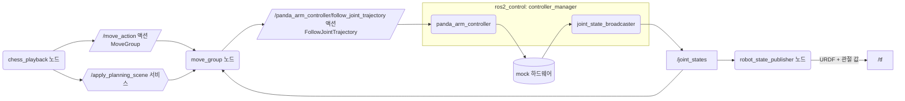
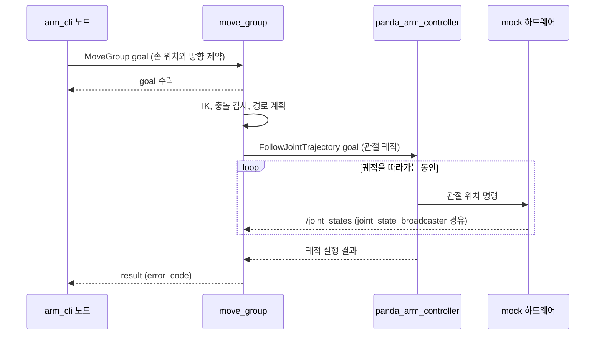
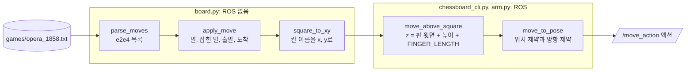

# 11장. 체스 두는 로봇팔 (Chess-bot)

- 원서: Chapter 11. Chess-bot, PDF p.185~209 (인쇄 쪽 = PDF 쪽 - 20)
- 선행 조건: 2~5장의 토픽, 서비스, 액션 개념. 이 장은 TurtleBot3 시뮬을 쓰지 않습니다.
- 새로 설치할 것: 아래 명령을 학습자가 직접 실행합니다. 패키지 이름과 버전은 2026-10-27에 `apt-cache policy`로 확인했습니다.

```bash
sudo apt install ros-jazzy-moveit ros-jazzy-moveit-resources-panda-moveit-config ros-jazzy-ros2controlcli
```

| 패키지 | 확인한 후보 버전 | 쓰는 곳 |
|---|---|---|
| `ros-jazzy-moveit` | 2.12.4-1noble.20260921.025955 | move_group, rviz2 MoveIt 플러그인, `moveit_msgs` |
| `ros-jazzy-moveit-resources-panda-moveit-config` | 3.1.0-1noble.20261006.035718 | Panda 팔의 MoveIt 설정과 `demo.launch.py`. ros2_control, 컨트롤러, `joint_state_publisher_gui`도 의존성으로 함께 설치됩니다. |
| `ros-jazzy-ros2controlcli` | 4.48.1-1noble.20261006.035651 | `ros2 control ...` 명령 |

## 이 장에서 체감할 구조

내 노드는 팔의 관절을 직접 움직이지 않습니다. `/move_action` 액션으로 move_group에게 "손을 여기로"라고 요청하고, move_group이 경로를 계획해 컨트롤러의 액션으로 넘깁니다.
관절 값은 `/joint_states`로 나오고, robot_state_publisher가 URDF와 합쳐 `/tf`로 바꿉니다.



그림에서 볼 것: 내 노드에서 하드웨어까지 가는 길에 액션이 두 번 있습니다. 앞의 것(`/move_action`)은 "어디로 가라"이고, 뒤의 것(`follow_joint_trajectory`)은 "이 궤적을 따라가라"입니다. 관절 값은 반대 방향으로 `/joint_states`를 타고 move_group과 robot_state_publisher에게 돌아옵니다.

## 1. 목표와 개념

이 장의 목표는 바퀴 달린 로봇에서 벗어나 로봇팔(manipulator)을 다뤄 보는 것입니다. 팔 끝을 원하는 위치로 보내고, 그리퍼를 열고 닫고, 체스판 위의 말을 옮겨 유명한 기보 한 판을 재현합니다.

- **링크(link)와 조인트(joint)**: 링크는 단단한 몸체 하나이고, 조인트는 두 링크를 잇는 연결입니다. 회전 조인트(revolute)는 각도 하나, 직선 조인트(prismatic)는 길이 하나를 바꿉니다.
- **기구학 사슬(kinematic chain)**: 바닥에서 손끝까지 링크와 조인트가 번갈아 이어진 줄입니다. 조인트 값을 모두 알면 손끝 위치가 하나로 정해집니다. 이 계산이 순기구학(forward kinematics)입니다.
- **관절 공간(joint space)과 작업 공간(Cartesian space)**: 관절 각도 벡터로 자세를 적는 방식과 손끝의 x, y, z와 방향으로 적는 방식입니다.

예:

```text
관절 공간 목표 (실습 11-4):  {joint_name: panda_joint1, position: 0.5, ...} 를 7개 관절마다 하나씩
작업 공간 목표 (실습 11-5):  ros2 run chess_bot arm_cli 0.4 0.0 0.5 3.1416 0 0
```

앞의 것은 관절 7개의 값을 모두 정해 주고, 뒤의 것은 손의 위치와 방향만 정하고 관절 값은 move_group이 IK로 구하게 맡깁니다.

- **역기구학(inverse kinematics, IK)**: 손끝 목표에서 관절 값을 거꾸로 구하는 계산입니다. 답이 없을 수도, 여러 개일 수도 있습니다. 관절이 6개보다 많은 팔(Panda는 7개)은 같은 손끝 자세에 팔꿈치 위치가 다른 답이 무수히 많습니다 (원서 PDF p.189).
- **URDF와 tf의 연결**: URDF(로봇 모양과 조인트를 적은 XML)는 고정된 설계도이고, `/joint_states`는 지금 관절 값입니다. robot_state_publisher가 둘을 합쳐 링크마다 좌표계를 계산해 `/tf`로 내보냅니다. tf 나무와 `tf2_echo`의 읽는 법은 2장에서 다뤘습니다.

예:

```bash
ros2 topic echo --once /joint_states
ros2 run tf2_ros tf2_echo panda_link0 panda_hand
```

첫 명령은 관절 이름과 값의 목록을, 둘째 명령은 그 값으로 계산된 바닥에서 손까지의 이동과 회전을 보여 줍니다. 같은 정보가 관절 공간과 작업 공간 두 가지로 보이는 셈입니다.

- **MoveIt 2와 move_group**: MoveIt은 경로 계획(motion planning) 프레임워크입니다. move_group 노드가 로봇 모델, 충돌 검사, IK, 계획기를 모두 품고, 결과 궤적을 컨트롤러에게 실행시킵니다.

목표 하나가 어떤 순서로 처리되는지 시간 순서로 그리면 다음과 같습니다. 액션의 goal, feedback, result 구조는 5장에서 다룬 것과 같습니다.



그림에서 볼 것: 내 노드는 관절 궤적을 만들지도, 컨트롤러와 직접 대화하지도 않습니다. 계획과 실행은 move_group 안에서 일어나고, 내 노드는 마지막에 `error_code` 하나만 받습니다.

예:

```python
self.move_client = ActionClient(self, MoveGroup, 'move_action')
goal.planning_options.plan_only = False
```

`arm.py`의 두 줄이고, `plan_only = False`이므로 계획과 실행을 한 번에 요청합니다. `True`로 두면 move_group은 계획만 돌려주고 컨트롤러를 부르지 않습니다.

- **플래닝 씬(planning scene)**: move_group이 충돌 검사에 쓰는 세계 모형입니다. 체스판과 말을 여기에 상자와 원기둥으로 넣으면 팔이 그것들을 피해서 움직입니다.

예:

```python
scene.is_diff = True
request = ApplyPlanningScene.Request(scene=scene)
```

`arm.py`의 `apply_scene`에서 보듯 플래닝 씬은 서비스로 바꿉니다. `is_diff = True`는 "지금 씬에 이 차이만 더하라"는 뜻이라, 말 하나를 추가할 때 씬 전체를 다시 보낼 필요가 없습니다.

비유: URDF는 관절 인형의 설계도, `/joint_states`는 지금 각 관절을 몇 도 굽혔는지 적은 쪽지, `/tf`는 그 둘로 계산한 손끝의 실제 위치입니다.

### 체스 칸 이름이 로봇 좌표가 되기까지

체스 칸 이름(`e2`)이 move_group의 목표가 되기까지 값은 다음 단계를 거칩니다. 왼쪽 묶음은 ROS를 전혀 쓰지 않는 순수 Python이고, 오른쪽 묶음에서 처음으로 ROS 메시지가 만들어집니다.



그림에서 볼 것: 이 그림의 네모 상자는 토픽이 아니라 함수입니다. 좌표 변환 규칙(랭크는 x축, 파일은 y축, 칸 한 변 5 cm)은 `square_to_xy` 한 곳에만 있으므로, 판을 옮기거나 칸 크기를 바꿀 때 고칠 곳도 한 곳입니다.

예:

```bash
python3 -c "from chess_bot.board import square_to_xy; print(square_to_xy('a1'), square_to_xy('h8'))"
```

출력 `(0.275, 0.175) (0.625, -0.175)`에서 a1은 로봇 가까운 왼쪽(x가 작고 y가 양수), h8은 먼 오른쪽입니다. 데모를 띄우지 않아도 이 계산을 확인할 수 있습니다.

### 어떤 팔을 쓸지 정한 근거

원서는 NASA Robonaut 2 시뮬을 씁니다 (원서 PDF p.192). 이 모델은 ROS 1 Indigo용이어서 Jazzy에서는 쓸 수 없습니다. `apt-cache policy`로 Jazzy에서 바로 설치되는 후보를 비교했습니다.

| 후보 | apt 패키지 (확인한 버전) | 판단 |
|---|---|---|
| Franka Panda (MoveIt 공식 예제 로봇) | `ros-jazzy-moveit-resources-panda-moveit-config` 3.1.0 | **선택**. Gazebo 없이 mock 하드웨어로 move_group, ros2_control, rviz2가 한 번에 뜹니다. 관절 7개라 IK 여유자유도를 직접 볼 수 있습니다. MoveIt 2 공식 튜토리얼과 이름이 같아 문서를 찾기 쉽습니다. |
| ROBOTIS OpenMANIPULATOR | `ros-jazzy-open-manipulator` 4.1.3 | 탈락. bringup이 gz_ros2_control, Dynamixel 드라이버 등에 의존해 WSL에서 실패할 지점이 많고, 관절 4개라 자세 자유도가 부족합니다. |

대가도 있습니다. Panda 데모에는 물리 엔진이 없으므로 그리퍼가 말을 실제로 쥐지 못합니다. 이 장은 "쥐었다"를 플래닝 씬에서 말을 손에 붙이는(attach) 동작으로 표현합니다. 물리 시뮬레이션에서 팔을 다루는 것은 18장에서 합니다.

### 코드와 폴더 구조

이 장을 마친 뒤의 `chess_bot` 패키지는 다음과 같습니다. `ros2 pkg create`가 만든 파일(`setup.cfg`, `resource/chess_bot`, `chess_bot/__init__.py`)은 손대지 않으므로 줄였습니다.

```text
~/rosbook_ws/src/chess_bot/
├── package.xml              rclpy, geometry_msgs, shape_msgs, moveit_msgs 실행 의존성 (11-5)
├── setup.py                 실행 파일 5개 등록, 기보 파일 설치 (11-5, 최종본은 11-10)
├── chess_bot.bash           셸 별명. 설치하지 않고 source만 함 (11-6)
├── games/
│   └── opera_1858.txt       오페라 게임 기보 (11-10)
├── chess_bot/
│   ├── arm.py               ArmClient: MoveGroup 액션과 플래닝 씬 서비스를 감싼 공용 클래스 (11-5)
│   ├── arm_cli.py           실행 파일: 손을 x, y, z, roll, pitch, yaw로 보냄 (11-5)
│   ├── hand.py              실행 파일: 그리퍼 open, pre, close (11-7)
│   ├── board.py             순수 Python: 칸 좌표, 기보 해석, 수 적용 (11-8)
│   ├── spawn_chessboard.py  실행 파일: 판과 말 32개를 씬에 추가 (11-8)
│   ├── chessboard_cli.py    ChessArm: 칸 이름과 높이로 손을 보냄 (11-9)
│   └── chess_playback.py    ChessPlayback: 기보 한 판을 재현 (11-10)
└── test/
    ├── test_board.py        board.py만 시험하는 pytest (11-10)
    └── test_copyright.py, test_flake8.py, test_pep257.py   ros2 pkg create가 만든 코드 검사
```

- 빌드하면 기보 파일은 `setup.py`의 `data_files` 줄을 따라 `install/chess_bot/share/chess_bot/games/opera_1858.txt`에 놓입니다. 실습 11-10에서 `$(ros2 pkg prefix chess_bot)/share/chess_bot/games/...`로 찾는 것이 이 파일입니다.
- 앞 장들의 노드는 `rclpy.spin(node)`으로 콜백을 기다리는 구조였습니다. 이 장의 실행 파일은 "이 동작이 끝나면 다음 동작"을 차례로 하는 순서형 프로그램이라, 동작마다 `rclpy.spin_until_future_complete(self, future)`로 그 결과만 기다립니다.
- 노드 클래스가 상속으로 쌓입니다. 아래쪽 클래스는 위쪽이 가진 동작을 그대로 쓰고 한 단계 높은 동작을 더합니다.

```text
Node ← ArmClient (arm.py: move_to_pose, set_gripper, add_object ...)
     ← ChessArm (chessboard_cli.py: move_above_square)
     ← ChessPlayback (chess_playback.py: transfer, play)
```

- 테스트 구조: `test_board.py`는 `board.py`만 import합니다. `square_to_xy`의 모서리 좌표와 잘못된 칸 거절, `parse_moves`의 수 번호와 체크 기호 걸러 내기, `apply_move`의 잡기와 캐슬링, 그리고 오페라 게임 33수 전체를 시험합니다. rclpy와 moveit_msgs를 쓰지 않으므로 move_group 없이 `colcon test`만으로 돕니다.

### 실무 메모

- 좌표 계산, 기보 해석처럼 ROS와 무관한 로직은 노드 파일에서 떼어 순수 모듈로 둡니다. 그러면 로봇이나 시뮬 없이 pytest로 빠르게 시험할 수 있고, `colcon test`가 CI에서도 그대로 돕니다. 이 장의 `board.py`와 `test_board.py`가 그 예입니다.
- 동작 계획은 언제든 실패할 수 있습니다(IK 해 없음, 충돌, 시간 초과). 목표가 수락되었는지와 결과의 `error_code`가 `MoveItErrorCodes.SUCCESS`인지를 매번 확인하고, 실패하면 다음 동작으로 넘어가지 않습니다. `arm.py`의 `_plan_and_execute`가 이 일을 한 곳에서 합니다.
- 플래닝 그룹, 링크, 조인트 이름은 SRDF와 URDF에 적힌 것과 정확히 같아야 하므로 `arm.py` 맨 위처럼 상수로 한곳에 모읍니다. 로봇을 바꿀 때 고칠 곳이 그곳뿐이 됩니다.
- 처음 시험하는 동작은 `velocity_scale`처럼 속도 비율을 낮게 두고 시작합니다. 시뮬에서는 차이가 작지만 실물 팔에서는 예상과 다른 경로를 보고 멈출 시간을 벌어 줍니다.
- 계산한 목표 좌표를 로그로 남깁니다(`chessboard_cli.py`의 `get_logger().info`). 계획이 실패했을 때 어떤 좌표에서 실패했는지 바로 알 수 있습니다.

## 2. 원서(ROS 1)와 달라지는 점

| 원서 (ROS 1) | ROS 2 Jazzy | 이유와 주의점 |
|---|---|---|
| Robonaut 2를 소스에서 빌드하고 Gazebo로 띄움 | `moveit_resources_panda_moveit_config`의 `demo.launch.py` (mock 하드웨어) | R2 모델은 Jazzy용이 없습니다. mock 하드웨어는 명령한 값을 그대로 상태로 돌려주는 가짜 하드웨어입니다. |
| `rosrun robot_state_publisher ...`와 `move_group.launch`를 따로 실행 | `demo.launch.py` 하나가 robot_state_publisher, move_group, ros2_control_node, 컨트롤러 spawner, rviz2를 모두 띄움 | 따로 띄우는 대신 `ros2 node list`로 무엇이 떴는지 확인합니다. |
| `moveit_commander` (Python 래퍼) | `/move_action` 액션(`moveit_msgs/action/MoveGroup`)과 `/apply_planning_scene` 서비스를 rclpy로 직접 호출 | Jazzy에는 moveit_commander가 없습니다. `moveit_py`(`ros-jazzy-moveit-py` 2.12.4)는 MoveIt을 내 프로세스 안에서 돌리는 방식이라 설정 파라미터를 많이 넘겨야 하고, ROS 2 통신 구조가 가려집니다. |
| `joint_state_controller`, `ros_control` | `joint_state_broadcaster`, `ros2_control` | 이름이 바뀌었습니다. 컨트롤러 목록은 `ros2 control list_controllers`로 봅니다. |
| Gazebo에 SDF 체스판을 스폰 | 플래닝 씬에 충돌 물체(CollisionObject)로 추가 | 물리 시뮬레이션이 없으므로 체스판은 충돌 검사용 모형이면 충분합니다. |
| `pip install pgnparser`로 PGN 기보 읽기 | 출발 칸과 도착 칸을 그대로 적는 기보(`e2e4` 형식)를 순수 Python으로 직접 읽음 | 시스템 pip 설치를 피하고, 기보 해석 대신 좌표 변환에 집중합니다. 잡기와 캐슬링도 처리합니다. |
| 속도 조절은 `set_max_velocity_scaling_factor` 등 메서드 | 요청 메시지의 `max_velocity_scaling_factor` 필드 | 같은 값이 메시지 필드로 드러납니다. |

## 3. 실습

모든 실습은 같은 터미널 배치를 씁니다.

- 터미널 A: `ros2 launch moveit_resources_panda_moveit_config demo.launch.py`를 계속 띄워 둡니다.
- 터미널 B, C: 관찰 명령과 내 노드를 실행합니다.

### 실습 11-1. Panda 데모를 띄우고 구조 보기

> **미검증 실습**: 문서를 쓸 때 MoveIt Panda 데모(`demo.launch.py`)를 실행하는 부분과 rviz2, rqt_graph 화면을 실제로 실행해 확인하지 못했습니다. 결과가 문서와 다르면 문서가 틀렸을 수 있으니, 7절의 검증 기록과 비교해 보세요.

**준비**: 위의 apt 패키지를 설치하고 새 터미널을 엽니다.

**직접 입력**: 터미널 A

```bash
ros2 launch moveit_resources_panda_moveit_config demo.launch.py
```

터미널 B

```bash
ros2 node list
ros2 control list_controllers
ros2 control list_hardware_interfaces
ros2 action list -t
ros2 topic info -v /joint_states
ros2 node info /move_group
```

**관찰**:

- rviz2 창에 Panda 팔과 MotionPlanning 패널이 뜹니다.
- `ros2 node list`에 `/move_group`, `/robot_state_publisher`, `/controller_manager`가 있어야 합니다. 정확한 이름은 출력으로 확인합니다.
- `list_controllers`에 `joint_state_broadcaster`, `panda_arm_controller`, `panda_hand_controller`가 `active`로 보여야 합니다.
- `list_hardware_interfaces`는 `panda_joint1/position [available] [claimed]`처럼 관절마다 command interface와 state interface를 보여 줍니다. claimed는 어떤 컨트롤러가 그 인터페이스를 쥐고 있다는 뜻입니다.
- `ros2 action list -t`에 `/move_action [moveit_msgs/action/MoveGroup]`과 `/panda_arm_controller/follow_joint_trajectory [control_msgs/action/FollowJointTrajectory]`가 함께 보입니다. 앞의 것은 내가 부를 입구이고, 뒤의 것은 move_group이 부르는 출구입니다.
- `/joint_states`의 publisher는 joint_state_broadcaster 하나이고, subscriber에 robot_state_publisher와 move_group이 있습니다.
- rqt_graph를 띄울 수 있다면 (`rqt_graph`) Nodes/Topics (all)로 위 연결을 그림으로 확인합니다.

**생각해 볼 질문**:

1. move_group은 관절 값을 어디서 얻습니까? 컨트롤러와 직접 대화하는 통로는 무엇입니까?

### 실습 11-2. 조인트, 링크, tf 연결 확인

> **미검증 실습**: 문서를 쓸 때 MoveIt 데모에서 조인트와 링크 이름, tf 연결을 확인하는 부분을 실제로 실행해 확인하지 못했습니다. 결과가 문서와 다르면 문서가 틀렸을 수 있으니, 7절의 검증 기록과 비교해 보세요.

**준비**: 터미널 A에서 데모가 실행 중입니다.

**직접 입력**: 터미널 B

```bash
ros2 topic echo --once /joint_states
ros2 run tf2_ros tf2_echo panda_link0 panda_hand
```

`tf2_echo`는 몇 줄 본 뒤 Ctrl+C로 끕니다. 이어서 tf 나무 전체를 PDF로 저장합니다.

```bash
cd /tmp && ros2 run tf2_tools view_frames
ros2 param get /robot_state_publisher robot_description | head -20
```

**관찰**:

- `/joint_states`의 `name`에 `panda_joint1`~`panda_joint7`과 손가락 조인트가 있고, `position`에 같은 순서로 값이 있습니다.
- `tf2_echo`는 바닥 좌표계에서 손 좌표계까지의 이동(Translation)과 회전(Rotation, RPY)을 보여 줍니다. 데모의 시작 자세에서 손이 아래를 향하면 roll이 약 3.14로 보입니다. 이 값을 기억해 두면 실습 11-9의 목표 방향을 이해하기 쉽습니다.
- `view_frames`가 만든 `frames_*.pdf`에 `panda_link0`부터 `panda_link8`, `panda_hand`, 손가락 링크까지 한 줄 사슬이 보입니다.
- robot_description 파라미터 안에 `<joint name="panda_joint1" type="revolute">` 같은 URDF가 들어 있습니다.

**생각해 볼 질문**:

2. joint_state_broadcaster를 멈추면 `/tf`의 손 위치는 어떻게 됩니까?

### 실습 11-3. rviz2에서 계획하고 실행하기

> **미검증 실습**: 문서를 쓸 때 rviz2의 MotionPlanning 패널에서 계획하고 실행하는 부분을 실제로 실행해 확인하지 못했습니다. 결과가 문서와 다르면 문서가 틀렸을 수 있으니, 7절의 검증 기록과 비교해 보세요.

**준비**: 터미널 A의 데모와 rviz2 창.

**직접 입력**: rviz2의 MotionPlanning 패널에서 다음을 합니다.

1. 팔 끝의 파란 공(interactive marker)을 끌어 목표 자세를 정합니다.
2. Planning 탭에서 Plan을 눌러 주황색 궤적 미리보기를 봅니다.
3. Execute를 누릅니다.

실행하는 동안 터미널 B에서 다음을 봅니다.

```bash
ros2 action info /move_action
ros2 action info /panda_arm_controller/follow_joint_trajectory
ros2 topic echo /joint_states --field position
```

**관찰**: `ros2 action info`가 각 액션의 서버(move_group, panda_arm_controller)와 클라이언트(rviz2, move_group)를 보여 줍니다. Execute 동안 `/joint_states` 값이 바뀝니다.

**생각해 볼 질문**:

3. rviz2의 Plan & Execute 버튼과 이 장에서 만들 Python 노드는 move_group 입장에서 무엇이 같습니까?

### 실습 11-4. 명령줄에서 MoveGroup 액션 보내기

> **미검증 실습**: 문서를 쓸 때 MoveGroup 액션을 명령줄로 보내는 부분(YAML, 액션 이름, 오류 코드 값)을 실제로 실행해 확인하지 못했습니다. 결과가 문서와 다르면 문서가 틀렸을 수 있으니, 7절의 검증 기록과 비교해 보세요.

**준비**: 터미널 A의 데모.

**직접 입력**: 터미널 B. 먼저 요청 메시지 모양을 봅니다.

```bash
ros2 interface show moveit_msgs/action/MoveGroup | less
ros2 interface show moveit_msgs/msg/Constraints | less
```

7개 관절 목표를 보냅니다. 값은 SRDF의 `ready` 자세에서 1번 관절만 0.5 rad 돌린 것입니다.

```bash
ros2 action send_goal --feedback /move_action moveit_msgs/action/MoveGroup "{
  request: {
    group_name: panda_arm,
    start_state: {is_diff: true},
    num_planning_attempts: 1,
    allowed_planning_time: 5.0,
    max_velocity_scaling_factor: 0.3,
    max_acceleration_scaling_factor: 0.3,
    goal_constraints: [{joint_constraints: [
      {joint_name: panda_joint1, position: 0.5, tolerance_above: 0.01, tolerance_below: 0.01, weight: 1.0},
      {joint_name: panda_joint2, position: -0.785, tolerance_above: 0.01, tolerance_below: 0.01, weight: 1.0},
      {joint_name: panda_joint3, position: 0.0, tolerance_above: 0.01, tolerance_below: 0.01, weight: 1.0},
      {joint_name: panda_joint4, position: -2.356, tolerance_above: 0.01, tolerance_below: 0.01, weight: 1.0},
      {joint_name: panda_joint5, position: 0.0, tolerance_above: 0.01, tolerance_below: 0.01, weight: 1.0},
      {joint_name: panda_joint6, position: 1.571, tolerance_above: 0.01, tolerance_below: 0.01, weight: 1.0},
      {joint_name: panda_joint7, position: 0.785, tolerance_above: 0.01, tolerance_below: 0.01, weight: 1.0}
    ]}]
  },
  planning_options: {plan_only: false}
}"
```

**관찰**:

- 피드백으로 `state: PLANNING`, `MONITOR` 같은 문자열이 지나가고, 결과의 `error_code: val: 1`이 성공입니다. 코드 표는 `ros2 interface show moveit_msgs/msg/MoveItErrorCodes`로 확인합니다.
- rviz2에서 팔이 바닥 축을 중심으로 돌아갑니다.
- `ros2 topic echo --once /joint_states --field position`에서 첫 값이 약 0.5입니다.

**생각해 볼 질문**:

4. `start_state: {is_diff: true}`를 빼면 어떤 상태에서 출발하는 계획이 됩니까?

### 실습 11-5. 패키지를 만들고 손끝을 좌표로 보내기

> **미검증 실습**: 문서를 쓸 때 `chess_bot` 패키지를 MoveIt 데모에 연결해 손끝을 좌표로 보내는 부분(패키지 빌드와 테스트는 확인했습니다)을 실제로 실행해 확인하지 못했습니다. 결과가 문서와 다르면 문서가 틀렸을 수 있으니, 7절의 검증 기록과 비교해 보세요.

**준비**: 터미널 A의 데모.

**직접 입력**: 패키지를 만듭니다.

```bash
cd ~/rosbook_ws/src
ros2 pkg create --build-type ament_python --license Apache-2.0 chess_bot
```

`~/rosbook_ws/src/chess_bot/package.xml`의 `<license>` 줄 아래에 다음을 추가합니다.

```xml
  <exec_depend>rclpy</exec_depend>
  <exec_depend>geometry_msgs</exec_depend>
  <exec_depend>shape_msgs</exec_depend>
  <exec_depend>moveit_msgs</exec_depend>
```

공용 클라이언트 클래스를 만듭니다. 이 파일은 이후 모든 실행 파일이 씁니다.

파일: `~/rosbook_ws/src/chess_bot/chess_bot/arm.py`

```python
import math

from geometry_msgs.msg import Pose, Quaternion
from moveit_msgs.action import MoveGroup
from moveit_msgs.msg import (
    AttachedCollisionObject, CollisionObject, Constraints, JointConstraint,
    MoveItErrorCodes, OrientationConstraint, PlanningScene, PositionConstraint)
from moveit_msgs.srv import ApplyPlanningScene
import rclpy
from rclpy.action import ActionClient
from rclpy.node import Node
from shape_msgs.msg import SolidPrimitive

ARM_GROUP = 'panda_arm'
HAND_GROUP = 'hand'
BASE_FRAME = 'panda_link0'
TOOL_LINK = 'panda_hand'
FINGER_JOINT = 'panda_finger_joint1'
TOUCH_LINKS = ['panda_hand', 'panda_leftfinger', 'panda_rightfinger']
FINGER_LENGTH = 0.1034
GRIPPER_OPENINGS = {'open': 0.035, 'pre': 0.02, 'close': 0.012}


def quaternion_from_rpy(roll, pitch, yaw):
    cr, sr = math.cos(roll / 2), math.sin(roll / 2)
    cp, sp = math.cos(pitch / 2), math.sin(pitch / 2)
    cy, sy = math.cos(yaw / 2), math.sin(yaw / 2)
    return Quaternion(
        x=sr * cp * cy - cr * sp * sy,
        y=cr * sp * cy + sr * cp * sy,
        z=cr * cp * sy - sr * sp * cy,
        w=cr * cp * cy + sr * sp * sy,
    )


class ArmClient(Node):
    def __init__(self, node_name):
        super().__init__(node_name)
        self.velocity_scale = self.declare_parameter('velocity_scale', 0.3).value
        self.move_client = ActionClient(self, MoveGroup, 'move_action')
        self.scene_client = self.create_client(ApplyPlanningScene, 'apply_planning_scene')

    def wait_for_move_group(self, timeout_sec=10.0):
        if not self.move_client.wait_for_server(timeout_sec=timeout_sec):
            raise RuntimeError('action server move_action not found. Is move_group running?')
        if not self.scene_client.wait_for_service(timeout_sec=timeout_sec):
            raise RuntimeError('service apply_planning_scene not found.')

    def _wait(self, future):
        rclpy.spin_until_future_complete(self, future)
        return future.result()

    def _plan_and_execute(self, group, constraints):
        goal = MoveGroup.Goal()
        goal.request.group_name = group
        goal.request.start_state.is_diff = True
        goal.request.goal_constraints = [constraints]
        goal.request.num_planning_attempts = 5
        goal.request.allowed_planning_time = 5.0
        goal.request.max_velocity_scaling_factor = self.velocity_scale
        goal.request.max_acceleration_scaling_factor = self.velocity_scale
        goal.planning_options.plan_only = False

        goal_handle = self._wait(self.move_client.send_goal_async(goal))
        if not goal_handle.accepted:
            raise RuntimeError('move_group rejected the goal')
        result = self._wait(goal_handle.get_result_async()).result
        if result.error_code.val != MoveItErrorCodes.SUCCESS:
            raise RuntimeError(f'{group}: MoveItErrorCodes {result.error_code.val}')

    def move_to_pose(self, x, y, z, roll, pitch, yaw):
        target = Pose()
        target.position.x, target.position.y, target.position.z = x, y, z

        position = PositionConstraint()
        position.header.frame_id = BASE_FRAME
        position.link_name = TOOL_LINK
        position.constraint_region.primitives = [
            SolidPrimitive(type=SolidPrimitive.SPHERE, dimensions=[0.005])]
        position.constraint_region.primitive_poses = [target]
        position.weight = 1.0

        orientation = OrientationConstraint()
        orientation.header.frame_id = BASE_FRAME
        orientation.link_name = TOOL_LINK
        orientation.orientation = quaternion_from_rpy(roll, pitch, yaw)
        orientation.absolute_x_axis_tolerance = 0.05
        orientation.absolute_y_axis_tolerance = 0.05
        orientation.absolute_z_axis_tolerance = 0.05
        orientation.weight = 1.0

        constraints = Constraints()
        constraints.position_constraints = [position]
        constraints.orientation_constraints = [orientation]
        self._plan_and_execute(ARM_GROUP, constraints)

    def move_joints(self, group, positions):
        constraints = Constraints()
        for name, value in positions.items():
            constraints.joint_constraints.append(JointConstraint(
                joint_name=name, position=value,
                tolerance_above=0.001, tolerance_below=0.001, weight=1.0))
        self._plan_and_execute(group, constraints)

    def set_gripper(self, state):
        self.move_joints(HAND_GROUP, {FINGER_JOINT: GRIPPER_OPENINGS[state]})

    def apply_scene(self, scene):
        scene.is_diff = True
        scene.robot_state.is_diff = True
        request = ApplyPlanningScene.Request(scene=scene)
        if not self._wait(self.scene_client.call_async(request)).success:
            raise RuntimeError('apply_planning_scene failed')

    def add_object(self, object_id, primitive, x, y, z):
        obj = CollisionObject()
        obj.header.frame_id = BASE_FRAME
        obj.id = object_id
        obj.pose.position.x, obj.pose.position.y, obj.pose.position.z = x, y, z
        obj.primitives = [primitive]
        obj.primitive_poses = [Pose()]
        obj.operation = CollisionObject.ADD
        scene = PlanningScene()
        scene.world.collision_objects = [obj]
        self.apply_scene(scene)

    def remove_object(self, object_id):
        obj = CollisionObject(id=object_id, operation=CollisionObject.REMOVE)
        obj.header.frame_id = BASE_FRAME
        scene = PlanningScene()
        scene.world.collision_objects = [obj]
        self.apply_scene(scene)

    def attach_object(self, object_id):
        attached = AttachedCollisionObject(link_name=TOOL_LINK, touch_links=TOUCH_LINKS)
        attached.object.id = object_id
        attached.object.operation = CollisionObject.ADD
        scene = PlanningScene()
        scene.robot_state.attached_collision_objects = [attached]
        self.apply_scene(scene)

    def detach_object(self, object_id):
        attached = AttachedCollisionObject(link_name=TOOL_LINK)
        attached.object.id = object_id
        attached.object.operation = CollisionObject.REMOVE
        scene = PlanningScene()
        scene.robot_state.attached_collision_objects = [attached]
        self.apply_scene(scene)
```

**줄 단위 해설** (`arm.py`):

| 줄 | 설명 |
|---|---|
| 1~12 | 메시지, 액션, 서비스 타입을 가져옵니다. flake8 규칙에 맞추어 알파벳 순서로 둡니다. |
| 14~21 | Panda 설정에 맞춘 이름과 값입니다. 그룹 이름, 링크 이름은 SRDF와 URDF에 적힌 것과 한 글자도 달라서는 안 됩니다. `FINGER_LENGTH`는 `panda_hand` 원점에서 손가락 끝까지의 거리(m)로, 손 좌표 목표를 정할 때 말 높이에 더합니다. |
| 24~33 | roll, pitch, yaw를 쿼터니언으로 바꾸는 함수입니다. 메시지의 방향은 쿼터니언으로만 적을 수 있습니다. |
| 36~41 | `velocity_scale` 파라미터를 선언하고, `move_action` 액션 클라이언트와 `apply_planning_scene` 서비스 클라이언트를 만듭니다. 이름 앞에 `/`가 없으므로 노드 네임스페이스 기준으로 풀립니다. |
| 43~47 | move_group이 떠 있지 않으면 기다리다가 분명한 오류를 냅니다. |
| 49~51 | future가 끝날 때까지 이 노드를 spin합니다. 이 장의 실행 파일은 한 동작을 끝까지 기다린 뒤 다음 동작으로 가는 순서형 프로그램이라 이 방식이 가장 단순합니다. |
| 53~62 | `MoveGroup.Goal`을 채웁니다. `start_state.is_diff=True`는 "지금 상태에서 출발"이라는 뜻입니다. `plan_only=False`라서 계획과 실행을 한 번에 요청합니다. |
| 64~69 | 목표를 보내고, 받아들여졌는지 확인하고, 결과를 기다린 뒤 `error_code.val`이 `SUCCESS`가 아니면 예외를 냅니다. |
| 71~95 | 손 위치는 반지름 5 mm 구 안에, 방향은 축마다 0.05 rad 안에 들어오라는 제약 두 개를 만들어 `panda_arm` 그룹으로 보냅니다. IK와 경로 계획은 move_group이 합니다. |
| 97~103 | 조인트 이름과 값 사전으로 관절 공간 목표를 만듭니다. |
| 105~106 | 그리퍼도 하나의 플래닝 그룹(`hand`)이므로 손가락 조인트 목표로 열고 닫습니다. |
| 108~113 | 플래닝 씬 변경을 `is_diff=True`(차이만 적용)로 보냅니다. 이 값을 빼면 씬 전체를 내 메시지로 덮어씁니다. |
| 115~132 | 원기둥이나 상자를 바닥 좌표계 기준 위치에 추가하고, id로 지웁니다. |
| 134~148 | 이미 씬에 있는 물체를 손에 붙이고 뗍니다. 붙일 때 모양을 다시 적지 않으면 MoveIt이 같은 id의 월드 물체를 옮겨 붙입니다. `touch_links`는 붙은 물체와 닿아도 충돌로 치지 않을 링크입니다. |

이제 첫 실행 파일을 만듭니다.

파일: `~/rosbook_ws/src/chess_bot/chess_bot/arm_cli.py`

```python
import sys

from chess_bot.arm import ArmClient
import rclpy
from rclpy.executors import ExternalShutdownException
from rclpy.utilities import remove_ros_args


def main(args=None):
    rclpy.init(args=args)
    argv = remove_ros_args(sys.argv)
    if len(argv) != 7:
        print('usage: ros2 run chess_bot arm_cli X Y Z ROLL PITCH YAW', file=sys.stderr)
        rclpy.try_shutdown()
        sys.exit(1)
    node = ArmClient('arm_cli')
    try:
        node.wait_for_move_group()
        node.move_to_pose(*[float(v) for v in argv[1:]])
        node.get_logger().info('reached the target pose')
    except (KeyboardInterrupt, ExternalShutdownException):
        pass
    except RuntimeError as error:
        node.get_logger().error(str(error))
    finally:
        node.destroy_node()
        rclpy.try_shutdown()


if __name__ == '__main__':
    main()
```

**줄 단위 해설** (`arm_cli.py`):

| 줄 | 설명 |
|---|---|
| 11 | `--ros-args -p velocity_scale:=1.0` 같은 ROS 인자를 뺀 순수 인자 목록을 얻습니다. `sys.argv`를 그대로 세면 ROS 인자까지 개수에 들어갑니다. |
| 12~15 | 인자가 6개가 아니면 사용법을 출력하고 종료합니다. |
| 16~20 | move_group을 기다린 뒤 손을 목표 자세로 보냅니다. |
| 21~27 | 이 장 모든 실행 파일이 쓰는 기본 형태입니다. MoveIt 실패는 `RuntimeError`로 받아 로그로 남깁니다. |

`~/rosbook_ws/src/chess_bot/setup.py`의 `console_scripts`를 다음처럼 채웁니다. 다른 줄은 `ros2 pkg create`가 만든 그대로 둡니다.

```python
    entry_points={
        'console_scripts': [
            'arm_cli = chess_bot.arm_cli:main',
        ],
    },
```

빌드합니다.

```bash
cd ~/rosbook_ws && colcon build --symlink-install --packages-select chess_bot
source ~/rosbook_ws/install/setup.bash
ros2 run chess_bot arm_cli 0.4 0.0 0.5 3.1416 0 0
```

**관찰**:

- rviz2에서 손이 바닥 앞 0.4 m, 높이 0.5 m에서 아래를 향합니다. 터미널에 `reached the target pose`가 찍힙니다.
- 실행 중 다른 터미널에서 `ros2 node info /arm_cli`를 보면 Action Clients에 `/move_action: moveit_msgs/action/MoveGroup`, Service Clients에 `/apply_planning_scene`이 있습니다.
- `ros2 run tf2_ros tf2_echo panda_link0 panda_hand`의 Translation이 요청한 값과 몇 mm 안에서 같습니다.

**생각해 볼 질문**:

5. 같은 목표를 두 번 보내면 팔 관절 값이 매번 같습니까? 관절 7개 팔에서 왜 그럴 수 있습니까?

### 실습 11-6. 자주 쓰는 자세에 별명 붙이기

> **미검증 실습**: 문서를 쓸 때 별명 함수로 MoveIt 데모의 팔을 움직이는 부분을 실제로 실행해 확인하지 못했습니다. 결과가 문서와 다르면 문서가 틀렸을 수 있으니, 7절의 검증 기록과 비교해 보세요.

**준비**: 실습 11-5 빌드 완료.

**직접 입력**: 파일: `~/rosbook_ws/src/chess_bot/chess_bot.bash`

```bash
armhigh() { ros2 run chess_bot arm_cli 0.4 0.0 0.6 3.1416 0 0 "$@"; }
armlow()  { ros2 run chess_bot arm_cli 0.4 0.0 0.3 3.1416 0 0 "$@"; }
armleft() { ros2 run chess_bot arm_cli 0.3 0.3 0.4 3.1416 0 0 "$@"; }
```

```bash
source ~/rosbook_ws/src/chess_bot/chess_bot.bash
armhigh
armlow --ros-args -p velocity_scale:=1.0
armleft
```

**줄 단위 해설**:

| 줄 | 설명 |
|---|---|
| 1~3 | 셸 함수입니다. `"$@"`로 뒤에 붙인 인자를 그대로 넘기므로 `--ros-args`도 쓸 수 있습니다. 설치 대상이 아니므로 `setup.py`는 바꾸지 않습니다. |

**관찰**: `velocity_scale:=1.0`일 때 팔이 눈에 띄게 빨리 움직입니다. 파라미터가 요청 메시지의 `max_velocity_scaling_factor`로 들어가기 때문입니다.

**생각해 볼 질문**:

6. 이 별명들은 `.bashrc`에 넣지 않았습니다. 새 터미널에서 `armhigh`를 쓰면 어떻게 됩니까?

### 실습 11-7. 그리퍼 열고 닫기

> **미검증 실습**: 문서를 쓸 때 MoveIt 데모에서 그리퍼를 열고 닫는 부분을 실제로 실행해 확인하지 못했습니다. 결과가 문서와 다르면 문서가 틀렸을 수 있으니, 7절의 검증 기록과 비교해 보세요.

**준비**: 터미널 A의 데모.

**직접 입력**: 먼저 그리퍼 그룹과 컨트롤러를 확인합니다.

```bash
ros2 control list_controllers
ros2 action list -t | grep hand
```

파일: `~/rosbook_ws/src/chess_bot/chess_bot/hand.py`

```python
import sys

from chess_bot.arm import ArmClient, GRIPPER_OPENINGS
import rclpy
from rclpy.executors import ExternalShutdownException
from rclpy.utilities import remove_ros_args


def main(args=None):
    rclpy.init(args=args)
    argv = remove_ros_args(sys.argv)
    if len(argv) != 2 or argv[1] not in GRIPPER_OPENINGS:
        print(f'usage: ros2 run chess_bot hand {{{"|".join(GRIPPER_OPENINGS)}}}', file=sys.stderr)
        rclpy.try_shutdown()
        sys.exit(1)
    node = ArmClient('hand')
    try:
        node.wait_for_move_group()
        node.set_gripper(argv[1])
        node.get_logger().info(f'gripper: {argv[1]}')
    except (KeyboardInterrupt, ExternalShutdownException):
        pass
    except RuntimeError as error:
        node.get_logger().error(str(error))
    finally:
        node.destroy_node()
        rclpy.try_shutdown()


if __name__ == '__main__':
    main()
```

**줄 단위 해설**:

| 줄 | 설명 |
|---|---|
| 12~15 | 인자가 `open`, `pre`, `close` 중 하나인지 검사합니다. f-string 안의 `{{`와 `}}`는 중괄호 글자 자체를 찍습니다. |
| 19 | `arm.py`의 `set_gripper`가 `hand` 그룹에 손가락 조인트 목표를 보냅니다. 팔과 같은 `/move_action` 입구를 씁니다. |

`setup.py`의 `console_scripts`에 한 줄을 추가하고 다시 빌드합니다.

```python
            'hand = chess_bot.hand:main',
```

```bash
cd ~/rosbook_ws && colcon build --symlink-install --packages-select chess_bot
source ~/rosbook_ws/install/setup.bash
ros2 run chess_bot hand open
ros2 run chess_bot hand close
ros2 topic echo --once /joint_states --field position
```

**관찰**: rviz2에서 손가락이 벌어지고 오므려집니다. `/joint_states`의 손가락 조인트 값이 0.035와 0.012 근처로 바뀝니다. 값은 손가락 하나가 가운데서 떨어진 거리(m)이므로 두 손가락 사이 간격은 그 두 배입니다.

**생각해 볼 질문**:

7. `GRIPPER_OPENINGS['close']`를 0.012로 둔 이유를 말의 반지름(실습 11-8의 `PIECE_RADIUS`)과 연결해 설명해 보십시오.

### 실습 11-8. 체스판을 플래닝 씬에 올리기

> **미검증 실습**: 문서를 쓸 때 체스판을 플래닝 씬에 올리고 rviz2와 `/monitored_planning_scene`에서 확인하는 부분을 실제로 실행해 확인하지 못했습니다. 결과가 문서와 다르면 문서가 틀렸을 수 있으니, 7절의 검증 기록과 비교해 보세요.

**준비**: 터미널 A의 데모.

**직접 입력**: 체스판 좌표 계산은 ROS와 무관한 순수 Python 모듈로 분리합니다. 그래야 데모 없이도 테스트할 수 있습니다.

파일: `~/rosbook_ws/src/chess_bot/chess_bot/board.py`

```python
FILES = 'abcdefgh'
RANKS = '12345678'

SQUARE_SIZE = 0.05
BOARD_CENTER_X = 0.45
BOARD_CENTER_Y = 0.0
BOARD_THICKNESS = 0.02
BOARD_TOP_Z = BOARD_THICKNESS
PIECE_RADIUS = 0.012
PIECE_HEIGHT = 0.04

CASTLING_ROOK_MOVES = {
    'e1g1': 'h1f1',
    'e1c1': 'a1d1',
    'e8g8': 'h8f8',
    'e8c8': 'a8d8',
}
KING_IDS = ('piece_e1', 'piece_e8')


def square_to_xy(square):
    if len(square) != 2 or square[0] not in FILES or square[1] not in RANKS:
        raise ValueError(f"expected a square like 'e2', got {square!r}")
    file_index = FILES.index(square[0])
    rank_index = RANKS.index(square[1])
    x = BOARD_CENTER_X + (rank_index - 3.5) * SQUARE_SIZE
    y = BOARD_CENTER_Y + (3.5 - file_index) * SQUARE_SIZE
    return x, y


def initial_position():
    return {f + r: f'piece_{f}{r}' for f in FILES for r in '1278'}


def parse_moves(text):
    moves = []
    for token in text.split():
        if token.endswith('.') or token in ('1-0', '0-1', '1/2-1/2', '*'):
            continue
        move = token.rstrip('+#')
        if len(move) != 4:
            raise ValueError(f'expected a move like e2e4, got {token!r}')
        square_to_xy(move[:2])
        square_to_xy(move[2:])
        moves.append(move)
    return moves


def apply_move(board, move):
    src, dst = move[:2], move[2:]
    if src not in board:
        raise ValueError(f'no piece on {src} for move {move}')
    piece = board.pop(src)
    captured = board.pop(dst, None)
    board[dst] = piece
    steps = [(piece, captured, src, dst)]
    if piece in KING_IDS and move in CASTLING_ROOK_MOVES:
        rook_src, rook_dst = CASTLING_ROOK_MOVES[move][:2], CASTLING_ROOK_MOVES[move][2:]
        rook = board.pop(rook_src)
        board[rook_dst] = rook
        steps.append((rook, None, rook_src, rook_dst))
    return steps
```

**줄 단위 해설** (`board.py`):

| 줄 | 설명 |
|---|---|
| 1~2 | 체스 칸 이름은 파일(file, 세로줄, 알파벳 a~h)과 랭크(rank, 가로줄, 숫자 1~8)로 이루어집니다. |
| 4~10 | 칸 한 변 5 cm, 판 중심은 Panda 바닥 앞 0.45 m, 판 두께 2 cm, 말은 반지름 1.2 cm, 높이 4 cm 원기둥입니다. 모두 m 단위입니다. |
| 12~18 | 캐슬링은 킹 이동 하나로 적히지만 룩도 함께 움직여야 하므로 짝을 표로 둡니다. 처음 위치의 킹(`piece_e1`, `piece_e8`)일 때만 적용합니다. |
| 21~28 | 백이 판 앞쪽(로봇 가까운 쪽)에 오도록 랭크는 x축(로봇 앞 방향), 파일은 y축으로 놓습니다. ROS 좌표계에서 y는 왼쪽이므로, 로봇에서 보아 a파일이 왼쪽에 오도록 `3.5 - file_index`를 씁니다. 3.5는 0~7 인덱스의 가운데입니다. |
| 31~32 | 시작 위치입니다. 말 id를 처음 칸 이름으로 정해 `piece_e2`처럼 씁니다. 말이 움직여도 id는 바뀌지 않습니다. |
| 35~46 | 기보 문자열에서 수 번호(`1.`), 결과(`1-0`), 체크 기호(`+`, `#`)를 걸러 내고 네 글자 이동만 남깁니다. 칸 이름이 틀리면 여기서 바로 실패합니다. |
| 49~62 | 이동 하나를 적용하고, 실제로 옮길 단계 목록 `(말, 잡힌 말, 출발, 도착)`을 돌려줍니다. 캐슬링이면 룩 단계가 하나 더 붙습니다. |

데모 없이 바로 확인합니다.

```bash
cd ~/rosbook_ws/src/chess_bot
python3 -c "from chess_bot.board import square_to_xy; print(square_to_xy('a1'), square_to_xy('h8'))"
```

출력은 `(0.275, 0.175) (0.625, -0.175)`와 같아야 합니다 (부동소수점 끝자리는 다를 수 있음).

이제 판과 말을 씬에 넣는 실행 파일입니다.

파일: `~/rosbook_ws/src/chess_bot/chess_bot/spawn_chessboard.py`

```python
from chess_bot import board
from chess_bot.arm import ArmClient
import rclpy
from rclpy.executors import ExternalShutdownException
from shape_msgs.msg import SolidPrimitive


def main(args=None):
    rclpy.init(args=args)
    node = ArmClient('spawn_chessboard')
    try:
        node.wait_for_move_group()
        board_size = 8 * board.SQUARE_SIZE
        board_box = SolidPrimitive(
            type=SolidPrimitive.BOX,
            dimensions=[board_size, board_size, board.BOARD_THICKNESS])
        node.add_object('chessboard', board_box, board.BOARD_CENTER_X, board.BOARD_CENTER_Y,
                        board.BOARD_THICKNESS / 2)

        piece_shape = SolidPrimitive(
            type=SolidPrimitive.CYLINDER,
            dimensions=[board.PIECE_HEIGHT, board.PIECE_RADIUS])
        for square, piece_id in sorted(board.initial_position().items()):
            x, y = board.square_to_xy(square)
            z = board.BOARD_TOP_Z + board.PIECE_HEIGHT / 2
            node.add_object(piece_id, piece_shape, x, y, z)
        node.get_logger().info('chessboard and 32 pieces added to the planning scene')
    except (KeyboardInterrupt, ExternalShutdownException):
        pass
    except RuntimeError as error:
        node.get_logger().error(str(error))
    finally:
        node.destroy_node()
        rclpy.try_shutdown()


if __name__ == '__main__':
    main()
```

**줄 단위 해설**:

| 줄 | 설명 |
|---|---|
| 13~18 | 체스판은 40 cm × 40 cm × 2 cm 상자입니다. `BOX`의 `dimensions`는 x, y, z 길이입니다. 상자의 위치는 중심이므로 z는 두께의 절반입니다. |
| 20~22 | 말은 원기둥입니다. `CYLINDER`의 `dimensions`는 높이, 반지름 순서입니다 (`ros2 interface show shape_msgs/msg/SolidPrimitive`로 확인). |
| 23~26 | 32개 말을 하나씩 추가합니다. 원기둥 위치도 중심이므로 판 윗면에 높이의 절반을 더합니다. |

`setup.py`에 추가하고 빌드, 실행합니다.

```python
            'spawn_chessboard = chess_bot.spawn_chessboard:main',
```

```bash
cd ~/rosbook_ws && colcon build --symlink-install --packages-select chess_bot
source ~/rosbook_ws/install/setup.bash
ros2 run chess_bot spawn_chessboard
ros2 topic echo --once /monitored_planning_scene --field world.collision_objects | grep "id:"
```

**관찰**: rviz2에 초록색 판과 원기둥 32개가 나타납니다. 판은 로봇 앞쪽에 놓이고, a1 말이 로봇에서 보아 왼쪽 앞에 있습니다. `/monitored_planning_scene` 토픽 이름은 `ros2 topic list | grep scene`으로 먼저 확인합니다.

**생각해 볼 질문**:

8. 데모를 껐다 켜면 체스판은 남아 있습니까? 플래닝 씬은 어디에 저장됩니까?

### 실습 11-9. 칸 이름으로 손 보내기

> **미검증 실습**: 문서를 쓸 때 칸 이름으로 MoveIt 데모의 팔을 보내는 부분을 실제로 실행해 확인하지 못했습니다. 결과가 문서와 다르면 문서가 틀렸을 수 있으니, 7절의 검증 기록과 비교해 보세요.

**준비**: 터미널 A의 데모, 실습 11-8의 체스판.

**직접 입력**: 파일: `~/rosbook_ws/src/chess_bot/chess_bot/chessboard_cli.py`

```python
import math
import sys

from chess_bot import board
from chess_bot.arm import ArmClient, FINGER_LENGTH
import rclpy
from rclpy.executors import ExternalShutdownException
from rclpy.utilities import remove_ros_args


class ChessArm(ArmClient):
    def move_above_square(self, square, height):
        x, y = board.square_to_xy(square)
        z = board.BOARD_TOP_Z + height + FINGER_LENGTH
        self.get_logger().info(f'{square} +{height:.3f} m -> x={x:.3f} y={y:.3f} z={z:.3f}')
        self.move_to_pose(x, y, z, math.pi, 0.0, 0.0)


def main(args=None):
    rclpy.init(args=args)
    argv = remove_ros_args(sys.argv)
    if len(argv) != 3:
        print('usage: ros2 run chess_bot chessboard_cli SQUARE HEIGHT', file=sys.stderr)
        rclpy.try_shutdown()
        sys.exit(1)
    node = ChessArm('chessboard_cli')
    try:
        node.wait_for_move_group()
        node.move_above_square(argv[1], float(argv[2]))
    except (KeyboardInterrupt, ExternalShutdownException):
        pass
    except (RuntimeError, ValueError) as error:
        node.get_logger().error(str(error))
    finally:
        node.destroy_node()
        rclpy.try_shutdown()


if __name__ == '__main__':
    main()
```

**줄 단위 해설**:

| 줄 | 설명 |
|---|---|
| 11~16 | `ArmClient`를 상속해 칸 이름과 높이(판 윗면 기준 손가락 끝 높이)를 손 좌표로 바꿉니다. 목표 링크가 `panda_hand`이므로 손가락 길이를 더해야 손가락 끝이 원하는 높이에 옵니다. roll = π는 손이 아래를 보는 방향입니다. |
| 15 | 계산한 좌표를 로그로 남깁니다. 실패했을 때 IK가 못 푼 좌표를 바로 볼 수 있습니다. |
| 32 | 칸 이름이 틀리면 `board.square_to_xy`가 `ValueError`를 내므로 함께 받습니다. |

`setup.py`에 추가하고 빌드, 실행합니다.

```python
            'chessboard_cli = chess_bot.chessboard_cli:main',
```

```bash
cd ~/rosbook_ws && colcon build --symlink-install --packages-select chess_bot
source ~/rosbook_ws/install/setup.bash
ros2 run chess_bot chessboard_cli e2 0.12
ros2 run chess_bot chessboard_cli a8 0.12
ros2 run tf2_ros tf2_echo panda_link0 panda_hand
```

**관찰**: 로그의 x, y가 `square_to_xy` 결과와 같고, `tf2_echo`의 Translation이 그 값과 몇 mm 안에서 맞습니다. 손이 기울어 있다면 실습 11-2에서 본 시작 자세의 RPY와 비교해 `move_to_pose`의 roll, pitch, yaw를 조정합니다.

**생각해 볼 질문**:

9. 높이 0을 주면 왜 계획이 실패합니까? 플래닝 씬과 연결해 답해 보십시오.

### 실습 11-10. 유명한 기보 재현하기

> **미검증 실습**: 문서를 쓸 때 오페라 게임을 MoveIt 데모의 팔로 재현하는 부분(기보 해석은 테스트로 확인했지만, 전체 소요 시간과 각 칸에서 IK가 풀리는지는 확인하지 못했습니다)을 실제로 실행해 확인하지 못했습니다. 결과가 문서와 다르면 문서가 틀렸을 수 있으니, 7절의 검증 기록과 비교해 보세요.

**준비**: 터미널 A의 데모. 체스판이 이미 있다면 데모를 다시 띄워 깨끗한 씬에서 시작합니다.

**직접 입력**: 1858년 파리 오페라 극장에서 모피(Morphy)가 둔 이른바 "오페라 게임"을 출발 칸과 도착 칸으로 적습니다. 기보 자체는 공개된 역사 기록입니다.

파일: `~/rosbook_ws/src/chess_bot/games/opera_1858.txt`

```
1. e2e4 e7e5 2. g1f3 d7d6 3. d2d4 c8g4 4. d4e5 g4f3 5. d1f3 d6e5
6. f1c4 g8f6 7. f3b3 d8e7 8. b1c3 c7c6 9. c1g5 b7b5 10. c3b5 c6b5
11. c4b5+ b8d7 12. e1c1 a8d8 13. d1d7 d8d7 14. h1d1 e7e6
15. b5d7+ f6d7 16. b3b8+ d7b8 17. d1d8# 1-0
```

12수의 `e1c1`은 퀸 쪽 캐슬링입니다. `board.py`가 a1 룩을 d1로 함께 옮깁니다.

파일: `~/rosbook_ws/src/chess_bot/chess_bot/chess_playback.py`

```python
import sys

from chess_bot import board
from chess_bot.chessboard_cli import ChessArm
import rclpy
from rclpy.executors import ExternalShutdownException
from rclpy.utilities import remove_ros_args

HOVER_HEIGHT = 0.12
GRASP_HEIGHT = board.PIECE_HEIGHT + 0.01
PLACE_HEIGHT = GRASP_HEIGHT + 0.003


class ChessPlayback(ChessArm):
    def transfer(self, piece, src, dst):
        self.move_above_square(src, HOVER_HEIGHT)
        self.move_above_square(src, GRASP_HEIGHT)
        self.set_gripper('close')
        self.attach_object(piece)
        self.move_above_square(src, HOVER_HEIGHT)
        self.move_above_square(dst, HOVER_HEIGHT)
        self.move_above_square(dst, PLACE_HEIGHT)
        self.set_gripper('pre')
        self.detach_object(piece)
        self.move_above_square(dst, HOVER_HEIGHT)

    def play(self, moves):
        position = board.initial_position()
        self.set_gripper('pre')
        for number, move in enumerate(moves, start=1):
            for piece, captured, src, dst in board.apply_move(position, move):
                self.get_logger().info(f'[{number}/{len(moves)}] {piece}: {src} -> {dst}')
                if captured is not None:
                    self.get_logger().info(f'capture: removing {captured}')
                    self.remove_object(captured)
                self.transfer(piece, src, dst)


def main(args=None):
    rclpy.init(args=args)
    argv = remove_ros_args(sys.argv)
    if len(argv) != 2:
        print('usage: ros2 run chess_bot chess_playback GAME_FILE', file=sys.stderr)
        rclpy.try_shutdown()
        sys.exit(1)
    with open(argv[1]) as f:
        moves = board.parse_moves(f.read())
    node = ChessPlayback('chess_playback')
    try:
        node.wait_for_move_group()
        node.play(moves)
        node.get_logger().info('game finished')
    except (KeyboardInterrupt, ExternalShutdownException):
        pass
    except (RuntimeError, ValueError) as error:
        node.get_logger().error(str(error))
    finally:
        node.destroy_node()
        rclpy.try_shutdown()


if __name__ == '__main__':
    main()
```

**줄 단위 해설**:

| 줄 | 설명 |
|---|---|
| 9~11 | 판 위 높이(손가락 끝 기준)입니다. 이동은 12 cm 위에서, 집기는 말 높이보다 1 cm 위에서 합니다. 놓을 때는 3 mm 더 띄워 판과 겹치지 않게 합니다. |
| 15~25 | 말 하나를 옮기는 순서입니다: 출발 칸 위, 내려가기, 닫기, 손에 붙이기, 올라가기, 도착 칸 위, 내려가기, 조금 열기, 떼기, 올라가기. |
| 19, 24 | 붙인 말은 손과 함께 움직이는 충돌 물체가 되므로, 옮기는 동안 다른 말과 부딪히지 않는 경로가 계획됩니다. 떼면 그 자리의 월드 물체로 돌아갑니다. |
| 27~36 | 시작 위치에서 수를 하나씩 적용합니다. 잡힌 말이 있으면 먼저 씬에서 지우고 옮깁니다. 캐슬링이면 킹과 룩이 차례로 옮겨집니다. |
| 46~47 | 실행 전에 기보 전체를 해석합니다. 칸 이름이 틀리면 팔이 움직이기 전에 실패합니다. |

`setup.py`에 두 가지를 추가합니다. `data_files`에 기보 파일을 설치하는 줄을, `console_scripts`에 실행 파일 줄을 넣습니다. 기보 파일을 만들기 전에 이 줄을 넣으면 빌드가 실패하므로 이 실습에서 추가합니다. 최종 `setup.py`는 다음과 같습니다.

파일: `~/rosbook_ws/src/chess_bot/setup.py`

```python
from setuptools import find_packages, setup

package_name = 'chess_bot'

setup(
    name=package_name,
    version='0.0.0',
    packages=find_packages(exclude=['test']),
    data_files=[
        ('share/ament_index/resource_index/packages',
            ['resource/' + package_name]),
        ('share/' + package_name, ['package.xml']),
        ('share/' + package_name + '/games', ['games/opera_1858.txt']),
    ],
    install_requires=['setuptools'],
    zip_safe=True,
    maintainer='pjw',
    maintainer_email='pjw@todo.todo',
    description='TODO: Package description',
    license='Apache-2.0',
    extras_require={
        'test': [
            'pytest',
        ],
    },
    entry_points={
        'console_scripts': [
            'arm_cli = chess_bot.arm_cli:main',
            'hand = chess_bot.hand:main',
            'spawn_chessboard = chess_bot.spawn_chessboard:main',
            'chessboard_cli = chess_bot.chessboard_cli:main',
            'chess_playback = chess_bot.chess_playback:main',
        ],
    },
)
```

maintainer 줄은 `ros2 pkg create`가 내 환경에 맞게 만든 값을 그대로 둡니다. 바뀐 곳은 13줄과 31~32줄입니다.

팔 없이 기보 처리를 검사하는 테스트를 추가합니다.

파일: `~/rosbook_ws/src/chess_bot/test/test_board.py`

```python
import os

from chess_bot import board
import pytest


def test_square_to_xy_corners():
    assert board.square_to_xy('a1') == pytest.approx((0.275, 0.175))
    assert board.square_to_xy('h8') == pytest.approx((0.625, -0.175))


def test_bad_square_is_rejected():
    with pytest.raises(ValueError):
        board.square_to_xy('i9')


def test_parse_skips_numbers_and_marks():
    assert board.parse_moves('1. e2e4 e7e5 2. d1h5+ b8c6 1-0') == ['e2e4', 'e7e5', 'd1h5', 'b8c6']


def test_capture_and_castling():
    position = board.initial_position()
    position.pop('f1')
    position.pop('g1')
    assert board.apply_move(position, 'e1g1') == [
        ('piece_e1', None, 'e1', 'g1'), ('piece_h1', None, 'h1', 'f1')]
    position['d5'] = position.pop('d7')
    position['e4'] = position.pop('e2')
    assert board.apply_move(position, 'e4d5') == [('piece_e2', 'piece_d7', 'e4', 'd5')]


def test_opera_game_replays():
    game_file = os.path.join(os.path.dirname(__file__), '..', 'games', 'opera_1858.txt')
    with open(game_file) as f:
        moves = board.parse_moves(f.read())
    position = board.initial_position()
    for number, move in enumerate(moves):
        white_to_move = number % 2 == 0
        piece = position.get(move[:2], '')
        assert piece[-1] in ('12' if white_to_move else '78'), move
        board.apply_move(position, move)
    assert len(moves) == 33
    assert len(position) == 32 - 12
```

**줄 단위 해설**:

| 줄 | 설명 |
|---|---|
| 7~9 | 판 모서리 두 칸의 좌표가 설계와 맞는지 봅니다. |
| 21~29 | 킹 쪽 캐슬링이 룩을 함께 옮기는지, 잡기가 잡힌 말 id를 돌려주는지 봅니다. |
| 32~43 | 오페라 게임 전체를 적용하면서, 매 수마다 움직이는 말이 차례에 맞는 색(id 끝 숫자가 1·2면 백, 7·8이면 흑)인지 확인합니다. 33수(반수 기준), 잡기 12번이므로 20개가 남아야 합니다. |

빌드, 테스트, 실행합니다.

```bash
cd ~/rosbook_ws && colcon build --symlink-install --packages-select chess_bot
source ~/rosbook_ws/install/setup.bash
colcon test --packages-select chess_bot
colcon test-result --verbose --test-result-base build/chess_bot
ros2 run chess_bot spawn_chessboard
ros2 run chess_bot chess_playback $(ros2 pkg prefix chess_bot)/share/chess_bot/games/opera_1858.txt --ros-args -p velocity_scale:=1.0
```

**관찰**:

- `colcon test-result`가 오류 0, 실패 0으로 끝나야 합니다. flake8, pep257, copyright 검사도 같이 돕니다.
- 로그에 `[1/33] piece_e2: e2 -> e4`처럼 진행이 찍히고, rviz2에서 말 원기둥이 손에 붙어 이동합니다. 붙은 물체는 rviz2에서 다른 색으로 보입니다.
- 잡기 수에서는 `capture: removing ...` 로그 뒤에 잡힌 말이 사라집니다.
- 한 판 전체는 수십 분 걸릴 수 있습니다. Ctrl+C로 언제든 멈출 수 있습니다.

**생각해 볼 질문**:

10. 실행 도중 Ctrl+C로 멈췄다가 다시 실행하면 왜 첫 수부터 실패할 수 있습니까?

## 4. 일부러 망가뜨려 보기

| 바꿀 것 | 예상 증상 | 원인을 확인하는 명령 |
|---|---|---|
| `arm.py`의 `ARM_GROUP`을 `panda_arms`로 바꿈 | 목표가 거절되거나 오류 코드로 끝납니다. move_group 로그에 그룹을 찾을 수 없다는 메시지가 납니다. (미검증) | 터미널 A의 move_group 로그, `ros2 param get /move_group robot_description_semantic \| grep "group name"` |
| 실습 11-4 명령의 `panda_joint1`을 `panda_jiont1`로 바꿈 (조인트 이름 오타) | 계획이 실패하고 결과 `error_code`가 SUCCESS(1)가 아닙니다. (미검증) | `ros2 topic echo --once /joint_states --field name`, `ros2 interface show moveit_msgs/msg/MoveItErrorCodes` |
| `ros2 control set_controller_state panda_arm_controller inactive` | 계획은 성공하지만 실행 단계에서 실패합니다. 컨트롤러가 목표를 받지 않기 때문입니다. (미검증) | `ros2 control list_controllers`, `ros2 action info /panda_arm_controller/follow_joint_trajectory` |
| `ros2 control set_controller_state joint_state_broadcaster inactive` | `/joint_states`가 멈춥니다. move_group은 현재 상태를 모른다고 경고하고 계획이 실패하거나, rviz2의 팔이 실제와 다른 자세에 멈춰 보입니다. (미검증) | `ros2 topic hz /joint_states`, `ros2 topic info -v /joint_states` |
| 터미널 A의 데모를 Ctrl+C로 끈 뒤 `arm_cli` 실행 (노드 종료) | 10초 뒤 `action server move_action not found` 오류. (미검증) | `ros2 action list -t`, `ros2 node list` |
| `chessboard_cli e2 -0.05` (판 속으로 들어가는 높이) | 목표 자세가 판과 충돌해 계획 실패. (미검증) | move_group 로그, rviz2에서 판 표시 확인 |
| `arm_cli 1.5 0 0.5 3.1416 0 0` (닿지 않는 위치) | IK 해가 없어 계획 실패. (미검증) | move_group 로그, `ros2 run tf2_ros tf2_echo panda_link0 panda_hand`로 현재 손 위치와 비교 |
| `arm.py`의 `BASE_FRAME`을 `panda_link_0`으로 바꿈 (tf에 없는 좌표계, 깨진 tf) | 목표의 좌표계를 변환할 수 없어 계획이 실패하고 move_group 로그에 프레임을 찾을 수 없다는 메시지가 납니다. (미검증) | `ros2 run tf2_tools view_frames`, `ros2 run tf2_ros tf2_echo panda_link_0 panda_hand` |
| 내 노드만 `ROS_DOMAIN_ID`를 다른 값으로 실행 | `move_action not found`. 같은 컴퓨터여도 도메인이 다르면 서로 보이지 않습니다. (미검증) | `echo $ROS_DOMAIN_ID`, `ros2 node list` |
| `arm_cli`를 `--ros-args -p use_sim_time:=true`로 실행 | 이 데모에는 `/clock`이 없으므로 노드 시계가 0에 머뭅니다. 이 장의 코드는 시계를 쓰지 않아 동작은 같지만, 로그 시각이 0 근처로 찍힙니다. 시뮬레이터가 있는 18장에서는 반대로 이 설정을 빠뜨리면 문제가 됩니다. (미검증) | `ros2 topic list \| grep clock`, `ros2 param get /arm_cli use_sim_time` (실행 중일 때) |

## 5. 확인 질문

<details><summary>Q1. move_group은 관절 값을 어디서 얻고, 컨트롤러와는 무엇으로 대화합니까?</summary>

`/joint_states`를 구독해 현재 관절 값을 얻습니다. 실행은 `/panda_arm_controller/follow_joint_trajectory` 액션(`control_msgs/action/FollowJointTrajectory`)의 클라이언트가 되어 궤적을 보냅니다. `ros2 node info /move_group`의 Subscribers와 Action Clients에서 둘 다 보입니다.

</details>

<details><summary>Q2. joint_state_broadcaster를 멈추면 /tf의 손 위치는 어떻게 됩니까?</summary>

robot_state_publisher는 새 관절 값을 받지 못하므로 마지막으로 받은 값으로 계산한 tf를 계속 보내거나 갱신을 멈춥니다. 컨트롤러가 팔을 움직여도 tf와 rviz2의 모습은 따라오지 않습니다. 고정 조인트의 tf(`/tf_static`)는 영향을 받지 않습니다.

</details>

<details><summary>Q3. rviz2의 Plan & Execute와 내 Python 노드는 move_group 입장에서 무엇이 같습니까?</summary>

둘 다 `/move_action` 액션의 클라이언트입니다. move_group은 요청이 어디서 왔는지 구분하지 않고 같은 계획기와 같은 컨트롤러 경로를 씁니다.

</details>

<details><summary>Q4. start_state: {is_diff: true}를 빼면?</summary>

빈 RobotState가 시작 상태로 해석되어, 모든 관절이 0인 자세에서 출발하는 계획이 될 수 있습니다. 그 계획은 현재 자세와 시작점이 맞지 않아 실행 단계에서 거부됩니다. `is_diff: true`는 "현재 상태에 이 차이만 적용"이라는 뜻이고, 차이가 비어 있으므로 현재 상태 그대로입니다.

</details>

<details><summary>Q5. 같은 목표를 두 번 보내면 관절 값이 같습니까?</summary>

같지 않을 수 있습니다. 손끝 자세는 6개 값으로 정해지는데 Panda는 관절이 7개라 남는 자유도 하나만큼 답이 여러 개입니다. IK 풀이가 무작위 시작점을 쓰면 매번 다른 답을 고를 수 있습니다. 관절 값을 고정하고 싶으면 관절 공간 목표(실습 11-4)를 씁니다.

</details>

<details><summary>Q6. 새 터미널에서 armhigh를 쓰면?</summary>

`command not found`가 납니다. 셸 함수는 `source`한 셸에만 있습니다. 매번 `source ~/rosbook_ws/src/chess_bot/chess_bot.bash`를 실행하거나, 원하면 학습자가 직접 `.bashrc`에 추가합니다.

</details>

<details><summary>Q7. close를 0.012로 둔 이유는?</summary>

말의 반지름이 0.012 m이고, 손가락 값은 가운데서 손가락 하나까지의 거리입니다. 0.012면 손가락이 말 표면에 딱 닿는 위치입니다. 이보다 작게 하면 손가락이 말을 파고드는 자세가 되어, 붙인 말과 손가락이 겹친다고 판단될 수 있습니다. 그래서 `touch_links`에 손가락 링크를 넣었습니다.

</details>

<details><summary>Q8. 데모를 껐다 켜면 체스판은 남아 있습니까?</summary>

남지 않습니다. 플래닝 씬은 move_group 프로세스의 메모리에만 있습니다. 다시 띄우면 `spawn_chessboard`를 다시 실행해야 합니다.

</details>

<details><summary>Q9. 높이 0을 주면 왜 실패합니까?</summary>

높이 0은 손가락 끝이 판 윗면에 닿는 위치입니다. 손가락 끝은 둥근 메시라 약간만 내려가도 판 상자와 겹치고, 같은 칸에 말이 있으면 말과도 겹칩니다. move_group은 충돌하는 목표 자세를 거부합니다.

</details>

<details><summary>Q10. 중간에 멈췄다 다시 실행하면 왜 첫 수부터 실패할 수 있습니까?</summary>

플래닝 씬에는 이미 옮겨진 말, 지워진 말, 손에 붙은 말이 남아 있습니다. 그런데 `chess_playback`은 늘 시작 위치에서 출발한다고 가정합니다. 예를 들어 e2에 말이 없으면 손이 빈 칸으로 가고, `attach_object('piece_e2')`가 다른 칸에 있는 물체를 붙이게 됩니다. 데모를 다시 띄우고 `spawn_chessboard`부터 다시 합니다.

</details>

## 6. 원서 대조 메모

- 원서는 Robonaut 2와 Gazebo, `moveit_commander`를 씁니다 (원서 PDF p.192~196). 이 장은 Panda mock 데모와 MoveGroup 액션으로 바꿨습니다. 이유는 1절과 2절에 적었습니다.
- 원서의 무작위 자세 예제(원서 PDF p.194~195)는 실습 11-4의 명령줄 관절 목표와 실습 11-5의 좌표 목표로 대신했습니다. 무작위 자세는 닿지 않는 목표가 많아 실패 원인을 배우기 어렵기 때문입니다.
- 원서 PDF p.197의 설명은 체스 칸 이름의 알파벳을 랭크로 부르는데, 알파벳은 파일(세로줄)이고 숫자가 랭크입니다.
- 칸 이름을 좌표로 바꾸는 방식이 원서 PDF p.198의 예제와 p.207의 예제에서 서로 반대로 되어 있습니다 (한 곳은 알파벳을 x, 다른 곳은 y로 봅니다). 이 장은 `board.py` 한 곳에서만 변환하고 테스트로 고정했습니다.
- 원서 PDF p.204의 예제가 여는 체스판 파일 이름이 앞 예제(p.203)에서 만든 파일 이름과 다릅니다 (밑줄 유무).
- 손 안쪽으로 집는 기준점 보정값이 원서 PDF p.200의 예제와 p.207의 예제에서 서로 다릅니다. 이 장은 `FINGER_LENGTH` 상수 하나로 통일했습니다.
- 원서 PDF p.196의 예제는 ROS 인자를 걸러 낸 목록을 만들고도 원래 `sys.argv`로 인자를 읽습니다. 이 장은 `remove_ros_args` 결과만 씁니다.
- 원서는 잡기를 처리하지 않는다고 밝힙니다 (원서 PDF p.208). 이 장은 잡기와 캐슬링을 처리합니다. 앙파상과 승진은 오페라 게임에 없어 다루지 않습니다.
- 원서는 PGN 해석에 pip 패키지를 씁니다 (원서 PDF p.206). 이 장은 시스템 pip 설치를 피하려고 출발·도착 칸 표기를 직접 읽습니다.
- 원서는 Gazebo의 체스판 SDF를 스폰합니다 (원서 PDF p.202~204). 이 장은 물리 시뮬레이션 대신 플래닝 씬 충돌 물체로 바꿨으므로 말을 실제로 쥐지 않고 attach/detach로 표현합니다.

## 7. 이 문서의 검증 상태

- 확인함 (2026-10-27, WSL Ubuntu 24.04, Jazzy, 별도 작업 공간 `~/guide_verify/E/ws`):
  - 1절과 맨 위의 apt 패키지 이름과 후보 버전: `apt-cache policy`로 확인했습니다. 모두 아직 설치되지 않은 상태입니다. `ros-jazzy-open-manipulator` 4.1.3, `ros-jazzy-moveit-py` 2.12.4, `ros-jazzy-pymoveit2` 5.0.0도 같은 방법으로 존재를 확인했습니다.
  - `chess_bot` 패키지 전체(이 문서의 코드와 같은 파일): `colcon build` 성공, 실행 파일 5개 설치, `share/chess_bot/games/opera_1858.txt` 설치 확인.
  - `colcon test --packages-select chess_bot`: 8개 중 오류 0, 실패 0, 건너뜀 1 (flake8, pep257, copyright 포함). 오페라 게임 33수, 잡기 12번, 남은 말 20개를 테스트로 확인했습니다.
  - `shape_msgs/msg/SolidPrimitive`의 BOX=1, SPHERE=2, CYLINDER=3과 CYLINDER의 dimensions 순서(높이, 반지름): `ros2 interface show`로 확인했습니다.
  - `ros2 run chess_bot arm_cli`는 moveit_msgs가 없는 현재 환경에서 `ModuleNotFoundError: moveit_msgs`로 끝납니다. MoveIt 설치가 필요하다는 것만 확인한 셈입니다.
- 확인 못 함:
  - MoveIt 2가 설치되지 않아 다음은 실행해 보지 못했습니다: `demo.launch.py` 이름과 실행, 노드와 컨트롤러 이름(`panda_arm_controller`, `panda_hand_controller`), 플래닝 그룹 `panda_arm`과 `hand`, 링크와 조인트 이름, `FINGER_LENGTH`와 그리퍼 값, `/move_action`과 `/apply_planning_scene`의 실제 이름과 `moveit_msgs` 필드, attach/detach의 동작, 실습 11-4의 YAML, `/monitored_planning_scene` 토픽 이름, `ros2 control` 명령의 출력 형식, 오류 코드 값과 4절의 증상.
  - 손이 아래를 향하는 방향이 roll = π인지는 실습 11-2의 `tf2_echo`로 학습자가 확인해야 합니다.
  - rviz2, rqt_graph 화면: 확인 못 함(GUI).
  - 오페라 게임 전체 재현에 걸리는 시간과 각 칸에서 IK가 모두 풀리는지: 확인 못 함.
- 설명 보강(2026-10-30): "이 장에서 체감할 구조"와 1절에 그림, 코드 예시, 코드와 폴더 구조, 실무 메모를 더했습니다. 머리말과 2~6절은 바꾸지 않았습니다. 1절의 코드 예시는 따로 실행하지 않았습니다.
- 미검증 표시(2026-10-31): 실습 11-1~11-10 전부에 미검증 실습 표시를 붙였고, 4절의 모든 행(10개)에 (미검증)을 붙였습니다.
