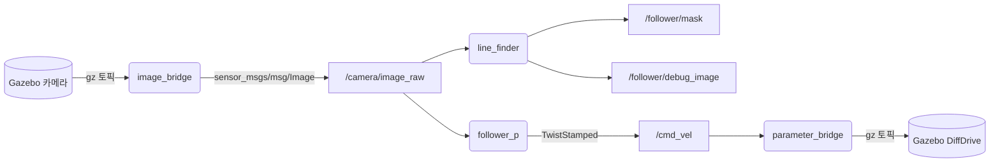
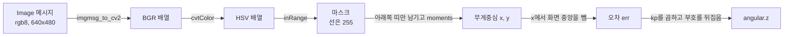
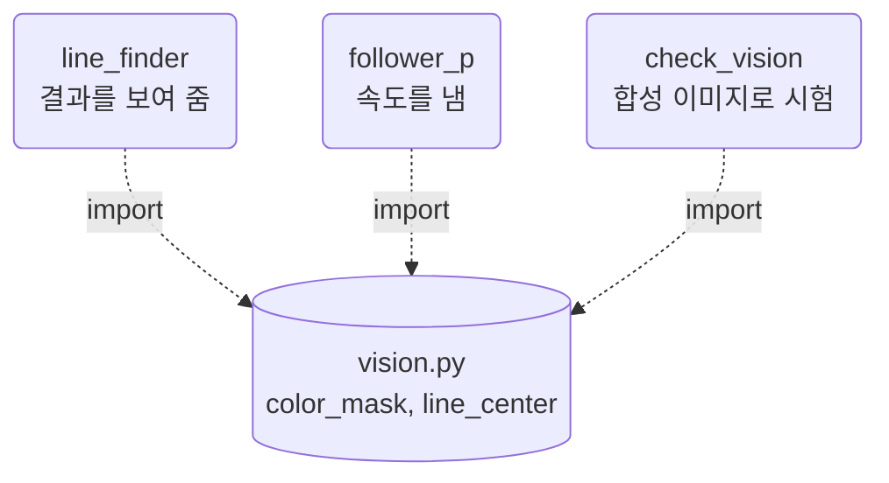

# 12장. 카메라로 선 따라가기

- 원서: Chapter 12. Follow-Bot, PDF p.213~228 (인쇄 쪽 = PDF 쪽 - 20)
- 선행 조건: 7장에서 `/cmd_vel`에 `TwistStamped`를 보내 본 경험, TurtleBot3 시뮬(`turtlebot3_world.launch.py`)을 띄워 본 경험
- 새로 설치할 것: 없음. 이 장에서 쓰는 `cv_bridge`, `rqt_image_view`, 압축 이미지 플러그인은 데스크톱 설치에 이미 들어 있습니다. `ros2 pkg prefix cv_bridge`가 경로를 출력하지 않으면 `sudo apt install ros-jazzy-cv-bridge ros-jazzy-rqt-image-view ros-jazzy-image-transport-plugins`를 실행합니다.

## 이 장에서 체감할 구조


`line_finder`는 눈으로 확인하기 위한 결과를 내고, `follower_p`는 같은 이미지를 따로 받아 속도 명령을 냅니다. 카메라 이미지도 결국 하나의 토픽이고, 영상 처리 노드는 "이미지 토픽을 받아 속도 토픽을 내보내는" 평범한 노드입니다. 센서 데이터에는 보통 QoS를 `qos_profile_sensor_data`로 맞춥니다.

## 1. 목표와 개념

이 장의 목표는 카메라 이미지에서 바닥의 노란 선을 찾고, 선이 화면 가운데에 오도록 회전 속도를 조절하면서 로봇을 따라가게 하는 것입니다.

- **이미지 메시지**: `sensor_msgs/msg/Image`는 가로·세로 크기, 픽셀 형식(`encoding`), 한 줄의 바이트 수(`step`), 그리고 픽셀 바이트 배열(`data`)로 이루어집니다.
- **cv_bridge**: ROS 이미지 메시지와 OpenCV 배열(numpy) 사이를 변환하는 라이브러리입니다.
- **HSV 색 공간**: 색상(H), 채도(S), 명도(V)로 색을 나타냅니다. 조명이 바뀌어도 색상 값은 비교적 덜 변하므로, 특정 색을 골라내기 쉽습니다. OpenCV에서 H는 0~179 범위이고, 노랑은 약 30입니다.
- **마스크와 무게중심**: 범위에 드는 픽셀만 255로 만든 흑백 이미지(마스크)를 만들고, 그 픽셀들의 평균 위치를 구하면 선의 위치가 됩니다.
- **비례 제어(P 제어)**: 오차(선의 x 위치와 화면 중앙의 차이)에 상수를 곱한 값을 회전 속도로 씁니다.

비유: 운전자가 차선의 가운데를 보고 핸들을 오차만큼만 꺾는 것과 같습니다.

### 이미지 한 장이 속도 명령이 되기까지

콜백은 이미지가 올 때마다 아래 순서를 한 번 거칩니다. 위 목록의 개념이 차례로 등장합니다.



그림에서 볼 것: 이미지는 변환을 거칠수록 숫자 하나(`angular.z`)로 줄어듭니다. 앞의 세 단계는 영상 처리이고, 마지막 두 단계만 제어입니다.

예: 이미지 메시지의 필드는 12-2의 로그 한 줄로 그대로 읽을 수 있습니다.

```python
f'image #{self.count}: {msg.width}x{msg.height} '
f'encoding={msg.encoding} step={msg.step} '
f'bytes={len(msg.data)}'
```

`step`은 640 픽셀 x 3 바이트인 1920이고, `data`의 길이는 `step * height`인 921600 바이트입니다. 한 장이 약 0.9 MB이므로 30 Hz면 초당 약 27 MB가 오갑니다.

예: 12-5의 `line_finder`는 메시지를 OpenCV 배열로 바꾸며 시작합니다.

```python
image = self.bridge.imgmsg_to_cv2(msg, desired_encoding='bgr8')
```

시뮬 카메라는 `rgb8`을 보내지만 OpenCV 함수는 B, G, R 순서를 기대하므로 받을 때 순서를 맞춥니다.

예: 12-3의 `vision.py`가 색을 고르는 부분입니다.

```python
hsv = cv2.cvtColor(bgr, cv2.COLOR_BGR2HSV)
return cv2.inRange(hsv, lower, upper)
```

노랑 `(0, 255, 255)`(BGR)는 HSV로 `[30 255 255]`가 되어, 기본 범위 `[20, 100, 100]`~`[40, 255, 255]` 안에 듭니다.

예: 12-6의 `follower_p`가 오차를 회전 속도로 바꾸는 두 줄입니다.

```python
err = center[0] - mask.shape[1] / 2
cmd.twist.angular.z = -self.get_parameter('kp').value * err
```

선이 오른쪽에 있으면 `err`가 양수이고, 부호를 뒤집은 `angular.z`는 음수(오른쪽 회전)가 됩니다. `kp=0.005`에서 오차 100 픽셀은 0.5 rad/s입니다.

### 코드와 폴더 구조

이 장은 `follow_bot` 패키지(ament_python)를 만듭니다. 패키지 기본 구조와 `data_files`로 launch 파일을 설치하는 방법은 2장에서 설명했으므로, 여기서는 이 장에서 더해지는 것만 적습니다.

```text
~/rosbook_ws/src/follow_bot/
├── package.xml            # 의존성: cv_bridge, sensor_msgs, geometry_msgs (12-2, 12-4)
├── setup.py               # console_scripts 4개와 launch/, worlds/ 설치 (12-2~12-6)
├── setup.cfg, resource/   # ros2 pkg create가 만든 그대로
├── follow_bot/
│   ├── vision.py          # ROS를 모르는 순수 함수: color_mask, line_center (12-3)
│   ├── check_vision.py    # vision.py를 합성 이미지로 시험하는 스크립트 (12-3)
│   ├── follower.py        # 이미지 메시지 필드만 로그로 찍는 구독 노드 (12-2)
│   ├── line_finder.py     # 선 검출 결과를 마스크와 디버그 이미지 토픽으로 발행 (12-5)
│   └── follower_p.py      # 선 검출 + 비례 제어로 /cmd_vel 발행 (12-6)
├── launch/course.launch.py  # Gazebo, robot_state_publisher, 로봇 생성을 include (12-4)
└── worlds/course.sdf        # 노란 팔각형 선이 있는 월드 (12-4)
```

빌드하면 `launch/`와 `worlds/`의 파일은 `install/follow_bot/share/follow_bot/launch/`와 `.../worlds/`에 놓이고(`--symlink-install`이면 `src/`를 가리키는 링크), 실행 파일 네 개는 `install/follow_bot/lib/follow_bot/`에 놓입니다.

세 노드가 `vision.py`를 함께 쓰는 구조입니다.



그림에서 볼 것: 영상 처리 함수는 ROS 코드가 아니므로 시뮬 없이 시험할 수 있습니다(12-3). `line_finder`와 `follower_p`는 서로 메시지를 주고받지 않고, 같은 카메라 토픽을 각자 구독해 같은 함수를 부릅니다. 그래서 `line_finder`를 껐다 켜도 주행에는 영향이 없습니다. 노드 뼈대는 이 가이드의 기본 형태 그대로이고, 이 장에서 눈에 띄는 차이는 구독 QoS를 `qos_profile_sensor_data`로 두는 것과 콜백 안에서 `get_parameter`를 매번 읽어 실행 중 파라미터 변경이 바로 반영되는 것입니다.

### 실무 메모

- 이미지 토픽은 크기가 큽니다(위의 계산). 같은 컴퓨터 안의 처리 노드는 원본(`/camera/image_raw`)을 구독하고, 네트워크 너머에서 눈으로 볼 때는 `image_transport` 압축 토픽(`/camera/image_raw/compressed`가 있을 때)을 고려합니다. 대역폭은 `ros2 topic bw`로 비교합니다.
- 센서 토픽은 `qos_profile_sensor_data`(best effort)로 구독하는 것이 일반적입니다. 발행 쪽과 QoS가 맞지 않으면 아무 로그 없이 데이터가 오지 않으므로, 안 보이면 `ros2 topic info -v`부터 확인합니다(4절 첫 항목).
- 처리 결과는 `cv2.imshow` 대신 디버그 이미지 토픽으로 내보내고 `rqt_image_view`로 봅니다. 이때 `header=msg.header`로 원본의 시각과 프레임을 이어 붙이는 습관을 들입니다.
- HSV 범위와 `kp`, `speed` 같은 임계값은 코드에 박지 않고 파라미터로 둡니다. 조명이나 월드가 바뀔 때 `ros2 param set`으로 실행 중에 조정합니다.

## 2. 원서(ROS 1)와 달라지는 점

| 원서 (ROS 1) | ROS 2 Jazzy | 이유와 주의점 |
|---|---|---|
| Gazebo Classic 플러그인이 카메라 토픽을 직접 발행 | Gazebo Harmonic 카메라를 `ros_gz_image`의 `image_bridge`가 ROS 토픽으로 옮김 | 브리지가 없으면 ROS 쪽에서는 이미지가 보이지 않습니다. `spawn_turtlebot3.launch.py`가 burger가 아닌 모델일 때 자동으로 띄웁니다. |
| 카메라 토픽 이름이 로봇 설정마다 다름 | `/camera/image_raw`, `/camera/camera_info` | waffle_pi 모델 SDF의 `<topic>`과 브리지 설정 파일에서 확인합니다 (실습 12-1). |
| `rospy.Subscriber(..., Image, cb)` | `create_subscription(Image, ..., qos_profile_sensor_data)` | ROS 2는 QoS를 명시합니다. 센서 토픽에는 best effort 수신이 일반적입니다. |
| `Twist`를 `cmd_vel_mux`로 보냄 | `TwistStamped`를 `/cmd_vel`로 직접 보냄 | Jazzy TurtleBot3 시뮬 브리지가 `TwistStamped`를 받습니다. `cmd_vel_mux`는 ROS 1 Kobuki 스택의 구성입니다. |
| `cv2.imshow`로 디버그 창 | 디버그 이미지를 토픽으로 발행하고 `rqt_image_view`로 봄 | 노드가 창을 직접 열지 않으면 원격에서도 볼 수 있고, 노드가 GUI에 묶이지 않습니다. |
| 원서가 쓰는 Gazebo 월드 | 이 장에서 직접 만든 `course.sdf` | 설치된 autorace 월드는 필요한 모델 파일이 패키지에 없어서 그대로 쓸 수 없었습니다. |

## 3. 실습

### 실습 12-1. 카메라 토픽 살펴보기

> **미검증 실습**: 문서를 쓸 때 Gazebo 시뮬의 카메라 토픽(실제 encoding, 압축 토픽 유무)과 rqt_image_view 화면을 실제로 실행해 확인하지 못했습니다. 결과가 문서와 다르면 문서가 틀렸을 수 있으니, 7절의 검증 기록과 비교해 보세요.

**준비**: 터미널 3개. 터미널 1에서 시뮬을 띄웁니다.

**직접 입력**:

터미널 1:
```bash
ros2 launch turtlebot3_gazebo turtlebot3_world.launch.py
```

터미널 2:
```bash
ros2 topic list | grep camera
ros2 topic info -v /camera/image_raw
ros2 interface show sensor_msgs/msg/Image
ros2 topic echo --once /camera/image_raw --field encoding
ros2 topic hz /camera/image_raw
```

터미널 3 (카메라 사양을 파일에서 직접 확인합니다):
```bash
P=$(ros2 pkg prefix turtlebot3_gazebo)/share/turtlebot3_gazebo
grep -n -A14 '<sensor name="camera"' $P/models/turtlebot3_waffle_pi/model.sdf
grep -n -B2 -A4 camera $P/params/turtlebot3_waffle_pi_bridge.yaml
grep -n image_bridge $P/launch/spawn_turtlebot3.launch.py
ros2 run rqt_image_view rqt_image_view /camera/image_raw --ros-args -p use_sim_time:=true
```

**관찰**:
- 모델 SDF에서 카메라는 `camera/image_raw` 토픽, 640x480, `R8G8B8`, 30 Hz, 수평 시야각 1.085595 rad, 프레임 `camera_rgb_frame`으로 설정되어 있습니다. 카메라는 바닥에서 약 9 cm 높이에 수평으로 달려 있습니다.
- 브리지 설정 파일에는 `camera/camera_info`만 있고, 이미지는 `spawn_turtlebot3.launch.py`가 따로 띄우는 `image_bridge`가 담당합니다.
- `topic info -v`의 Publisher 쪽 노드 이름과 QoS를 적어 둡니다. 이 값이 12-2의 구독 QoS와 맞는지 비교합니다.
- `/camera/image_raw/compressed`처럼 뒤에 전송 방식이 붙은 토픽이 함께 보이면, `image_bridge`가 image_transport로 발행하고 있다는 뜻입니다.

**생각해 볼 질문**:
1. 640x480 `rgb8` 이미지 한 장은 몇 바이트이고, 30 Hz면 초당 몇 MB입니까?
2. 카메라가 9 cm 높이에서 수평으로 보면, 화면 아래쪽 1/4에는 로봇 앞 어느 정도 거리의 바닥이 보이겠습니까?

### 실습 12-2. 패키지를 만들고 이미지를 받아 보기

> **미검증 실습**: 문서를 쓸 때 Gazebo 시뮬 카메라가 내보내는 이미지의 encoding(rgb8로 예상)을 실제로 실행해 확인하지 못했습니다. 결과가 문서와 다르면 문서가 틀렸을 수 있으니, 7절의 검증 기록과 비교해 보세요.

**준비**: 터미널 1에서 시뮬이 계속 실행 중입니다.

**직접 입력**:
```bash
cd ~/rosbook_ws/src
ros2 pkg create --build-type ament_python --license Apache-2.0 \
  --dependencies rclpy sensor_msgs geometry_msgs cv_bridge -- follow_bot
```

`~/rosbook_ws/src/follow_bot/follow_bot/follower.py`:
```python
import rclpy
from rclpy.executors import ExternalShutdownException
from rclpy.node import Node
from sensor_msgs.msg import Image


class Follower(Node):
    def __init__(self):
        super().__init__('follower')
        self.count = 0
        self.sub = self.create_subscription(
            Image, 'camera/image_raw', self.image_callback, 10)

    def image_callback(self, msg):
        self.count += 1
        if self.count % 30 == 1:
            self.get_logger().info(
                f'image #{self.count}: {msg.width}x{msg.height} '
                f'encoding={msg.encoding} step={msg.step} '
                f'bytes={len(msg.data)}')


def main(args=None):
    rclpy.init(args=args)
    node = Follower()
    try:
        rclpy.spin(node)
    except (KeyboardInterrupt, ExternalShutdownException):
        pass
    finally:
        node.destroy_node()
        rclpy.try_shutdown()


if __name__ == '__main__':
    main()
```

`~/rosbook_ws/src/follow_bot/setup.py`의 `console_scripts`에 한 줄을 추가합니다 (setup.py 전체는 실습 12-4에서 다시 보여 줍니다).
```python
            'follower = follow_bot.follower:main',
```

```bash
cd ~/rosbook_ws && colcon build --symlink-install --packages-select follow_bot
source ~/rosbook_ws/install/setup.bash
ros2 run follow_bot follower --ros-args -p use_sim_time:=true
```

**줄 단위 해설**:

| 줄 | 설명 |
|---|---|
| `from sensor_msgs.msg import Image` | 카메라 이미지 메시지 타입입니다. |
| `create_subscription(Image, 'camera/image_raw', ..., 10)` | 상대 이름이므로 네임스페이스가 없으면 `/camera/image_raw`가 됩니다. 마지막 `10`은 depth 10, reliable QoS를 뜻합니다. |
| `self.count % 30 == 1` | 30 Hz 이미지마다 로그를 찍으면 너무 많으므로 약 1초에 한 번만 찍습니다. |
| `msg.width`, `msg.height`, `msg.encoding`, `msg.step`, `len(msg.data)` | 메시지 구조를 눈으로 확인합니다. `step`은 한 줄의 바이트 수이고, `data` 길이는 `step * height`입니다. |

**관찰**: 로그에 `640x480 encoding=rgb8 step=1920 bytes=921600`과 비슷한 줄이 약 1초 간격으로 나와야 합니다. 이 장의 검증 환경에서는 합성 이미지(`bgr8`)로 같은 노드를 돌려 `640x480 encoding=bgr8 step=1920 bytes=921600`을 확인했습니다. 다른 터미널에서 `ros2 node info /follower`를 실행해 Subscribers에 `/camera/image_raw: sensor_msgs/msg/Image`가 있는지 봅니다.

**생각해 볼 질문**:
1. 로그가 한 줄도 나오지 않는다면 어떤 명령으로 원인을 좁히겠습니까? (힌트: 4절의 QoS 항목)

### 실습 12-3. HSV로 노란색 골라내기 (시뮬 없이)

**준비**: 시뮬은 꺼도 됩니다. 영상 처리 함수만 따로 만들어 합성 이미지로 시험합니다.

**직접 입력**:

`~/rosbook_ws/src/follow_bot/follow_bot/vision.py`:
```python
import cv2
import numpy as np


def color_mask(bgr, lower_hsv, upper_hsv):
    hsv = cv2.cvtColor(bgr, cv2.COLOR_BGR2HSV)
    lower = np.array(lower_hsv, dtype=np.uint8)
    upper = np.array(upper_hsv, dtype=np.uint8)
    return cv2.inRange(hsv, lower, upper)


def line_center(mask, band_top=0.75, band_rows=20):
    h = mask.shape[0]
    top = int(h * band_top)
    band = np.zeros_like(mask)
    band[top:top + band_rows, :] = mask[top:top + band_rows, :]
    m = cv2.moments(band, binaryImage=True)
    if m['m00'] == 0:
        return None
    return int(m['m10'] / m['m00']), int(m['m01'] / m['m00'])
```

`~/rosbook_ws/src/follow_bot/follow_bot/check_vision.py`:
```python
import cv2
from follow_bot.vision import color_mask, line_center
import numpy as np
from rclpy.logging import get_logger


def main():
    log = get_logger('check_vision')
    pixel = np.uint8([[[0, 255, 255]]])
    log.info(f'yellow BGR (0,255,255) -> HSV {cv2.cvtColor(pixel, cv2.COLOR_BGR2HSV)[0, 0]}')

    image = np.full((480, 640, 3), 90, dtype=np.uint8)
    cv2.line(image, (320, 479), (480, 200), (0, 220, 220), 30)

    mask = color_mask(image, [20, 100, 100], [40, 255, 255])
    log.info(f'mask pixels: {cv2.countNonZero(mask)}')
    log.info(f'center in band: {line_center(mask)}')


if __name__ == '__main__':
    main()
```

setup.py의 `console_scripts`에 `'check_vision = follow_bot.check_vision:main',`을 추가하고 빌드합니다.
```bash
cd ~/rosbook_ws && colcon build --symlink-install --packages-select follow_bot
source ~/rosbook_ws/install/setup.bash
ros2 run follow_bot check_vision
```

**줄 단위 해설**:

| 줄 | 설명 |
|---|---|
| `cv2.cvtColor(bgr, cv2.COLOR_BGR2HSV)` | OpenCV 배열은 기본이 BGR 순서입니다. HSV로 바꾸면 H가 0~179, S와 V가 0~255입니다. |
| `cv2.inRange(hsv, lower, upper)` | 세 채널이 모두 범위 안에 드는 픽셀은 255, 나머지는 0인 마스크를 돌려줍니다. |
| `band_top=0.75, band_rows=20` | 화면 높이의 3/4 지점부터 20줄만 봅니다. 로봇 바로 앞의 선만 쓰고, 먼 곳의 선은 무시하기 위해서입니다. |
| `cv2.moments(band, binaryImage=True)` | `m00`은 픽셀 수, `m10/m00`과 `m01/m00`은 무게중심의 x, y입니다. |
| `if m['m00'] == 0: return None` | 띠 안에 선이 없으면 위치를 알 수 없다고 알립니다. 0으로 나누는 것을 막습니다. |
| `get_logger('check_vision')` | 노드가 없는 스크립트에서도 ROS 로그 형식으로 출력합니다. |
| `np.full(..., 90)`과 `cv2.line(..., (0, 220, 220), 30)` | 회색 바닥에 두께 30 픽셀의 노란 선을 그린 합성 이미지입니다. |

**관찰**: 검증 환경에서 실제로 나온 출력은 다음과 같습니다.
```
[INFO] [...] [check_vision]: yellow BGR (0,255,255) -> HSV [ 30 255 255]
[INFO] [...] [check_vision]: mask pixels: 10144
[INFO] [...] [check_vision]: center in band: (382, 369)
```
선이 오른쪽 위로 기울어 있으므로, 화면 3/4 높이에서 선 중심은 x=382로 화면 중앙(320)보다 오른쪽입니다.

**생각해 볼 질문**:
1. 하한을 `[0, 0, 0]`, 상한을 `[179, 255, 255]`로 바꾸면 `mask pixels`는 얼마가 되겠습니까?

### 실습 12-4. 선이 있는 월드와 launch 파일 조립하기

> **미검증 실습**: 문서를 쓸 때 Gazebo에 코스를 띄웠을 때의 모습(코스 모양, 카메라 화면)과 `--show-args` 출력 전체를 실제로 실행해 확인하지 못했습니다. 결과가 문서와 다르면 문서가 틀렸을 수 있으니, 7절의 검증 기록과 비교해 보세요.

**준비**: 시뮬은 꺼 둡니다. 이 실습에서는 남이 만든 launch 파일을 include해서 새 launch 파일을 조립합니다.

**직접 입력**:
```bash
mkdir -p ~/rosbook_ws/src/follow_bot/worlds ~/rosbook_ws/src/follow_bot/launch
```

`~/rosbook_ws/src/follow_bot/worlds/course.sdf`:
```xml
<?xml version="1.0"?>
<sdf version="1.8">
  <world name="course">
    <plugin filename="gz-sim-physics-system" name="gz::sim::systems::Physics"/>
    <plugin filename="gz-sim-user-commands-system" name="gz::sim::systems::UserCommands"/>
    <plugin filename="gz-sim-scene-broadcaster-system" name="gz::sim::systems::SceneBroadcaster"/>
    <plugin filename="gz-sim-sensors-system" name="gz::sim::systems::Sensors">
      <render_engine>ogre2</render_engine>
    </plugin>
    <plugin filename="gz-sim-imu-system" name="gz::sim::systems::Imu"/>

    <light type="directional" name="sun">
      <pose>0 0 10 0 0 0</pose>
      <diffuse>0.9 0.9 0.9 1</diffuse>
      <direction>-0.3 0.2 -1</direction>
    </light>

    <model name="ground">
      <static>true</static>
      <link name="link">
        <collision name="collision">
          <geometry><plane><normal>0 0 1</normal><size>20 20</size></plane></geometry>
        </collision>
        <visual name="visual">
          <geometry><plane><normal>0 0 1</normal><size>20 20</size></plane></geometry>
          <material>
            <ambient>0.4 0.4 0.4 1</ambient>
            <diffuse>0.4 0.4 0.4 1</diffuse>
          </material>
        </visual>
      </link>
    </model>

    <model name="yellow_line">
      <static>true</static>
      <link name="link">
        <visual name="bottom">
          <pose>0 -2 0.001 0 0 0</pose>
          <geometry><box><size>2.05 0.05 0.001</size></box></geometry>
          <material><ambient>1 1 0 1</ambient><diffuse>1 1 0 1</diffuse></material>
        </visual>
        <visual name="corner_1">
          <pose>1.5 -1.5 0.001 0 0 0.7854</pose>
          <geometry><box><size>1.46 0.05 0.001</size></box></geometry>
          <material><ambient>1 1 0 1</ambient><diffuse>1 1 0 1</diffuse></material>
        </visual>
        <visual name="right">
          <pose>2 0 0.001 0 0 1.5708</pose>
          <geometry><box><size>2.05 0.05 0.001</size></box></geometry>
          <material><ambient>1 1 0 1</ambient><diffuse>1 1 0 1</diffuse></material>
        </visual>
        <visual name="corner_2">
          <pose>1.5 1.5 0.001 0 0 -0.7854</pose>
          <geometry><box><size>1.46 0.05 0.001</size></box></geometry>
          <material><ambient>1 1 0 1</ambient><diffuse>1 1 0 1</diffuse></material>
        </visual>
        <visual name="top">
          <pose>0 2 0.001 0 0 0</pose>
          <geometry><box><size>2.05 0.05 0.001</size></box></geometry>
          <material><ambient>1 1 0 1</ambient><diffuse>1 1 0 1</diffuse></material>
        </visual>
        <visual name="corner_3">
          <pose>-1.5 1.5 0.001 0 0 0.7854</pose>
          <geometry><box><size>1.46 0.05 0.001</size></box></geometry>
          <material><ambient>1 1 0 1</ambient><diffuse>1 1 0 1</diffuse></material>
        </visual>
        <visual name="left">
          <pose>-2 0 0.001 0 0 1.5708</pose>
          <geometry><box><size>2.05 0.05 0.001</size></box></geometry>
          <material><ambient>1 1 0 1</ambient><diffuse>1 1 0 1</diffuse></material>
        </visual>
        <visual name="corner_4">
          <pose>-1.5 -1.5 0.001 0 0 -0.7854</pose>
          <geometry><box><size>1.46 0.05 0.001</size></box></geometry>
          <material><ambient>1 1 0 1</ambient><diffuse>1 1 0 1</diffuse></material>
        </visual>
      </link>
    </model>
  </world>
</sdf>
```

| 줄 | 설명 |
|---|---|
| `<plugin ... Physics/UserCommands/SceneBroadcaster>` | 물리 계산, 모델 생성 명령 처리, GUI로 장면 전달을 맡는 기본 시스템입니다. 로봇을 spawn하려면 UserCommands가 필요합니다. |
| `<plugin ... Sensors>`와 `<render_engine>ogre2` | 카메라 같은 렌더링 센서를 돌립니다. 이것이 없으면 카메라 토픽에 이미지가 나오지 않습니다. |
| `<plugin ... Imu>` | 로봇 모델의 IMU 센서를 돌립니다. |
| `model name="ground"` | 바닥 평면을 직접 정의합니다. 인터넷에서 모델을 내려받는 `model://ground_plane` 대신 써서 오프라인에서도 열리게 했습니다. |
| `model name="yellow_line"` | 충돌 없이 보이기만 하는 얇은 상자 8개로 한 변 약 4 m의 팔각형 코스를 만듭니다. 선 폭은 5 cm입니다. |
| `<pose>x y z roll pitch yaw</pose>` | 각 조각의 위치와 회전입니다. 모서리 조각은 yaw를 ±0.7854 rad(45도) 돌렸습니다. |

`~/rosbook_ws/src/follow_bot/launch/course.launch.py`:
```python
import os

from ament_index_python.packages import get_package_share_directory
from launch import LaunchDescription
from launch.actions import AppendEnvironmentVariable, DeclareLaunchArgument
from launch.actions import IncludeLaunchDescription
from launch.launch_description_sources import PythonLaunchDescriptionSource
from launch.substitutions import LaunchConfiguration


def generate_launch_description():
    tb3_dir = get_package_share_directory('turtlebot3_gazebo')
    gz_sim_launch = os.path.join(
        get_package_share_directory('ros_gz_sim'), 'launch', 'gz_sim.launch.py')
    default_world = os.path.join(
        get_package_share_directory('follow_bot'), 'worlds', 'course.sdf')

    world = LaunchConfiguration('world')
    x_pose = LaunchConfiguration('x_pose')
    y_pose = LaunchConfiguration('y_pose')

    return LaunchDescription([
        DeclareLaunchArgument('world', default_value=default_world),
        DeclareLaunchArgument('x_pose', default_value='0.0'),
        DeclareLaunchArgument('y_pose', default_value='-2.0'),

        AppendEnvironmentVariable(
            'GZ_SIM_RESOURCE_PATH', os.path.join(tb3_dir, 'models')),

        IncludeLaunchDescription(
            PythonLaunchDescriptionSource(gz_sim_launch),
            launch_arguments={
                'gz_args': ['-r -v2 ', world],
                'on_exit_shutdown': 'true',
            }.items()),

        IncludeLaunchDescription(
            PythonLaunchDescriptionSource(
                os.path.join(tb3_dir, 'launch', 'robot_state_publisher.launch.py')),
            launch_arguments={'use_sim_time': 'true'}.items()),

        IncludeLaunchDescription(
            PythonLaunchDescriptionSource(
                os.path.join(tb3_dir, 'launch', 'spawn_turtlebot3.launch.py')),
            launch_arguments={'x_pose': x_pose, 'y_pose': y_pose}.items()),
    ])
```

| 줄 | 설명 |
|---|---|
| `get_package_share_directory(...)` | 설치된 패키지의 share 폴더 경로를 찾습니다. 경로를 하드코딩하지 않습니다. |
| `DeclareLaunchArgument('world', ...)` 등 | 밖에서 `world:=...`, `x_pose:=...`처럼 바꿀 수 있는 인자를 선언합니다. 14장은 `world` 인자만 바꿔서 이 파일을 다시 씁니다. |
| `y_pose` 기본값 `-2.0` | 로봇을 아래쪽 직선 구간 위(`y=-2`)에 놓습니다. 로봇은 +x 방향을 보므로 선과 나란히 섭니다. |
| `AppendEnvironmentVariable('GZ_SIM_RESOURCE_PATH', ...)` | Gazebo가 `turtlebot3_waffle_pi` 모델의 메시 파일을 찾을 수 있게 경로를 더합니다. |
| `gz_sim.launch.py`와 `'gz_args': ['-r -v2 ', world]` | Gazebo 서버와 GUI를 함께 띄우고, `-r`로 바로 시뮬레이션을 시작합니다. 리스트는 실행 시점에 문자열로 이어 붙여집니다. |
| `'on_exit_shutdown': 'true'` | Gazebo 창을 닫으면 launch 전체를 끝냅니다. |
| `robot_state_publisher.launch.py` | TurtleBot3 패키지가 제공하는 launch를 그대로 include해서 TF를 발행합니다. |
| `spawn_turtlebot3.launch.py` | 로봇 생성, `parameter_bridge`, `image_bridge`를 한 번에 띄웁니다. 이 파일은 yaw 인자를 받지 않습니다. |

이제 `~/rosbook_ws/src/follow_bot/setup.py` 전체를 아래처럼 바꿉니다. 실습 12-5와 12-6에서 만들 실행 파일도 미리 등록해 둡니다. 파일을 아직 만들지 않은 실행 파일은 실행하면 `ModuleNotFoundError`가 나므로, 해당 실습까지는 실행하지 않습니다.
```python
from glob import glob
import os

from setuptools import find_packages, setup

package_name = 'follow_bot'

setup(
    name=package_name,
    version='0.0.0',
    packages=find_packages(exclude=['test']),
    data_files=[
        ('share/ament_index/resource_index/packages',
            ['resource/' + package_name]),
        ('share/' + package_name, ['package.xml']),
        (os.path.join('share', package_name, 'launch'), glob('launch/*.launch.py')),
        (os.path.join('share', package_name, 'worlds'), glob('worlds/*.sdf')),
    ],
    install_requires=['setuptools'],
    zip_safe=True,
    maintainer='pjw',
    maintainer_email='pjw@todo.todo',
    description='Line following with a camera (Chapter 12)',
    license='Apache-2.0',
    extras_require={
        'test': [
            'pytest',
        ],
    },
    entry_points={
        'console_scripts': [
            'follower = follow_bot.follower:main',
            'check_vision = follow_bot.check_vision:main',
            'line_finder = follow_bot.line_finder:main',
            'follower_p = follow_bot.follower_p:main',
        ],
    },
)
```

`~/rosbook_ws/src/follow_bot/package.xml`의 의존성 부분을 아래처럼 맞춥니다. `maintainer`, `description` 줄은 `ros2 pkg create`가 만든 그대로 두어도 됩니다.
```xml
<?xml version="1.0"?>
<?xml-model href="http://download.ros.org/schema/package_format3.xsd" schematypens="http://www.w3.org/2001/XMLSchema"?>
<package format="3">
  <name>follow_bot</name>
  <version>0.0.0</version>
  <description>Line following with a camera (Chapter 12)</description>
  <maintainer email="pjw@todo.todo">pjw</maintainer>
  <license>Apache-2.0</license>

  <depend>rclpy</depend>
  <depend>sensor_msgs</depend>
  <depend>geometry_msgs</depend>
  <depend>cv_bridge</depend>

  <exec_depend>python3-opencv</exec_depend>
  <exec_depend>python3-numpy</exec_depend>
  <exec_depend>ros_gz_sim</exec_depend>
  <exec_depend>turtlebot3_gazebo</exec_depend>

  <test_depend>ament_copyright</test_depend>
  <test_depend>ament_flake8</test_depend>
  <test_depend>ament_pep257</test_depend>
  <test_depend>python3-pytest</test_depend>

  <export>
    <build_type>ament_python</build_type>
  </export>
</package>
```

| 줄 | 설명 |
|---|---|
| `from glob import glob`, `import os` | `launch/`와 `worlds/` 폴더의 파일 목록을 만들 때 씁니다. |
| `data_files`의 마지막 두 줄 | 빌드할 때 launch 파일과 월드 파일을 `install/follow_bot/share/follow_bot/` 아래로 복사(또는 링크)합니다. 이 줄이 없으면 `ros2 launch follow_bot ...`가 파일을 찾지 못합니다. |
| `exec_depend ros_gz_sim`, `turtlebot3_gazebo` | launch 파일이 include하는 패키지들입니다. 실행할 때만 필요하므로 `exec_depend`입니다. |

```bash
cd ~/rosbook_ws && colcon build --symlink-install --packages-select follow_bot
source ~/rosbook_ws/install/setup.bash
ros2 launch follow_bot course.launch.py --show-args
ros2 launch -p follow_bot course.launch.py
gz sdf -k $(ros2 pkg prefix follow_bot)/share/follow_bot/worlds/course.sdf
ros2 launch follow_bot course.launch.py
```

**관찰**:
- `--show-args`에 `world`, `x_pose`, `y_pose`가 보입니다. include한 파일의 인자도 함께 나옵니다.
- `ros2 launch -p`는 실행하지 않고 launch 구조만 출력합니다. 검증 환경에서는 DeclareLaunchArgument 3개, AppendEnvironmentVariable 1개, IncludeLaunchDescription 3개가 차례로 출력되는 것을 확인했습니다.
- `gz sdf -k`는 SDF 문법을 검사합니다. 검증 환경에서 `Valid.`가 나왔습니다.
- 마지막 명령으로 Gazebo가 열리면 회색 바닥에 노란 팔각형 선이 있고, 로봇은 아래쪽 직선 위에 서 있어야 합니다. 다른 터미널에서 `ros2 run rqt_image_view rqt_image_view /camera/image_raw --ros-args -p use_sim_time:=true`로 선이 화면 아래쪽에 보이는지 확인합니다.

**생각해 볼 질문**:
1. `turtlebot3_world.launch.py`는 `gz_sim.launch.py`를 서버용과 GUI용으로 두 번 include합니다. 이 장의 launch 파일은 한 번만 include합니다. 무엇이 달라집니까? (`ros2 launch -p`로 두 파일을 비교해 봅니다.)

### 실습 12-5. 선 검출 결과를 토픽으로 보기

> **미검증 실습**: 문서를 쓸 때 Gazebo 시뮬에서 rqt_image_view와 rqt_graph로 보는 관찰 항목과 압축 토픽 유무를 실제로 실행해 확인하지 못했습니다. 결과가 문서와 다르면 문서가 틀렸을 수 있으니, 7절의 검증 기록과 비교해 보세요.

**준비**: 터미널 1에서 `ros2 launch follow_bot course.launch.py`가 실행 중입니다.

**직접 입력**:

`~/rosbook_ws/src/follow_bot/follow_bot/line_finder.py`:
```python
import cv2
from cv_bridge import CvBridge
from follow_bot.vision import color_mask, line_center
import rclpy
from rclpy.executors import ExternalShutdownException
from rclpy.node import Node
from rclpy.qos import qos_profile_sensor_data
from sensor_msgs.msg import Image


class LineFinder(Node):
    def __init__(self):
        super().__init__('line_finder')
        self.declare_parameter('lower_hsv', [20, 100, 100])
        self.declare_parameter('upper_hsv', [40, 255, 255])
        self.bridge = CvBridge()
        self.sub = self.create_subscription(
            Image, 'camera/image_raw', self.image_callback, qos_profile_sensor_data)
        self.mask_pub = self.create_publisher(Image, 'follower/mask', 1)
        self.debug_pub = self.create_publisher(Image, 'follower/debug_image', 1)

    def image_callback(self, msg):
        image = self.bridge.imgmsg_to_cv2(msg, desired_encoding='bgr8')
        mask = color_mask(image,
                          self.get_parameter('lower_hsv').value,
                          self.get_parameter('upper_hsv').value)
        center = line_center(mask)

        h, w = mask.shape
        top = int(h * 0.75)
        cv2.rectangle(image, (0, top), (w - 1, top + 20), (255, 0, 0), 2)
        if center is not None:
            cv2.circle(image, center, 10, (0, 0, 255), -1)

        self.mask_pub.publish(
            self.bridge.cv2_to_imgmsg(mask, encoding='mono8', header=msg.header))
        self.debug_pub.publish(
            self.bridge.cv2_to_imgmsg(image, encoding='bgr8', header=msg.header))


def main(args=None):
    rclpy.init(args=args)
    node = LineFinder()
    try:
        rclpy.spin(node)
    except (KeyboardInterrupt, ExternalShutdownException):
        pass
    finally:
        node.destroy_node()
        rclpy.try_shutdown()


if __name__ == '__main__':
    main()
```

| 줄 | 설명 |
|---|---|
| `declare_parameter('lower_hsv', [20, 100, 100])` | HSV 범위를 파라미터로 둡니다. 실행 중에 `ros2 param set`으로 바꿔 볼 수 있습니다. |
| `qos_profile_sensor_data` | best effort, depth 5인 QoS입니다. 이미지가 몇 장 빠져도 최신 이미지를 빨리 받는 쪽이 낫기 때문입니다. |
| `create_publisher(Image, 'follower/mask', 1)` | 디버그용이므로 큐를 1로 둡니다. |
| `imgmsg_to_cv2(msg, desired_encoding='bgr8')` | 시뮬 카메라는 `rgb8`을 보내지만, OpenCV 함수가 기대하는 BGR 순서로 변환해서 받습니다. |
| `cv2.rectangle(...)`, `cv2.circle(...)` | 검사하는 띠를 파란 사각형으로, 찾은 선 중심을 빨간 점으로 그립니다. |
| `cv2_to_imgmsg(..., header=msg.header)` | 원본 이미지의 시각과 프레임(`camera_rgb_frame`)을 그대로 붙입니다. 결과 이미지가 언제 어느 카메라에서 온 것인지 유지됩니다. |

```bash
cd ~/rosbook_ws && colcon build --symlink-install --packages-select follow_bot
source ~/rosbook_ws/install/setup.bash
ros2 run follow_bot line_finder --ros-args -p use_sim_time:=true
```

다른 터미널:
```bash
ros2 run rqt_image_view rqt_image_view /follower/debug_image --ros-args -p use_sim_time:=true
ros2 topic info -v /camera/image_raw
ros2 topic echo --once /follower/mask --field encoding
ros2 topic echo --once /follower/debug_image --field header
ros2 param set /line_finder lower_hsv "[0, 0, 0]"
ros2 run rqt_graph rqt_graph
```

**관찰**:
- `rqt_image_view`에서 파란 띠 안의 노란 선 위에 빨간 점이 찍혀야 합니다. 드롭다운에서 `/follower/mask`를 고르면 선만 흰색인 흑백 이미지가 보입니다.
- `topic info -v`의 Subscription 목록에서 `line_finder`는 `Reliability: BEST_EFFORT`, `History (Depth): KEEP_LAST (5)`로 나옵니다. 검증 환경에서 이 값을 확인했습니다.
- `/follower/mask`의 encoding은 `mono8`, `/follower/debug_image`의 header에는 `frame_id: camera_rgb_frame`이 그대로 실려 있습니다 (합성 이미지로 확인).
- `lower_hsv`를 `[0, 0, 0]`으로 바꾸면 마스크가 거의 흰색이 되고 빨간 점이 화면 가운데 근처로 옮겨갑니다.
- rqt_graph에서 `/camera/image_raw`가 `line_finder`로 들어가는 화살표를 확인합니다.
- 압축 이미지: `ros2 topic list | grep compressed`로 `/camera/image_raw/compressed`가 있는지 봅니다. 있으면 `rqt_image_view` 드롭다운에서 고를 수 있고, `ros2 topic bw`로 원본 토픽과 대역폭을 비교할 수 있습니다. `line_finder`가 낸 토픽에는 압축 버전이 없습니다. `create_publisher`로 직접 발행했기 때문입니다.

**생각해 볼 질문**:
1. `header=msg.header`를 빼면 `/follower/debug_image`의 `frame_id`와 `stamp`는 어떻게 됩니까?
2. 원본 이미지와 압축 이미지의 대역폭 차이가 큰 이유는 무엇이고, 영상 처리 노드는 어느 쪽을 구독해야 합니까?

### 실습 12-6. 비례 제어로 선 따라가기

> **미검증 실습**: 문서를 쓸 때 Gazebo에서 로봇이 선을 따라 도는 모습과 `kp` 변화에 따른 주행을 실제로 실행해 확인하지 못했습니다. 결과가 문서와 다르면 문서가 틀렸을 수 있으니, 7절의 검증 기록과 비교해 보세요.

**준비**: 터미널 1에서 `course.launch.py`가 실행 중이고, 로봇이 출발 위치에 있습니다. 로봇이 이미 움직였다면 launch를 다시 시작합니다.

**직접 입력**:

`~/rosbook_ws/src/follow_bot/follow_bot/follower_p.py`:
```python
from cv_bridge import CvBridge
from follow_bot.vision import color_mask, line_center
from geometry_msgs.msg import TwistStamped
import rclpy
from rclpy.executors import ExternalShutdownException
from rclpy.node import Node
from rclpy.qos import qos_profile_sensor_data
from sensor_msgs.msg import Image


class FollowerP(Node):
    def __init__(self):
        super().__init__('follower_p')
        self.declare_parameter('lower_hsv', [20, 100, 100])
        self.declare_parameter('upper_hsv', [40, 255, 255])
        self.declare_parameter('speed', 0.15)
        self.declare_parameter('kp', 0.005)
        self.bridge = CvBridge()
        self.sub = self.create_subscription(
            Image, 'camera/image_raw', self.image_callback, qos_profile_sensor_data)
        self.cmd_pub = self.create_publisher(TwistStamped, 'cmd_vel', 10)

    def image_callback(self, msg):
        image = self.bridge.imgmsg_to_cv2(msg, desired_encoding='bgr8')
        mask = color_mask(image,
                          self.get_parameter('lower_hsv').value,
                          self.get_parameter('upper_hsv').value)
        center = line_center(mask)

        cmd = TwistStamped()
        cmd.header.stamp = self.get_clock().now().to_msg()
        if center is not None:
            err = center[0] - mask.shape[1] / 2
            cmd.twist.linear.x = self.get_parameter('speed').value
            cmd.twist.angular.z = -self.get_parameter('kp').value * err
        self.cmd_pub.publish(cmd)


def main(args=None):
    rclpy.init(args=args)
    node = FollowerP()
    try:
        rclpy.spin(node)
    except (KeyboardInterrupt, ExternalShutdownException):
        pass
    finally:
        node.destroy_node()
        rclpy.try_shutdown()


if __name__ == '__main__':
    main()
```

| 줄 | 설명 |
|---|---|
| `declare_parameter('speed', 0.15)`, `('kp', 0.005)` | 전진 속도(m/s)와 비례 이득입니다. 오차 100 픽셀이면 0.5 rad/s로 돕니다. |
| `create_publisher(TwistStamped, 'cmd_vel', 10)` | Jazzy TurtleBot3 시뮬이 받는 타입입니다. |
| `cmd.header.stamp = self.get_clock().now().to_msg()` | `use_sim_time:=true`면 시뮬 시각이 들어갑니다. |
| `err = center[0] - mask.shape[1] / 2` | 선이 화면 오른쪽에 있으면 양수입니다. |
| `cmd.twist.angular.z = -kp * err` | 양의 `angular.z`는 왼쪽(반시계) 회전이므로, 선이 오른쪽에 있으면 음수로 오른쪽으로 돕니다. |
| `if center is not None:` 이외의 경우 | 선을 놓치면 속도 0인 명령을 보내 멈춥니다. |

```bash
cd ~/rosbook_ws && colcon build --symlink-install --packages-select follow_bot
source ~/rosbook_ws/install/setup.bash
ros2 run follow_bot follower_p --ros-args -p use_sim_time:=true
```

다른 터미널:
```bash
ros2 node info /follower_p
ros2 topic echo /cmd_vel --field twist.angular.z
ros2 param set /follower_p kp 0.001
ros2 param set /follower_p kp 0.02
ros2 param set /follower_p speed 0.0
```

**관찰**:
- 로봇이 노란 선을 따라 팔각형을 돕니다. `angular.z`는 직선에서는 0 근처이고, 모서리에 가까워지면 음수(오른쪽 회전) 또는 양수로 커집니다.
- `kp`를 0.001로 줄이면 모서리에서 충분히 돌지 못하고 선을 벗어나기 쉽습니다. 0.02로 키우면 좌우로 흔들리는 모습이 커집니다.
- 검증 환경에서는 시뮬 대신 선이 x=443 근처에 있는 합성 이미지를 넣어서 `linear.x: 0.15`, `angular.z: -0.615`를 확인했고, `kp`를 0.001로 바꾼 직후 `angular.z: -0.123`으로 바뀌는 것을 확인했습니다.

**생각해 볼 질문**:
1. 로봇이 선을 왼쪽으로 놓치고 멈췄습니다. 이 노드가 선을 다시 찾게 하려면 무엇을 바꿔야 합니까?
2. 원서처럼 오차를 픽셀이 아니라 화면 폭으로 나눈 비율로 쓰면, 카메라 해상도가 바뀌어도 `kp`를 그대로 쓸 수 있습니까?

## 4. 일부러 망가뜨려 보기

| 바꿀 것 | 예상 증상 | 원인을 확인하는 명령 |
|---|---|---|
| QoS 불일치: `line_finder.py`의 `mask_pub`을 `qos_profile_sensor_data`로 바꾸고, `ros2 run follow_bot follower --ros-args -r camera/image_raw:=follower/mask`로 마스크를 reliable 구독 | follower 로그가 나오지 않고 `New publisher discovered on topic ..., offering incompatible QoS ... RELIABILITY` 경고가 나옴 | `ros2 topic info -v /follower/mask`에서 publisher와 subscriber의 Reliability 비교 |
| 토픽 이름 오타: `ros2 run follow_bot follower_p --ros-args -r camera/image_raw:=camera/image` | 로봇이 전혀 움직이지 않고 `/cmd_vel`도 나오지 않음 | `ros2 topic info /camera/image` (Publisher count: 0), `ros2 node info /follower_p` |
| 타입 불일치: `ros2 topic pub -r 2 /cmd_vel geometry_msgs/msg/Twist "{angular: {z: 1.0}}"` | 로봇은 이 명령에 반응하지 않음. 같은 이름의 토픽에 타입이 두 개 생김 | `ros2 topic list -t | grep cmd_vel` (두 타입이 함께 표시), `ros2 topic info -v /cmd_vel` |
| 노드 종료: 로봇이 달리는 중에 `follower_p`를 Ctrl+C | 마지막으로 받은 속도를 계속 따르는지, 멈추는지 관찰 (미검증) | `ros2 topic hz /cmd_vel`, `ros2 node list` |
| `use_sim_time` 누락: `follower_p`를 `-p use_sim_time:=true` 없이 실행하고 `ros2 topic echo /clock`과 비교 | `/cmd_vel`의 `header.stamp`가 시뮬 시각이 아니라 벽시계 시각(큰 값)이 됨 | `ros2 topic echo --once /cmd_vel --field header.stamp`, `ros2 param get /follower_p use_sim_time` |
| HSV 하한을 H 255 같은 범위 밖 값으로 설정: `ros2 param set /line_finder upper_hsv "[255, 255, 255]"` | H 상한이 179를 넘어도 오류는 없지만 범위 해석이 원래 의도와 달라짐 | `ros2 param get /line_finder upper_hsv`, rqt_image_view로 `/follower/mask` 확인 |

## 5. 확인 질문

<details><summary>Q1. 640x480 rgb8 이미지 한 장의 크기와 30 Hz일 때의 대역폭은? (12-1)</summary>

640 × 480 × 3 = 921,600 바이트입니다. 30 Hz면 초당 약 27.6 MB입니다. 같은 컴퓨터 안에서도 적지 않은 양이므로, 원격으로 볼 때는 압축 토픽을 씁니다.

</details>

<details><summary>Q2. 화면 아래쪽 1/4에 보이는 바닥까지의 거리는? (12-1)</summary>

수직 시야각은 약 2 × atan(tan(1.0856/2) × 480/640) ≈ 0.85 rad입니다. 화면 3/4 높이의 행은 광축에서 약 0.21 rad 아래를 보므로, 9 cm 높이에서 약 0.4 m 앞의 바닥이 보입니다. 화면 맨 아래 행은 약 0.2 m 앞입니다. 그래서 검사 띠는 로봇 바로 앞의 선을 봅니다.

</details>

<details><summary>Q3. follower 로그가 나오지 않을 때 원인 좁히기 (12-2)</summary>

먼저 `ros2 topic info -v /camera/image_raw`로 publisher가 있는지와 QoS를 확인합니다. publisher가 BEST_EFFORT인데 구독이 RELIABLE이면 연결되지 않고 경고가 나옵니다. publisher가 없으면 시뮬이나 `image_bridge`가 떠 있지 않은 것입니다. 이름이 다르면 `ros2 node info /follower`로 실제 구독 토픽 이름을 봅니다.

</details>

<details><summary>Q4. 하한 [0,0,0], 상한 [179,255,255]일 때 mask pixels는? (12-3)</summary>

모든 픽셀이 범위 안에 들어가므로 640 × 480 = 307,200입니다.

</details>

<details><summary>Q5. gz_sim.launch.py를 한 번만 include하면 무엇이 달라지나? (12-4)</summary>

`turtlebot3_world.launch.py`는 `-s`(서버만)와 `-g`(GUI만)로 나눠 두 프로세스를 띄웁니다. 이 장의 파일은 `-s`, `-g` 없이 한 번 include하므로 서버와 GUI가 함께 뜹니다. 화면 없이 돌리려면 `gz_args`에 `-s`를 넣고 GUI include를 빼면 됩니다.

</details>

<details><summary>Q6. header=msg.header를 빼면? (12-5)</summary>

`cv2_to_imgmsg`가 만든 메시지의 header는 비어 있어서 `stamp`가 0, `frame_id`가 빈 문자열이 됩니다. rviz2처럼 프레임과 시각을 쓰는 도구는 이 이미지를 어디에 붙일지 모릅니다.

</details>

<details><summary>Q7. 원본과 압축 이미지 대역폭 차이와 구독할 쪽 (12-5)</summary>

압축 토픽은 JPEG이나 PNG로 줄여 보내므로 대역폭이 훨씬 작습니다. 대신 압축과 해제에 CPU를 쓰고 JPEG은 화질이 조금 떨어집니다. 같은 컴퓨터에서 도는 영상 처리 노드는 원본을 구독하는 것이 보통이고, 네트워크 너머에서 사람이 볼 때 압축 토픽을 씁니다.

</details>

<details><summary>Q8. 선을 놓쳐서 멈춘 로봇이 다시 선을 찾게 하려면? (12-6)</summary>

선이 안 보일 때 속도 0을 보내는 대신, 마지막으로 본 방향으로 제자리 회전하도록 바꾸면 됩니다. 마지막 오차의 부호를 저장해 두고, `center`가 `None`일 때 `angular.z`에 그 부호의 작은 값을 넣습니다.

</details>

<details><summary>Q9. 오차를 화면 폭 비율로 쓰면 kp를 그대로 쓸 수 있나? (12-6)</summary>

대부분 그렇습니다. 오차를 `(cx - w/2) / (w/2)`처럼 -1~1로 정규화하면 해상도와 무관해집니다. 다만 시야각이 다른 카메라로 바꾸면 같은 비율이 다른 각도에 해당하므로 다시 맞춰야 합니다. 14장의 `marker_finder`가 이 방식을 씁니다.

</details>

## 6. 원서 대조 메모

- 원서 PDF p.207 부근의 설명은 속도 메시지 타입을 `sensor_msgs` 소속으로 적고 있지만, `Twist`는 `geometry_msgs`에 있습니다. ROS 2 TurtleBot3 시뮬에서는 `geometry_msgs/msg/TwistStamped`를 씁니다.
- 원서 Example 12-3의 HSV 범위는 H 값을 255까지 쓰는데, OpenCV의 H는 0~179입니다. 또 V 범위가 좁아서 조명이 조금만 달라져도 놓치기 쉽습니다. 이 장에서는 H 20~40, S·V 100 이상을 씁니다.
- 원서 Example 12-4의 범위는 거의 모든 색을 받아들이고, `Twist`를 import하지 않은 채 사용합니다.
- 원서 코드의 `3*h/4` 같은 슬라이스 인덱스는 Python 3에서 실수가 되어 오류가 납니다. 이 장의 코드는 `int(h * band_top)`을 씁니다.
- 원서의 회전 명령 `-err/100`은 오차가 320 픽셀이면 3.2 rad/s까지 커집니다. TurtleBot3 waffle_pi의 최대 회전 속도(약 1.82 rad/s)를 넘으므로, 이 장에서는 `kp=0.005`로 시작합니다.
- 원서의 `cmd_vel_mux` 리매핑과 `cv2.imshow` 디버그 창은 ROS 1 Kobuki 스택과 데스크톱 GUI에 묶인 방식이라 쓰지 않았습니다.
- 원서의 월드 대신 직접 만든 `course.sdf`를 씁니다. Jazzy에 설치된 `turtlebot3_autorace_2020.world`는 `model://turtlebot3_autorace_2020/...` 모델을 참조하지만 해당 모델 폴더가 설치되어 있지 않았습니다.

## 7. 이 문서의 검증 상태

<details><summary>검증 기록 펼치기</summary>

- 확인함:
  - 카메라 설정: 설치된 `turtlebot3_waffle_pi/model.sdf`(토픽, 해상도, 형식, 시야각, 프레임, 위치), `turtlebot3_waffle_pi_bridge.yaml`(camera_info), `spawn_turtlebot3.launch.py`(image_bridge, burger 제외)를 직접 읽음.
  - 별도 작업 공간(`~/guide_verify/F/ws`)에서 `follow_bot` 빌드 성공, `colcon test`의 flake8·pep257·copyright 통과(12~14장 세 패키지 합계 9 tests, 0 failures).
  - `check_vision` 출력(3절 12-3에 그대로 실음).
  - `gz sdf -k`로 `course.sdf` 문법 검사(`Valid.`), `ros2 launch -p`로 `course.launch.py` 구조 출력.
  - 합성 이미지를 `/camera/image_raw`로 발행하는 검증용 노드를 두고 실제 프로세스 간 통신(Cyclone DDS)으로 `follower`, `line_finder`, `follower_p`를 실행: 이미지 크기 로그, `mono8` 마스크, header 유지, `angular.z` 값, `kp` 변경, `topic info -v`의 QoS 표시, `node info`.
  - 망가뜨리기 표의 QoS 불일치 경고 문구, 이름 오타 시 Publisher count 0, `/cmd_vel`에 Twist와 TwistStamped가 함께 표시되는 것, `use_sim_time:=true`인데 `/clock`이 없을 때 stamp가 0이 되는 것.
- 확인 못 함:
  - Gazebo를 실제로 띄운 상태의 모든 관찰(확인 못 함(GUI)): 코스 모양, 카메라 화면, 로봇이 선을 따라 도는지, `kp` 변화에 따른 주행 모습, 노드 종료 후 로봇이 계속 움직이는지.
  - `rqt_image_view`, `rqt_graph` 화면(확인 못 함(GUI)).
  - 시뮬 카메라의 실제 encoding(`rgb8`으로 예상)과 `image_bridge`가 압축 토픽을 함께 내는지.
  - `ros2 launch ... --show-args` 출력 전체.
- 설명 보강(2026-10-30): "이 장에서 체감할 구조"와 1절에 그림, 코드 예시, 코드와 폴더 구조, 실무 메모를 더했습니다. 머리말과 2~6절은 바꾸지 않았습니다. 1절의 코드 예시는 따로 실행하지 않았습니다.
- 미검증 표시(2026-10-31): 실습 12-1, 12-2, 12-4, 12-5, 12-6에 미검증 실습 표시를 붙였고, 4절의 노드 종료 행에 (미검증)을 붙였습니다.

</details>
