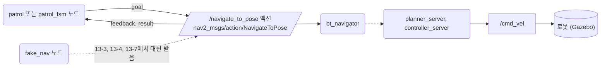
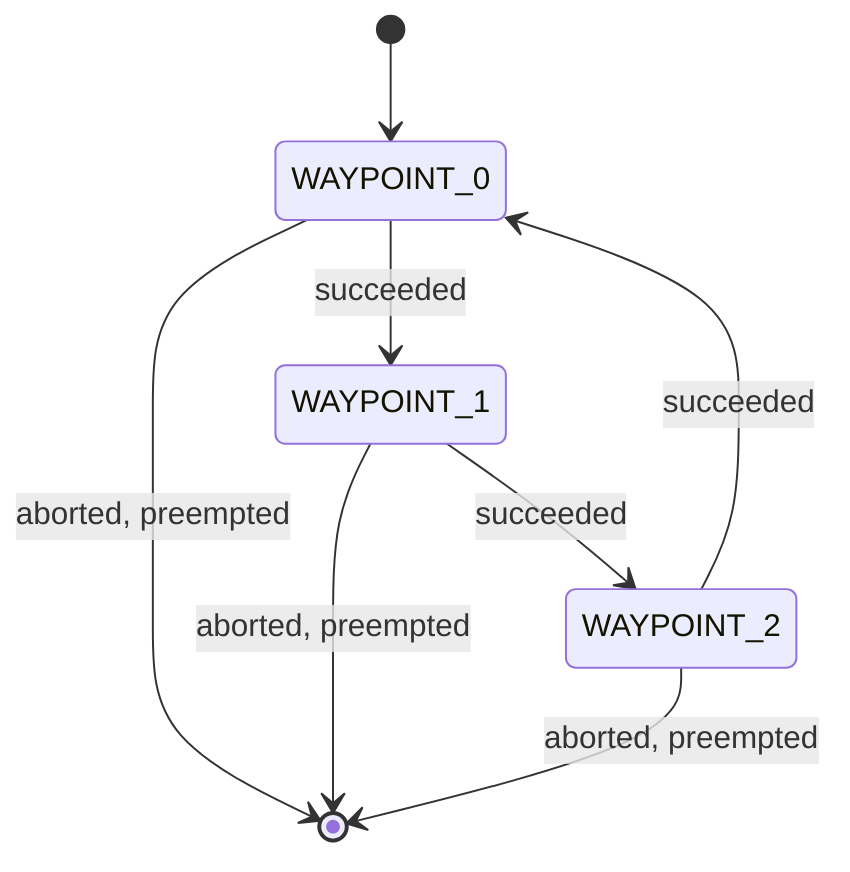
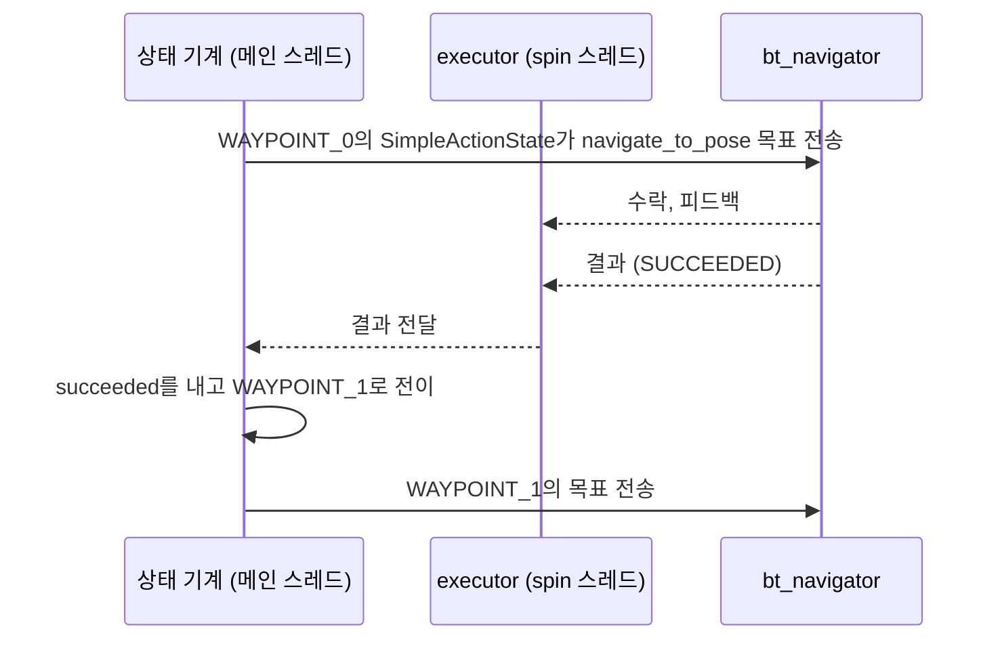

# 13장. 순찰하기

- 원서: Chapter 13. On Patrol, PDF p.229~244 (인쇄 쪽 = PDF 쪽 - 20)
- 선행 조건: 9~10장에서 TurtleBot3 월드 지도를 `~/rosbook_ws/maps/`에 저장했고 Nav2로 목표 지점까지 이동해 본 경험, 5장의 액션 개념
- 새로 설치할 것: `sudo apt install ros-jazzy-smach ros-jazzy-smach-ros` (실습 13-5부터 필요합니다)

## 이 장에서 체감할 구조



그림에서 볼 것: 순찰 노드는 액션 이름과 타입만 알고, 그 뒤가 진짜 Nav2인지 가짜 서버인지 모릅니다.

순찰은 "목표 하나 보내기, 결과 기다리기, 다음 목표로"의 반복이고, 상태 기계(state machine)는 이 반복을 상태와 전이로 정리하는 틀입니다. Nav2 내부도 같은 문제를 행동 트리(behavior tree)로 풉니다.

## 1. 목표와 개념

이 장의 목표는 지도 위의 여러 지점을 차례로 돌며 끝없이 순찰하는 로봇을 만들고, 같은 동작을 상태 기계로 다시 짜 보는 것입니다.

- **NavigateToPose 액션**: Nav2의 `bt_navigator` 노드가 제공하는 액션 서버입니다. 목표 자세(`PoseStamped`)를 받아 경로를 만들고 따라가며, 남은 거리 같은 피드백을 보냅니다. 액션은 오래 걸리는 요청을 보내고, 중간 경과(피드백)와 최종 결과를 받는 통신 방식입니다.

  예:

  ```python
  send_future = self.client.send_goal_async(goal)
  rclpy.spin_until_future_complete(self, send_future)
  ```

  실습 13-4의 `patrol.py`에서 가져온 줄입니다. 10장의 `patrol.py`는 콜백으로 다음 목표를 보냈지만, 이 장은 future가 끝날 때까지 그 자리에서 노드를 돌리고 다음 줄로 넘어가는 순차 방식을 씁니다.
- **웨이포인트**: 순찰할 지점 목록입니다. 각 지점은 지도 좌표계(`map`)의 x, y와 도착했을 때 바라볼 방향(yaw)입니다.

  예:

  ```python
  WAYPOINTS = [(0.5, 0.5, 0.0), (1.5, -0.5, math.pi / 2), (0.0, 0.0, math.pi)]
  ```

  실습 13-4의 목록을 한 줄로 줄여 쓴 것입니다. 값은 특정 지도의 `map` 프레임 좌표라서, 13-2에서 자기 지도로 고른 값으로 바꿉니다.
- **상태 기계**: 로봇이 지금 하는 일(상태)과, 그 일이 끝났을 때 결과(outcome)에 따라 다음 상태로 넘어가는 규칙(전이)을 표로 적은 것입니다. 상태가 늘어나도 흐름이 한눈에 보이고, 실패했을 때 어디로 갈지 명시할 수 있습니다.

  예:

  ```python
  StateMachine.add('ONE', Say('one'),
                   transitions={'next': 'TWO', 'finished': 'finished'})
  ```

  실습 13-5의 `simple_fsm.py`에서 가져온 줄입니다. 상태 이름(`ONE`), 상태 객체(`Say`), 그리고 "결과 이름 → 다음 상태 이름" 표가 한 번에 등록됩니다.
- **행동 트리**: Nav2가 내부에서 쓰는 방식입니다. 상태 기계가 "다음에 어디로 갈지"를 적는다면, 행동 트리는 "어떤 순서와 조건으로 하위 행동을 시도할지"를 나무 모양으로 적습니다.

  예:

  ```xml
  <RecoveryNode number_of_retries="6" name="NavigateRecovery">
    <PipelineSequence name="NavigateWithReplanning">
  ```

  실습 13-8에서 읽는 `navigate_to_pose_w_replanning_and_recovery.xml`의 바깥 두 줄입니다. 전이를 적는 대신 "실패하면 6번까지 복구 후 재시도"라는 규칙을 노드 하나(`RecoveryNode`)로 감쌉니다.

비유: 경비원이 순찰표의 지점을 하나씩 확인하고 서명하는 것이 웨이포인트 순찰이고, "문이 잠겨 있으면 관리실에 연락, 아니면 다음 지점"처럼 상황별 행동을 적은 근무 지침서가 상태 기계입니다.

실습 13-7의 `patrol_fsm`은 웨이포인트 세 개를 상태 세 개로 만듭니다.



그림에서 볼 것: `succeeded`만 다음 상태로 이어지고, `aborted`와 `preempted`는 전이가 적혀 있지 않아 상태 기계 전체가 같은 이름의 결과로 끝납니다. 13-7의 관찰과 Q7이 이 끝나는 화살표를 다음 상태로 바꾸는 이야기입니다.

상태 기계 노드와 Nav2는 다음처럼 주고받습니다.



그림에서 볼 것: `sm.execute()`는 메인 스레드를 붙잡고 있으므로, 액션 응답은 다른 스레드에서 도는 executor가 받습니다. 13-7의 코드가 `threading.Thread(target=executor.spin)`을 따로 띄우는 이유입니다.

### 코드와 폴더 구조

이 장은 `patrol` 패키지를 새로 만듭니다. ament_python 패키지의 기본 구성은 7장의 `wander_bot`과 같습니다.

```text
~/rosbook_ws/src/patrol/
├── package.xml       rclpy, nav2_msgs 등 depend와 smach, smach_ros exec_depend (13-3)
├── setup.py          실행 파일 다섯 개를 한꺼번에 등록 (13-3)
├── setup.cfg         ros2 pkg create가 작성, 고치지 않음
├── resource/patrol   패키지 표시 파일, 고치지 않음
├── patrol/
│   ├── __init__.py
│   ├── fake_nav.py     navigate_to_pose를 흉내 내는 액션 서버 (13-3)
│   ├── patrol.py       WAYPOINTS, make_pose, 순차 방식 순찰 노드 (13-4)
│   ├── simple_fsm.py   상태 두 개짜리 첫 상태 기계, 노드 없음 (13-5)
│   ├── shapes.py       상태 기계 안에 상태 기계 넣기, 노드 없음 (13-6)
│   └── patrol_fsm.py   SimpleActionState로 짠 순찰 (13-7)
└── test/             flake8, pep257, copyright 검사 (ros2 pkg create가 작성)
```

- 패키지 이름과 모듈 이름이 둘 다 `patrol`이라서, `patrol_fsm.py`는 `from patrol.patrol import make_pose, WAYPOINTS`로 같은 패키지의 다른 파일을 가져다 씁니다. 공통 함수와 데이터는 한 파일에 두고 나머지가 import하는 구조입니다.
- 앞 장과 달라지는 뼈대는 세 가지입니다. `patrol.py`는 콜백 대신 `spin_until_future_complete`로 기다립니다. `simple_fsm.py`와 `shapes.py`는 통신을 하지 않으므로 `rclpy.init`도 Node도 없습니다. `patrol_fsm.py`는 Node를 상속하지 않고 `Node('patrol_fsm')`을 바로 만들며, spin을 별도 스레드에 맡깁니다.

smach 상태 클래스와 상태 기계를 조립하는 코드의 뼈대는 다음과 같습니다. 13-5의 코드에서 이름만 일반화했습니다.

```python
class MyState(State):
    def __init__(self):
        super().__init__(outcomes=['succeeded', 'aborted'])

    def execute(self, userdata):
        return 'succeeded'


sm = StateMachine(outcomes=['done', 'failed'])
with sm:
    StateMachine.add('A', MyState(), transitions={'succeeded': 'B', 'aborted': 'failed'})
    StateMachine.add('B', MyState(), transitions={'succeeded': 'done', 'aborted': 'failed'})
outcome = sm.execute()
```

상태는 낼 수 있는 결과 이름을 `outcomes`로 미리 선언하고, `execute()`는 그중 하나를 문자열로 돌려줍니다. 상태 기계는 `with` 블록 안에서 상태를 추가하고, 처음 추가한 상태(`A`)에서 시작합니다.

### 실무 메모

- 상태 기계는 "지금 어느 상태이고 결과에 따라 어디로 가는가"를 모두 적으므로 흐름을 따라 읽기 쉽지만, 상태가 늘수록 전이 수가 빠르게 늘어납니다. 행동 트리는 재시도나 대체 같은 패턴을 `RecoveryNode` 같은 노드로 재사용하고, Nav2는 그 트리를 XML 파일로 바꿔 끼웁니다 (`waffle_pi.yaml`의 `default_nav_to_pose_bt_xml`). 작업 순서가 짧고 분명하면 상태 기계, 실패 처리와 재시도가 많으면 행동 트리가 다루기 쉽습니다.
- 상태마다 실패 결과(`aborted` 같은 것)를 반드시 선언하고, 그 결과가 어디로 가는지 전이에 적어 둡니다. 13-7처럼 적지 않은 결과는 상태 기계 전체를 끝내므로, "의도한 종료"인지 "빠뜨린 전이"인지 코드만 보고 구별할 수 있게 합니다.
- 실제 로봇을 움직이기 전에 같은 이름과 타입의 가짜 액션 서버(13-3의 `fake_nav`)로 클라이언트 흐름과 실패 처리를 먼저 시험합니다. `succeed` 파라미터처럼 실패를 일부러 만들 수 있는 스위치를 넣어 두면 실패 경로까지 확인할 수 있습니다.
- 웨이포인트는 지도에 묶인 데이터입니다. 13-4처럼 코드 상수로 두면 지도를 바꿀 때마다 코드를 고쳐야 하므로, 실제 프로젝트에서는 10장의 `patrol.py`처럼 파라미터로 받거나 설정 파일로 빼 둡니다.

## 2. 원서(ROS 1)와 달라지는 점

| 원서 (ROS 1) | ROS 2 Jazzy | 이유와 주의점 |
|---|---|---|
| `move_base` 액션, `MoveBaseAction` | Nav2 `navigate_to_pose` 액션, `nav2_msgs/action/NavigateToPose` | ROS 2의 내비게이션 스택은 Nav2입니다. 결과 상태는 `action_msgs/msg/GoalStatus`로 확인합니다. |
| `actionlib.SimpleActionClient` | `rclpy.action.ActionClient` | 목표 전송과 결과 받기가 모두 future를 돌려줍니다. future가 끝날 때까지 노드를 spin해야 콜백이 처리됩니다. |
| `smach`, `smach_ros` (ROS 1) | `ros-jazzy-smach`, `ros-jazzy-smach-ros` (ROS 2 포팅판, 3.0.3) | 사용법은 거의 같지만 `SimpleActionState`에 노드를 첫 인자로 넘겨야 하고, 노드를 따로 spin해야 합니다. |
| `smach_viewer`로 상태 기계 그림 보기 | Jazzy용 패키지가 없음 | 상태와 전이는 로그로 확인합니다. |
| `move_base` 내부는 고정된 상태 흐름 | Nav2는 BT XML 파일로 흐름을 정의 | 실습 13-8에서 설치된 XML을 직접 읽습니다. |
| Python 2 (`print` 문, `xrange`) | Python 3 | 원서 코드를 그대로 옮기면 문법 오류가 납니다. |

상태 기계 도구 선택: Jazzy 저장소에서 `apt-cache policy`로 확인한 후보는 다음과 같습니다.

| 패키지 | 버전 | 특징 |
|---|---|---|
| `ros-jazzy-smach`, `ros-jazzy-smach-ros` | 3.0.3 | 원서와 같은 API입니다. 원서 예제와 1:1로 비교할 수 있어 이 장에서 씁니다. |
| `ros-jazzy-yasmin`, `ros-jazzy-yasmin-ros` | 6.1.2 | ROS 2용으로 새로 만든 상태 기계 라이브러리입니다. C++과 Python을 모두 지원하고 웹 뷰어가 있습니다. |
| `ros-jazzy-py-trees`, `ros-jazzy-py-trees-ros` | 2.6.0 | 행동 트리 라이브러리입니다. Nav2와 같은 사고방식을 Python에서 연습하기 좋습니다. |

## 3. 실습

### 실습 13-1. Nav2 액션을 명령줄로 다뤄 보기

**준비**: 9~10장에서 저장한 지도 파일 이름을 확인합니다. 9장에서 저장한 이름대로 `MAP=~/rosbook_ws/maps/tb3_world.yaml`로 적었으니, 다른 이름으로 저장했다면 그 이름으로 바꿉니다. 터미널 4개를 씁니다.

**직접 입력**:

터미널 1:
```bash
ros2 launch turtlebot3_gazebo turtlebot3_world.launch.py
```

터미널 2:
```bash
MAP=~/rosbook_ws/maps/tb3_world.yaml
ros2 launch turtlebot3_navigation2 navigation2.launch.py use_sim_time:=True map:=$MAP
```

rviz2가 열리면 툴바의 "2D Pose Estimate"로 로봇의 현재 위치와 방향을 지정합니다. 시뮬의 로봇은 월드 좌표 (-2.0, -0.5)에서 +x 방향을 보고 시작합니다. 9장에서 같은 출발 위치로 SLAM 지도를 만들었다면 이 위치가 지도 원점 근처이므로, 지도의 원점 부근을 +x 방향으로 드래그합니다.

터미널 3:
```bash
ros2 action list -t
ros2 action info /navigate_to_pose
ros2 interface show nav2_msgs/action/NavigateToPose
ros2 action send_goal --feedback /navigate_to_pose nav2_msgs/action/NavigateToPose \
  "{pose: {header: {frame_id: map}, pose: {position: {x: 0.5, y: 0.5}, orientation: {w: 1.0}}}}"
```

**관찰**:
- `action list -t`에 `/navigate_to_pose [nav2_msgs/action/NavigateToPose]`가 있습니다. `/navigate_through_poses`, `/follow_waypoints`, `/spin`, `/backup` 같은 다른 Nav2 액션도 함께 보입니다.
- `action info`의 Action servers에는 `/bt_navigator`가 있습니다.
- `interface show` 출력은 `---`로 나뉜 세 부분(Goal, Result, Feedback)입니다. Goal에는 `pose`와 `behavior_tree`가 있고, Result에는 `error_code`, `error_msg`가, Feedback에는 `current_pose`, `navigation_time`, `estimated_time_remaining`, `number_of_recoveries`, `distance_remaining`이 있습니다.
- `send_goal --feedback`을 실행하면 피드백이 계속 출력되고 `distance_remaining`이 줄어들다가 `Goal finished with status: SUCCEEDED`로 끝납니다.

**생각해 볼 질문**:
1. `send_goal` 도중 Ctrl+C를 누르면 로봇은 어떻게 됩니까? 액션의 어떤 기능 때문입니까?

### 실습 13-2. 순찰 지점 고르기

**준비**: 13-1의 시뮬과 Nav2가 실행 중입니다.

**직접 입력**:
```bash
ros2 topic echo /clicked_point
```

rviz2 툴바의 "Publish Point"를 누르고 지도에서 순찰할 지점을 클릭합니다. 3~4곳을 고르고 각 좌표를 적어 둡니다. 장애물(기둥)과 벽에서 0.3 m 이상 떨어진 곳을 고릅니다.

**관찰**: 클릭할 때마다 `header.frame_id: map`과 `point: {x, y, z}`가 하나씩 출력됩니다. 이 x, y가 다음 실습의 웨이포인트가 됩니다. 도착 방향(yaw)은 다음 지점을 바라보는 각도로 정하면 자연스럽습니다.

**생각해 볼 질문**:
1. `/clicked_point`의 타입은 무엇이고, 왜 Pose가 아니라 Point입니까? (`ros2 topic info /clicked_point`)

### 실습 13-3. 가짜 내비게이션 서버 만들기

**준비**: Nav2와 Gazebo를 매번 띄우지 않고도 순찰 코드를 시험할 수 있도록, 같은 이름과 타입의 액션 서버를 흉내 내는 노드를 먼저 만듭니다. Nav2를 실행 중이라면 이 실습 동안 끕니다. 같은 이름의 서버가 둘이면 어느 쪽이 목표를 받을지 알 수 없습니다.

**직접 입력**:
```bash
cd ~/rosbook_ws/src
ros2 pkg create --build-type ament_python --license Apache-2.0 \
  --dependencies rclpy geometry_msgs nav2_msgs action_msgs -- patrol
```

`~/rosbook_ws/src/patrol/patrol/fake_nav.py`:
```python
import time

from nav2_msgs.action import NavigateToPose
import rclpy
from rclpy.action import ActionServer
from rclpy.executors import ExternalShutdownException
from rclpy.node import Node


class FakeNav(Node):
    def __init__(self):
        super().__init__('fake_nav')
        self.declare_parameter('duration', 2.0)
        self.declare_parameter('succeed', True)
        self.server = ActionServer(
            self, NavigateToPose, 'navigate_to_pose', self.execute)

    def execute(self, goal_handle):
        pose = goal_handle.request.pose
        self.get_logger().info(
            f'goal: ({pose.pose.position.x:.2f}, {pose.pose.position.y:.2f}) '
            f'frame={pose.header.frame_id}')
        feedback = NavigateToPose.Feedback()
        steps = 10
        for i in range(steps):
            feedback.distance_remaining = float(steps - i) / steps
            goal_handle.publish_feedback(feedback)
            time.sleep(self.get_parameter('duration').value / steps)

        if self.get_parameter('succeed').value:
            goal_handle.succeed()
        else:
            goal_handle.abort()
        return NavigateToPose.Result()


def main(args=None):
    rclpy.init(args=args)
    node = FakeNav()
    try:
        rclpy.spin(node)
    except (KeyboardInterrupt, ExternalShutdownException):
        pass
    finally:
        node.destroy_node()
        rclpy.try_shutdown()


if __name__ == '__main__':
    main()
```

| 줄 | 설명 |
|---|---|
| `declare_parameter('duration', 2.0)`, `('succeed', True)` | 이동에 걸리는 척할 시간과, 성공으로 끝낼지 실패로 끝낼지를 파라미터로 둡니다. 실패 상황을 일부러 만들 수 있습니다. |
| `ActionServer(self, NavigateToPose, 'navigate_to_pose', self.execute)` | Nav2와 같은 이름, 같은 타입의 서버입니다. 클라이언트는 차이를 알 수 없습니다. |
| `goal_handle.request.pose` | 클라이언트가 보낸 목표입니다. |
| `feedback.distance_remaining = ...`, `publish_feedback` | 1.0에서 0.1까지 줄어드는 남은 거리를 10번 보냅니다. |
| `goal_handle.succeed()` / `abort()` | 결과 상태를 정합니다. 이 호출 없이 반환하면 rclpy가 경고를 남기고 상태를 중단(aborted)으로 처리합니다. |

`~/rosbook_ws/src/patrol/setup.py` 전체를 아래로 바꿉니다. 뒤 실습에서 만들 실행 파일까지 미리 등록합니다.
```python
from setuptools import find_packages, setup

package_name = 'patrol'

setup(
    name=package_name,
    version='0.0.0',
    packages=find_packages(exclude=['test']),
    data_files=[
        ('share/ament_index/resource_index/packages',
            ['resource/' + package_name]),
        ('share/' + package_name, ['package.xml']),
    ],
    install_requires=['setuptools'],
    zip_safe=True,
    maintainer='pjw',
    maintainer_email='pjw@todo.todo',
    description='Patrolling with Nav2 and smach (Chapter 13)',
    license='Apache-2.0',
    extras_require={
        'test': [
            'pytest',
        ],
    },
    entry_points={
        'console_scripts': [
            'patrol = patrol.patrol:main',
            'fake_nav = patrol.fake_nav:main',
            'simple_fsm = patrol.simple_fsm:main',
            'shapes = patrol.shapes:main',
            'patrol_fsm = patrol.patrol_fsm:main',
        ],
    },
)
```

`~/rosbook_ws/src/patrol/package.xml`:
```xml
<?xml version="1.0"?>
<?xml-model href="http://download.ros.org/schema/package_format3.xsd" schematypens="http://www.w3.org/2001/XMLSchema"?>
<package format="3">
  <name>patrol</name>
  <version>0.0.0</version>
  <description>Patrolling with Nav2 and smach (Chapter 13)</description>
  <maintainer email="pjw@todo.todo">pjw</maintainer>
  <license>Apache-2.0</license>

  <depend>rclpy</depend>
  <depend>geometry_msgs</depend>
  <depend>nav2_msgs</depend>
  <depend>action_msgs</depend>

  <exec_depend>smach</exec_depend>
  <exec_depend>smach_ros</exec_depend>

  <test_depend>ament_copyright</test_depend>
  <test_depend>ament_flake8</test_depend>
  <test_depend>ament_pep257</test_depend>
  <test_depend>python3-pytest</test_depend>

  <export>
    <build_type>ament_python</build_type>
  </export>
</package>
```

`smach`를 아직 설치하지 않았어도 빌드는 됩니다. `exec_depend`는 실행할 때만 필요한 의존성입니다.

```bash
cd ~/rosbook_ws && colcon build --symlink-install --packages-select patrol
source ~/rosbook_ws/install/setup.bash
ros2 run patrol fake_nav
```

다른 터미널:
```bash
ros2 action list -t
ros2 action info /navigate_to_pose
ros2 action send_goal --feedback /navigate_to_pose nav2_msgs/action/NavigateToPose \
  "{pose: {header: {frame_id: map}, pose: {position: {x: 1.0, y: 2.0}}}}"
```

**관찰**: 검증 환경에서 `ros2 action list -t`는 `/navigate_to_pose [nav2_msgs/action/NavigateToPose]` 한 줄을, `ros2 action info`는 Action servers 1개(`/fake_nav`)를 보여 주었습니다. `send_goal`을 보내면 fake_nav 로그에 `goal: (1.00, 2.00) frame=map`이 찍히고, 약 2초 동안 피드백 10개가 나온 뒤 성공으로 끝납니다.

**생각해 볼 질문**:
1. 가짜 서버로 시험할 때 확인할 수 없는 것은 무엇입니까?

### 실습 13-4. 웨이포인트 순찰 노드

**준비**: 터미널 1에서 `ros2 run patrol fake_nav`가 실행 중입니다.

**직접 입력**:

`~/rosbook_ws/src/patrol/patrol/patrol.py` (`WAYPOINTS`는 13-2에서 고른 좌표로 바꿉니다):
```python
import math

from action_msgs.msg import GoalStatus
from geometry_msgs.msg import PoseStamped
from nav2_msgs.action import NavigateToPose
import rclpy
from rclpy.action import ActionClient
from rclpy.executors import ExternalShutdownException
from rclpy.node import Node

# (x, y, yaw) in the map frame. Replace with points picked on your own map.
WAYPOINTS = [
    (0.5, 0.5, 0.0),
    (1.5, -0.5, math.pi / 2),
    (0.0, 0.0, math.pi),
]


def make_pose(node, x, y, yaw):
    pose = PoseStamped()
    pose.header.frame_id = 'map'
    pose.header.stamp = node.get_clock().now().to_msg()
    pose.pose.position.x = x
    pose.pose.position.y = y
    pose.pose.orientation.z = math.sin(yaw / 2.0)
    pose.pose.orientation.w = math.cos(yaw / 2.0)
    return pose


class Patrol(Node):
    def __init__(self):
        super().__init__('patrol')
        self.client = ActionClient(self, NavigateToPose, 'navigate_to_pose')

    def go_to(self, x, y, yaw):
        goal = NavigateToPose.Goal()
        goal.pose = make_pose(self, x, y, yaw)
        self.get_logger().info(f'going to ({x:.2f}, {y:.2f}, yaw={yaw:.2f})')

        send_future = self.client.send_goal_async(goal)
        rclpy.spin_until_future_complete(self, send_future)
        handle = send_future.result()
        if not handle.accepted:
            self.get_logger().warn('goal rejected')
            return False

        result_future = handle.get_result_async()
        rclpy.spin_until_future_complete(self, result_future)
        return result_future.result().status == GoalStatus.STATUS_SUCCEEDED


def main(args=None):
    rclpy.init(args=args)
    node = Patrol()
    try:
        node.get_logger().info('waiting for navigate_to_pose server...')
        node.client.wait_for_server()
        while rclpy.ok():
            for x, y, yaw in WAYPOINTS:
                ok = node.go_to(x, y, yaw)
                node.get_logger().info('arrived' if ok else 'failed')
    except (KeyboardInterrupt, ExternalShutdownException):
        pass
    finally:
        node.destroy_node()
        rclpy.try_shutdown()


if __name__ == '__main__':
    main()
```

| 줄 | 설명 |
|---|---|
| `WAYPOINTS = [...]` | 지도 좌표계의 (x, y, yaw) 목록입니다. 다른 지도에서는 반드시 바꿔야 합니다. |
| `make_pose(...)` | yaw 하나만 있는 회전을 쿼터니언으로 바꿉니다. z축 회전이면 `z = sin(yaw/2)`, `w = cos(yaw/2)`입니다. 다른 모듈에서도 쓰도록 클래스 밖에 둡니다. |
| `pose.header.frame_id = 'map'` | 목표가 어느 좌표계의 값인지 알립니다. 비워 두면 Nav2가 목표를 해석하지 못합니다. |
| `ActionClient(self, NavigateToPose, 'navigate_to_pose')` | 액션 이름과 타입이 서버와 정확히 같아야 합니다. |
| `send_goal_async(goal)`와 `spin_until_future_complete` | 목표를 보내고, 서버가 받아들였는지 답이 올 때까지 노드를 돌립니다. |
| `handle.accepted` | 서버가 목표를 거절하면 결과를 기다리지 않습니다. |
| `get_result_async()` | 이동이 끝날 때까지 기다리는 두 번째 future입니다. |
| `status == GoalStatus.STATUS_SUCCEEDED` | 결과 상태가 성공(4)인지 확인합니다. 실패는 ABORTED(6), 취소는 CANCELED(5)입니다. |
| `node.client.wait_for_server()` | 서버가 뜰 때까지 무한히 기다립니다. 이름이 틀리면 여기서 멈춥니다. |
| `while rclpy.ok(): for ...` | 목록을 끝까지 돈 뒤 처음부터 다시 돕니다. |

```bash
cd ~/rosbook_ws && colcon build --symlink-install --packages-select patrol
ros2 run patrol patrol
```

다른 터미널:
```bash
ros2 node info /patrol
ros2 param set /fake_nav succeed false
ros2 param set /fake_nav succeed true
```

**관찰**:
- 검증 환경에서 patrol은 `going to (0.50, 0.50, yaw=0.00)`, 약 2초 뒤 `arrived`, 다음 지점으로 넘어가기를 반복했습니다. 세 지점을 돈 뒤 첫 지점으로 돌아갑니다.
- `node info /patrol`의 Action Clients에 `/navigate_to_pose: nav2_msgs/action/NavigateToPose`가 있습니다.
- `succeed`를 false로 바꾸면 다음 목표부터 `failed`가 찍히고, 그래도 다음 지점으로 넘어갑니다. 이 코드는 실패해도 처리 방법이 따로 없습니다.

이제 fake_nav를 끄고 13-1의 시뮬과 Nav2를 다시 띄웁니다. "2D Pose Estimate"로 위치를 맞춘 뒤 `ros2 run patrol patrol --ros-args -p use_sim_time:=true`를 실행하면, 로봇이 지점들을 차례로 돕니다.

**생각해 볼 질문**:
1. 한 지점에서 실패했을 때 다음 지점으로 넘어가는 대신 "출발점으로 돌아가서 다시 시작"하게 하려면, 이 코드의 어디를 바꿔야 합니까? 상태가 더 늘어나면 어떤 문제가 생길까요?

### 실습 13-5. smach로 만드는 첫 상태 기계

**준비**: smach를 설치합니다. 시뮬은 필요 없습니다.
```bash
sudo apt install ros-jazzy-smach ros-jazzy-smach-ros
python3 -c "import smach, smach_ros; print('ok')"
```

**직접 입력**:

`~/rosbook_ws/src/patrol/patrol/simple_fsm.py`:
```python
import time

from rclpy.logging import get_logger
from smach import State, StateMachine

log = get_logger('simple_fsm')


class Say(State):
    def __init__(self, word, rounds=None):
        super().__init__(outcomes=['next', 'finished'])
        self.word = word
        self.rounds = rounds
        self.count = 0

    def execute(self, userdata):
        self.count += 1
        log.info(f'{self.word} ({self.count})')
        time.sleep(1.0)
        if self.rounds is not None and self.count >= self.rounds:
            return 'finished'
        return 'next'


def main():
    sm = StateMachine(outcomes=['finished'])
    with sm:
        StateMachine.add('ONE', Say('one'),
                         transitions={'next': 'TWO', 'finished': 'finished'})
        StateMachine.add('TWO', Say('two', rounds=3),
                         transitions={'next': 'ONE', 'finished': 'finished'})
    outcome = sm.execute()
    log.info(f'state machine outcome: {outcome}')


if __name__ == '__main__':
    main()
```

| 줄 | 설명 |
|---|---|
| `class Say(State)` | 상태 하나입니다. 만들 때 이 상태가 낼 수 있는 결과(outcome) 이름을 모두 선언합니다. |
| `execute(self, userdata)` | 상태에 들어오면 호출되고, 결과 이름 하나를 문자열로 돌려줍니다. `userdata`는 상태 사이에 데이터를 넘기는 통로입니다. |
| `rounds=3` | TWO 상태가 세 번째로 실행되면 `finished`를 냅니다. |
| `StateMachine(outcomes=['finished'])` | 상태 기계 전체의 결과 목록입니다. 리스트로 넘겨야 합니다. |
| `StateMachine.add('ONE', ..., transitions={...})` | 상태를 이름과 함께 추가하고, 각 결과가 어느 상태로 가는지 적습니다. 처음 추가한 상태가 시작 상태입니다. |
| `'finished': 'finished'` | 전이 대상이 상태 이름이 아니라 상태 기계의 결과 이름이면, 상태 기계가 그 결과로 끝납니다. |
| `get_logger('simple_fsm')` | 노드 없이 ROS 로그 형식으로 출력합니다. 이 예제는 통신을 하지 않으므로 `rclpy.init`이 필요 없습니다. |

```bash
cd ~/rosbook_ws && colcon build --symlink-install --packages-select patrol
ros2 run patrol simple_fsm
```

**관찰**: `one (1)`, `two (1)`, `one (2)`, `two (2)`, `one (3)`, `two (3)`이 1초 간격으로 나오고 `state machine outcome: finished`로 끝나야 합니다. smach 자체도 상태 전이를 로그로 남깁니다.

**생각해 볼 질문**:
1. ONE 상태의 `transitions`에서 `'finished': 'finished'`를 빼면 어떻게 됩니까?

### 실습 13-6. 상태 기계 안에 상태 기계 넣기

**준비**: 13-5와 같습니다.

**직접 입력**:

`~/rosbook_ws/src/patrol/patrol/shapes.py`:
```python
import time

from rclpy.logging import get_logger
from smach import State, StateMachine

log = get_logger('shapes')


class Drive(State):
    def __init__(self, distance):
        super().__init__(outcomes=['success'])
        self.distance = distance

    def execute(self, userdata):
        log.info(f'driving {self.distance} m')
        time.sleep(0.5)
        return 'success'


class Turn(State):
    def __init__(self, angle):
        super().__init__(outcomes=['success'])
        self.angle = angle

    def execute(self, userdata):
        log.info(f'turning {self.angle:.0f} deg')
        time.sleep(0.5)
        return 'success'


def polygon(sides):
    sm = StateMachine(outcomes=['success'])
    with sm:
        for i in range(1, sides + 1):
            if i < sides:
                StateMachine.add(f'SIDE_{i}', Drive(1.0),
                                 transitions={'success': f'TURN_{i}'})
                StateMachine.add(f'TURN_{i}', Turn(360.0 / sides),
                                 transitions={'success': f'SIDE_{i + 1}'})
            else:
                StateMachine.add(f'SIDE_{i}', Drive(1.0),
                                 transitions={'success': 'success'})
    return sm


def main():
    shapes = StateMachine(outcomes=['success'])
    with shapes:
        StateMachine.add('TRIANGLE', polygon(3), transitions={'success': 'SQUARE'})
        StateMachine.add('SQUARE', polygon(4), transitions={'success': 'success'})
    outcome = shapes.execute()
    log.info(f'final outcome: {outcome}')


if __name__ == '__main__':
    main()
```

| 줄 | 설명 |
|---|---|
| `Drive`, `Turn` | 실제로 움직이지 않고 로그만 남기는 상태입니다. 상태 기계의 흐름만 연습합니다. |
| `polygon(sides)` | 변 수만큼 "직진, 회전"을 반복하는 상태 기계를 만들어 돌려줍니다. 마지막 변 뒤에는 회전 없이 끝납니다. |
| `StateMachine.add('TRIANGLE', polygon(3), ...)` | 상태 기계도 상태처럼 쓸 수 있습니다. 하위 상태 기계의 결과(`success`)가 상위의 전이 키가 됩니다. |

```bash
ros2 run patrol shapes
```

**관찰**: 삼각형(직진 3번, 120도 회전 2번) 다음에 사각형(직진 4번, 90도 회전 3번)이 출력되고 `final outcome: success`로 끝나야 합니다.

**생각해 볼 질문**:
1. `Drive`가 장애물을 만나 `blocked`라는 결과를 낼 수 있게 하려면, 어떤 곳들을 함께 고쳐야 합니까?

### 실습 13-7. 상태 기계로 순찰하기

**준비**: 터미널 1에서 `ros2 run patrol fake_nav`가 실행 중입니다. (나중에는 실제 Nav2로 바꿉니다.)

**직접 입력**:

`~/rosbook_ws/src/patrol/patrol/patrol_fsm.py`:
```python
import threading

from nav2_msgs.action import NavigateToPose
from patrol.patrol import make_pose, WAYPOINTS
import rclpy
from rclpy.executors import SingleThreadedExecutor
from rclpy.node import Node
import smach
from smach import StateMachine
from smach_ros import SimpleActionState


def main(args=None):
    rclpy.init(args=args)
    node = Node('patrol_fsm')
    executor = SingleThreadedExecutor()
    executor.add_node(node)
    spinner = threading.Thread(target=executor.spin)
    spinner.start()

    names = [f'WAYPOINT_{i}' for i in range(len(WAYPOINTS))]
    sm = StateMachine(outcomes=['succeeded', 'aborted', 'preempted'])
    with sm:
        for i, (x, y, yaw) in enumerate(WAYPOINTS):
            goal = NavigateToPose.Goal()
            goal.pose = make_pose(node, x, y, yaw)
            next_name = names[(i + 1) % len(names)]
            StateMachine.add(
                names[i],
                SimpleActionState(node, 'navigate_to_pose', NavigateToPose, goal=goal),
                transitions={'succeeded': next_name})

    try:
        outcome = sm.execute()
        node.get_logger().info(f'state machine finished: {outcome}')
    except (KeyboardInterrupt, smach.InvalidUserCodeError):
        pass
    finally:
        executor.shutdown()
        spinner.join()
        node.destroy_node()
        rclpy.try_shutdown()


if __name__ == '__main__':
    main()
```

| 줄 | 설명 |
|---|---|
| `from patrol.patrol import make_pose, WAYPOINTS` | 13-4의 웨이포인트와 변환 함수를 그대로 다시 씁니다. |
| `SingleThreadedExecutor`와 `threading.Thread(target=executor.spin)` | `SimpleActionState`는 노드를 직접 spin하지 않습니다. 상태 기계가 메인 스레드에서 도는 동안 별도 스레드가 노드를 돌려 액션 응답을 받습니다. |
| `StateMachine(outcomes=['succeeded', 'aborted', 'preempted'])` | `SimpleActionState`가 내는 세 결과입니다. 전이를 적지 않은 결과는 같은 이름의 상태 기계 결과로 끝납니다. |
| `SimpleActionState(node, 'navigate_to_pose', NavigateToPose, goal=goal)` | 상태에 들어오면 목표를 보내고, 결과 상태에 따라 `succeeded`, `aborted`, `preempted` 중 하나를 냅니다. 액션 클라이언트 코드를 직접 쓰지 않아도 됩니다. |
| `names[(i + 1) % len(names)]` | 마지막 웨이포인트의 다음은 첫 웨이포인트입니다. 그래서 끝없이 돕니다. |
| `except (KeyboardInterrupt, smach.InvalidUserCodeError)` | Ctrl+C가 상태 실행 중에 들어오면 smach가 `InvalidUserCodeError`로 감싸서 다시 던집니다. |
| `executor.shutdown()`, `spinner.join()` | spin 스레드를 먼저 멈추고 기다린 뒤 노드를 정리합니다. 순서가 바뀌면 종료할 때 프로세스가 비정상 종료될 수 있습니다. |

```bash
cd ~/rosbook_ws && colcon build --symlink-install --packages-select patrol
ros2 run patrol patrol_fsm
```

다른 터미널에서 `ros2 param set /fake_nav succeed false`로 실패를 만들어 봅니다.

**관찰**: fake_nav 로그에 세 지점이 차례로 반복해서 찍혀야 합니다. 실패를 만들면 그 상태가 `aborted`를 내고, 전이가 적혀 있지 않으므로 상태 기계 전체가 `state machine finished: aborted`로 끝납니다. 13-4의 patrol은 실패해도 계속 돌았던 것과 비교합니다.

**생각해 볼 질문**:
1. 실패했을 때 상태 기계를 끝내지 않고 첫 지점으로 돌아가게 하려면 `transitions`를 어떻게 적어야 합니까?

### 실습 13-8. Nav2의 행동 트리 읽기

**준비**: 아무것도 실행하지 않아도 됩니다.

**직접 입력**:
```bash
BT=$(ros2 pkg prefix nav2_bt_navigator)/share/nav2_bt_navigator/behavior_trees
ls $BT
cat $BT/navigate_to_pose_w_replanning_and_recovery.xml
grep -n bt_xml $(ros2 pkg prefix turtlebot3_navigation2)/share/turtlebot3_navigation2/param/waffle_pi.yaml
```

**관찰**:
- 폴더에는 `navigate_to_pose_w_replanning_and_recovery.xml`, `navigate_through_poses_w_replanning_and_recovery.xml`, `follow_point.xml`, `odometry_calibration.xml` 등 12개 파일이 있습니다.
- 기본 트리의 뼈대는 `RecoveryNode`(최대 6번 재시도) 아래에 `PipelineSequence`가 있고, 그 안에서 1 Hz로 경로를 다시 계산(`ComputePathToPose`)하면서 경로를 따라가는(`FollowPath`) 구조입니다. 실패하면 `RoundRobin`으로 코스트맵 지우기, 제자리 회전, 대기, 후진을 하나씩 시도합니다.
- TurtleBot3의 `waffle_pi.yaml`은 `default_nav_to_pose_bt_xml`과 `default_nav_through_poses_bt_xml` 둘 다 `navigate_to_pose_w_replanning_and_recovery.xml`을 가리킵니다. 여러 지점을 한 번에 지나가는 액션에도 단일 목표용 트리를 쓰는 설정입니다.

**생각해 볼 질문**:
1. 상태 기계로 짠 13-7과 비교해서, 행동 트리의 `RecoveryNode`는 상태 기계로 그리면 어떤 모양입니까?

## 4. 일부러 망가뜨려 보기

| 바꿀 것 | 예상 증상 | 원인을 확인하는 명령 |
|---|---|---|
| 액션 이름 오타: `ros2 run patrol patrol --ros-args -r navigate_to_pose:=navigate_to_poses` | `waiting for navigate_to_pose server...`에서 영원히 멈춤. 로그에는 원래 이름이 찍혀서 오타가 보이지 않음 | `ros2 action list -t`, `ros2 node info /patrol` (Action Clients의 실제 이름) |
| 타입 불일치: `ros2 action send_goal /navigate_to_pose nav2_msgs/action/NavigateThroughPoses "{}"` | 서버를 찾지 못하고 기다리기만 함. 같은 이름이어도 타입이 다르면 연결되지 않음 | `ros2 action info -t /navigate_to_pose`, `ros2 action list -t` |
| 노드 종료: patrol이 목표를 기다리는 중에 fake_nav를 Ctrl+C | patrol이 결과 future를 계속 기다리며 멈춤. fake_nav를 다시 실행해도 이전 목표의 결과는 오지 않음 | `ros2 action info /navigate_to_pose` (서버 0개), `ros2 node list` |
| QoS 불일치: Nav2 실행 중 `ros2 topic echo /map --qos-durability volatile --qos-reliability reliable` | 지도는 처음 한 번만 발행되는 transient local 토픽이므로 volatile 구독자에게는 아무것도 오지 않음 | `ros2 topic info -v /map` (publisher의 Durability: TRANSIENT_LOCAL) |
| `use_sim_time` 누락: `navigation2.launch.py`를 `use_sim_time:=True` 없이 실행 | TF 시간이 맞지 않아 "extrapolation" 경고가 반복되고, 목표가 거절되거나 로봇이 움직이지 않음 | `ros2 param get /bt_navigator use_sim_time`, `ros2 topic echo --once /clock` |
| 환경 변수 누락: `TURTLEBOT3_MODEL` 없이 `navigation2.launch.py` 실행 | launch가 시작하자마자 `KeyError: 'TURTLEBOT3_MODEL'`로 끝남 | `echo $TURTLEBOT3_MODEL` |

## 5. 확인 질문

<details><summary>Q1. send_goal 도중 Ctrl+C를 누르면? (13-1)</summary>

`ros2 action send_goal`은 Ctrl+C를 받으면 목표 취소 요청을 보냅니다. Nav2는 취소를 받아들이고 로봇을 멈춥니다. 이것이 서비스와 다른 액션의 기능인 "취소(cancel)"입니다. 클라이언트 프로세스가 강제 종료되어 취소 요청을 못 보내면, 서버는 목표를 계속 수행합니다.

</details>

<details><summary>Q2. /clicked_point의 타입과 Point인 이유 (13-2)</summary>

`geometry_msgs/msg/PointStamped`입니다. "Publish Point" 도구는 클릭 한 번으로 위치만 정하고 방향은 정하지 않기 때문입니다. 방향까지 정하려면 드래그하는 "2D Goal Pose" 도구를 씁니다.

</details>

<details><summary>Q3. 가짜 서버로 확인할 수 없는 것 (13-3)</summary>

실제 경로 계획 성공 여부, 도착까지 걸리는 시간, 장애물과 복구 동작, 지도 좌표가 맞는지(벽 안쪽을 골랐는지)는 확인할 수 없습니다. 가짜 서버는 클라이언트 쪽 코드의 흐름(목표 전송, 수락, 결과 처리, 실패 처리)만 시험합니다.

</details>

<details><summary>Q4. 실패 시 출발점으로 돌아가게 하려면? (13-4)</summary>

`for` 반복 안에서 `ok`가 False일 때 출발점으로 `go_to`를 부르고 `break`로 바깥 `while`을 다시 시작하게 하면 됩니다. 하지만 "출발점 이동도 실패하면?", "배터리가 부족하면?" 같은 경우가 늘어날수록 if와 break가 얽혀 흐름을 읽기 어려워집니다. 이것이 상태 기계를 쓰는 이유입니다.

</details>

<details><summary>Q5. ONE 상태에서 'finished' 전이를 빼면? (13-5)</summary>

smach는 상태의 결과가 전이 표에 없으면 상태 기계 결과 목록에서 같은 이름을 찾습니다. `finished`는 상태 기계 결과에 있으므로 그대로 동작합니다. 상태 기계 결과에도 없는 이름이었다면 실행 전 검사에서 오류가 납니다. ONE은 `rounds`가 없어 실제로는 `finished`를 내지 않습니다.

</details>

<details><summary>Q6. Drive에 blocked 결과를 추가하려면? (13-6)</summary>

`Drive`의 `outcomes`에 `blocked`를 더하고, `polygon`이 만드는 하위 상태 기계의 `outcomes`에도 `blocked`를 더한 뒤, 각 SIDE 상태의 전이에 `'blocked': 'blocked'`를 적습니다. 상위의 TRIANGLE, SQUARE 전이와 최상위 상태 기계 결과에도 `blocked`를 처리하는 줄이 필요합니다. 결과 이름은 아래에서 위로 모두 선언되어야 합니다.

</details>

<details><summary>Q7. 실패해도 첫 지점으로 돌아가게 하려면? (13-7)</summary>

각 상태의 전이를 `transitions={'succeeded': next_name, 'aborted': names[0]}`처럼 적습니다. 그러면 `aborted`가 상태 기계를 끝내지 않고 첫 웨이포인트 상태로 넘어갑니다.

</details>

<details><summary>Q8. RecoveryNode를 상태 기계로 그리면? (13-8)</summary>

"이동" 상태가 성공하면 끝, 실패하면 "복구" 상태로 가고, 복구가 끝나면 시도 횟수를 하나 늘려 다시 "이동"으로 돌아가며, 횟수가 6을 넘으면 실패로 끝나는 고리 모양입니다. 행동 트리는 이 고리를 노드 하나로 감싸서 재사용합니다.

</details>

## 6. 원서 대조 메모

- 원서 PDF p.230 부근의 첫 상태 기계 예제는 상태 기계 결과를 리스트가 아닌 문자열 하나로 넘깁니다. smach는 결과 목록을 리스트로 받으므로 이 장에서는 `outcomes=['finished']`처럼 씁니다.
- 원서 예제는 Python 2의 `print` 문과 `xrange`를 씁니다. Python 3에서는 문법 오류나 이름 오류가 납니다.
- 원서 PDF p.224 부근 본문에 철자 오류("wiht")가 있습니다. 내용 이해에는 영향이 없습니다.
- 원서의 웨이포인트 좌표는 원서 월드의 지도 기준입니다. TurtleBot3 월드에서는 맞지 않으므로 이 장에서는 13-2에서 직접 고르게 했습니다.
- 원서의 `smach_viewer` 실습은 Jazzy 패키지가 없어 대신 로그로 확인합니다.
- 원서에는 행동 트리 내용이 없습니다. Nav2가 행동 트리로 동작하므로 13-8을 추가했습니다.

## 7. 이 문서의 검증 상태

- 확인함 (별도 작업 공간 `~/guide_verify/F/ws`, Cyclone DDS, `ros2 daemon start` 이후):
  - `patrol` 패키지 빌드와 `colcon test`(flake8, pep257, copyright) 통과.
  - `fake_nav`와 `patrol`의 실제 프로세스 간 실행: `ros2 action list -t`, `ros2 action info`(서버 `/fake_nav` 1개), `ros2 action send_goal`, 세 지점 순환과 `arrived` 로그, `succeed false`로 바꾼 뒤 `failed` 로그.
  - `apt-cache policy`로 `ros-jazzy-smach`·`ros-jazzy-smach-ros` 3.0.3, `ros-jazzy-yasmin`·`ros-jazzy-yasmin-ros` 6.1.2, `ros-jazzy-py-trees`·`ros-jazzy-py-trees-ros` 2.6.0 후보 확인. 현재 smach는 설치되어 있지 않음(`import smach` 실패).
  - Nav2 BT 폴더의 파일 목록, 기본 트리 XML 내용, TurtleBot3 `waffle_pi.yaml`의 BT 설정 두 줄, `navigation2.launch.py`가 `TURTLEBOT3_MODEL` 환경 변수를 요구하는 것, `nav2_msgs/action/NavigateToPose` 정의.
- 확인 못 함:
  - smach를 쓰는 `simple_fsm`, `shapes`, `patrol_fsm` 실행: 패키지를 설치할 수 없는 검증 조건이었습니다. 코드는 flake8을 통과했고, smach 소스의 API(`SimpleActionState(node, ...)`, 처음 추가한 상태가 시작 상태, `InvalidUserCodeError`)를 읽어서 맞췄지만 실행 결과(13-5~13-7의 관찰)는 예상입니다.
  - Gazebo, Nav2, rviz2를 띄운 모든 관찰(확인 못 함(GUI)): 13-1의 send_goal과 피드백, 13-2의 Publish Point, 실제 로봇 순찰.
  - 4절의 액션 이름 오타, 타입 불일치, 노드 종료, `/map` QoS, `use_sim_time` 누락 증상은 실행하지 않은 예상입니다. `TURTLEBOT3_MODEL` 누락의 `KeyError`는 launch 파일 코드를 읽어 판단했습니다.
- 설명 보강(2026-10-30): "이 장에서 체감할 구조"와 1절에 그림, 코드 예시, 코드와 폴더 구조, 실무 메모를 더했습니다. 머리말과 2~6절은 바꾸지 않았습니다. 1절의 코드 예시는 따로 실행하지 않았습니다.
