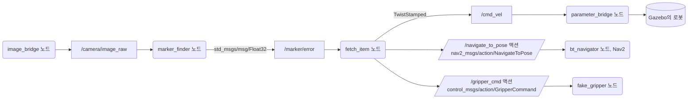
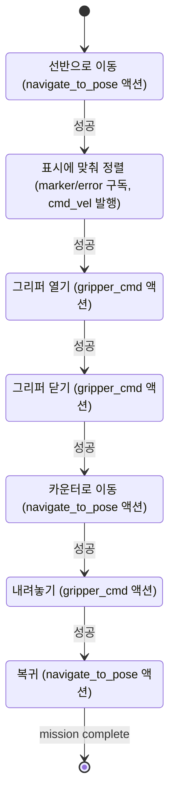
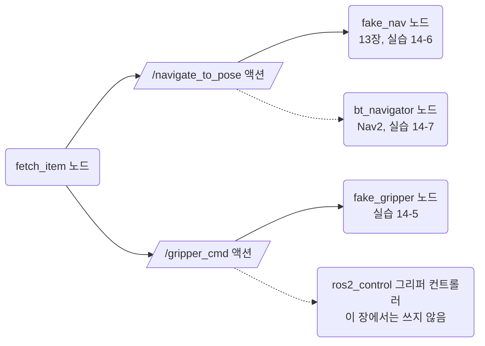
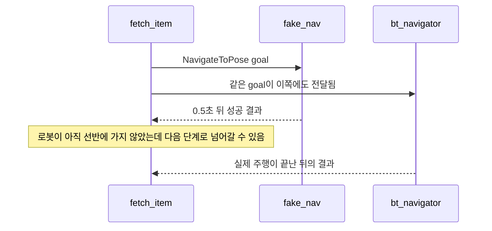

# 14장. 창고에서 물건 가져오기

- 원서: Chapter 14. Stockroom-Bot, PDF p.245~276 (인쇄 쪽 = PDF 쪽 - 20)
- 선행 조건: 12장의 `follow_bot` 패키지(월드 launch 파일을 다시 씁니다), 13장의 `patrol` 패키지(가짜 내비게이션 서버 `fake_nav`), 9~10장의 SLAM과 Nav2 사용 경험
- 새로 설치할 것: 없음. `control_msgs`, `cv_bridge`, `slam_toolbox`는 데스크톱 설치와 TurtleBot3 패키지에 이미 들어 있습니다. `ros2 interface show control_msgs/action/GripperCommand`가 실패하면 `sudo apt install ros-jazzy-control-msgs`를 실행합니다.

## 이 장에서 체감할 구조


네모 상자는 토픽, 평행사변형은 액션입니다. 액션 화살표는 클라이언트에서 서버 쪽으로 그렸습니다. `fetch_item`은 "선반으로 이동, 표시에 맞춰 정렬, 집기, 카운터로 이동, 내려놓기, 복귀"를 차례로 실행하는 지휘자이고, 각 단계의 실제 일은 다른 노드가 합니다.

## 1. 목표와 개념

원서는 팔이 달린 Fetch 로봇으로 창고 선반의 물건을 집어 오는 큰 과제를 다룹니다. 이 장은 같은 구조를 TurtleBot3 시뮬에서 줄여서 만듭니다.

- **작업 분해**: 큰 임무를 "이동", "인식", "조작"으로 나누고, 각각을 독립된 노드와 인터페이스(액션, 토픽)로 만듭니다. 지휘 노드는 인터페이스만 알고 내부 구현은 모릅니다.

가져오기 임무를 단계 순서로 그리면 다음과 같습니다. 괄호 안은 그 단계가 쓰는 인터페이스입니다.



그림에서 볼 것: 화살표는 모두 "성공하면 다음"입니다. 어느 단계든 실패하면 `failed: 단계 이름`을 로그로 남기고 그 자리에서 임무를 끝냅니다. 같은 인터페이스(`navigate_to_pose`, `gripper_cmd`)를 여러 단계가 목표 값만 바꿔 다시 씁니다.

예:

```python
steps = [
    ('go to shelf', lambda: self.navigate(*shelf)),
    ('align with marker', self.align),
```

`fetch_item.py`의 `run()`은 이렇게 단계 이름과 함수의 쌍을 목록으로 적고, 각 함수가 `True`나 `False`를 돌려주게 합니다.

- **표시(marker) 인식**: 선반마다 색 패널을 붙이고, 카메라 이미지에서 그 색의 무게중심이 화면 중앙에서 얼마나 벗어났는지를 -1~1 값으로 발행합니다. 원서의 AR 태그 인식을 색 인식으로 바꾼 것입니다.

예:

```python
self.error_pub.publish(Float32(data=float((cx - half) / half)))
```

`marker_finder.py`는 무게중심의 x 좌표(`cx`)를 화면 폭의 절반(`half`)으로 나눠, 해상도와 상관없는 -1~1 값 하나만 내보냅니다. 지휘 노드는 이미지를 몰라도 됩니다.

- **시각 정렬(visual servoing)**: 인식 결과를 보고 로봇을 조금씩 돌려 표시를 화면 가운데에 맞춥니다. 지도 기반 이동은 수 cm 오차가 있으므로 마지막 맞춤은 센서로 합니다.

예:

```python
cmd.twist.angular.z = -self.get_parameter('kp').value * self.error
```

`fetch_item.py`의 `align`에 있는 비례 제어 한 줄입니다. 표시가 오른쪽(오차 양수)에 있으면 음수 각속도, 즉 오른쪽으로 돌고, 오차가 줄수록 회전도 느려집니다.

- **가짜 그리퍼**: 실제 팔 대신 `control_msgs/action/GripperCommand` 액션 서버를 흉내 내는 노드입니다. 실제 그리퍼 드라이버(ros2_control의 그리퍼 컨트롤러)와 같은 인터페이스를 쓰므로, 나중에 진짜로 바꿔도 지휘 노드는 그대로입니다.

### 가짜 서버를 진짜 서버 자리에 끼우기

`fetch_item`이 아는 것은 액션 이름과 타입뿐입니다. 그래서 그 이름과 타입으로 서버를 띄우기만 하면 가짜든 진짜든 같은 자리에 끼울 수 있습니다.



그림에서 볼 것: 실선은 지금 쓰는 서버, 점선은 그 자리에 대신 들어갈 서버입니다. 한 이름에는 한 번에 서버 하나만 띄웁니다. 이동 쪽은 실습 14-6에서 `fake_nav`, 실습 14-7에서 `bt_navigator`로 바꾸고, `fetch_item`의 코드는 한 줄도 바꾸지 않습니다.

예:

```python
self.server = ActionServer(self, GripperCommand, 'gripper_cmd', self.execute)
self.gripper = ActionClient(self, GripperCommand, 'gripper_cmd')
```

위는 `fake_gripper.py`, 아래는 `fetch_item.py`의 줄입니다. 두 줄의 타입(`GripperCommand`)과 이름(`'gripper_cmd'`)이 같다는 것이 둘 사이의 약속 전부입니다.

같은 이름의 액션 서버가 둘 떠 있으면 이 약속이 깨집니다. 예를 들어 실습 14-6의 `fake_nav`를 끄지 않은 채 Nav2를 띄우면 다음 일이 생깁니다.



그림에서 볼 것: 목표 요청이 두 서버에 모두 전달되므로, `fetch_item`이 어느 쪽 결과를 받게 될지 알 수 없습니다. 그래서 실습 14-6과 14-7은 시작하기 전에 `ros2 action list`로 남아 있는 서버가 없는지부터 확인합니다.

예:

```bash
ros2 action info /navigate_to_pose
```

출력의 `Action servers:` 개수가 1이어야 합니다. 2 이상이면 같은 이름의 서버를 띄운 터미널을 찾아 끕니다.

비유: 식당 홀 매니저(fetch_item)는 "3번 테이블로 가서, 주문서를 확인하고, 접시를 받아 와"라고 순서만 정하고, 길 찾기·주문서 읽기·접시 들기는 각 담당자가 합니다. 접시 담당이 신입(가짜 그리퍼)이어도 주문 방식만 같으면 매니저는 바뀔 것이 없습니다.

### 코드와 폴더 구조

이 장을 마친 뒤의 `stockroom_bot` 패키지는 다음과 같습니다. `ros2 pkg create`가 만든 파일(`setup.cfg`, `resource/stockroom_bot`, `stockroom_bot/__init__.py`, `test/`의 코드 검사)은 손대지 않으므로 줄였습니다.

```text
~/rosbook_ws/src/stockroom_bot/
├── package.xml                 의존성. launch가 12장 패키지를 쓰므로 follow_bot도 적음 (14-2)
├── setup.py                    launch와 worlds 폴더 설치, 실행 파일 3개 등록 (14-2)
├── worlds/
│   └── stockroom.sdf           방, 색 패널이 붙은 선반 3개, 카운터 (14-2)
├── launch/
│   ├── stockroom.launch.py     12장 course.launch.py를 world 인자만 바꿔 include (14-2)
│   └── fetch.launch.py         marker_finder, fake_gripper, fetch_item을 함께 띄움 (14-6)
└── stockroom_bot/
    ├── marker_finder.py        카메라 이미지에서 색 표시를 찾아 /marker/error 발행 (14-4)
    ├── fake_gripper.py         /gripper_cmd 액션 서버 흉내 (14-5)
    └── fetch_item.py           단계 목록을 차례로 실행하는 지휘 노드 (14-6)

~/rosbook_ws/maps/stockroom.pgm, stockroom.yaml    패키지 밖에 저장한 창고 지도 (14-3)
```

- 패키지 사이의 관계: `stockroom_bot`의 launch는 12장 `follow_bot`의 launch 파일을 다시 쓰고, 흐름 시험에는 13장 `patrol`의 `fake_nav`를 따로 띄웁니다. `fake_nav`는 실행할 때만 쓰는 도구이므로 `package.xml`에는 `follow_bot`만 적습니다.
- 노드 뼈대: `marker_finder`와 `fake_gripper`는 이 가이드의 기본 노드 형태(CONVENTIONS.md 6절) 그대로 `rclpy.spin`으로 콜백을 기다립니다. `fetch_item`만 다릅니다. 별도 스레드가 executor를 spin하고, 메인 스레드는 `run()`의 단계를 차례로 기다립니다. 13장 `patrol_fsm`과 같은 구조입니다.
- 지휘 노드는 Nav2 내부(10장)를 모릅니다. `NavigateToPose` 목표를 채우는 방법은 10장, 13장과 같고, 이 장에서 새로 더해지는 것은 인식 토픽과 그리퍼 액션입니다.

### 실무 메모

- 개발 순서는 "인터페이스(액션과 토픽의 이름, 타입)를 먼저 정하고, 가짜 서버로 지휘 노드를 시험한 뒤, 진짜 서버로 바꾸기"입니다. 10장, 13장, 이 장이 모두 이 순서를 따릅니다. 시뮬이나 실물 로봇을 띄우지 않고도 흐름과 실패 처리를 먼저 다듬을 수 있습니다.
- 실행 전에 `ros2 action list -t`와 `ros2 action info <액션 이름>`으로 서버가 정확히 하나인지 확인하는 습관을 들입니다. 이전 실행에서 남은 가짜 서버는 오류 메시지 없이 결과만 이상하게 만들기 때문에 찾기 어렵습니다.
- 서버를 기다릴 때는 `wait_for_server(timeout_sec=10.0)`처럼 항상 시간 제한을 두고, 실패하면 어느 단계에서 멈췄는지 로그로 남깁니다.
- 선반 좌표처럼 현장마다 바뀌는 값은 코드 안 사전(`SHELVES`)보다 파라미터 파일로 빼는 것이 좋습니다(2절 표 참고). 지도를 다시 만들 때 코드를 고치지 않아도 됩니다.
- 한 토픽(`/cmd_vel`)에 publisher가 둘 이상이면, 한 번에 하나만 명령을 내도록 단계를 나눕니다. 이 장은 정렬 중에 Nav2가 명령을 내지 않는다는 순서로 이것을 지킵니다. `ros2 topic info -v /cmd_vel`로 publisher 목록을 확인할 수 있습니다.

## 2. 원서(ROS 1)와 달라지는 점

| 원서 (ROS 1) | ROS 2 Jazzy | 이유와 주의점 |
|---|---|---|
| Fetch 로봇 시뮬(`fetch_gazebo`) | TurtleBot3 waffle_pi와 직접 만든 창고 월드 | Jazzy 저장소에 Fetch 패키지가 없습니다(`apt-cache policy ros-jazzy-fetch-gazebo` 후보 없음). |
| Fetch 팔과 MoveIt으로 실제 집기 | `fake_gripper`가 `GripperCommand` 액션만 흉내 냄 | 아래 "가짜 그리퍼를 쓰는 이유" 참고. 팔과 MoveIt은 18장에서 따로 다룹니다. |
| ALVAR AR 태그(`ar_track_alvar`) | 색 패널과 OpenCV 색 인식 | ALVAR는 ROS 1 전용입니다. Jazzy에는 `ros-jazzy-aruco-opencv`(6.1.2), `ros-jazzy-apriltag-ros`(3.4.0)가 있지만, 태그 텍스처를 월드에 넣는 작업이 커서 이 장에서는 색으로 줄였습니다. |
| `move_base` 액션 | Nav2 `navigate_to_pose` 액션 | 13장과 같습니다. |
| 선반 위치와 물건 위치를 `.yaml`로 관리 | 코드 안의 `SHELVES` 사전 | 학습용으로 줄였습니다. 실제로는 파라미터 파일로 빼는 것이 좋습니다. |
| roslaunch XML | Python launch 파일 | 12장의 launch 파일을 `world` 인자만 바꿔 include합니다. |

가짜 그리퍼를 쓰는 이유:
- TurtleBot3 waffle_pi에는 팔이 없습니다. 팔이 달린 `ros-jazzy-turtlebot3-manipulation`(2.2.1)은 apt에 있지만, 그 Gazebo 시뮬 패키지(`ros-jazzy-turtlebot3-manipulation-gazebo`)는 apt 후보가 없었습니다.
- 시뮬에서 물체를 실제로 집으려면 접촉 마찰, 그리퍼 제어기, 팔 경로 계획(MoveIt)을 모두 맞춰야 하고, 이 장의 핵심인 "작업 분해와 지휘"보다 훨씬 큰 주제가 됩니다.
- 인터페이스를 진짜와 같게 두면, 나중에 그리퍼 컨트롤러를 붙일 때 액션 이름만 맞추면 됩니다.

## 3. 실습

### 실습 14-1. 쓸 수 있는 로봇과 도구 확인하기

**준비**: 터미널 1개.

**직접 입력**:
```bash
apt-cache policy ros-jazzy-fetch-gazebo ros-jazzy-turtlebot3-manipulation ros-jazzy-turtlebot3-manipulation-gazebo
apt-cache policy ros-jazzy-aruco-opencv ros-jazzy-apriltag-ros
ros2 interface show control_msgs/action/GripperCommand
```

**관찰**:
- 검증 환경에서 `ros-jazzy-fetch-gazebo`와 `ros-jazzy-turtlebot3-manipulation-gazebo`는 아무 줄도 출력되지 않았고(후보 없음), `ros-jazzy-turtlebot3-manipulation`은 `Candidate: 2.2.1-...`이었습니다.
- `GripperCommand`의 Goal은 `command`(그 안에 `position`, `max_effort`), Result와 Feedback은 `position`, `effort`, `stalled`, `reached_goal`입니다. `position`은 그리퍼가 벌어진 간격(m)입니다.

**생각해 볼 질문**:
1. 왜 그리퍼 명령을 토픽이 아니라 액션으로 정의했을까요?

### 실습 14-2. 패키지, 창고 월드, launch 파일

> **미검증 실습**: 문서를 쓸 때 Gazebo 창에서 보는 창고 월드 모습을 실제로 실행해 확인하지 못했습니다. 결과가 문서와 다르면 문서가 틀렸을 수 있으니, 7절의 검증 기록과 비교해 보세요.

**준비**: 12장의 `follow_bot`이 빌드되어 있어야 합니다.

**직접 입력**:
```bash
cd ~/rosbook_ws/src
ros2 pkg create --build-type ament_python --license Apache-2.0 \
  --dependencies rclpy sensor_msgs geometry_msgs std_msgs nav2_msgs control_msgs action_msgs cv_bridge \
  -- stockroom_bot
mkdir -p ~/rosbook_ws/src/stockroom_bot/worlds ~/rosbook_ws/src/stockroom_bot/launch
```

`~/rosbook_ws/src/stockroom_bot/worlds/stockroom.sdf`:
```xml
<?xml version="1.0"?>
<sdf version="1.8">
  <world name="stockroom">
    <plugin filename="gz-sim-physics-system" name="gz::sim::systems::Physics"/>
    <plugin filename="gz-sim-user-commands-system" name="gz::sim::systems::UserCommands"/>
    <plugin filename="gz-sim-scene-broadcaster-system" name="gz::sim::systems::SceneBroadcaster"/>
    <plugin filename="gz-sim-sensors-system" name="gz::sim::systems::Sensors">
      <render_engine>ogre2</render_engine>
    </plugin>
    <plugin filename="gz-sim-imu-system" name="gz::sim::systems::Imu"/>

    <light type="directional" name="sun">
      <pose>0 0 10 0 0 0</pose>
      <diffuse>0.9 0.9 0.9 1</diffuse>
      <direction>-0.3 0.2 -1</direction>
    </light>

    <model name="ground">
      <static>true</static>
      <link name="link">
        <collision name="collision">
          <geometry><plane><normal>0 0 1</normal><size>20 20</size></plane></geometry>
        </collision>
        <visual name="visual">
          <geometry><plane><normal>0 0 1</normal><size>20 20</size></plane></geometry>
          <material><ambient>0.5 0.5 0.5 1</ambient><diffuse>0.5 0.5 0.5 1</diffuse></material>
        </visual>
      </link>
    </model>

    <!-- Room 6 m x 4 m, walls 0.5 m high -->
    <model name="walls">
      <static>true</static>
      <link name="link">
        <collision name="north_c"><pose>0 2.05 0.25 0 0 0</pose>
          <geometry><box><size>6.2 0.1 0.5</size></box></geometry></collision>
        <visual name="north_v"><pose>0 2.05 0.25 0 0 0</pose>
          <geometry><box><size>6.2 0.1 0.5</size></box></geometry></visual>
        <collision name="south_c"><pose>0 -2.05 0.25 0 0 0</pose>
          <geometry><box><size>6.2 0.1 0.5</size></box></geometry></collision>
        <visual name="south_v"><pose>0 -2.05 0.25 0 0 0</pose>
          <geometry><box><size>6.2 0.1 0.5</size></box></geometry></visual>
        <collision name="east_c"><pose>3.05 0 0.25 0 0 0</pose>
          <geometry><box><size>0.1 4.0 0.5</size></box></geometry></collision>
        <visual name="east_v"><pose>3.05 0 0.25 0 0 0</pose>
          <geometry><box><size>0.1 4.0 0.5</size></box></geometry></visual>
        <collision name="west_c"><pose>-3.05 0 0.25 0 0 0</pose>
          <geometry><box><size>0.1 4.0 0.5</size></box></geometry></collision>
        <visual name="west_v"><pose>-3.05 0 0.25 0 0 0</pose>
          <geometry><box><size>0.1 4.0 0.5</size></box></geometry></visual>
      </link>
    </model>

    <!-- Three shelves along the north wall, each with a colour panel facing the room -->
    <model name="shelf_red">
      <static>true</static>
      <pose>-1.5 1.75 0 0 0 0</pose>
      <link name="link">
        <collision name="c"><pose>0 0 0.2 0 0 0</pose>
          <geometry><box><size>0.6 0.3 0.4</size></box></geometry></collision>
        <visual name="v"><pose>0 0 0.2 0 0 0</pose>
          <geometry><box><size>0.6 0.3 0.4</size></box></geometry>
          <material><ambient>0.8 0.8 0.8 1</ambient><diffuse>0.8 0.8 0.8 1</diffuse></material></visual>
        <visual name="panel"><pose>0 -0.155 0.12 0 0 0</pose>
          <geometry><box><size>0.2 0.01 0.15</size></box></geometry>
          <material><ambient>1 0 0 1</ambient><diffuse>1 0 0 1</diffuse></material></visual>
        <visual name="item"><pose>0 0 0.45 0 0 0</pose>
          <geometry><box><size>0.1 0.1 0.1</size></box></geometry>
          <material><ambient>1 0 0 1</ambient><diffuse>1 0 0 1</diffuse></material></visual>
      </link>
    </model>

    <model name="shelf_green">
      <static>true</static>
      <pose>0 1.75 0 0 0 0</pose>
      <link name="link">
        <collision name="c"><pose>0 0 0.2 0 0 0</pose>
          <geometry><box><size>0.6 0.3 0.4</size></box></geometry></collision>
        <visual name="v"><pose>0 0 0.2 0 0 0</pose>
          <geometry><box><size>0.6 0.3 0.4</size></box></geometry>
          <material><ambient>0.8 0.8 0.8 1</ambient><diffuse>0.8 0.8 0.8 1</diffuse></material></visual>
        <visual name="panel"><pose>0 -0.155 0.12 0 0 0</pose>
          <geometry><box><size>0.2 0.01 0.15</size></box></geometry>
          <material><ambient>0 1 0 1</ambient><diffuse>0 1 0 1</diffuse></material></visual>
        <visual name="item"><pose>0 0 0.45 0 0 0</pose>
          <geometry><box><size>0.1 0.1 0.1</size></box></geometry>
          <material><ambient>0 1 0 1</ambient><diffuse>0 1 0 1</diffuse></material></visual>
      </link>
    </model>

    <model name="shelf_blue">
      <static>true</static>
      <pose>1.5 1.75 0 0 0 0</pose>
      <link name="link">
        <collision name="c"><pose>0 0 0.2 0 0 0</pose>
          <geometry><box><size>0.6 0.3 0.4</size></box></geometry></collision>
        <visual name="v"><pose>0 0 0.2 0 0 0</pose>
          <geometry><box><size>0.6 0.3 0.4</size></box></geometry>
          <material><ambient>0.8 0.8 0.8 1</ambient><diffuse>0.8 0.8 0.8 1</diffuse></material></visual>
        <visual name="panel"><pose>0 -0.155 0.12 0 0 0</pose>
          <geometry><box><size>0.2 0.01 0.15</size></box></geometry>
          <material><ambient>0 0 1 1</ambient><diffuse>0 0 1 1</diffuse></material></visual>
        <visual name="item"><pose>0 0 0.45 0 0 0</pose>
          <geometry><box><size>0.1 0.1 0.1</size></box></geometry>
          <material><ambient>0 0 1 1</ambient><diffuse>0 0 1 1</diffuse></material></visual>
      </link>
    </model>

    <!-- Delivery counter by the south wall -->
    <model name="counter">
      <static>true</static>
      <pose>0 -1.8 0 0 0 0</pose>
      <link name="link">
        <collision name="c"><pose>0 0 0.15 0 0 0</pose>
          <geometry><box><size>0.8 0.3 0.3</size></box></geometry></collision>
        <visual name="v"><pose>0 0 0.15 0 0 0</pose>
          <geometry><box><size>0.8 0.3 0.3</size></box></geometry>
          <material><ambient>0.6 0.4 0.2 1</ambient><diffuse>0.6 0.4 0.2 1</diffuse></material></visual>
      </link>
    </model>
  </world>
</sdf>
```

| 줄 | 설명 |
|---|---|
| 앞부분의 plugin, light, ground | 12장의 `course.sdf`와 같습니다. |
| `model name="walls"` | 6 m x 4 m 방을 높이 0.5 m 벽으로 둘러쌉니다. LiDAR(높이 약 0.13 m)가 벽을 보고 SLAM 지도를 만들 수 있습니다. 벽마다 `collision`과 `visual`을 함께 둡니다. |
| `shelf_red/green/blue`의 `<pose>` | 북쪽 벽(y=2) 앞, x = -1.5, 0, 1.5에 선반을 놓습니다. |
| `visual name="panel"`, `<pose>0 -0.155 0.12 ...` | 선반 앞면(방 쪽, -y 방향)에 붙은 20 cm x 15 cm 색 패널입니다. 중심 높이 0.12 m는 카메라 높이(약 0.10 m)와 비슷해서 정면에서 잘 보입니다. |
| `visual name="item"` | 선반 위에 놓인 물건(색 상자)입니다. 충돌 모델이 없어 물리적으로 부딪히지는 않고 보이기만 합니다. 가짜 그리퍼는 이것을 실제로 옮기지 않습니다. |
| `model name="counter"` | 남쪽 벽 앞의 배달 카운터입니다. |

`~/rosbook_ws/src/stockroom_bot/launch/stockroom.launch.py`:
```python
import os

from ament_index_python.packages import get_package_share_directory
from launch import LaunchDescription
from launch.actions import IncludeLaunchDescription
from launch.launch_description_sources import PythonLaunchDescriptionSource


def generate_launch_description():
    course_launch = os.path.join(
        get_package_share_directory('follow_bot'), 'launch', 'course.launch.py')
    world = os.path.join(
        get_package_share_directory('stockroom_bot'), 'worlds', 'stockroom.sdf')

    return LaunchDescription([
        IncludeLaunchDescription(
            PythonLaunchDescriptionSource(course_launch),
            launch_arguments={
                'world': world,
                'x_pose': '0.0',
                'y_pose': '0.0',
            }.items()),
    ])
```

| 줄 | 설명 |
|---|---|
| `course_launch = ...follow_bot...` | 12장에서 만든 launch 파일을 그대로 다시 씁니다. Gazebo, robot_state_publisher, 로봇 생성, 브리지가 모두 들어 있습니다. |
| `'world': world` | 월드만 창고로 바꿉니다. |
| `'x_pose': '0.0', 'y_pose': '0.0'` | 로봇을 방 가운데에 +x 방향으로 놓습니다. 여기서 SLAM을 시작하면 지도 원점이 방 가운데가 되어, 코드의 좌표가 월드 좌표와 거의 같아집니다. |

`~/rosbook_ws/src/stockroom_bot/setup.py`:
```python
from glob import glob
import os

from setuptools import find_packages, setup

package_name = 'stockroom_bot'

setup(
    name=package_name,
    version='0.0.0',
    packages=find_packages(exclude=['test']),
    data_files=[
        ('share/ament_index/resource_index/packages',
            ['resource/' + package_name]),
        ('share/' + package_name, ['package.xml']),
        (os.path.join('share', package_name, 'launch'), glob('launch/*.launch.py')),
        (os.path.join('share', package_name, 'worlds'), glob('worlds/*.sdf')),
    ],
    install_requires=['setuptools'],
    zip_safe=True,
    maintainer='pjw',
    maintainer_email='pjw@todo.todo',
    description='Reduced stockroom fetch task in simulation (Chapter 14)',
    license='Apache-2.0',
    extras_require={
        'test': [
            'pytest',
        ],
    },
    entry_points={
        'console_scripts': [
            'marker_finder = stockroom_bot.marker_finder:main',
            'fake_gripper = stockroom_bot.fake_gripper:main',
            'fetch_item = stockroom_bot.fetch_item:main',
        ],
    },
)
```

`~/rosbook_ws/src/stockroom_bot/package.xml`:
```xml
<?xml version="1.0"?>
<?xml-model href="http://download.ros.org/schema/package_format3.xsd" schematypens="http://www.w3.org/2001/XMLSchema"?>
<package format="3">
  <name>stockroom_bot</name>
  <version>0.0.0</version>
  <description>Reduced stockroom fetch task in simulation (Chapter 14)</description>
  <maintainer email="pjw@todo.todo">pjw</maintainer>
  <license>Apache-2.0</license>

  <depend>rclpy</depend>
  <depend>sensor_msgs</depend>
  <depend>geometry_msgs</depend>
  <depend>std_msgs</depend>
  <depend>nav2_msgs</depend>
  <depend>control_msgs</depend>
  <depend>action_msgs</depend>
  <depend>cv_bridge</depend>

  <exec_depend>python3-opencv</exec_depend>
  <exec_depend>python3-numpy</exec_depend>
  <exec_depend>launch_ros</exec_depend>
  <exec_depend>follow_bot</exec_depend>

  <test_depend>ament_copyright</test_depend>
  <test_depend>ament_flake8</test_depend>
  <test_depend>ament_pep257</test_depend>
  <test_depend>python3-pytest</test_depend>

  <export>
    <build_type>ament_python</build_type>
  </export>
</package>
```

`exec_depend follow_bot`은 이 패키지의 launch 파일이 `follow_bot`의 launch 파일을 쓴다는 표시입니다. setup.py에는 다음 실습들에서 만들 세 실행 파일이 미리 등록되어 있습니다.

```bash
cd ~/rosbook_ws && colcon build --symlink-install --packages-select stockroom_bot
source ~/rosbook_ws/install/setup.bash
gz sdf -k $(ros2 pkg prefix stockroom_bot)/share/stockroom_bot/worlds/stockroom.sdf
ros2 launch stockroom_bot stockroom.launch.py
```

**관찰**: `gz sdf -k`가 `Valid.`를 출력합니다(검증 환경에서 확인). Gazebo가 열리면 회색 방의 북쪽 벽 앞에 빨강·초록·파랑 패널이 붙은 선반 3개, 남쪽 벽 앞에 갈색 카운터, 방 가운데에 로봇이 보여야 합니다.

**생각해 볼 질문**:
1. 월드 파일 이름만 바꿔 12장의 launch 파일을 다시 쓸 수 있었던 것은 12장 launch 파일의 어떤 설계 덕분입니까?

### 실습 14-3. 창고 지도 만들기

> **미검증 실습**: 문서를 쓸 때 창고 시뮬에서 SLAM으로 지도를 만들고 저장하는 과정을 실제로 실행해 확인하지 못했습니다. 결과가 문서와 다르면 문서가 틀렸을 수 있으니, 7절의 검증 기록과 비교해 보세요.

**준비**: 터미널 1에서 `ros2 launch stockroom_bot stockroom.launch.py`가 실행 중입니다. 터미널 4개를 씁니다.

**직접 입력**:

터미널 2:
```bash
ros2 launch slam_toolbox online_async_launch.py use_sim_time:=true
```

터미널 3:
```bash
ros2 run turtlebot3_teleop teleop_keyboard
```

터미널 4 (지도가 그려지는 모습을 보려면):
```bash
ros2 run rviz2 rviz2 --ros-args -p use_sim_time:=true
```

rviz2에서 Fixed Frame을 `map`으로 바꾸고, Add 버튼으로 Map 디스플레이를 추가해 토픽을 `/map`으로 둡니다. `turtlebot3_navigation2`의 `navigation2.launch.py`는 `slam` 인자가 없으므로 이 용도로 쓰지 않습니다. 키보드로 로봇을 방 안 곳곳으로 천천히 움직여 벽이 모두 지도에 나타나게 한 뒤, 새 터미널에서 지도를 저장합니다.
```bash
mkdir -p ~/rosbook_ws/maps
ros2 run nav2_map_server map_saver_cli -f ~/rosbook_ws/maps/stockroom --ros-args -p use_sim_time:=true
ls ~/rosbook_ws/maps/stockroom.*
```

**관찰**: `stockroom.pgm`(지도 그림)과 `stockroom.yaml`(해상도, 원점 정보)이 생깁니다. 지도에는 직사각형 방, 북쪽의 선반 3개와 남쪽의 카운터가 장애물로 나타나야 합니다. `teleop_keyboard`는 Jazzy에서 `TwistStamped`를 발행하므로 시뮬과 타입이 맞습니다.

저장한 뒤 터미널 2~4를 끄고, 다음 실습부터는 Nav2를 지도와 함께 띄웁니다.
```bash
ros2 launch turtlebot3_navigation2 navigation2.launch.py use_sim_time:=True map:=$HOME/rosbook_ws/maps/stockroom.yaml
```

**생각해 볼 질문**:
1. 선반 위의 물건 상자(높이 0.4~0.5 m)는 지도에 나타납니까? 이유는 무엇입니까?

### 실습 14-4. 색 표시 찾기

> **미검증 실습**: 문서를 쓸 때 시뮬 카메라로 패널을 보는 관찰을 실제로 실행해 확인하지 못했습니다. 결과가 문서와 다르면 문서가 틀렸을 수 있으니, 7절의 검증 기록과 비교해 보세요.

**준비**: 창고 시뮬이 실행 중입니다. 로봇이 선반 하나를 정면으로 보도록 teleop으로 옮겨 둡니다.

**직접 입력**:

`~/rosbook_ws/src/stockroom_bot/stockroom_bot/marker_finder.py`:
```python
import cv2
from cv_bridge import CvBridge
import numpy as np
import rclpy
from rclpy.executors import ExternalShutdownException
from rclpy.node import Node
from rclpy.qos import qos_profile_sensor_data
from sensor_msgs.msg import Image
from std_msgs.msg import Float32

# OpenCV HSV: H 0..179, S 0..255, V 0..255. Red wraps around H=0.
COLOR_RANGES = {
    'red': [((0, 120, 70), (10, 255, 255)), ((170, 120, 70), (179, 255, 255))],
    'green': [((50, 120, 70), (70, 255, 255))],
    'blue': [((110, 120, 70), (130, 255, 255))],
}


class MarkerFinder(Node):
    def __init__(self):
        super().__init__('marker_finder')
        self.declare_parameter('color', 'green')
        self.declare_parameter('min_area', 500)
        self.bridge = CvBridge()
        self.sub = self.create_subscription(
            Image, 'camera/image_raw', self.image_callback, qos_profile_sensor_data)
        self.error_pub = self.create_publisher(Float32, 'marker/error', 10)
        self.debug_pub = self.create_publisher(Image, 'marker/debug_image', 1)

    def image_callback(self, msg):
        image = self.bridge.imgmsg_to_cv2(msg, desired_encoding='bgr8')
        hsv = cv2.cvtColor(image, cv2.COLOR_BGR2HSV)
        mask = np.zeros(hsv.shape[:2], dtype=np.uint8)
        for lower, upper in COLOR_RANGES[self.get_parameter('color').value]:
            mask |= cv2.inRange(hsv, np.array(lower, np.uint8), np.array(upper, np.uint8))

        m = cv2.moments(mask, binaryImage=True)
        if m['m00'] >= self.get_parameter('min_area').value:
            cx = m['m10'] / m['m00']
            cy = m['m01'] / m['m00']
            half = image.shape[1] / 2.0
            self.error_pub.publish(Float32(data=float((cx - half) / half)))
            cv2.circle(image, (int(cx), int(cy)), 10, (255, 255, 255), -1)
        self.debug_pub.publish(
            self.bridge.cv2_to_imgmsg(image, encoding='bgr8', header=msg.header))


def main(args=None):
    rclpy.init(args=args)
    node = MarkerFinder()
    try:
        rclpy.spin(node)
    except (KeyboardInterrupt, ExternalShutdownException):
        pass
    finally:
        node.destroy_node()
        rclpy.try_shutdown()


if __name__ == '__main__':
    main()
```

| 줄 | 설명 |
|---|---|
| `COLOR_RANGES` | 색 이름별 HSV 범위 목록입니다. 빨강은 H가 0 근처와 179 근처 양쪽에 걸쳐 있어서 범위를 두 개 둡니다. |
| `declare_parameter('min_area', 500)` | 픽셀 500개보다 작은 덩어리는 잡음으로 보고 무시합니다. |
| `mask \|= cv2.inRange(...)` | 범위가 여러 개면 각 마스크를 OR로 합칩니다. |
| `m['m00'] >= min_area` | 표시가 충분히 크게 보일 때만 결과를 발행합니다. 안 보이면 `marker/error`를 아예 내지 않습니다. |
| `(cx - half) / half` | 화면 왼쪽 끝 -1, 가운데 0, 오른쪽 끝 +1인 정규화 오차입니다. 해상도가 바뀌어도 같은 의미를 가집니다. |
| `Float32(data=float(...))` | `std_msgs/msg/Float32`의 필드는 `data` 하나입니다. numpy 실수형을 그대로 넣지 않고 `float`으로 바꿉니다. |
| `debug_pub.publish(...)` | 표시를 찾았든 못 찾았든 디버그 이미지는 항상 냅니다. |

```bash
cd ~/rosbook_ws && colcon build --symlink-install --packages-select stockroom_bot
ros2 run stockroom_bot marker_finder --ros-args -p use_sim_time:=true -p color:=green
```

다른 터미널:
```bash
ros2 topic echo /marker/error
ros2 run rqt_image_view rqt_image_view /marker/debug_image --ros-args -p use_sim_time:=true
ros2 param set /marker_finder color red
ros2 node info /marker_finder
```

**관찰**:
- 초록 패널이 화면 오른쪽에 있으면 `data`가 양수, 가운데면 0 근처입니다. teleop으로 로봇을 조금씩 돌리면 값이 따라 바뀝니다.
- 디버그 이미지에서 패널 위에 흰 점이 찍힙니다. 선반 위의 같은 색 물건 상자도 함께 마스크에 들어가므로 흰 점은 패널과 상자 사이 어딘가에 찍힐 수 있습니다.
- `color`를 `red`로 바꾸면 빨간 선반 쪽을 볼 때만 값이 나옵니다.
- 검증 환경에서는 초록 사각형을 그린 합성 이미지로 `marker/error` 발행과 `node info`의 Publishers(`/marker/debug_image`, `/marker/error`)를 확인했습니다.

**생각해 볼 질문**:
1. `color`를 `yellow`처럼 사전에 없는 이름으로 바꾸면 어떻게 됩니까?

### 실습 14-5. 가짜 그리퍼

**준비**: 시뮬은 없어도 됩니다.

**직접 입력**:

`~/rosbook_ws/src/stockroom_bot/stockroom_bot/fake_gripper.py`:
```python
import time

from control_msgs.action import GripperCommand
import rclpy
from rclpy.action import ActionServer
from rclpy.executors import ExternalShutdownException
from rclpy.node import Node


class FakeGripper(Node):
    def __init__(self):
        super().__init__('fake_gripper')
        self.position = 0.0
        self.server = ActionServer(
            self, GripperCommand, 'gripper_cmd', self.execute)

    def execute(self, goal_handle):
        target = goal_handle.request.command.position
        self.get_logger().info(f'gripper {self.position:.3f} -> {target:.3f} m')
        time.sleep(1.0)
        self.position = target
        goal_handle.succeed()
        result = GripperCommand.Result()
        result.position = target
        result.reached_goal = True
        return result


def main(args=None):
    rclpy.init(args=args)
    node = FakeGripper()
    try:
        rclpy.spin(node)
    except (KeyboardInterrupt, ExternalShutdownException):
        pass
    finally:
        node.destroy_node()
        rclpy.try_shutdown()


if __name__ == '__main__':
    main()
```

| 줄 | 설명 |
|---|---|
| `ActionServer(self, GripperCommand, 'gripper_cmd', ...)` | ros2_control의 그리퍼 컨트롤러가 제공하는 것과 같은 액션 타입입니다. 이름은 이 장에서 정한 것입니다. |
| `goal_handle.request.command.position` | 목표 간격(m)입니다. 0이면 닫힘입니다. |
| `time.sleep(1.0)` | 움직이는 데 1초 걸리는 척합니다. |
| `result.reached_goal = True` | 항상 목표에 도달했다고 답합니다. 실제 그리퍼라면 물건을 쥐어 멈추면 `stalled`가 True가 됩니다. |

```bash
cd ~/rosbook_ws && colcon build --symlink-install --packages-select stockroom_bot
ros2 run stockroom_bot fake_gripper
```

다른 터미널:
```bash
ros2 action list -t
ros2 action send_goal /gripper_cmd control_msgs/action/GripperCommand "{command: {position: 0.08, max_effort: 10.0}}"
```

**관찰**: fake_gripper 로그에 `gripper 0.000 -> 0.080 m`가 찍히고, `send_goal`은 1초 뒤 결과 `position: 0.08`, `reached_goal: true`와 함께 SUCCEEDED로 끝납니다.

**생각해 볼 질문**:
1. 진짜 그리퍼로 바꿀 때 `fetch_item` 쪽에서 바꿔야 할 것은 무엇입니까?

### 실습 14-6. 지휘 노드와 launch 파일

**준비**: 먼저 가짜 서버들로 흐름을 시험하고(14-6), 그다음 실제 시뮬과 Nav2로 돌립니다(14-7). 앞 실습에서 켜 둔 것은 모두 Ctrl+C로 끕니다. 14-3의 시뮬과 Nav2, 14-4의 `marker_finder`, 14-5의 `fake_gripper`가 여기에 해당합니다. `fetch.launch.py`가 `marker_finder`와 `fake_gripper`를 직접 띄우고, 이 실습의 `fake_nav`는 Nav2와 이름이 같은 `/navigate_to_pose` 서버이기 때문입니다. 이름이 같은 액션 서버가 두 개 있으면 목표 요청이 양쪽에 모두 전달되므로, 어느 쪽 결과를 받게 될지 알 수 없습니다.

**직접 입력**:

`~/rosbook_ws/src/stockroom_bot/stockroom_bot/fetch_item.py`:
```python
import math
import threading
import time

from action_msgs.msg import GoalStatus
from control_msgs.action import GripperCommand
from geometry_msgs.msg import TwistStamped
from nav2_msgs.action import NavigateToPose
import rclpy
from rclpy.action import ActionClient
from rclpy.executors import SingleThreadedExecutor
from rclpy.node import Node
from std_msgs.msg import Float32

# Poses in the map frame (x, y, yaw). The map origin is where the robot started.
SHELVES = {
    'red': (-1.5, 1.0, math.pi / 2),
    'green': (0.0, 1.0, math.pi / 2),
    'blue': (1.5, 1.0, math.pi / 2),
}
COUNTER = (0.0, -1.0, -math.pi / 2)
HOME = (0.0, 0.0, 0.0)


class FetchItem(Node):
    def __init__(self):
        super().__init__('fetch_item')
        self.declare_parameter('color', 'green')
        self.declare_parameter('kp', 0.8)
        self.nav = ActionClient(self, NavigateToPose, 'navigate_to_pose')
        self.gripper = ActionClient(self, GripperCommand, 'gripper_cmd')
        self.cmd_pub = self.create_publisher(TwistStamped, 'cmd_vel', 10)
        self.error = 0.0
        self.error_time = 0.0
        self.sub = self.create_subscription(
            Float32, 'marker/error', self.error_callback, 10)

    def error_callback(self, msg):
        self.error = msg.data
        self.error_time = time.monotonic()

    def wait(self, future):
        while rclpy.ok() and not future.done():
            time.sleep(0.05)
        return future.result()

    def run_action(self, client, goal):
        if not client.wait_for_server(timeout_sec=10.0):
            self.get_logger().error('action server not available')
            return False
        handle = self.wait(client.send_goal_async(goal))
        if not handle.accepted:
            return False
        result = self.wait(handle.get_result_async())
        return result.status == GoalStatus.STATUS_SUCCEEDED

    def navigate(self, x, y, yaw):
        goal = NavigateToPose.Goal()
        goal.pose.header.frame_id = 'map'
        goal.pose.header.stamp = self.get_clock().now().to_msg()
        goal.pose.pose.position.x = x
        goal.pose.pose.position.y = y
        goal.pose.pose.orientation.z = math.sin(yaw / 2.0)
        goal.pose.pose.orientation.w = math.cos(yaw / 2.0)
        return self.run_action(self.nav, goal)

    def grip(self, position):
        goal = GripperCommand.Goal()
        goal.command.position = position
        goal.command.max_effort = 10.0
        return self.run_action(self.gripper, goal)

    def align(self, timeout=15.0):
        start = time.monotonic()
        good = 0
        while time.monotonic() - start < timeout:
            cmd = TwistStamped()
            cmd.header.stamp = self.get_clock().now().to_msg()
            if time.monotonic() - self.error_time < 0.5:
                cmd.twist.angular.z = -self.get_parameter('kp').value * self.error
                good = good + 1 if abs(self.error) < 0.05 else 0
            else:
                good = 0
            self.cmd_pub.publish(cmd)
            if good >= 5:
                break
            time.sleep(0.1)
        self.cmd_pub.publish(TwistStamped())
        return good >= 5

    def run(self):
        shelf = SHELVES[self.get_parameter('color').value]
        steps = [
            ('go to shelf', lambda: self.navigate(*shelf)),
            ('align with marker', self.align),
            ('open gripper', lambda: self.grip(0.08)),
            ('close gripper', lambda: self.grip(0.0)),
            ('go to counter', lambda: self.navigate(*COUNTER)),
            ('release item', lambda: self.grip(0.08)),
            ('go home', lambda: self.navigate(*HOME)),
        ]
        for name, step in steps:
            self.get_logger().info(f'step: {name}')
            if not step():
                self.get_logger().error(f'failed: {name}')
                return False
        self.get_logger().info('mission complete')
        return True


def main(args=None):
    rclpy.init(args=args)
    node = FetchItem()
    executor = SingleThreadedExecutor()
    executor.add_node(node)
    spinner = threading.Thread(target=executor.spin)
    spinner.start()
    try:
        node.run()
    except KeyboardInterrupt:
        pass
    finally:
        executor.shutdown()
        spinner.join()
        node.destroy_node()
        rclpy.try_shutdown()


if __name__ == '__main__':
    main()
```

| 줄 | 설명 |
|---|---|
| `SHELVES`, `COUNTER`, `HOME` | 지도 좌표계의 목표 자세입니다. 선반 앞 0.6 m 지점에서 북쪽(yaw = π/2)을 보고, 카운터 앞에서는 남쪽을 봅니다. 14-3에서 방 가운데에서 SLAM을 시작했다는 가정입니다. |
| `ActionClient(...)` 두 개 | 이동과 그리퍼, 두 액션 서버의 클라이언트입니다. |
| `error_callback`과 `self.error_time` | 마지막으로 표시를 본 시각을 기록합니다. 0.5초 넘게 소식이 없으면 표시를 놓친 것으로 봅니다. |
| `wait(self, future)` | 다른 스레드의 executor가 콜백을 처리하는 동안, 메인 스레드는 future가 끝나기를 짧게 자면서 기다립니다. |
| `wait_for_server(timeout_sec=10.0)` | 서버가 없으면 10초 뒤 포기하고 실패로 처리합니다. 시간 제한이 없으면 영원히 멈춥니다. |
| `navigate`, `grip` | 각 액션의 목표 메시지를 채워 `run_action`에 넘깁니다. |
| `align` | 오차에 비례해 제자리 회전합니다. 오차가 0.05 미만인 상태가 5번(약 0.5초) 연속되면 정렬 완료입니다. 표시 소식이 0.5초 넘게 끊기면 `else` 쪽으로 가서 회전 명령은 0이 되고, 연속 횟수도 0부터 다시 셉니다. 끝나면 정지 명령을 한 번 보냅니다. |
| `time.monotonic()` | 정렬 시간 제한과 표시 신선도는 벽시계 기준입니다. 시뮬 시간이 멈춰 있어도 무한히 기다리지 않습니다. |
| `steps = [...]` | 임무를 이름 붙은 단계 목록으로 적습니다. 하나라도 실패하면 거기서 멈추고 단계 이름을 로그로 남깁니다. |
| `SingleThreadedExecutor`와 `threading.Thread` | `run()`이 메인 스레드에서 순서대로 기다리는 동안, 별도 스레드가 노드를 spin해서 액션 응답과 `marker/error`를 받습니다. 13장 `patrol_fsm`과 같은 구조입니다. |
| `executor.shutdown()`, `spinner.join()` | 종료할 때 spin 스레드를 먼저 정리합니다. |

`~/rosbook_ws/src/stockroom_bot/launch/fetch.launch.py`:
```python
from launch import LaunchDescription
from launch.actions import DeclareLaunchArgument
from launch.substitutions import LaunchConfiguration
from launch_ros.actions import Node


def generate_launch_description():
    color = LaunchConfiguration('color')
    use_sim_time = LaunchConfiguration('use_sim_time')
    common = {'use_sim_time': use_sim_time}

    return LaunchDescription([
        DeclareLaunchArgument('color', default_value='green'),
        DeclareLaunchArgument('use_sim_time', default_value='true'),

        Node(package='stockroom_bot', executable='marker_finder',
             parameters=[common, {'color': color}]),
        Node(package='stockroom_bot', executable='fake_gripper',
             parameters=[common]),
        Node(package='stockroom_bot', executable='fetch_item', output='screen',
             parameters=[common, {'color': color}]),
    ])
```

| 줄 | 설명 |
|---|---|
| `DeclareLaunchArgument('color', ...)` | 가져올 물건의 색을 launch 인자 하나로 받아, 인식 노드와 지휘 노드에 같은 값을 넘깁니다. |
| `use_sim_time` 기본값 `'true'` | 시뮬과 함께 쓰는 것이 기본입니다. 가짜 서버로 시험할 때는 `false`로 바꿉니다. |
| `common = {'use_sim_time': use_sim_time}` | 세 노드에 같은 파라미터를 줍니다. |
| `output='screen'` | 지휘 노드의 단계 로그를 터미널에 보이게 합니다. |

```bash
cd ~/rosbook_ws && colcon build --symlink-install --packages-select stockroom_bot
source ~/rosbook_ws/install/setup.bash
```

시뮬 없이 흐름 시험하기: 먼저 남아 있는 액션 서버가 없는지 확인합니다. `/navigate_to_pose`나 `/gripper_cmd`가 보이면 그것을 띄운 터미널을 찾아 끕니다.
```bash
ros2 action list
```

터미널 1에서 13장의 가짜 내비게이션 서버를 0.5초짜리로 띄웁니다.
```bash
ros2 run patrol fake_nav --ros-args -p duration:=0.5
```

터미널 2에서 launch 파일을 실행합니다. 시뮬이 없으면 카메라 이미지가 없으므로, 이동 단계는 가짜 서버 덕분에 성공하지만 정렬 단계는 15초 뒤 `failed: align with marker`로 끝납니다. 앞 단계의 흐름과 실패 처리를 확인하는 용도입니다.
```bash
ros2 launch stockroom_bot fetch.launch.py use_sim_time:=false
```

다른 터미널:
```bash
ros2 node info /fetch_item
ros2 action list -t
```

**관찰**:
- 검증 환경에서는 초록 사각형이 그려진 합성 카메라 이미지(로봇의 회전 명령에 따라 사각형이 좌우로 움직이게 만든 것)와 `fake_nav`를 함께 두고 `fetch.launch.py use_sim_time:=false`를 실행했습니다. 로그는 다음 순서로 약 6.5초 만에 끝났습니다.
  ```
  [fetch_item]: step: go to shelf
  [fake_nav]: goal: (0.00, 1.00) frame=map
  [fetch_item]: step: align with marker
  [fetch_item]: step: open gripper
  [fake_gripper]: gripper 0.000 -> 0.080 m
  [fetch_item]: step: close gripper
  [fake_gripper]: gripper 0.080 -> 0.000 m
  [fetch_item]: step: go to counter
  [fake_nav]: goal: (0.00, -1.00) frame=map
  [fetch_item]: step: release item
  [fake_gripper]: gripper 0.000 -> 0.080 m
  [fetch_item]: step: go home
  [fake_nav]: goal: (0.00, 0.00) frame=map
  [fetch_item]: mission complete
  ```
- 정렬 단계에서 `marker/error`는 0.406에서 0.022까지 줄었고, `/cmd_vel`의 `angular.z`는 -0.325에서 0으로 줄었습니다. 약 1.8초 걸렸습니다.
- `ros2 node info /fetch_item`은 Subscribers `/marker/error: std_msgs/msg/Float32`, Publishers `/cmd_vel: geometry_msgs/msg/TwistStamped`, Action Clients `/gripper_cmd`, `/navigate_to_pose`를 보여 주었습니다.

**생각해 볼 질문**:
1. `run()`의 단계 목록은 13장의 상태 기계와 무엇이 같고 무엇이 다릅니까?

### 실습 14-7. 시뮬과 Nav2로 전체 실행하기

> **미검증 실습**: 문서를 쓸 때 시뮬과 Nav2를 띄운 전체 흐름을 실제로 실행해 확인하지 못했습니다. 결과가 문서와 다르면 문서가 틀렸을 수 있으니, 7절의 검증 기록과 비교해 보세요.

**준비**: 터미널 4개. 14-6에서 켠 `fake_nav`와 `fetch.launch.py`를 Ctrl+C로 끕니다. `fetch_item`은 임무가 끝나면 스스로 종료되지만, 같은 launch의 `marker_finder`와 `fake_gripper`는 계속 남아 있습니다. `ros2 action list`에 `/navigate_to_pose`와 `/gripper_cmd`가 보이지 않아야 합니다. 시뮬과 Nav2는 아래에서 새로 띄웁니다.

**직접 입력**:

터미널 1:
```bash
ros2 launch stockroom_bot stockroom.launch.py
```

터미널 2:
```bash
ros2 launch turtlebot3_navigation2 navigation2.launch.py use_sim_time:=True map:=$HOME/rosbook_ws/maps/stockroom.yaml
```

rviz2에서 "2D Pose Estimate"로 로봇 위치(방 가운데, +x 방향)를 지정합니다.

터미널 3:
```bash
ros2 launch stockroom_bot fetch.launch.py color:=blue
```

터미널 4:
```bash
ros2 run rqt_graph rqt_graph
ros2 topic info -v /cmd_vel
```

**관찰**:
- 로봇이 파란 선반 앞으로 가서 멈추고, 제자리에서 조금 돌아 패널을 가운데에 맞춘 뒤, 그리퍼 로그 두 줄이 나오고, 카운터로 갔다가 방 가운데로 돌아와야 합니다.
- rqt_graph(Nodes/Topics (all))에서 맨 앞의 구조 그림과 같은 연결을 확인합니다. 액션은 `/navigate_to_pose/_action/...`처럼 숨은 토픽과 서비스로 보입니다.
- `topic info -v /cmd_vel`에는 publisher가 둘 이상(Nav2의 컨트롤러 쪽과 `fetch_item`) 나옵니다. 정렬 중에는 Nav2가 명령을 내지 않으므로 충돌하지 않지만, 둘이 동시에 내면 로봇이 떨립니다.

더 해 보기: 13장의 smach로 `run()`을 상태 기계로 바꿔 봅니다. 이동과 그리퍼 단계는 `SimpleActionState`로, 정렬은 `State`를 상속한 클래스로 만들고, `align`이 실패하면 선반으로 다시 이동하도록 전이를 적습니다.

**생각해 볼 질문**:
1. Nav2가 선반 앞에 로봇을 세웠는데 패널이 화면 밖에 있어서 정렬이 실패합니다. 원인 후보와 고치는 방법은 무엇입니까?

## 4. 일부러 망가뜨려 보기

| 바꿀 것 | 예상 증상 | 원인을 확인하는 명령 |
|---|---|---|
| 노드 종료: `fake_gripper` 없이 실행(launch에서 빼거나 해당 노드만 종료) | `step: open gripper` 뒤 10초 동안 멈췄다가 `action server not available`, `failed: open gripper` | `ros2 action info /gripper_cmd` (Action servers: 0) |
| 토픽 이름 오타: `ros2 run stockroom_bot marker_finder --ros-args -r camera/image_raw:=camera/image` | `marker/error`가 나오지 않고 정렬 단계가 15초 뒤 실패 | `ros2 topic info /camera/image` (Publisher count: 0), `ros2 node info /marker_finder` |
| 타입 불일치: `ros2 topic pub -r 10 /marker/error std_msgs/msg/Float64 "{data: 0.0}"` | 같은 이름에 두 타입이 생기고 `fetch_item`은 이 메시지를 받지 못함 (미검증) | `ros2 topic list -t | grep marker`, `ros2 topic info -v /marker/error` |
| QoS 불일치: `ros2 topic echo /camera/image_raw --qos-reliability reliable`을 시뮬 카메라에 대고 실행 | 카메라 publisher가 best effort이면 아무것도 출력되지 않고 incompatible QoS 경고 (미검증) | `ros2 topic info -v /camera/image_raw` (publisher의 Reliability) |
| `use_sim_time` 불일치: Nav2는 `use_sim_time:=True`, `fetch.launch.py`는 `use_sim_time:=false` | `fetch_item`이 보내는 목표 자세의 `stamp`가 벽시계 시각이 되어 Nav2가 미래 시각의 TF를 찾으며 경고를 낼 수 있음 (미검증) | `ros2 param get /fetch_item use_sim_time`, `ros2 topic echo --once /clock` |
| 지원하지 않는 색: `ros2 launch stockroom_bot fetch.launch.py color:=yellow` | `fetch_item`이 `SHELVES['yellow']`에서 `KeyError`로 종료되고, `marker_finder`도 첫 이미지에서 `KeyError` (미검증) | launch 출력의 Traceback, `ros2 node list` |

## 5. 확인 질문

<details><summary>Q1. 그리퍼 명령이 토픽이 아니라 액션인 이유 (14-1)</summary>

그리퍼를 여닫는 데는 시간이 걸리고, 지휘 노드는 "다 닫혔는지, 물건을 쥐고 멈췄는지(stalled)"라는 결과를 알아야 다음 단계로 갈 수 있습니다. 중간에 취소할 수도 있어야 합니다. 이것이 액션이 제공하는 기능입니다.

</details>

<details><summary>Q2. 12장 launch 파일을 다시 쓸 수 있었던 이유 (14-2)</summary>

12장 launch 파일이 월드 경로와 로봇 시작 위치를 하드코딩하지 않고 `DeclareLaunchArgument`로 노출했기 때문입니다. include하는 쪽에서 `launch_arguments`로 값만 바꿔 넘기면 됩니다.

</details>

<details><summary>Q3. 선반 위 물건 상자가 지도에 나타나는가? (14-3)</summary>

나타나지 않습니다. 이유는 높이입니다. TurtleBot3의 LiDAR는 바닥에서 약 0.13 m 높이(TF로는 `base_footprint`에서 `base_scan`까지 0.132 m)의 수평면 하나만 훑으므로, 0.4~0.5 m 높이에 있는 상자에는 광선이 닿지 않습니다. 선반 자체(0~0.4 m)는 이 높이를 지나므로 나타납니다. `collision`이 없다는 점은 이유가 아닙니다. 시뮬의 LiDAR는 `gpu_lidar` 센서이고, 렌더링으로 visual 형상까지의 거리를 재기 때문입니다. `collision`은 물리 계산(부딪힘, 받침)에만 쓰입니다. 그래서 같은 상자를 LiDAR 높이에 놓으면 `collision`이 없어도 스캔에 나타날 것으로 예상합니다. 이 경우는 실행해 확인하지 않았습니다.

</details>

<details><summary>Q4. color를 사전에 없는 이름으로 바꾸면? (14-4)</summary>

`marker_finder`의 콜백에서 `COLOR_RANGES[...]`가 `KeyError`를 내고 노드가 종료됩니다. 파라미터를 받을 때 값을 검사하려면 `add_on_set_parameters_callback`으로 허용된 이름만 받게 하면 됩니다.

</details>

<details><summary>Q5. 진짜 그리퍼로 바꿀 때 fetch_item에서 바꿀 것 (14-5)</summary>

액션 타입이 같으므로 코드는 거의 그대로입니다. 액션 이름을 실제 컨트롤러 이름(예: `gripper_controller/gripper_cmd`)에 맞추는 리매핑과, 열림·닫힘 위치 값과 `max_effort`를 그리퍼 사양에 맞추는 것 정도입니다. 물건을 쥐었는지는 `reached_goal`이 아니라 `stalled`로 판단해야 할 수 있습니다.

</details>

<details><summary>Q6. 단계 목록과 상태 기계의 같은 점과 다른 점 (14-6)</summary>

같은 점: 임무를 이름 붙은 단계로 나누고 순서대로 실행하며, 각 단계의 결과(성공/실패)로 다음 행동을 정합니다. 다른 점: 단계 목록은 "성공하면 다음, 실패하면 끝"만 표현할 수 있습니다. 상태 기계는 결과마다 다른 상태로 가는 전이를 적을 수 있어서 "정렬 실패 시 다시 이동" 같은 되돌아가기나 분기가 자연스럽습니다.

</details>

<details><summary>Q7. 선반 앞에서 패널이 화면 밖이라 정렬이 실패할 때 (14-7)</summary>

원인 후보는 (1) 초기 위치 추정이 틀려 지도 좌표가 어긋남, (2) SLAM을 방 가운데가 아닌 곳에서 시작해 `SHELVES` 좌표가 지도와 맞지 않음, (3) Nav2 목표 허용 오차(yaw 허용치) 때문에 방향이 조금 틀어짐입니다. rviz2에서 로봇 위치와 지도를 비교하고, `SHELVES` 좌표를 지도에 맞게 고칩니다. 정렬 단계에서 표시가 안 보이면 천천히 좌우로 돌며 찾는 동작을 추가하는 것도 방법입니다.

</details>

## 6. 원서 대조 메모

- 원서 PDF p.260 부근의 launch 예제에는 `use_sim_time`이 `use_time_time`으로 잘못 적힌 줄이 있습니다. 이대로면 시뮬 시간 설정이 적용되지 않습니다.
- 원서 PDF p.264 부근의 roslaunch XML 예제에는 닫히지 않은 `<arg>` 태그가 있어 그대로 쓰면 파싱 오류가 납니다.
- 원서의 선반 칸 위치 계산 코드는 Python 2의 정수 나눗셈을 전제로 합니다. Python 3에서는 실수가 되어 인덱스로 쓸 때 오류가 납니다(`//`를 써야 합니다).
- 원서는 ALVAR AR 태그를 쓰는데, `ar_track_alvar`는 ROS 1 전용입니다. Jazzy에서 태그 인식이 필요하면 `ros-jazzy-aruco-opencv` 또는 `ros-jazzy-apriltag-ros`를 검토합니다.
- 원서의 Fetch 로봇과 시뮬 패키지는 Jazzy용이 없어서, 이 장은 원서의 과제를 "이동, 표시 인식, 정렬, 그리퍼 명령, 배달"의 흐름만 남기고 줄였습니다. 팔 경로 계획과 실제 집기는 다루지 않습니다.

## 7. 이 문서의 검증 상태

- 확인함 (별도 작업 공간 `~/guide_verify/F/ws`, Cyclone DDS, `ros2 daemon start` 이후):
  - `apt-cache policy`: `ros-jazzy-fetch-gazebo`, `ros-jazzy-fetch-description`, `ros-jazzy-turtlebot3-manipulation-gazebo` 후보 없음, `ros-jazzy-turtlebot3-manipulation` 2.2.1, `ros-jazzy-aruco-opencv` 6.1.2, `ros-jazzy-apriltag-ros` 3.4.0, `ros-jazzy-control-msgs`·`ros-jazzy-cv-bridge`·`ros-jazzy-slam-toolbox` 설치됨.
  - `ros2 interface show control_msgs/action/GripperCommand`.
  - `stockroom_bot` 빌드와 `colcon test`(flake8, pep257, copyright) 통과, `gz sdf -k`로 `stockroom.sdf` 검사(`Valid.`).
  - 합성 카메라 이미지와 `patrol`의 `fake_nav`를 써서 `fetch.launch.py use_sim_time:=false` 전체 흐름이 `mission complete`까지 진행되고 프로세스가 정상 종료됨. 정렬 수렴 값, `ros2 node info /fetch_item`, `/marker_finder`.
  - 망가뜨리기: `fake_gripper`가 없을 때 10초 뒤 `action server not available`, `failed: open gripper`. `camera/image`로 잘못 리매핑했을 때 Publisher count 0과 `marker/error` 없음. `use_sim_time:=true`인데 `/clock`이 없어도 정렬은 끝남(벽시계 기준)과 이때 stamp가 0인 것.
  - `turtlebot3_teleop`의 `teleop_keyboard`가 Jazzy에서 `TwistStamped`를 발행하는 것(소스 확인), `slam_toolbox` `online_async_launch.py`의 인자, `nav2_map_server`의 `map_saver_cli` 실행 파일 존재.
- 확인 못 함:
  - Gazebo, Nav2, SLAM, rviz2, rqt를 띄운 모든 관찰(확인 못 함(GUI)): 창고 월드 모습, 지도 만들기 결과, 실제 카메라로 본 패널 인식, 실제 주행과 정렬, rqt_graph.
  - 실습 14-7의 `SHELVES` 좌표가 실제 SLAM 지도에서 그대로 맞는지.
  - 4절의 타입 불일치(Float64), 카메라 QoS, `use_sim_time` 불일치, `color:=yellow` 증상은 실행하지 않은 예상입니다.
  - 합성 이미지 시험 중 한 번, `marker/error`가 몇 개 나온 뒤 끊겨 정렬이 실패한 적이 있습니다. 같은 조건으로 다시 실행했을 때는 재현되지 않았고 원인은 확인하지 못했습니다.
- 설명 보강(2026-10-30): "이 장에서 체감할 구조"와 1절에 그림, 코드 예시, 코드와 폴더 구조, 실무 메모를 더했습니다. 머리말과 2~6절은 바꾸지 않았습니다. 1절의 코드 예시는 따로 실행하지 않았습니다.
- 결함 수정(2026-10-31): Q3의 답에서 "물건 상자에 `collision`이 없어 LiDAR 광선이 통과한다"는 이유를 지우고, 높이만으로 설명하도록 고쳤습니다. 근거는 `turtlebot3_gazebo/models/turtlebot3_waffle_pi/model.sdf`의 LiDAR가 `type="gpu_lidar"`이고, `gz/sensors/GpuLidarSensor.hh`의 설명이 visual 형상까지의 거리를 잰다고 적은 점입니다. LiDAR 높이 0.17 m는 0.13 m(TF 0.132 m)로 고쳐 6장과 맞췄습니다. 근거는 `turtlebot3_description/urdf/turtlebot3_waffle_pi.urdf`의 `base_joint` 0.010과 `scan_joint` 0.122, `model.sdf`의 센서 `pose` 0.121(모델 원점 기준)입니다. 실습 14-2 월드 해설 표의 같은 숫자와 `item` 설명도 함께 고쳤습니다. 시뮬은 실행하지 않았으므로 collision 없는 상자가 LiDAR 높이에서 스캔에 잡히는지는 직접 보지 못했습니다. 7절에서 실행하지 않았다고 적은 실습 14-2(Gazebo 화면), 14-3, 14-4(시뮬 카메라), 14-7과 4절의 해당 네 행에 미검증 표시를 달았습니다. 14-2 표의 카메라 높이 0.09 m도 같은 URDF의 `base_joint` 0.010, `camera_joint` 0.084, `camera_rgb_joint` 0.009를 더한 약 0.10 m로 고쳤습니다.
