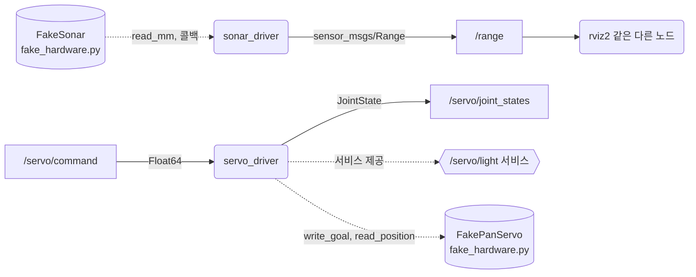
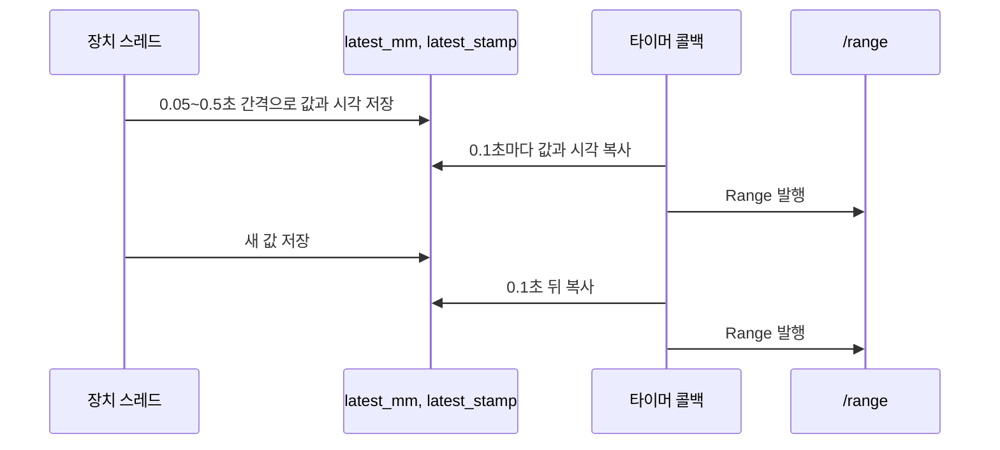
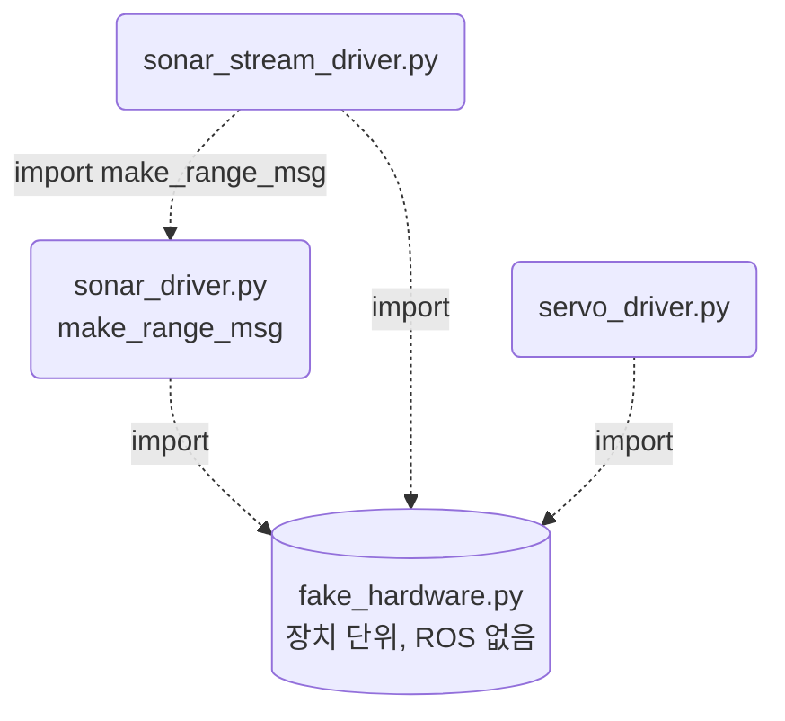

# 15장. 나만의 센서와 액추에이터

- 원서: Chapter 15. Your Own Sensors and Actuators, PDF p.279~294 (인쇄 쪽 = PDF 쪽 - 20)
- 선행 조건: 2~5장에서 만든 `basics` 패키지로 토픽, 서비스, 액션을 한 번씩 써 본 상태. 실물 장치는 필요 없습니다.
- 새로 설치할 것: 없음 (`diagnostic_msgs`, `std_srvs`, `control_msgs`는 Jazzy 기본 설치에 들어 있습니다)

## 이 장에서 체감할 구조

장치의 세부 사항(단위, 레지스터, 통신 방식)은 드라이버 노드 안에만 있고, 바깥에는 표준 메시지 타입만 보입니다.


원통으로 그린 `fake_hardware.py`의 두 클래스는 ROS를 모르는 일반 파이썬 클래스이고, 단위 변환과 ROS 메시지 만들기는 모두 드라이버 노드 쪽에서 합니다.

## 1. 목표와 개념

원서는 ROS를 모르는 장치를 ROS 그래프에 붙이는 "래퍼(wrapper)" 노드를 설계하는 방법을 다룹니다. 이 장의 요점은 코드 양이 아니라 설계 선택입니다.

- 드라이버 노드: 장치 전용 라이브러리를 부르고, 결과를 표준 메시지로 바꿔 내보내는 노드입니다. 다른 노드는 장치가 무엇인지 몰라도 됩니다.
- 센서 쪽 선택지: 값을 일정 주기로 읽어 토픽으로 낼지(폴링), 장치가 값을 줄 때마다 낼지(콜백 스트림), 장치 콜백은 받아 두되 일정 주기로 낼지, 요청이 올 때만 서비스로 돌려줄지를 고릅니다.
- 액추에이터 쪽 선택지: 계속 바뀌는 명령은 토픽, 가끔 주는 즉시 명령은 서비스, 시간이 걸리고 진행 상황이 필요한 명령은 액션으로 받습니다.
- 표준 메시지 우선: `sensor_msgs`, `diagnostic_msgs`, `std_srvs`처럼 이미 있는 타입을 먼저 찾습니다. 맞는 타입이 있으면 rviz2, rqt 같은 기존 도구가 그대로 붙습니다.

비유: 드라이버 노드는 외국어만 하는 장치 옆에 앉은 통역사이고, 회의실(ROS 그래프)에는 통역된 공용어(표준 메시지)만 들립니다.

이 가이드에는 실물 장치가 없으므로, 잡음이 섞인 가짜 초음파 거리 센서, WSL에서 실제로 읽을 수 있는 CPU 사용률(`/proc/stat`), 가짜 팬(pan) 서보 모터를 씁니다.

### 장치 값이 표준 메시지가 되기까지

드라이버 노드의 일은 크게 세 가지입니다. 장치 단위를 SI 단위로 바꾸고(REP 103: 길이는 m, 각도는 rad), 측정 시각과 `frame_id`를 header에 채우고, 장치 사양을 메시지에 함께 싣습니다.

예: 15-3의 `make_range_msg`에서 장치 단위(mm 정수)가 ROS 단위(m 실수)로 바뀌고 header가 채워집니다.

```python
msg.header.stamp = stamp
msg.header.frame_id = frame_id
msg.range = distance_mm / 1000.0
```

단위 변환이 이 함수 한 곳에만 있어서 두 드라이버(15-3, 15-4)가 같은 변환을 씁니다. `Range.msg`의 주석에도 header 시각은 센서가 거리를 돌려준 시각이라고 적혀 있습니다.

센서를 내보내는 방법은 장치가 값을 주는 방식에 따라 갈립니다. 일정 주기로 읽으면(설계 1) 타이머 주기대로 발행되고, 장치가 불규칙하게 밀어 주는 값은 최신 값만 저장해 두고 타이머가 발행하면(설계 3) 그 간격도 일정하게 만들 수 있습니다.

예: 15-3(설계 1)에서는 타이머 콜백이 장치를 읽고 바로 발행합니다.

```python
self.timer = self.create_timer(period, self.on_timer)
```

예: 15-4(설계 3)에서는 장치 스레드가 값을 저장하고, 타이머 콜백이 그 값을 복사해 발행합니다. 두 스레드가 같은 변수를 만지므로 lock으로 보호합니다.

```python
with self.lock:
    self.latest_mm = distance_mm
    self.latest_stamp = stamp
```



그림에서 볼 것: 장치 쪽 화살표의 간격은 들쭉날쭉하지만 `/range` 쪽 화살표는 0.1초마다 한 번씩입니다. 저장 변수가 두 스레드 사이의 완충 역할을 합니다.

액추에이터 쪽은 명령의 성격에 따라 인터페이스를 고릅니다. 15-6의 `servo_driver`는 세 가지를 한 노드에 모았습니다.

예:

```python
self.cmd_sub = self.create_subscription(Float64, 'servo/command', self.on_command, 10)
self.state_pub = self.create_publisher(JointState, 'servo/joint_states', 10)
self.light_srv = self.create_service(SetBool, 'servo/light', self.on_light)
```

목표 각도는 토픽, 현재 상태는 `JointState` 토픽, 켜기/끄기는 서비스입니다. 밖에서는 라디안만 보이고, 틱으로 바꾸는 곳은 한 줄입니다.

```python
ticks = FakePanServo.CENTER + round(target * TICKS_PER_RAD)
```

### 코드와 폴더 구조

이 장은 `sensors_actuators` 패키지(ament_python)를 만듭니다. 패키지 기본 파일은 2장에서 설명했으므로, 여기서는 이 장의 파일과 역할 분담만 적습니다.

```text
~/rosbook_ws/src/sensors_actuators/
├── package.xml            # 의존성: sensor_msgs, std_msgs, std_srvs, diagnostic_msgs (15-1)
├── setup.py               # console_scripts 4개 등록 (15-3)
└── sensors_actuators/
    ├── fake_hardware.py       # ROS를 import 하지 않는 가짜 장치: FakeSonar, FakePanServo (15-2)
    ├── sonar_driver.py        # 설계 1 드라이버와 make_range_msg (15-3)
    ├── sonar_stream_driver.py # 설계 3 드라이버, make_range_msg를 다시 씀 (15-4)
    ├── cpu_monitor.py         # /proc/stat을 읽어 DiagnosticArray 발행 (15-5)
    └── servo_driver.py        # 명령 토픽, JointState 토픽, SetBool 서비스 (15-6)
```

빌드하면 실행 파일 네 개가 `install/sensors_actuators/lib/sensors_actuators/`에 놓입니다. `ros2 run sensors_actuators sonar_driver`가 이 위치를 찾습니다.



그림에서 볼 것: 장치 코드와 ROS 코드가 파일 단위로 나뉘어 있어, `fake_hardware.py`를 실제 장치 라이브러리로 바꿔도 드라이버 파일의 ROS 부분은 거의 그대로 둘 수 있습니다. 이 장의 노드는 기본 뼈대에 장치 객체를 `__init__`에서 만들고, 장치 콜백을 쓰는 노드(`sonar_stream_driver`)만 `destroy_node`를 확장해 장치 스트림을 닫는 점이 더해집니다.

### 실무 메모

- 메시지 타입은 의미에 맞는 표준을 먼저 찾습니다(`sensor_msgs/Range`, `JointState`, `diagnostic_msgs`). 그러면 rviz2의 `Range` 디스플레이처럼 기존 도구가 이 드라이버가 가짜인지 진짜인지 모른 채 그대로 붙습니다(15-8).
- 단위는 SI로 내보냅니다(REP 103). 장치 고유 단위(mm, 틱)는 드라이버 안에서 끝냅니다.
- `header.stamp`는 발행 시각이 아니라 측정 시각을 넣고, `frame_id`는 센서가 로봇에 붙은 자리를 뜻하는 이름이므로 파라미터로 둡니다. tf 트리에 그 이름의 프레임이 있어야 다른 노드가 좌표를 변환할 수 있습니다.
- 설치마다 달라지는 값은 파라미터로 둡니다(`frame_id`, `rate`, `limit`). 장치 사양인 측정 한계와 시야각은 메시지 필드(`min_range`, `max_range`, `field_of_view`)에 실어 보내서, 받는 쪽이 장치 모델을 몰라도 값을 해석하게 합니다.

## 2. 원서(ROS 1)와 달라지는 점

| 원서 (ROS 1) | ROS 2 Jazzy | 이유와 주의점 |
|---|---|---|
| 가짜 센서가 PySide 다이얼 창 | 창 없는 가짜 초음파 센서 (`fake_hardware.py`) | 창을 띄우지 않아도 잡음, 비동기 콜백 같은 실제 장치의 성질을 흉내 낼 수 있습니다. |
| 다이얼 각도를 `geometry_msgs/Quaternion`으로 발행 | 거리를 `sensor_msgs/msg/Range`로 발행 | 의미에 맞는 표준 타입을 고르는 연습입니다. `Range`에는 header와 측정 한계가 들어 있습니다. |
| `rospy.Rate` 루프 | `create_timer` 콜백 | ROS 2에서는 실행기(executor)가 타이머 콜백을 부릅니다. |
| `rospy.spin()`이 콜백 스레드를 따로 돌림 | `rclpy.spin()`의 단일 스레드 실행기 | 장치 라이브러리가 자기 스레드에서 콜백을 부르면 노드 콜백과 동시에 실행될 수 있으므로 lock이 여전히 필요합니다. |
| 사용자 정의 `Light.srv` | `std_srvs/srv/SetBool` | 켜기/끄기는 표준 서비스로 충분합니다. 새 인터페이스 패키지를 만들 필요가 없습니다. |
| 사용자 정의 `Rotation.action` | `control_msgs/action/SingleJointPosition` 소개(구현은 5장 방식으로 과제) | 관절 하나를 목표 위치로 옮기는 표준 액션이 이미 있습니다. |
| 토픽이 TCP 위에서 동작한다는 설명 | DDS(RMW) 위에서 동작, QoS로 전달 방식 결정 | 전달 보장 여부와 늦게 들어온 구독자 처리 같은 성질을 QoS로 고릅니다. |

## 3. 실습

### 실습 15-1. 패키지 만들기

**준비**: 터미널 1개.

**직접 입력**:

```bash
cd ~/rosbook_ws/src
ros2 pkg create --build-type ament_python --license Apache-2.0 sensors_actuators \
  --dependencies rclpy sensor_msgs std_msgs std_srvs diagnostic_msgs
```

**줄 단위 해설**:

| 줄 | 설명 |
|---|---|
| `--dependencies ...` | `package.xml`에 `<depend>`로 들어갑니다. 이 장에서 쓰는 메시지 패키지를 미리 적어 둡니다. |
| `diagnostic_msgs` | 장치 상태(정상, 경고, 오류)를 알리는 표준 타입이 들어 있는 패키지입니다. 실습 15-5에서 씁니다. |

**관찰**: `~/rosbook_ws/src/sensors_actuators/` 아래에 `package.xml`, `setup.py`, `sensors_actuators/__init__.py`가 생깁니다.

**생각해 볼 질문**: 드라이버 노드를 만들 때 왜 새 메시지 타입부터 만들지 않고 기존 패키지를 의존성으로 거는 것부터 시작할까요?

### 실습 15-2. 가짜 장치 라이브러리

실제 장치라면 제조사가 주는 라이브러리에 해당하는 파일입니다. ROS를 전혀 import 하지 않는다는 점이 중요합니다.

**준비**: 15-1을 마친 상태.

**직접 입력**: `~/rosbook_ws/src/sensors_actuators/sensors_actuators/fake_hardware.py`

```python
import math
import random
import threading
import time


class FakeSonar:
    def __init__(self, noise_mm=15.0):
        self.noise_mm = noise_mm
        self._start = time.monotonic()
        self._running = False

    def read_mm(self):
        t = time.monotonic() - self._start
        true_mm = 1000.0 + 600.0 * math.sin(t / 3.0)
        measured = random.gauss(true_mm, self.noise_mm)
        return int(min(4000, max(20, measured)))

    def register_callback(self, callback):
        self._running = True
        thread = threading.Thread(
            target=self._stream, args=(callback,), daemon=True)
        thread.start()

    def _stream(self, callback):
        while self._running:
            time.sleep(random.uniform(0.05, 0.5))
            callback(self.read_mm())

    def close(self):
        self._running = False


class FakePanServo:
    TICKS_PER_REV = 4096
    CENTER = 2048

    def __init__(self, speed_ticks_per_s=300.0):
        self._speed = speed_ticks_per_s
        self._pos = float(self.CENTER)
        self._goal = float(self.CENTER)
        self._last = time.monotonic()
        self._led = False

    def _update(self):
        now = time.monotonic()
        step = self._speed * (now - self._last)
        self._last = now
        diff = self._goal - self._pos
        self._pos += max(-step, min(step, diff))

    def write_goal(self, ticks):
        self._update()
        self._goal = float(min(4095, max(0, int(ticks))))

    def read_position(self):
        self._update()
        return int(round(self._pos))

    def set_led(self, on):
        self._led = bool(on)

    def led(self):
        return self._led
```

**줄 단위 해설**:

| 줄 | 설명 |
|---|---|
| `read_mm` | 거리를 밀리미터 정수로 돌려줍니다. 실제 값은 1.0 m를 중심으로 천천히 오르내리고, 가우스 잡음이 섞입니다. 20~4000 mm 밖은 잘라 냅니다. |
| `register_callback`, `_stream` | 장치가 자기 스레드에서 0.05~0.5초 간격으로 측정값을 밀어 주는 방식을 흉내 냅니다. 간격이 일정하지 않다는 점이 핵심입니다. |
| `close` | 스트림 스레드를 멈춥니다. 드라이버 노드가 종료할 때 부릅니다. |
| `TICKS_PER_REV`, `CENTER` | 서보의 단위는 라디안이 아니라 한 바퀴 4096 틱이고, 2048이 가운데입니다. 이런 장치 고유 단위를 노드 밖으로 내보내지 않는 것이 이 장의 목표입니다. |
| `_update` | 마지막 호출 이후 지난 시간만큼 목표 쪽으로 위치를 옮깁니다. 초당 300틱이라 1 rad(약 652틱) 이동에 2초 남짓 걸립니다. |
| `write_goal`, `read_position` | 목표 틱 쓰기와 현재 틱 읽기입니다. 0~4095 밖의 값은 장치가 잘라 냅니다. |
| `set_led`, `led` | 켜고 끄기만 하는 단순 장치 기능입니다. |

**관찰**: 이 파일만으로는 아무것도 실행되지 않습니다. 다음 실습에서 드라이버가 이 클래스를 부릅니다.

**생각해 볼 질문**: 장치 라이브러리가 ROS를 import 하지 않도록 나누면 어떤 점이 좋을까요?

### 실습 15-3. 설계 1: 일정 주기로 읽어 토픽으로 내기

원서 PDF p.281의 첫 번째 설계에 해당합니다. 타이머가 돌 때마다 장치를 읽습니다.

**준비**: 15-2를 마친 상태.

**직접 입력**: `~/rosbook_ws/src/sensors_actuators/sensors_actuators/sonar_driver.py`

```python
import math

import rclpy
from rclpy.executors import ExternalShutdownException
from rclpy.node import Node
from sensor_msgs.msg import Range

from sensors_actuators.fake_hardware import FakeSonar


def make_range_msg(distance_mm, frame_id, stamp):
    msg = Range()
    msg.header.stamp = stamp
    msg.header.frame_id = frame_id
    msg.radiation_type = Range.ULTRASOUND
    msg.field_of_view = math.radians(15.0)
    msg.min_range = 0.02
    msg.max_range = 4.0
    msg.range = distance_mm / 1000.0
    return msg


class SonarDriver(Node):
    def __init__(self):
        super().__init__('sonar_driver')
        self.declare_parameter('frame_id', 'sonar_link')
        self.declare_parameter('rate', 10.0)
        self.frame_id = self.get_parameter('frame_id').value
        period = 1.0 / self.get_parameter('rate').value
        self.sonar = FakeSonar()
        self.pub = self.create_publisher(Range, 'range', 10)
        self.timer = self.create_timer(period, self.on_timer)

    def on_timer(self):
        distance_mm = self.sonar.read_mm()
        stamp = self.get_clock().now().to_msg()
        self.pub.publish(make_range_msg(distance_mm, self.frame_id, stamp))


def main(args=None):
    rclpy.init(args=args)
    node = SonarDriver()
    try:
        rclpy.spin(node)
    except (KeyboardInterrupt, ExternalShutdownException):
        pass
    finally:
        node.destroy_node()
        rclpy.try_shutdown()


if __name__ == '__main__':
    main()
```

`setup.py`의 `entry_points`를 아래처럼 고칩니다. 이 장의 실행 파일 네 개를 한 번에 등록해 둡니다.

```python
    entry_points={
        'console_scripts': [
            'sonar_driver = sensors_actuators.sonar_driver:main',
            'sonar_stream_driver = sensors_actuators.sonar_stream_driver:main',
            'cpu_monitor = sensors_actuators.cpu_monitor:main',
            'servo_driver = sensors_actuators.servo_driver:main',
        ],
    },
```

아직 없는 파일은 빌드 자체에는 영향이 없지만, 실행하면 import 오류가 납니다. 이번에는 `sonar_driver`만 실행합니다.

```bash
cd ~/rosbook_ws && colcon build --symlink-install --packages-select sensors_actuators
source ~/rosbook_ws/install/setup.bash
ros2 run sensors_actuators sonar_driver
```

**줄 단위 해설**:

| 줄 | 설명 |
|---|---|
| `make_range_msg` | 장치 단위(mm 정수)를 ROS 단위(m 실수)로 바꾸는 곳이 여기 한 군데뿐입니다. 다음 실습에서 다시 씁니다. |
| `radiation_type = Range.ULTRASOUND` | `Range`는 초음파(0)와 적외선(1)을 구분하는 상수를 갖고 있습니다. `ros2 interface show sensor_msgs/msg/Range`로 확인할 수 있습니다. |
| `field_of_view`, `min_range`, `max_range` | 받는 쪽이 값을 해석하는 데 필요한 장치 사양입니다. 사양을 메시지에 같이 실어 보내므로 받는 쪽은 장치 모델명을 몰라도 됩니다. |
| `declare_parameter('frame_id', ...)` | 센서가 로봇 어디에 붙었는지는 설치할 때 정해지므로 파라미터로 둡니다. |
| `declare_parameter('rate', 10.0)` | 읽는 주기도 파라미터입니다. 장치가 감당할 수 있는 속도는 장치마다 다릅니다. |
| `create_timer(period, self.on_timer)` | 주기마다 장치를 한 번 읽고 한 번 발행합니다. 이것이 설계 1의 전부입니다. |
| `self.get_clock().now().to_msg()` | 측정 시각을 header에 넣습니다. 받는 쪽이 오래된 값인지 판단할 수 있습니다. |

**관찰**: 다른 터미널에서 다음 명령을 차례로 실행합니다.

```bash
ros2 node info /sonar_driver
ros2 topic info -v /range
ros2 topic echo --once /range
ros2 topic hz /range
ros2 interface show sensor_msgs/msg/Range
```

- `node info`의 Publishers에 `/range: sensor_msgs/msg/Range`가 보입니다.
- `topic info -v`의 QoS는 `RELIABLE`, `VOLATILE`, `KEEP_LAST (10)`입니다.
- `echo` 결과의 `frame_id`는 `sonar_link`, `radiation_type`은 `0`, `field_of_view`는 약 `0.2618`, `range`는 0.4~1.6 사이 값입니다.
- `hz`는 약 10 Hz입니다.

**생각해 볼 질문**: 이 설계에서 장치가 실제로 측정하는 속도보다 타이머가 더 빠르면 어떤 일이 생길까요?

### 실습 15-4. 설계 3: 장치 콜백을 받아 두고 일정 주기로 내기

원서 PDF p.283~285의 두 번째, 세 번째 설계에 해당합니다. 장치가 불규칙하게 값을 밀어 줄 때, 받을 때마다 바로 발행하면(설계 2) 발행 간격도 불규칙해집니다. 여기서는 최신 값만 저장해 두고, 발행은 타이머가 맡습니다.

**준비**: 15-3의 `sonar_driver`를 Ctrl+C로 멈춥니다.

**직접 입력**: `~/rosbook_ws/src/sensors_actuators/sensors_actuators/sonar_stream_driver.py`

```python
import threading

import rclpy
from rclpy.executors import ExternalShutdownException
from rclpy.node import Node
from sensor_msgs.msg import Range

from sensors_actuators.fake_hardware import FakeSonar
from sensors_actuators.sonar_driver import make_range_msg


class SonarStreamDriver(Node):
    def __init__(self):
        super().__init__('sonar_stream_driver')
        self.declare_parameter('frame_id', 'sonar_link')
        self.frame_id = self.get_parameter('frame_id').value
        self.lock = threading.Lock()
        self.latest_mm = None
        self.latest_stamp = None
        self.pub = self.create_publisher(Range, 'range', 10)
        self.timer = self.create_timer(0.1, self.on_timer)
        self.sonar = FakeSonar()
        self.sonar.register_callback(self.on_measurement)

    def on_measurement(self, distance_mm):
        stamp = self.get_clock().now().to_msg()
        with self.lock:
            self.latest_mm = distance_mm
            self.latest_stamp = stamp

    def on_timer(self):
        with self.lock:
            distance_mm = self.latest_mm
            stamp = self.latest_stamp
        if distance_mm is None:
            return
        self.pub.publish(make_range_msg(distance_mm, self.frame_id, stamp))

    def destroy_node(self):
        self.sonar.close()
        super().destroy_node()


def main(args=None):
    rclpy.init(args=args)
    node = SonarStreamDriver()
    try:
        rclpy.spin(node)
    except (KeyboardInterrupt, ExternalShutdownException):
        pass
    finally:
        node.destroy_node()
        rclpy.try_shutdown()


if __name__ == '__main__':
    main()
```

```bash
ros2 run sensors_actuators sonar_stream_driver
```

`--symlink-install`로 빌드했고 `setup.py`에 이미 등록했으므로 다시 빌드하지 않아도 됩니다. 실행 파일을 못 찾는다는 오류가 나면 빌드와 `source`를 한 번 더 합니다.

**줄 단위 해설**:

| 줄 | 설명 |
|---|---|
| `from sensors_actuators.sonar_driver import make_range_msg` | 단위 변환을 한 곳에서만 하도록 15-3의 함수를 다시 씁니다. |
| `self.lock = threading.Lock()` | `on_measurement`는 장치 라이브러리의 스레드에서, `on_timer`는 rclpy 실행기 스레드에서 불립니다. 두 스레드가 같은 변수를 만지므로 lock으로 보호합니다. |
| `self.latest_mm = None` | 아직 측정값이 없음을 뜻합니다. 첫 값이 오기 전에는 발행하지 않습니다. |
| `self.latest_stamp` | 값을 받은 시각입니다. `Range`의 header 시각은 측정 시각이어야 하므로 발행 시각이 아니라 이 값을 씁니다. |
| `on_measurement` | 받은 시각과 값을 저장만 하고 바로 돌아갑니다. 장치 스레드에서 오래 일하지 않는 것이 좋습니다. |
| `on_timer` | lock 안에서는 값과 시각을 복사만 하고, 메시지 만들기와 발행은 lock 밖에서 합니다. |
| `destroy_node` | 노드가 끝날 때 장치 스트림도 멈추도록 부모 메서드를 확장합니다. |

**관찰**:

```bash
ros2 topic hz /range
ros2 node list
```

장치 콜백 간격은 0.05~0.5초로 들쭉날쭉하지만, `/range`는 약 10 Hz로 고르게 나옵니다. 같은 값이 연속으로 두 번 이상 나올 수 있는데, 그 사이에 장치가 새 값을 주지 않았기 때문입니다. 이때 header의 `stamp`도 같게 나오므로, 받는 쪽은 새 측정이 아니라는 것을 알 수 있습니다.

**생각해 볼 질문**: 같은 값이 반복해서 발행되는 것이 문제가 되는 경우와 그렇지 않은 경우를 하나씩 들어 보세요.

설계 4(요청할 때만 측정해서 서비스로 돌려주기, 원서 PDF p.286)는 이 장에서 구현하지 않습니다. 4장에서 만든 서비스 서버와 같은 구조이고, 측정에 시간이 오래 걸리거나 전력을 아껴야 하는 장치에 어울립니다.

### 실습 15-5. 실제로 읽을 수 있는 장치: CPU 사용률

WSL 안에는 온도 센서나 배터리 정보가 없지만, `/proc/stat`에서 CPU 사용 시간은 읽을 수 있습니다. CPU 사용률에 꼭 맞는 `sensor_msgs` 타입은 없으므로, 장치 상태를 알리는 표준 타입 `diagnostic_msgs/msg/DiagnosticArray`를 씁니다.

**준비**: 앞 실습의 노드는 멈춰도 되고 그대로 두어도 됩니다.

**직접 입력**: `~/rosbook_ws/src/sensors_actuators/sensors_actuators/cpu_monitor.py`

```python
import rclpy
from diagnostic_msgs.msg import DiagnosticArray, DiagnosticStatus, KeyValue
from rclpy.executors import ExternalShutdownException
from rclpy.node import Node


def read_cpu_times():
    with open('/proc/stat') as f:
        fields = [int(v) for v in f.readline().split()[1:]]
    idle = fields[3] + fields[4]
    return idle, sum(fields[:8])


class CpuMonitor(Node):
    def __init__(self):
        super().__init__('cpu_monitor')
        self.declare_parameter('warn_percent', 80.0)
        self.pub = self.create_publisher(DiagnosticArray, 'diagnostics', 10)
        self.prev_idle, self.prev_total = read_cpu_times()
        self.timer = self.create_timer(1.0, self.on_timer)

    def on_timer(self):
        idle, total = read_cpu_times()
        d_idle = idle - self.prev_idle
        d_total = total - self.prev_total
        self.prev_idle, self.prev_total = idle, total
        if d_total <= 0:
            return
        usage = 100.0 * (1.0 - d_idle / d_total)

        status = DiagnosticStatus()
        status.name = 'cpu_monitor: CPU usage'
        status.hardware_id = 'wsl_cpu'
        if usage >= self.get_parameter('warn_percent').value:
            status.level = DiagnosticStatus.WARN
            status.message = 'high load'
        else:
            status.level = DiagnosticStatus.OK
            status.message = 'ok'
        status.values = [KeyValue(key='usage_percent', value=f'{usage:.1f}')]

        msg = DiagnosticArray()
        msg.header.stamp = self.get_clock().now().to_msg()
        msg.status = [status]
        self.pub.publish(msg)


def main(args=None):
    rclpy.init(args=args)
    node = CpuMonitor()
    try:
        rclpy.spin(node)
    except (KeyboardInterrupt, ExternalShutdownException):
        pass
    finally:
        node.destroy_node()
        rclpy.try_shutdown()


if __name__ == '__main__':
    main()
```

```bash
ros2 run sensors_actuators cpu_monitor
```

**줄 단위 해설**:

| 줄 | 설명 |
|---|---|
| `read_cpu_times` | `/proc/stat` 첫 줄은 부팅 후 누적된 CPU 시간입니다. 4번째와 5번째 값(idle, iowait)을 쉬는 시간으로 봅니다. 전체 시간은 앞의 8개 값만 더합니다. 9번째와 10번째 값(guest, guest_nice)은 이미 user, nice에 들어 있어서 더하면 두 번 셉니다. |
| `d_idle`, `d_total` | 누적값이므로 이전 값과의 차이로 1초 동안의 사용률을 구합니다. |
| `DiagnosticStatus.WARN`, `OK` | 상태 수준 상수입니다. 받는 쪽은 숫자를 해석하지 않고 수준만 보고 경고를 띄울 수 있습니다. |
| `KeyValue(...)` | 수치 같은 세부 정보는 문자열 키-값 목록으로 붙입니다. |
| `'diagnostics'` | 진단 메시지를 모으는 관례적인 토픽 이름입니다. |

**관찰**:

```bash
ros2 interface show diagnostic_msgs/msg/DiagnosticStatus
ros2 topic echo --once /diagnostics
```

`level`은 `"\0"`처럼 보입니다. `level`이 `byte` 타입이라 0이 문자로 찍히기 때문이며, `OK`라는 뜻입니다. `message`는 `ok`, `values`에 `usage_percent`가 있습니다. 다른 터미널에서 빌드처럼 CPU를 많이 쓰는 일을 하면 `usage_percent`가 올라갑니다.

**생각해 볼 질문**: CPU 사용률을 `std_msgs/msg/Float32`로 내보내면 어떤 정보가 사라질까요?

### 실습 15-6. 액추에이터: 명령 토픽, 상태 토픽, 서비스

원서 PDF p.287~293의 액추에이터 설계를 서보 하나로 묶었습니다. 목표 각도는 계속 바뀔 수 있으므로 토픽으로 받고(원서의 설계 1), 켜기/끄기는 서비스로 받습니다(설계 2). 현재 각도는 `sensor_msgs/msg/JointState`로 내보냅니다.

**준비**: 터미널 2개 이상.

**직접 입력**: `~/rosbook_ws/src/sensors_actuators/sensors_actuators/servo_driver.py`

```python
import math

import rclpy
from rclpy.executors import ExternalShutdownException
from rclpy.node import Node
from sensor_msgs.msg import JointState
from std_msgs.msg import Float64
from std_srvs.srv import SetBool

from sensors_actuators.fake_hardware import FakePanServo

TICKS_PER_RAD = FakePanServo.TICKS_PER_REV / (2.0 * math.pi)


class ServoDriver(Node):
    def __init__(self):
        super().__init__('servo_driver')
        self.declare_parameter('joint_name', 'pan_joint')
        self.declare_parameter('limit', 1.5)
        self.joint_name = self.get_parameter('joint_name').value
        self.servo = FakePanServo()
        self.prev_pos = self.read_position_rad()
        self.prev_time = self.get_clock().now()

        self.cmd_sub = self.create_subscription(
            Float64, 'servo/command', self.on_command, 10)
        self.state_pub = self.create_publisher(
            JointState, 'servo/joint_states', 10)
        self.light_srv = self.create_service(
            SetBool, 'servo/light', self.on_light)
        self.timer = self.create_timer(0.05, self.on_timer)

    def read_position_rad(self):
        ticks = self.servo.read_position()
        return (ticks - FakePanServo.CENTER) / TICKS_PER_RAD

    def on_command(self, msg):
        limit = self.get_parameter('limit').value
        target = min(limit, max(-limit, msg.data))
        if target != msg.data:
            self.get_logger().warn(
                f'command {msg.data:.2f} clipped to {target:.2f}')
        ticks = FakePanServo.CENTER + round(target * TICKS_PER_RAD)
        self.servo.write_goal(ticks)

    def on_light(self, request, response):
        self.servo.set_led(request.data)
        response.success = self.servo.led() == request.data
        response.message = 'light on' if self.servo.led() else 'light off'
        return response

    def on_timer(self):
        now = self.get_clock().now()
        pos = self.read_position_rad()
        dt = (now - self.prev_time).nanoseconds * 1e-9
        vel = (pos - self.prev_pos) / dt if dt > 0 else 0.0
        self.prev_pos, self.prev_time = pos, now

        msg = JointState()
        msg.header.stamp = now.to_msg()
        msg.name = [self.joint_name]
        msg.position = [pos]
        msg.velocity = [vel]
        self.state_pub.publish(msg)


def main(args=None):
    rclpy.init(args=args)
    node = ServoDriver()
    try:
        rclpy.spin(node)
    except (KeyboardInterrupt, ExternalShutdownException):
        pass
    finally:
        node.destroy_node()
        rclpy.try_shutdown()


if __name__ == '__main__':
    main()
```

```bash
ros2 run sensors_actuators servo_driver
```

**줄 단위 해설**:

| 줄 | 설명 |
|---|---|
| `TICKS_PER_RAD` | 장치 단위(틱)와 ROS 단위(라디안)를 바꾸는 상수입니다. 바깥 노드는 틱이라는 단위를 볼 일이 없습니다. |
| `declare_parameter('limit', 1.5)` | 기구가 부딪히지 않도록 드라이버가 지키는 안전 한계입니다. 장치마다 다르므로 파라미터로 둡니다. |
| `'servo/command'`, `Float64` | 목표 각도(rad)를 받는 토픽입니다. 상대 이름이라 네임스페이스를 주면 함께 옮겨 갑니다. |
| `'servo/joint_states'`, `JointState` | 관절 이름, 위치, 속도를 담는 표준 타입입니다. robot_state_publisher나 rviz2가 이 타입을 읽습니다. |
| `create_service(SetBool, 'servo/light', ...)` | 켜기/끄기 같은 짧은 명령은 결과를 바로 돌려받는 서비스가 어울립니다. |
| `on_command` | 한계를 넘는 명령은 잘라 내고 경고 로그를 남깁니다. 그 뒤 라디안을 틱으로 바꿔 장치에 씁니다. |
| `on_light` | `response.success`는 장치가 실제로 요청한 상태가 되었는지로 정합니다. |
| `on_timer` | 20 Hz로 현재 위치를 읽고, 직전 값과의 차이로 속도를 계산해 발행합니다. |

**관찰**: 두 번째 터미널에서 실행합니다.

```bash
ros2 node info /servo_driver
ros2 topic echo /servo/joint_states --field position
```

세 번째 터미널에서 명령을 보냅니다.

```bash
ros2 topic pub --once /servo/command std_msgs/msg/Float64 "{data: 1.0}"
ros2 topic pub --once /servo/command std_msgs/msg/Float64 "{data: 3.0}"
ros2 service call /servo/light std_srvs/srv/SetBool "{data: true}"
```

- `node info`에 Subscribers `/servo/command: std_msgs/msg/Float64`, Publishers `/servo/joint_states: sensor_msgs/msg/JointState`, Service Servers `/servo/light: std_srvs/srv/SetBool`이 보입니다.
- 1.0을 보내면 position이 0에서 약 2초 동안 늘어나 1.0 근처(틱 단위로 반올림되어 1.0001 정도)에서 멈춥니다. 움직이는 동안 velocity는 약 0.46 rad/s입니다.
- 3.0을 보내면 드라이버 터미널에 `command 3.00 clipped to 1.50` 경고가 찍힙니다.
- 서비스 응답은 `success=True, message='light on'`입니다.

**생각해 볼 질문**: 목표에 도착했는지 알려 주고, 도중에 취소할 수도 있게 하려면 토픽과 서비스 중 무엇으로도 부족합니다. 무엇을 써야 할까요?

### 실습 15-7. 시간이 걸리는 명령은 액션으로 (구조만 확인)

원서 PDF p.292의 세 번째 액추에이터 설계는 회전처럼 시간이 걸리는 명령을 액션으로 받습니다. ROS 2에는 관절 하나를 목표 위치로 옮기는 표준 액션이 이미 있습니다.

**준비**: 터미널 1개.

**직접 입력**:

```bash
ros2 interface show control_msgs/action/SingleJointPosition
```

**관찰**: `---`로 나뉜 세 부분이 보입니다. Goal은 `position`, `min_duration`, `max_velocity`이고, Result는 비어 있으며, Feedback은 `header`, `position`, `velocity`, `error`입니다.

**생각해 볼 질문**: 15-6의 `servo_driver`에 이 액션 서버를 붙인다면, Feedback의 `error`는 어떤 값으로 채우면 될까요? (5장에서 만든 액션 서버를 참고해 직접 구현해 보는 것이 이 장의 과제입니다.)

### 실습 15-8. rviz2로 거리 센서 보기 (선택, GUI)

**준비**: 터미널 3개. 첫 터미널에서 `ros2 run sensors_actuators sonar_driver`.

**직접 입력**:

```bash
ros2 run tf2_ros static_transform_publisher --frame-id map --child-frame-id sonar_link
rviz2
```

rviz2에서 Fixed Frame을 `map`으로 바꾸고, Add 버튼으로 `Range` 디스플레이를 추가한 뒤 Topic을 `/range`로 고릅니다.

**줄 단위 해설**:

| 줄 | 설명 |
|---|---|
| `static_transform_publisher --frame-id map --child-frame-id sonar_link` | `Range` 메시지의 `frame_id`(`sonar_link`)가 어디에 있는지 rviz2에 알려 주는 고정 좌표 변환입니다. 위치와 회전을 생략하면 같은 자리에 겹칩니다. |

**관찰**: 원뿔 모양이 거리 값에 맞춰 길어졌다 짧아졌다 합니다. rviz2는 이 장치가 가짜인지 진짜인지 모르고, `Range` 타입만 보고 그립니다.

**생각해 볼 질문**: `static_transform_publisher`를 실행하지 않으면 rviz2의 Range 디스플레이에 어떤 상태가 표시될까요?

## 4. 일부러 망가뜨려 보기

| 바꿀 것 | 예상 증상 | 원인을 확인하는 명령 |
|---|---|---|
| `sonar_driver` 실행 중에 `ros2 topic echo --qos-durability transient_local /range` | echo가 아무것도 받지 못하고, 양쪽에 `incompatible QoS ... Last incompatible policy: DURABILITY` 경고가 찍힙니다. | `ros2 topic info -v /range`로 publisher의 Durability가 `VOLATILE`인지 봅니다. |
| `ros2 topic pub /servo/command std_msgs/msg/Float32 "{data: 0.5}"` | `Waiting for at least 1 matching subscription(s)...`만 반복되고 서보가 움직이지 않습니다. | `ros2 topic info /servo/command`로 타입이 `Float64`인지 봅니다. 이름이 같아도 타입이 다르면 연결되지 않습니다. |
| `sonar_stream_driver.py`에서 `with self.lock:` 두 곳을 지우기 | 이 예제에서는 대입 하나뿐이라 증상이 거의 보이지 않습니다. 값 여러 개를 같이 갱신하는 장치라면 섞인 값이 나올 수 있습니다. | 증상이 드물게 나타나는 종류의 버그입니다. 코드 리뷰로 찾아야 한다는 점을 기억해 둡니다. |
| `ros2 run sensors_actuators sonar_driver --ros-args -p frame_id:=sonar_lnik` | 토픽은 잘 나오지만 15-8의 rviz2에서 Range가 그려지지 않고 변환이 없다는 상태가 뜹니다. | `ros2 topic echo --once /range --field header.frame_id`, `ros2 run tf2_ros tf2_echo map sonar_lnik` |
| `servo_driver` 실행 중에 그 터미널에서 Ctrl+C | `/servo/joint_states`가 끊기고, 명령 pub은 구독자를 기다립니다. | `ros2 node list`, `ros2 topic info /servo/command` |

## 5. 확인 질문

<details><summary>Q1. 15-1: 왜 새 메시지 타입부터 만들지 않을까요?</summary>

표준 타입을 쓰면 rviz2, rqt, 다른 사람이 만든 노드가 바로 연결됩니다. 새 타입은 받는 쪽도 그 인터페이스 패키지를 알아야 하므로, 표준 타입으로 표현할 수 없을 때만 만듭니다.

</details>

<details><summary>Q2. 15-2: 장치 라이브러리가 ROS를 import 하지 않으면 무엇이 좋을까요?</summary>

ROS 없이도 장치를 시험할 수 있고, ROS 버전이 바뀌어도 장치 코드는 그대로 둘 수 있습니다. ROS에 맞추는 일은 드라이버 노드 한 곳에서만 하게 됩니다.

</details>

<details><summary>Q3. 15-3: 타이머가 장치보다 빠르면 어떻게 될까요?</summary>

장치에 따라 같은 값을 다시 돌려주거나, 읽기 함수가 다음 측정까지 막혀서(blocking) 타이머 콜백이 늦어집니다. 콜백이 늦어지면 같은 실행기의 다른 콜백도 늦어집니다.

</details>

<details><summary>Q4. 15-4: 같은 값이 반복 발행되는 것이 문제가 되는 경우는?</summary>

받는 쪽이 메시지 하나를 새 측정 하나로 세는 경우(예: 측정 횟수로 평균을 내는 필터)에는 문제가 됩니다. 최신 거리만 필요한 장애물 회피라면 문제가 되지 않습니다. 필요하면 header의 stamp를 측정 시각으로 넣어 받는 쪽이 구분하게 합니다.

</details>

<details><summary>Q5. 15-5: Float32로 내보내면 무엇이 사라질까요?</summary>

측정 시각(header), 정상인지 경고인지 하는 수준, 어떤 장치의 값인지(name, hardware_id)가 사라집니다. 받는 쪽은 숫자의 의미를 따로 알아야 합니다.

</details>

<details><summary>Q6. 15-6: 도착 여부와 취소가 필요하면 무엇을 쓸까요?</summary>

액션입니다. Goal로 목표를 받고, Feedback으로 진행 상황을 보내고, Result로 끝을 알리며, 클라이언트가 취소를 요청할 수 있습니다.

</details>

<details><summary>Q7. 15-7: Feedback의 error는 무엇으로 채울까요?</summary>

목표 위치에서 현재 위치를 뺀 값입니다. 15-6의 `read_position_rad()`로 현재 위치를 읽어 계산합니다.

</details>

<details><summary>Q8. 15-8: 좌표 변환이 없으면 rviz2에 무엇이 보일까요?</summary>

Range 디스플레이가 오류 상태가 되고, `sonar_link`에서 `map`으로 가는 변환이 없다는 내용이 표시됩니다. 메시지는 받고 있어도 어디에 그릴지 모르기 때문입니다.

</details>

## 6. 원서 대조 메모

장치 대응표입니다.

| 원서 장치 | 이 가이드의 대체물 | 비고 |
|---|---|---|
| 가짜 센서: 다이얼 창(0~99 값) | `FakeSonar`: 잡음 섞인 거리(mm), 불규칙 콜백 스트림 | 창 없이 비동기 콜백을 흉내 냅니다. |
| 다이얼 각도 → `Quaternion` 토픽 | 거리 → `sensor_msgs/msg/Range` 토픽 `/range` | |
| 센서 설계 1, 2, 3 | 15-3(설계 1), 15-4(설계 3, 설계 2는 설명만) | |
| 센서 설계 4(서비스) | 설명만 | 4장 서비스 서버와 같은 구조입니다. |
| (해당 없음) | `cpu_monitor`: `/proc/stat` CPU 사용률 → `DiagnosticArray` | WSL에서 실제로 읽을 수 있는 유일한 하드웨어 값으로 골랐습니다. |
| 가짜 액추에이터: 볼륨(`Float32` 토픽) | 서보 목표 각도(`Float64` 토픽 `/servo/command`) | 상태 보고(`JointState`)를 추가했습니다. |
| 가짜 액추에이터: 조명(`Light.srv`) | `std_srvs/srv/SetBool` 서비스 `/servo/light` | |
| 가짜 액추에이터: 회전(`Rotation.action`) | `control_msgs/action/SingleJointPosition` 소개 | 구현은 과제로 남겼습니다. |

원서의 오류와 주의할 점입니다.

- 원서 PDF p.284~285 설계 3 예제: 콜백 함수 안에서 전역 각도 변수에 대입하면서 `global` 선언이 없어 값이 갱신되지 않습니다. 또 각도가 0일 때 조건문이 거짓이 되어 발행을 건너뜁니다. 이 가이드의 15-4는 `None`과 비교합니다.
- 원서 PDF p.286과 p.288의 예제: 서비스 정의를 import 하는 패키지 이름이 서로 다릅니다.
- 원서 PDF p.289, p.293의 예제: 절댓값 함수를 import 하지 않고 씁니다.
- 원서 PDF p.292~293: 예제 두 개의 캡션이 볼륨 제어라고 되어 있지만 실제 내용은 조명과 회전입니다.
- 원서 PDF p.291에는 값의 범위를 거꾸로 적은 곳이 있고, p.288에는 액추에이터를 설명하는 문단에서 센서라고 쓴 곳이 있습니다.
- 원서 PDF p.291은 토픽이 TCP 위에서 동작한다고 설명합니다. ROS 2는 DDS 위에서 동작하고, 전달 보장 같은 성질은 QoS로 정합니다. 4절 첫 줄이 그 차이를 직접 보여 줍니다.

## 7. 이 문서의 검증 상태

- 확인함 (WSL Ubuntu 24.04, ROS 2 Jazzy, `RMW_IMPLEMENTATION=rmw_cyclonedds_cpp`, 이 문서의 코드와 같은 파일을 별도 워크스페이스에서 빌드):
  - `colcon build` 성공, `ros2 pkg executables sensors_actuators`에 실행 파일 4개.
  - `sonar_driver`: `node info`, `topic info -v`(RELIABLE, VOLATILE), `echo --once`(frame_id, radiation_type 0, field_of_view 0.2618), `hz`(약 10.0 Hz), `param get frame_id`.
  - `sonar_stream_driver`: `hz` 약 10.0 Hz.
  - `cpu_monitor`: `/diagnostics` echo에서 level `"\0"`, message `ok`, `usage_percent` 값.
  - `servo_driver`: `node info`, 1.0 명령 후 이동 중 position 약 0.94와 velocity 약 0.46, 도착 후 1.000155, 3.0 명령 시 `clipped to 1.50` 경고, `SetBool` 응답 `success=True, message='light on'`.
  - 4절 첫째 줄(QoS 경고 문구)과 둘째 줄(타입이 다른 pub이 구독자를 찾지 못함, `topic info`에 `Float64`).
  - `ros2 interface show control_msgs/action/SingleJointPosition`, `static_transform_publisher --help`의 `--frame-id`, `--child-frame-id` 인자.
- 확인 못 함:
  - 15-8의 rviz2 화면(GUI), 4절 넷째 줄의 rviz2 표시.
  - 4절 셋째 줄(lock 제거)의 증상은 재현을 시도하지 않았습니다.
- 설명 보강(2026-10-30): "이 장에서 체감할 구조"와 1절에 그림, 코드 예시, 코드와 폴더 구조, 실무 메모를 더했습니다. 머리말과 2~6절은 바꾸지 않았습니다. 1절의 코드 예시는 따로 실행하지 않았습니다.
