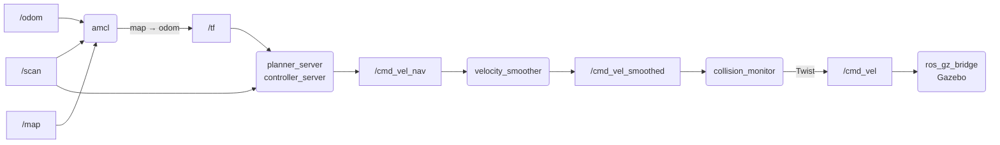
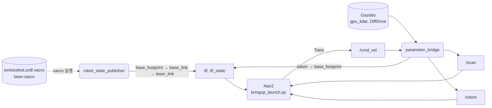
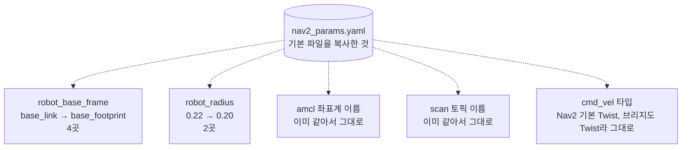

# 17장. 나만의 이동 로봇 2부

- 원서: Chapter 17. Your Own Mobile Robot: Part 2, PDF p.319~338 (인쇄 쪽 = PDF 쪽 - 20)
- 선행 조건: 16장의 `tortoisebot` 패키지를 마치고 `sim.launch.py`로 로봇을 운전해 본 상태. 9~10장에서 Nav2를 TurtleBot3로 써 본 경험.
- 새로 설치할 것: 없음 (`nav2_bringup`, `nav2_minimal_tb3_sim`, `tf2_tools`는 이미 설치되어 있습니다)

## 이 장에서 체감할 구조

Nav2는 로봇이 누구인지 묻지 않고, 좌표 변환 트리(`map → odom → base_footprint → laser_link`), `/scan`, `/odom`, 그리고 `/cmd_vel`의 타입만 봅니다. 이 넷을 맞추는 일이 "내 로봇에 내비게이션 붙이기"의 전부입니다.



## 1. 목표와 개념

원서는 16장에서 만든 로봇에 레이저 센서를 달고, 내비게이션 스택을 설정해 지도 위에서 목표까지 스스로 가게 만듭니다.

- 좌표 변환 확인: 내비게이션은 `map`, `odom`, 로봇 기준 좌표계, 센서 좌표계가 하나의 트리로 이어져 있어야 동작합니다. 먼저 트리를 눈으로 확인합니다.
- 레이저 센서: Gazebo의 `gpu_lidar` 센서를 모델에 붙이고, 브리지로 `/scan`을 ROS에 보냅니다.
- Nav2 설정: 기본 설정 파일을 복사해서 이 로봇에 맞는 값(로봇 기준 좌표계 이름, 로봇 반지름)만 고칩니다. 처음부터 쓰지 않는 이유는 설정 항목이 수백 개이기 때문입니다.
- 위치 추정과 목표: amcl에 초기 위치를 알려 주고, 목표 자세를 액션으로 보냅니다.

비유: Nav2는 렌터카를 받은 운전자와 같습니다. 차종은 상관없지만, 차 크기(robot_radius), 계기판 위치(좌표계 이름), 페달 규격(`/cmd_vel` 타입)은 알려 줘야 합니다.

### 내 로봇이 Nav2에 보여야 하는 것

16장의 `tortoisebot` 시뮬에 레이저를 더하면, 9장과 10장에서 TurtleBot3로 쓴 Nav2가 로봇을 바꿔도 같은 토픽과 같은 좌표계 이름으로 연결됩니다. Nav2에 보이는 것은 아래 네 가지뿐입니다.



그림에서 볼 것: 로봇이 바뀌어도 Nav2 쪽 연결(`/scan`, `/odom`, `/tf`, `/cmd_vel`)은 그대로이고, 로봇 쪽(모델, 센서, 브리지)이 이 이름들을 만들어 냅니다. `map → odom` 변환은 Nav2 안의 amcl이 더하므로 위 그림에는 없습니다(17-5).

시작은 좌표 변환 트리를 눈으로 확인하는 것입니다.

예: 17-1의 명령입니다. 센서를 붙이기 전에 트리가 `odom`부터 바퀴까지 이어져 있는지 봅니다.

```bash
ros2 run tf2_tools view_frames
ros2 run tf2_ros tf2_echo odom base_footprint
```

센서를 붙일 때는 Gazebo 쪽 센서가 내는 토픽 이름과 header의 `frame_id`가 각각 브리지와 tf 트리에 맞아야 합니다.

예: 17-2의 `laser.xacro`입니다. `frame_id`로 `laser_link`를 쓰도록 지정해야 tf 트리의 링크와 이름이 같아집니다.

```xml
<topic>scan</topic>
<gz_frame_id>laser_link</gz_frame_id>
```

### 남의 로봇용 설정을 내 로봇에 맞추기

Nav2의 기본 설정 파일에는 특정 로봇을 가정한 값(`robot_radius: 0.22`, `robot_base_frame: base_link` 등)이 들어 있습니다. 17-4에서는 파일을 복사한 뒤, 내 로봇과 다른 값만 고칩니다.



그림에서 볼 것: 고치는 곳은 프레임 이름과 로봇 크기 두 종류입니다. 토픽 이름과 amcl의 프레임 이름은 표준 이름을 지켰기 때문에 고칠 필요가 없었습니다. 속도 명령 타입도 Nav2 기본값(`Twist`)과 이 로봇의 브리지가 이미 같아서 그대로 둡니다. 다만 다른 로봇에 옮길 때는 Nav2 출력과 브리지 yaml의 타입이 같은지 꼭 확인합니다.

예: 17-4에서 실제로 바뀌는 줄입니다.

```text
-  robot_base_frame: base_link
+  robot_base_frame: base_footprint
-  robot_radius: 0.22
+  robot_radius: 0.20
```

예: 17-6에서 Nav2 쪽 `cmd_vel` 타입을 확인하는 명령입니다. 기본값이 `False`(Twist)이고, 이 로봇의 브리지도 `Twist`라서 맞습니다.

```bash
ros2 param get /controller_server enable_stamped_cmd_vel
```

### 코드와 폴더 구조

이 장은 새 패키지를 만들지 않고, 16장의 `tortoisebot` 패키지에 파일을 더합니다. 16장의 구조에 `laser.xacro`, `tortoise_sandbox.sdf`, `nav2_params.yaml`이 더해집니다.

```text
~/rosbook_ws/src/tortoisebot/
├── urdf/
│   ├── tortoisebot.urdf.xacro   # include 한 줄 추가: laser.xacro (17-2)
│   └── laser.xacro              # 새 파일: laser_link, laser_joint, gpu_lidar 센서 (17-2)
├── config/
│   ├── tortoisebot_bridge.yaml  # scan 항목 추가 (17-2)
│   └── nav2_params.yaml         # 새 파일: Nav2 기본 설정을 복사해 6줄 수정 (17-4)
└── worlds/
    └── tortoise_sandbox.sdf     # 새 파일: 연습장 월드(Sensors 시스템 포함) (17-3)
```

`setup.py`는 16장에서 `urdf/*.xacro`, `config/*.yaml`, `worlds/*.sdf`를 이미 `glob`으로 잡아 두었으므로 고치지 않고, 새 파일은 다시 빌드하면 `install/tortoisebot/share/tortoisebot/urdf/`, `.../config/`, `.../worlds/`에 놓입니다. `sim.launch.py`는 `world:=`로 월드 파일 경로를 받으므로 이것도 고치지 않습니다. 17-5에서 Nav2에 주는 `params_file`은 설치 폴더가 아니라 소스 폴더의 `nav2_params.yaml`을 가리킵니다.

이 장에서 새로 짜는 노드 코드는 없습니다. Nav2 노드들은 이미 설치된 패키지(`nav2_bringup`)이고, 이 장은 그 노드들이 읽는 모델, 월드, 설정 파일만 더합니다.

### 실무 메모

- 표준 토픽 이름(`/scan`, `/odom`, `/cmd_vel`)과 표준 프레임 이름(`map`, `odom`, `base_footprint`, `base_link`, REP 105)을 지키면 Nav2 같은 큰 스택을 거의 고치지 않고 씁니다. 이 장에서 고친 것은 6줄뿐입니다.
- 새 로봇에 Nav2를 붙일 때는 순서를 지킵니다. tf 트리(17-1), 센서 토픽과 `frame_id`(17-3), `/odom`, `/cmd_vel` 타입(17-6), 마지막으로 Nav2입니다. 앞 단계가 안 되면 뒤 단계로 넘어가지 말고 앞 단계부터 고칩니다. Nav2 로그부터 읽으면 원인을 놓치기 쉽습니다.
- 기본 설정 파일은 복사해서 쓰고 `diff`로 바뀐 줄을 확인합니다. 원본이 업데이트되어도 어디를 고쳤는지 한눈에 보입니다.
- 센서가 만드는 `frame_id`는 모델의 링크 이름과 문자열까지 같아야 합니다. `gz_frame_id`를 빠뜨리면 Gazebo가 정한 긴 이름이 들어가 tf 트리와 맞지 않습니다(17-2).
- `/cmd_vel` 타입은 Nav2의 출력 노드들(controller_server, velocity_smoother, collision_monitor 등)과 로봇 브리지가 모두 같아야 합니다. 한 곳만 바꾸면 연결되지 않습니다(5절 Q6).
- 시뮬에 붙는 모든 노드와 도구는 `use_sim_time:=true`로 실행합니다. 하나만 빠져도 변환 시각이 맞지 않습니다(4절).

## 2. 원서(ROS 1)와 달라지는 점

| 원서 (ROS 1) | ROS 2 Jazzy | 이유와 주의점 |
|---|---|---|
| `rosrun tf view_frames` | `ros2 run tf2_tools view_frames` | 결과 PDF 파일 이름에 날짜와 시각이 붙습니다. |
| Gazebo Classic `gpu_ray` 센서 + ROS 플러그인 | Gazebo Harmonic `gpu_lidar` 센서 + 브리지 yaml의 `scan` 항목 | 센서는 Gazebo 토픽만 냅니다. 월드에 Sensors 시스템이 있어야 센서가 동작합니다. |
| Willow Garage 사무실 월드와 지도 | TurtleBot3 연습장 월드 + `nav2_bringup`의 `tb3_sandbox` 지도 | 설치된 패키지에 이미 짝이 맞는 월드 모델과 지도가 있습니다. |
| `move_base` + `amcl` + 설정 yaml 여러 개 | Nav2 (`nav2_bringup`의 `bringup_launch.py`) + yaml 하나 | Nav2는 lifecycle 노드 묶음이고, 설정은 노드 이름별로 한 파일에 들어 있습니다. |
| footprint를 다각형으로 지정 | 이 장에서는 `robot_radius`(원) 사용 | 작은 원형에 가까운 로봇은 반지름 하나로 충분하고, 기본 설정이 이미 이 방식입니다. |
| rviz의 2D Nav Goal | rviz2의 Nav2 Goal 도구 또는 `ros2 action send_goal` | 목표는 `/navigate_to_pose` 액션으로 전달됩니다. |
| `cmd_vel` 타입이 항상 `Twist` | Nav2 출력 타입은 `enable_stamped_cmd_vel` 파라미터가 정함(Jazzy 기본 `false`, Twist) | 로봇 브리지의 `/cmd_vel` 타입과 같아야 합니다. |

## 3. 실습

### 실습 17-1. 좌표 변환 트리 확인하기

원서 PDF p.319~323처럼, 센서를 붙이기 전에 로봇의 좌표 변환이 모두 이어져 있는지 확인합니다.

**준비**: 터미널 3개. 첫 터미널에서 `ros2 launch tortoisebot sim.launch.py`.

**직접 입력**:

```bash
cd /tmp
ros2 run tf2_tools view_frames
ros2 run tf2_ros tf2_echo odom base_footprint
ros2 run tf2_ros tf2_echo base_footprint left_wheel
ros2 topic info -v /tf_static
```

rviz2는 `rviz2 --ros-args -p use_sim_time:=true`로 실행하고, Fixed Frame을 `odom`으로 바꾼 뒤 `RobotModel`(Description Topic `/robot_description`)과 `TF` 디스플레이를 추가합니다.

**줄 단위 해설**:

| 줄 | 설명 |
|---|---|
| `view_frames` | 5초 동안 `/tf`와 `/tf_static`을 듣고 트리를 `frames_<날짜>.pdf`와 `.gv`로 저장합니다. |
| `tf2_echo odom base_footprint` | DiffDrive가 Gazebo에서 보내고 브리지가 넘겨준 변환입니다. 로봇이 움직이면 값이 바뀝니다. |
| `tf2_echo base_footprint left_wheel` | `robot_state_publisher`가 `/joint_states`로 계산한 변환입니다. 바퀴가 돌면 회전값이 바뀝니다. |
| `topic info -v /tf_static` | 고정 조인트 변환을 내는 노드(`robot_state_publisher`)와 Durability `TRANSIENT_LOCAL`을 봅니다. |

**관찰**: `.gv` 파일(또는 PDF)에 `odom → base_footprint → base_link`가 있고, `base_link` 아래에 `left_wheel`, `right_wheel`, `front_caster`(그 아래 `front_wheel`)가 있습니다. 고정 변환(`base_footprint → base_link`)은 평균 주기가 10000처럼 비현실적인 값으로 표시되는데, 한 번만 보내는 정적 변환이라 그렇습니다. `map`은 아직 없습니다. 17-5에서 amcl이 `map → odom`을 추가합니다.

```bash
cat /tmp/frames_*.gv | grep -- '->'
```

**생각해 볼 질문**: `odom → base_footprint`를 내는 노드와 `base_footprint → base_link`를 내는 노드는 각각 무엇일까요? 둘 중 하나가 죽으면 어떻게 될까요?

### 실습 17-2. 레이저 센서 달기

원서 PDF p.324~327의 레이저 추가를 Gazebo Harmonic 방식으로 합니다.

**준비**: 17-1의 런치를 멈춥니다.

**직접 입력**: `~/rosbook_ws/src/tortoisebot/urdf/laser.xacro`

```xml
<?xml version="1.0"?>
<robot xmlns:xacro="http://www.ros.org/wiki/xacro">

  <link name="laser_link">
    <visual>
      <geometry><cylinder radius="0.03" length="0.04"/></geometry>
      <material name="black"/>
    </visual>
    <collision>
      <geometry><cylinder radius="0.03" length="0.04"/></geometry>
    </collision>
    <xacro:cylinder_inertial m="0.1" r="0.03" h="0.04"/>
  </link>

  <joint name="laser_joint" type="fixed">
    <parent link="base_link"/>
    <child link="laser_link"/>
    <origin xyz="0 0 ${chassis_h/2 + 0.02}" rpy="0 0 0"/>
  </joint>

  <gazebo reference="laser_link">
    <sensor name="laser" type="gpu_lidar">
      <topic>scan</topic>
      <gz_frame_id>laser_link</gz_frame_id>
      <update_rate>10</update_rate>
      <always_on>true</always_on>
      <visualize>true</visualize>
      <ray>
        <scan>
          <horizontal>
            <samples>360</samples>
            <resolution>1</resolution>
            <min_angle>${-pi}</min_angle>
            <max_angle>${pi}</max_angle>
          </horizontal>
        </scan>
        <range>
          <min>0.12</min>
          <max>8.0</max>
          <resolution>0.01</resolution>
        </range>
      </ray>
    </sensor>
  </gazebo>

</robot>
```

`tortoisebot.urdf.xacro`에서 16-6에 넣은 include 줄 바로 아래에 한 줄을 추가합니다.

```xml
  <xacro:include filename="$(find tortoisebot)/urdf/laser.xacro"/>
```

`config/tortoisebot_bridge.yaml` 끝에 항목 하나를 추가합니다.

```yaml

- ros_topic_name: "scan"
  gz_topic_name: "scan"
  ros_type_name: "sensor_msgs/msg/LaserScan"
  gz_type_name: "gz.msgs.LaserScan"
  direction: GZ_TO_ROS
```

```bash
cd ~/rosbook_ws && colcon build --symlink-install --packages-select tortoisebot
xacro ~/rosbook_ws/src/tortoisebot/urdf/tortoisebot.urdf.xacro > /tmp/tortoisebot.urdf
check_urdf /tmp/tortoisebot.urdf
```

**줄 단위 해설**:

| 줄 | 설명 |
|---|---|
| `xacro:cylinder_inertial` | 16-4에서 정의한 매크로를 다른 파일에서 씁니다. include는 붙여 넣기와 같으므로, 매크로 정의보다 뒤에 include해야 합니다. |
| `laser_joint` (fixed) | 센서는 몸체에 고정합니다. 높이는 몸체 윗면(0.05) 위 0.02이므로, 바닥 기준으로 0.09 + 0.07 = 0.16 m입니다. |
| `<gazebo reference="laser_link">` | 이 링크에 센서를 붙인다는 뜻입니다. SDF로 바꿀 때 링크가 합쳐져도 센서 위치는 유지됩니다. |
| `type="gpu_lidar"` | GPU 렌더링으로 레이저를 흉내 내는 센서입니다. 월드에 Sensors 시스템(렌더링 엔진 ogre2)이 있어야 동작합니다. 빈 월드 `empty.sdf`에는 이 시스템이 들어 있지 않을 수 있으므로 17-3의 월드를 씁니다. |
| `<topic>scan</topic>` | Gazebo 쪽 토픽 이름입니다. 브리지 yaml의 `gz_topic_name`과 같아야 합니다. |
| `<gz_frame_id>laser_link</gz_frame_id>` | 메시지 header의 `frame_id`로 쓸 이름입니다. 이것이 없으면 Gazebo가 정한 긴 이름이 들어가서 tf 트리와 맞지 않습니다. |
| `samples` 360, `min_angle`/`max_angle` ±π | 1도 간격으로 한 바퀴를 봅니다. |
| `range` 0.12~8.0 | 측정 가능한 거리입니다. 최소 거리는 레이저 원기둥 반지름(0.03)보다 크게 두어 자기 몸체를 보지 않게 합니다. |
| 브리지 `scan` 항목 | `GZ_TO_ROS` 한 방향입니다. |

**관찰**: `check_urdf` 트리에 `laser_link`가 `base_link` 아래에 추가됩니다. 이 단계에서 `gz sdf -k /tmp/tortoisebot.urdf`를 실행하면 `gz_frame_id`가 SDF 규격에 없는 요소라는 노란 경고가 나오지만, 마지막 줄은 `Valid.`입니다. Gazebo는 이 요소를 그대로 센서에 전달해 씁니다.

**생각해 볼 질문**: 레이저를 몸체 윗면보다 낮게, 예를 들어 바닥에서 0.03 m 높이에 달면 어떤 문제가 생길까요?

### 실습 17-3. 연습장 월드에서 레이저 확인하기

원서는 Willow Garage 사무실을 쓰지만, 여기서는 이미 설치된 TurtleBot3 연습장 모델과 그 지도를 씁니다.

**준비**: 터미널 3개.

**직접 입력**: `~/rosbook_ws/src/tortoisebot/worlds/tortoise_sandbox.sdf`

```xml
<?xml version="1.0"?>
<sdf version="1.8">
  <world name="tortoise_sandbox">
    <plugin filename="gz-sim-physics-system"
            name="gz::sim::systems::Physics"/>
    <plugin filename="gz-sim-user-commands-system"
            name="gz::sim::systems::UserCommands"/>
    <plugin filename="gz-sim-scene-broadcaster-system"
            name="gz::sim::systems::SceneBroadcaster"/>
    <plugin filename="gz-sim-sensors-system"
            name="gz::sim::systems::Sensors">
      <render_engine>ogre2</render_engine>
    </plugin>

    <light name="sun" type="directional">
      <pose>0 0 10 0 0 0</pose>
      <direction>-0.5 0.1 -0.9</direction>
    </light>

    <model name="ground_plane">
      <static>true</static>
      <link name="link">
        <collision name="collision">
          <geometry><plane><normal>0 0 1</normal><size>50 50</size></plane></geometry>
        </collision>
        <visual name="visual">
          <geometry><plane><normal>0 0 1</normal><size>50 50</size></plane></geometry>
        </visual>
      </link>
    </model>

    <include>
      <uri>model://turtlebot3_world</uri>
    </include>
  </world>
</sdf>
```

```bash
cd ~/rosbook_ws && colcon build --symlink-install --packages-select tortoisebot
ros2 launch tortoisebot sim.launch.py \
  world:=$(ros2 pkg prefix tortoisebot)/share/tortoisebot/worlds/tortoise_sandbox.sdf x:=-2.0 y:=-0.5
```

**줄 단위 해설**:

| 줄 | 설명 |
|---|---|
| Physics, UserCommands, SceneBroadcaster | 물리 계산, 모델 생성 같은 명령 처리(`create`가 씀), 화면에 장면 보내기를 맡는 시스템입니다. 월드 파일에 직접 적으면 기본값 대신 이 목록이 쓰입니다. |
| Sensors + `ogre2` | `gpu_lidar` 같은 렌더링 센서를 돌립니다. 이 줄이 없으면 `/scan`이 나오지 않습니다. |
| `model://turtlebot3_world` | `GZ_SIM_RESOURCE_PATH`에서 `turtlebot3_world` 폴더를 찾아 넣습니다. 16-6의 `sim.launch.py`가 `nav2_minimal_tb3_sim/models`를 이 경로에 추가해 두었습니다. 이 모델은 자기 `model.sdf`에서 `static`으로 선언되어 있어 움직이지 않습니다. |
| `x:=-2.0 y:=-0.5` | `nav2_bringup`의 TurtleBot3 시뮬 예제가 쓰는 시작 위치와 같습니다. 지도 좌표와 월드 좌표가 일치하므로, 17-5에서 초기 위치를 같은 값으로 줄 수 있습니다. |

**관찰**:

```bash
ros2 topic echo --once /scan --field header
ros2 topic hz /scan
ros2 topic info -v /scan
ros2 run tf2_ros tf2_echo odom laser_link
```

- header의 `frame_id`가 `laser_link`이고, stamp는 시뮬 시각(수십 초 이내의 작은 값)입니다.
- `/scan`은 약 10 Hz입니다. publisher는 `ros_gz_bridge`이고 QoS는 `RELIABLE`입니다.
- `odom → laser_link`의 Translation z는 0.160입니다.
- rviz2(`use_sim_time:=true`)에서 `LaserScan` 디스플레이를 추가하면 연습장 기둥과 벽이 점으로 보입니다.

**생각해 볼 질문**: 월드 파일에 직접 적은 `x`, `y` 시작 위치와 `/odom`의 위치는 어떤 관계일까요?

### 실습 17-4. Nav2 설정 파일 복사하고 고치기

원서 PDF p.328~332는 내비게이션 설정 파일 여러 개를 처음부터 씁니다. Nav2에서는 기본 파일을 복사해서 로봇에 따라 다른 값만 고치는 것이 일반적입니다.

**준비**: 터미널 1개.

**직접 입력**:

```bash
cp /opt/ros/jazzy/share/nav2_bringup/params/nav2_params.yaml \
   ~/rosbook_ws/src/tortoisebot/config/nav2_params.yaml
grep -nE "base_frame|robot_radius|scan_topic|topic: /scan|enable_stamped" \
   ~/rosbook_ws/src/tortoisebot/config/nav2_params.yaml
```

출력에서 보이는 값을 이 로봇에 맞춰 편집기로 고칩니다.

- `robot_base_frame: base_link`인 줄(bt_navigator, local_costmap, global_costmap, behavior_server, 모두 4곳)을 `robot_base_frame: base_footprint`로 바꿉니다.
- `robot_radius: 0.22`인 줄(local_costmap, global_costmap, 2곳)을 `robot_radius: 0.20`으로 바꿉니다.

고친 뒤 원본과 비교합니다.

```bash
diff /opt/ros/jazzy/share/nav2_bringup/params/nav2_params.yaml \
     ~/rosbook_ws/src/tortoisebot/config/nav2_params.yaml
cd ~/rosbook_ws && colcon build --symlink-install --packages-select tortoisebot
```

**줄 단위 해설**:

| 항목 | 설명 |
|---|---|
| `amcl`의 `base_frame_id: "base_footprint"`, `odom_frame_id: "odom"`, `global_frame_id: "map"` | 기본값이 이미 이 로봇의 좌표계 이름과 같으므로 고치지 않습니다. |
| `robot_base_frame` | 코스트맵과 행동 서버가 로봇 위치를 읽을 좌표계입니다. `base_link`도 트리에 있으므로 그대로 두어도 동작하지만, 2D 기준점인 `base_footprint`로 통일합니다. |
| `robot_radius` | 장애물에서 떨어질 거리를 정하는 로봇 크기입니다. 이 로봇에서 중심에서 가장 먼 점은 뒷바퀴 바깥 모서리(약 0.19 m)이므로 0.20으로 둡니다. |
| `scan_topic: scan`, `topic: /scan` | amcl, 코스트맵, collision_monitor가 듣는 레이저 토픽입니다. 17-2의 브리지와 이름이 같으므로 고치지 않습니다. |
| `enable_stamped_cmd_vel` | 기본 파일에 이 줄이 없습니다. Jazzy의 기본값은 `false`이고, 그래서 Nav2는 `Twist`를 냅니다. 이 로봇의 브리지도 `Twist`이므로 고치지 않습니다. |

**관찰**: `diff` 결과는 `robot_base_frame` 4줄과 `robot_radius` 2줄의 변경만 보여 줍니다. 그 밖의 줄이 바뀌었다면 실수로 고친 것입니다.

**생각해 볼 질문**: TurtleBot3 시뮬(`/cmd_vel`이 `TwistStamped`)에 이 설정을 그대로 쓰면 무엇이 맞지 않을까요?

### 실습 17-5. Nav2 띄우고 위치 알려 주기, 목표 보내기

원서 PDF p.333~336의 rviz 사용법을 rviz2와 명령줄 두 가지로 합니다.

**준비**: 터미널 4개. 첫 터미널에서 17-3의 `sim.launch.py`(연습장 월드, `x:=-2.0 y:=-0.5`)가 실행 중입니다.

**직접 입력**: 두 번째 터미널에서 Nav2를 띄웁니다.

```bash
ros2 launch nav2_bringup bringup_launch.py use_sim_time:=true \
  map:=/opt/ros/jazzy/share/nav2_bringup/maps/tb3_sandbox.yaml \
  params_file:=$HOME/rosbook_ws/src/tortoisebot/config/nav2_params.yaml
```

세 번째 터미널에서 rviz2를 Nav2 기본 화면으로 띄웁니다.

```bash
ros2 launch nav2_bringup rviz_launch.py use_sim_time:=true
```

rviz2의 "2D Pose Estimate" 도구로 로봇이 있는 곳(지도에서 x -2.0, y -0.5 근처)을 클릭하고 앞쪽(+x)으로 끌어 초기 위치를 줍니다. 그다음 "Nav2 Goal" 도구로 빈 곳을 클릭해 목표를 줍니다.

같은 일을 명령줄로도 할 수 있습니다. 네 번째 터미널에서 실행합니다.

```bash
ros2 topic pub --once -w 1 /initialpose geometry_msgs/msg/PoseWithCovarianceStamped \
  "{header: {frame_id: map}, pose: {pose: {position: {x: -2.0, y: -0.5}, orientation: {w: 1.0}},
    covariance: [0.25,0,0,0,0,0, 0,0.25,0,0,0,0, 0,0,0,0,0,0, 0,0,0,0,0,0, 0,0,0,0,0,0, 0,0,0,0,0,0.07]}}"
ros2 action send_goal /navigate_to_pose nav2_msgs/action/NavigateToPose \
  "{pose: {header: {frame_id: map}, pose: {position: {x: -0.5, y: -0.5}, orientation: {w: 1.0}}}}"
```

**줄 단위 해설**:

| 줄 | 설명 |
|---|---|
| `bringup_launch.py` | map_server, amcl(위치 추정)과 planner, controller, bt_navigator 등(내비게이션)을 한 번에 띄웁니다. 기본으로 한 프로세스(`nav2_container`)에 컴포넌트로 올립니다. |
| `use_sim_time:=true` | 이 런치의 기본값은 `false`입니다. 시뮬과 함께 쓸 때는 반드시 켭니다. |
| `map:=.../tb3_sandbox.yaml` | 연습장 월드에 맞춰 미리 만든 지도입니다. 해상도 0.05 m, 원점 (-10, -10)입니다. |
| `params_file:=...` | 17-4에서 고친 파일입니다. 설치 폴더가 아니라 소스 폴더의 파일을 바로 주었습니다. |
| `rviz_launch.py use_sim_time:=true` | Nav2용 화면 구성 파일을 불러 rviz2를 띄웁니다. 이 런치도 `use_sim_time` 기본값이 `false`입니다. |
| `/initialpose`, `PoseWithCovarianceStamped` | "2D Pose Estimate" 도구가 내는 것과 같은 메시지입니다. 공분산은 x, y 0.25(표준편차 0.5 m)와 yaw 0.07입니다. `-w 1`은 구독자 하나가 보일 때까지 기다렸다가 보냅니다. |
| `/navigate_to_pose`, `NavigateToPose` | "Nav2 Goal" 도구가 쓰는 액션입니다. 5장에서 만든 액션과 같은 구조(목표, 피드백, 결과)입니다. |

**관찰**: 각 단계마다 구조를 확인합니다.

```bash
ros2 lifecycle get /amcl
ros2 lifecycle get /bt_navigator
ros2 topic info -v /map
ros2 run tf2_ros tf2_echo map base_footprint
ros2 action list
```

- 초기 위치를 주기 전에는 Nav2 터미널에 `AMCL cannot publish a pose or update the transform. Please set the initial pose...` 경고가 반복되고, 코스트맵이 `map` 좌표계를 기다린다는 로그가 나옵니다. 이 상태에서는 `bt_navigator`가 `inactive`일 수 있습니다.
- 초기 위치를 주면 `map → base_footprint`가 (-2.0, -0.5) 근처 값으로 나오고, 잠시 뒤 lifecycle이 모두 `active [3]`이 됩니다.
- `/map`의 publisher는 `map_server`이고 Durability가 `TRANSIENT_LOCAL`입니다. 나중에 켠 rviz2도 지도를 받을 수 있는 이유입니다.
- 목표를 보내면 로봇이 움직이고, 명령줄로 보냈다면 마지막에 `Goal finished with status: SUCCEEDED`가 나옵니다.

**생각해 볼 질문**: 초기 위치를 실제와 1 m쯤 다르게 주면 어떤 일이 생길까요? rviz2의 어떤 표시로 확인할 수 있을까요?

### 실습 17-6. Nav2의 cmd_vel과 로봇 브리지의 타입 맞추기

**준비**: 17-5의 모든 터미널이 실행 중입니다.

**직접 입력**:

```bash
ros2 param get /controller_server enable_stamped_cmd_vel
ros2 topic info -v /cmd_vel_nav
ros2 node info /velocity_smoother
ros2 topic info -v /cmd_vel_smoothed
ros2 topic info -v /cmd_vel
```

**관찰**:

- `enable_stamped_cmd_vel`은 `False`입니다.
- `/cmd_vel_nav`는 `controller_server`와 `behavior_server`가 내고 `velocity_smoother`가 받습니다.
- `velocity_smoother`는 `/cmd_vel_nav`를 받아 `/cmd_vel_smoothed`로 내고, `collision_monitor`가 그것을 받습니다.
- `/cmd_vel`의 publisher는 `collision_monitor`(와 도킹 기능의 `docking_server`)이고, subscriber는 `ros_gz_bridge`입니다. 모두 `geometry_msgs/msg/Twist`입니다.

Nav2의 마지막 출력 타입과 로봇 브리지의 입력 타입이 같아야 로봇이 움직입니다. TurtleBot3 시뮬(`turtlebot3_gazebo`)처럼 브리지가 `TwistStamped`인 로봇에 Nav2를 붙일 때는 `nav2_params.yaml`의 관련 노드들(controller_server, velocity_smoother, collision_monitor, behavior_server, docking_server)에 `enable_stamped_cmd_vel: true`를 넣거나, 로봇 쪽 브리지를 `Twist`로 바꿔야 합니다. `nav2_minimal_tb3_sim`의 TurtleBot3 브리지가 `Twist`로 되어 있는 것도 이 때문입니다.

```bash
grep -A4 'cmd_vel' $(ros2 pkg prefix nav2_minimal_tb3_sim)/share/nav2_minimal_tb3_sim/configs/turtlebot3_waffle_bridge.yaml
```

**생각해 볼 질문**: Nav2 노드 가운데 `/cmd_vel`을 직접 내는 것은 `collision_monitor`인데, `enable_stamped_cmd_vel`을 `controller_server` 한 곳에만 켜면 어떻게 될까요?

## 4. 일부러 망가뜨려 보기

| 바꿀 것 | 예상 증상 | 원인을 확인하는 명령 |
|---|---|---|
| 브리지 yaml의 `cmd_vel` 타입을 `geometry_msgs/msg/TwistStamped`로 바꾸고 17-5를 다시 실행 | 경로는 rviz2에 그려지지만 로봇이 움직이지 않고, 목표는 진척이 없어 결국 실패합니다. | `ros2 topic info -v /cmd_vel`에서 publisher(`collision_monitor`, Twist)와 subscriber(`ros_gz_bridge`, TwistStamped)의 타입을 비교합니다. |
| `laser.xacro`의 `<topic>scan</topic>`을 `<topic>laser</topic>`으로 바꾸기 | `/scan` 토픽은 브리지 때문에 목록에 있지만 데이터가 오지 않습니다. amcl이 위치를 고치지 못하고 코스트맵에 장애물이 나타나지 않습니다. | `gz topic -l`, `ros2 topic hz /scan` |
| `nav2_params.yaml`의 `robot_base_frame` 한 곳을 `base_footprnt`로 오타 | 해당 코스트맵이 변환을 기다린다는 로그를 반복하고, lifecycle 활성화가 끝나지 않습니다. | Nav2 터미널 로그, `ros2 lifecycle get /local_costmap/local_costmap`, `view_frames` |
| `bringup_launch.py`를 `use_sim_time:=true` 없이 실행 | 벽시계 시각과 시뮬 시각이 달라 변환 시점이 맞지 않는다는(extrapolation) 오류가 반복되고 코스트맵이 준비되지 않습니다. | `ros2 param get /amcl use_sim_time`, `ros2 topic echo --once /clock` |
| `robot_radius`를 0.5로 키우기 | 연습장 기둥 사이 좁은 길로는 경로를 찾지 못하고, 목표가 장애물 근처면 계획 실패가 납니다. | rviz2의 코스트맵 표시, Nav2 터미널의 planner 로그 |
| Nav2 실행 중에 `sim.launch.py` 터미널에서 Ctrl+C | `/clock`이 멈춰 Nav2 전체의 시간이 멈추고, 변환이 오래되었다는 경고가 납니다. | `ros2 topic hz /clock`, `ros2 node list` |

## 5. 확인 질문

<details><summary>Q1. 17-1: 두 변환을 내는 노드와, 하나가 죽었을 때의 결과는?</summary>

`odom → base_footprint`는 Gazebo의 DiffDrive가 내고 `ros_gz_bridge`가 ROS로 넘깁니다. `base_footprint → base_link`는 `robot_state_publisher`가 `/tf_static`으로 냅니다. 브리지가 죽으면 로봇 위치가 갱신되지 않고, `robot_state_publisher`가 죽으면 새로 켠 노드는 몸체와 센서 좌표계를 찾지 못합니다(이미 받은 정적 변환은 버퍼에 남아 있을 수 있습니다).

</details>

<details><summary>Q2. 17-2: 레이저를 너무 낮게 달면?</summary>

레이저 평면이 바닥이나 로봇 자신의 바퀴와 캐스터에 걸려 가짜 장애물이 보일 수 있습니다. 또 기본 설정 파일의 collision_monitor `scan` 소스에는 `min_height: 0.15`가 적혀 있습니다. 이 값이 2D 레이저에 어떻게 적용되는지는 이 가이드에서 확인하지 않았지만, 이 장의 센서 높이 0.16 m는 그보다 높게 잡았습니다.

</details>

<details><summary>Q3. 17-3: 시작 위치와 /odom의 관계는?</summary>

`/odom`은 로봇이 생성된 자리를 원점으로 삼습니다. 그래서 (-2.0, -0.5)에서 시작해도 `/odom`은 (0, 0)에서 시작합니다. 월드(지도) 좌표와 odom 좌표의 차이를 메워 주는 것이 amcl이 내는 `map → odom` 변환입니다.

</details>

<details><summary>Q4. 17-4: TurtleBot3 시뮬에 이 설정을 그대로 쓰면?</summary>

Nav2는 `Twist`를 내는데 `turtlebot3_gazebo`의 브리지는 `TwistStamped`를 기다리므로 로봇이 움직이지 않습니다. 또 `robot_radius`가 TurtleBot3 Waffle Pi보다 작아 장애물에 너무 가깝게 지나갈 수 있습니다.

</details>

<details><summary>Q5. 17-5: 초기 위치를 1 m 틀리게 주면?</summary>

amcl의 입자(particle)들이 틀린 곳에 퍼지고, 레이저 점이 지도 벽과 어긋나 보입니다. 오차가 작으면 로봇이 움직이면서 amcl이 고쳐 가지만, 크면 틀린 위치에 머물러 경로가 벽을 뚫는 것처럼 보이거나 목표에 실패합니다. rviz2의 LaserScan 점과 지도 벽이 겹치는지, ParticleCloud가 어디에 모였는지로 확인합니다.

</details>

<details><summary>Q6. 17-6: controller_server에만 enable_stamped_cmd_vel을 켜면?</summary>

`controller_server`는 `/cmd_vel_nav`를 `TwistStamped`로 내지만 `velocity_smoother`는 여전히 `Twist`로 받으려 하므로 연결되지 않습니다. 사슬에 있는 노드 모두의 설정을 같이 바꿔야 합니다.

</details>

## 6. 원서 대조 메모

- 원서 PDF p.320~322: rviz에서 변환이 없다는 오류를 만나고 Gazebo의 joint state 플러그인과 `robot_state_publisher`로 해결하는 흐름입니다. 이 가이드는 16-6에서 처음부터 JointStatePublisher 시스템과 브리지 항목을 넣었으므로, 17-1은 확인만 합니다. 같은 오류는 16장 4절 셋째 줄로 재현할 수 있습니다.
- 원서의 레이저(PDF p.324~327)는 전방 180도, 720개 샘플, 최대 30 m, 40 Hz입니다. 이 가이드는 360도, 360개 샘플, 최대 8 m, 10 Hz로 새로 정했습니다. amcl과 코스트맵에는 이 정도로 충분하고, WSL의 렌더링 부하가 줄어듭니다.
- 원서 PDF p.325: 고정 조인트인 레이저 조인트에 회전축(`axis`)을 적었는데, 고정 조인트에서는 의미가 없습니다. 이 가이드의 `laser_joint`에는 넣지 않았습니다.
- 원서 PDF p.326: 모델 파일 이름을 적는 곳에 철자가 다른 이름(`tortoise.urdf`)이 쓰였습니다.
- 원서의 Willow Garage 지도와 월드, 시작 위치는 TurtleBot3 연습장 월드와 `tb3_sandbox` 지도, 시작 위치 (-2.0, -0.5)로 바꿨습니다.
- 원서의 `move_base`와 amcl 설정 파일 여러 개는 `nav2_params.yaml` 하나를 복사해 6줄만 고치는 방식으로 바꿨습니다. 원서의 다각형 footprint 대신 `robot_radius`를 씁니다.
- ROS 1의 `move_base`는 항상 `Twist`를 냈으므로 원서에는 타입 맞추기 단계가 없습니다. 17-6은 ROS 2 Jazzy에서 새로 생긴 주의점입니다.

## 7. 이 문서의 검증 상태

- 확인함 (WSL Ubuntu 24.04, ROS 2 Jazzy, `RMW_IMPLEMENTATION=rmw_cyclonedds_cpp`, 이 문서와 같은 파일을 별도 워크스페이스에서 빌드):
  - 레이저 포함 모델의 `xacro`, `check_urdf` 트리, `gz sdf -k`(`gz_frame_id` 경고와 `Valid.`), `gz sdf -p`에서 센서와 플러그인 확인.
  - `robot_state_publisher` + `joint_state_publisher`(GUI 없는 판) + 가짜 드라이버로 `view_frames` 트리와 `tf2_echo odom laser_link`(z 0.160).
  - `nav2_bringup`의 `nav2_params.yaml` 내용(좌표계 이름, `robot_radius`, scan 토픽, `enable_stamped_cmd_vel` 없음)과 고친 뒤 `diff`(6줄).
  - `bringup_launch.py`와 `rviz_launch.py`의 `--show-args`(`use_sim_time` 기본값 `false`).
  - Gazebo 서버만(`gz sim -s -r --headless-rendering`, 창 없음) 연습장 월드로 띄우고 브리지, `robot_state_publisher`, `create -file`로 같은 구성을 만들어서:
    - `/scan` header `frame_id: laser_link`, range_min 0.12, 약 10 Hz, publisher QoS RELIABLE.
    - `bringup_launch.py`(이 문서의 인자 그대로): map_server, amcl, controller_server `active [3]`, 초기 위치 전 amcl 경고 문구.
    - `/initialpose` 명령 후 `map → base_footprint` (-1.962, -0.512).
    - `send_goal`로 (-0.5, -0.5) 목표 `SUCCEEDED`, 로봇의 `/odom` x 약 1.25 이동.
    - `enable_stamped_cmd_vel` `False`, `/cmd_vel_nav`, `/cmd_vel_smoothed`, `/cmd_vel`의 publisher, subscriber와 타입, `/map` TRANSIENT_LOCAL, `ros2 action list`.
  - `turtlebot3_world` 모델의 `static` 선언, `nav2_minimal_tb3_sim` 브리지의 `cmd_vel` 타입 `Twist`.
- 확인 못 함:
  - Gazebo, rviz2 화면(GUI)과 "2D Pose Estimate", "Nav2 Goal" 도구 조작. `sim.launch.py` 자체는 창이 뜨므로 실행하지 않았습니다.
  - `gz sdf -k`로 월드 파일을 단독 검사하면 `model://` 주소를 풀지 못해 오류가 납니다(검사 도구가 `GZ_SIM_RESOURCE_PATH`를 쓰지 않음). 월드는 위의 서버 실행으로만 확인했습니다.
  - 4절의 증상은 모두 예상이며 재현하지 않았습니다.
  - `empty.sdf`에 Sensors 시스템이 들어 있는지는 확인하지 않았습니다(17-2 해설에 "않을 수 있으므로"로 적음).
- 설명 보강(2026-10-30): "이 장에서 체감할 구조"와 1절에 그림, 코드 예시, 코드와 폴더 구조, 실무 메모를 더했습니다. 머리말과 2~6절은 바꾸지 않았습니다. 1절의 코드 예시는 따로 실행하지 않았습니다.
