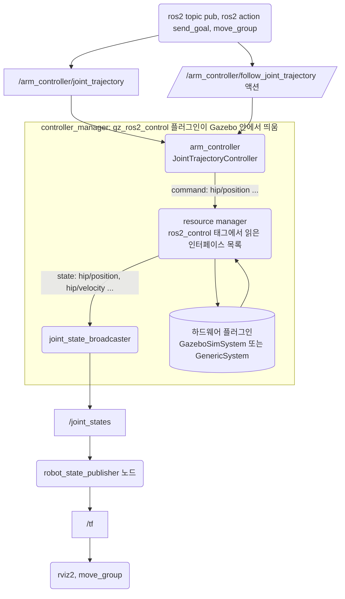
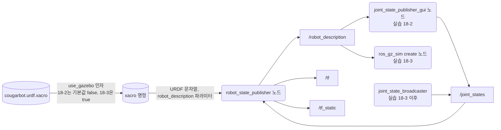
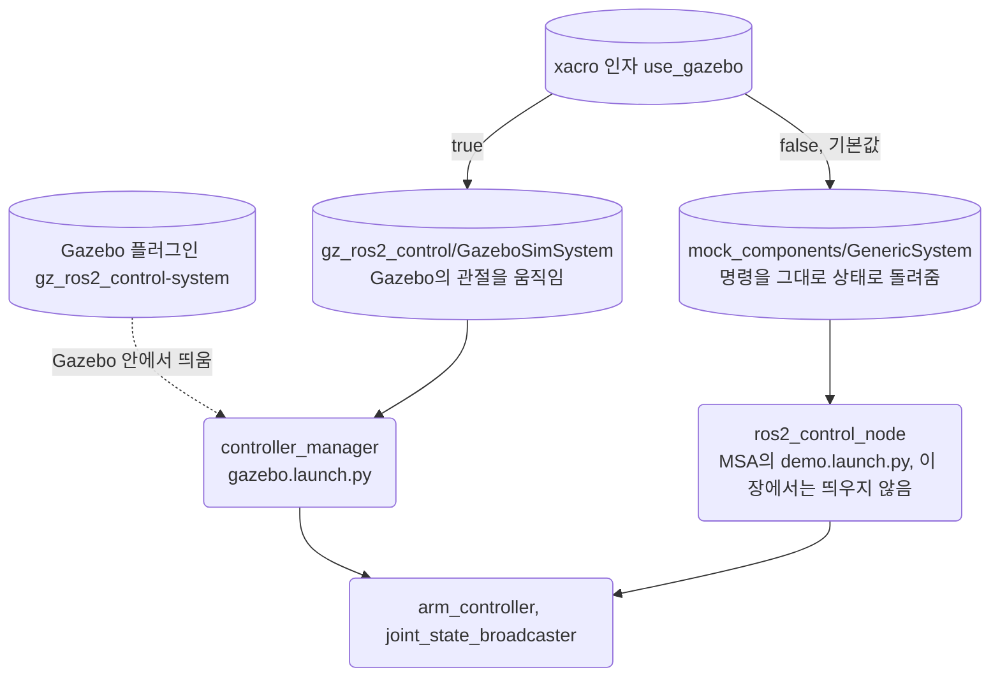
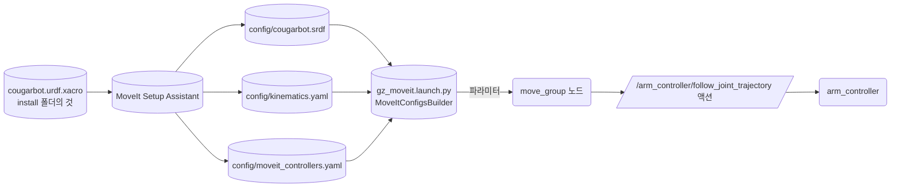

# 18장. 나만의 로봇팔 (Your Own Robot Arm)

- 원서: Chapter 18. Your Own Robot Arm, PDF p.339~366 (인쇄 쪽 = PDF 쪽 - 20)
- 선행 조건: 11장(MoveIt 2 설치, move_group과 `/move_action` 구조), 16~17장의 URDF·xacro·Gazebo 경험이 있으면 좋습니다.
- 새로 설치할 것: 아래 명령을 학습자가 직접 실행합니다. 패키지 이름과 버전은 2026-10-27에 `apt-cache policy`로 확인했습니다. 11장의 `ros-jazzy-moveit`도 필요합니다.

```bash
sudo apt install ros-jazzy-ros2-control ros-jazzy-ros2-controllers ros-jazzy-gz-ros2-control ros-jazzy-joint-state-publisher-gui ros-jazzy-ros2controlcli
```

| 패키지 | 확인한 후보 버전 | 쓰는 곳 |
|---|---|---|
| `ros-jazzy-ros2-control` | 4.48.1-1noble.20261006.040510 | controller_manager, spawner, hardware_interface |
| `ros-jazzy-ros2-controllers` | 4.42.1-1noble.20260924.191822 | joint_trajectory_controller 등 컨트롤러 모음 |
| `ros-jazzy-gz-ros2-control` | 1.2.20-1noble.20261006.040504 | Gazebo 안에서 controller_manager를 띄우는 플러그인 |
| `ros-jazzy-joint-state-publisher-gui` | 2.4.3-1noble.20260912.164400 | 슬라이더로 관절을 돌려 보는 창 |
| `ros-jazzy-ros2controlcli` | 4.48.1-1noble.20261006.035651 | `ros2 control ...` 명령 |
| `ros-jazzy-moveit` (11장) | 2.12.4-1noble.20260921.025955 | MoveIt Setup Assistant(`ros-jazzy-moveit-setup-assistant` 2.12.4)와 `moveit_configs_utils`가 함께 설치됩니다. |

## 이 장에서 체감할 구조

URDF 안의 `<ros2_control>` 태그가 "어떤 관절에 어떤 명령과 상태 인터페이스가 있는지"를 선언하고, controller_manager가 그 인터페이스를 컨트롤러에게 나눠 줍니다.
컨트롤러를 바꾸지 않고 하드웨어 플러그인만 바꾸면 같은 팔이 Gazebo에서도, mock 하드웨어에서도 움직입니다.



그림에서 볼 것: 명령은 위에서 아래로(컨트롤러, resource manager, 하드웨어 플러그인) 내려가고, 상태는 아래에서 위로 joint_state_broadcaster를 거쳐 `/joint_states`로 올라옵니다. 하드웨어 플러그인 상자 하나만 바뀌어도 나머지 상자는 그대로입니다.

## 1. 목표와 개념

11장에서는 남이 만든 팔(Panda)의 설정을 그대로 썼습니다. 이 장은 4관절 팔 CougarBot을 처음부터 만들어 MoveIt으로 움직이기까지의 단계를 밟습니다.

- **xacro**: URDF에 변수, 계산식, 매크로를 쓸 수 있게 하는 전처리기입니다. 링크 네 개가 같은 원기둥 모양이므로 매크로 하나로 만듭니다. URDF의 링크, 조인트, 원점의 뜻은 16장에서 다뤘습니다.

예:

```xml
<xacro:arm_joint name="hip" parent="base_link" child="torso" axis="0 0 1"
                 z="0.05" lower="${-pi}" upper="${pi}"/>
```

`cougarbot.urdf.xacro`에서 매크로를 부르는 줄입니다. xacro를 돌리면 이 한 줄이 `<joint name="hip" type="revolute">`와 그 안의 `parent`, `child`, `origin`, `axis`, `limit` 태그로 펼쳐집니다.

xacro 파일이 `/tf`가 되기까지의 흐름은 다음과 같습니다.



그림에서 볼 것: robot_state_publisher는 URDF를 파라미터로 받아 `/robot_description` 토픽으로 다시 나눠 줍니다. 슬라이더 창과 Gazebo 모델 생성 노드는 그 토픽에서 URDF를 받습니다. `/joint_states`를 내는 쪽은 실습 18-2에서는 슬라이더 창, 실습 18-3부터는 joint_state_broadcaster로 바뀌지만 robot_state_publisher는 그 차이를 모릅니다.

- **관성(inertial)**: 시뮬레이터가 링크를 움직이려면 질량과 관성 텐서가 필요합니다. rviz2는 모양만 쓰지만 Gazebo는 관성이 없으면 링크를 무시하거나 이상하게 움직입니다.
- **ros2_control**: 컨트롤러와 하드웨어 드라이버 사이의 표준 틀입니다. 하드웨어 쪽은 관절마다 command interface(쓸 수 있는 값, 예: 목표 위치)와 state interface(읽을 수 있는 값, 예: 현재 위치, 속도)를 내놓습니다. 컨트롤러는 이 인터페이스를 이름으로 요청해 씁니다.

예:

```xml
<command_interface name="position"/>
<state_interface name="velocity"/>
```

URDF의 `<ros2_control>` 태그 안에서 관절마다 선언하는 줄입니다. `controllers.yaml`의 `command_interfaces`, `state_interfaces`는 여기 선언된 이름만 요청할 수 있습니다.

하드웨어 플러그인은 xacro 인자 하나로 바꿔 끼웁니다.



그림에서 볼 것: 바뀌는 것은 하드웨어 플러그인과 controller_manager를 띄우는 주체뿐입니다. 컨트롤러 이름, 인터페이스 이름, 그 위의 토픽과 액션은 두 경우가 같습니다. 11장의 Panda 데모는 mock 쪽 길(`ros2_control_node`와 mock 하드웨어)을 쓴 예입니다.

- **controller_manager**: 컨트롤러를 불러오고(load), 설정하고(configure), 켜고(activate) 끄는 노드입니다. 주기적으로 "하드웨어 읽기, 컨트롤러 계산, 하드웨어 쓰기"를 반복합니다.

예:

```python
Node(package='controller_manager', executable='spawner', arguments=[name])
```

`gazebo.launch.py`에서 컨트롤러마다 spawner를 하나씩 띄우는 줄입니다. spawner는 controller_manager에게 "이 이름의 컨트롤러를 불러와 켜 달라"고 요청하고 끝나는 짧은 프로그램입니다.

- **joint_trajectory_controller(JTC)**: 시간에 따른 관절 값 목록(궤적)을 받아 보간하며 따라가는 컨트롤러입니다. MoveIt이 실행할 때 쓰는 컨트롤러입니다.

예:

```bash
ros2 topic pub --once /arm_controller/joint_trajectory trajectory_msgs/msg/JointTrajectory "{joint_names: [hip, shoulder, elbow, wrist], points: [{positions: [0.5, 0.6, 0.8, 0.4], time_from_start: {sec: 2}}]}"
```

실습 18-4의 명령입니다. 궤적 점 하나에 "2초 뒤 이 관절 값"을 적으면 JTC가 지금 값에서 그 값까지 사이를 보간해 따라갑니다.

- **joint_state_broadcaster**: 상태 인터페이스 값을 읽어 `/joint_states`로 내보내는 컨트롤러입니다. 이름은 컨트롤러지만 명령은 내리지 않습니다.
- **MoveIt Setup Assistant(MSA)**: URDF를 읽어 SRDF(플래닝 그룹, 자기충돌 무시 쌍, 이름 붙인 자세)와 설정 파일을 담은 `*_moveit_config` 패키지를 만들어 주는 GUI 도구입니다.

MSA가 만든 설정 패키지와 move_group의 관계는 다음과 같습니다.



그림에서 볼 것: MSA는 실행 중에 쓰이는 프로그램이 아니라 설정 파일을 만드는 도구입니다. move_group은 MSA를 모르고, launch 파일이 읽어 넘긴 파라미터만 압니다. 그 파라미터 중 `moveit_controllers.yaml`이 ros2_control 쪽 컨트롤러와 이어지는 유일한 연결점입니다.

예:

```yaml
  arm_controller:
    type: FollowJointTrajectory
    action_ns: follow_joint_trajectory
```

`moveit_controllers.yaml`의 일부입니다. move_group은 컨트롤러 이름과 `action_ns`로 실행을 맡길 액션 서버를 찾으므로, 이 이름이 `controllers.yaml`의 컨트롤러 이름과 같아야 합니다.

비유: ros2_control의 하드웨어 인터페이스는 콘센트이고, 컨트롤러는 플러그입니다. 콘센트 모양(인터페이스 이름)만 맞으면 벽 뒤가 실제 모터든 Gazebo든 플러그는 그대로 꽂힙니다.

CougarBot은 바닥(`base_link`) 위에 몸통 회전(`hip`, z축), 어깨(`shoulder`, y축), 팔꿈치(`elbow`, y축), 손목(`wrist`, y축)이 차례로 이어진 4관절 팔입니다. 손 끝 자세는 6개 값이 필요한데 관절이 4개뿐이므로, 임의의 손 방향을 맞출 수는 없고 위치 위주로 목표를 줍니다.

### 코드와 폴더 구조

이 장은 Python 노드를 하나도 만들지 않습니다. 모델, 설정, launch 파일만으로 팔이 움직이고, 그 파일들이 두 패키지에 나뉘어 있습니다. `ros2 pkg create`와 MSA가 만든 뒤 손대지 않는 파일은 줄였습니다.

```text
~/rosbook_ws/src/cougarbot/                    ament_cmake, 직접 만듦
├── CMakeLists.txt             install(DIRECTORY config launch urdf ...) 추가 (18-2)
├── package.xml                xacro, gz_ros2_control, 컨트롤러 등 실행 의존성 (18-2)
├── urdf/
│   └── cougarbot.urdf.xacro   링크, 조인트, ros2_control 태그, Gazebo 플러그인 (18-1, 18-3)
├── config/
│   └── controllers.yaml       controller_manager와 arm_controller의 파라미터 (18-3)
└── launch/
    ├── display.launch.py      robot_state_publisher, 슬라이더 창, rviz2 (18-2)
    └── gazebo.launch.py       Gazebo, robot_state_publisher, 모델 생성, /clock 브리지, spawner (18-3)

~/rosbook_ws/src/cougarbot_moveit_config/      ament_cmake, MSA가 만듦 (18-6)
├── CMakeLists.txt, package.xml
├── config/
│   ├── cougarbot.srdf         플래닝 그룹 arm, 자세 home, 충돌 검사에서 뺄 링크 쌍
│   ├── kinematics.yaml        IK 플러그인 설정. position_only_ik를 직접 추가 (18-6)
│   ├── moveit_controllers.yaml  move_group이 실행을 맡길 컨트롤러 이름과 액션
│   ├── moveit.rviz            MotionPlanning 패널이 있는 rviz2 화면 설정
│   └── ...                    그 밖의 설정 파일 (ls config로 확인)
└── launch/
    ├── demo.launch.py         MSA가 만든 mock 하드웨어용 데모. 이 장에서는 쓰지 않음
    ├── gz_moveit.launch.py    Gazebo용으로 move_group과 rviz2만 띄움, 직접 만듦 (18-7)
    └── ...
```

- 설치 위치: ament_python 패키지는 `setup.py`의 `data_files`로 파일을 설치했지만, ament_cmake 패키지는 `CMakeLists.txt`의 `install(DIRECTORY config launch urdf DESTINATION share/${PROJECT_NAME})`로 설치합니다. 빌드하면 `install/cougarbot/share/cougarbot/urdf/cougarbot.urdf.xacro`처럼 놓이고, launch 파일의 `get_package_share_directory('cougarbot')`와 xacro의 `$(find cougarbot)`, 그리고 MSA가 여는 파일이 모두 이 설치 위치를 가리킵니다.
- 컨트롤러 YAML의 구조: 최상위 키는 노드 이름이고, 그 아래에 `ros__parameters`가 옵니다. `controller_manager` 아래에는 "어떤 이름의 컨트롤러가 어떤 타입인지"를, 각 컨트롤러 이름 아래에는 "어느 관절의 어떤 인터페이스를 쓸지"를 적습니다.

```yaml
controller_manager:
  ros__parameters:
    arm_controller:
      type: joint_trajectory_controller/JointTrajectoryController
arm_controller:
  ros__parameters:
    joints: [hip, shoulder, elbow, wrist]
```

실습 18-3의 `controllers.yaml`을 구조만 보이도록 줄인 것입니다. 실제 파일은 `joints`를 한 줄에 하나씩 적고 `command_interfaces`, `state_interfaces`도 둡니다.

### 실무 메모

- 실제 로봇 프로젝트는 보통 패키지를 역할별로 나눕니다. 모델(URDF, 메시)을 담는 description 패키지, 하드웨어 설정과 launch를 담는 bringup 패키지, MSA가 만드는 moveit_config 패키지입니다. 이 장은 학습용이라 앞의 둘을 `cougarbot` 하나에 합쳤습니다. 나누어 두면 모델만 필요한 쪽(rviz2, 다른 로봇과의 조립)이 bringup의 의존성을 끌고 오지 않습니다.
- 하드웨어 플러그인만 바꿔 mock, 시뮬, 실물을 오가는 구조 덕분에, 컨트롤러 설정과 MoveIt 설정을 mock 하드웨어나 Gazebo에서 먼저 맞춰 둘 수 있습니다. 다만 실물로 옮길 때는 하드웨어 플러그인만 보면 안 됩니다. 관절의 회전 방향과 영점, 관절 한계, MoveIt의 속도·가속도 제한(`config/joint_limits.yaml`), 충돌 검사에 쓰는 주변 환경, 비상 정지 수단을 실물 기준으로 다시 확인하고, 처음에는 느린 속도로 움직여 봅니다.
- 관절 한계(`<limit lower upper effort velocity>`)는 URDF에 실제 기구의 값대로 정확히 적습니다. Gazebo와 MoveIt이 이 값을 함께 쓰므로, 틀리면 시뮬에서는 되던 계획이 실물에서는 기구 한계에 부딪힙니다.
- 컨트롤러 이름 하나(`arm_controller`)가 `controllers.yaml`, spawner 인자, `moveit_controllers.yaml`, 액션 이름 네 곳에 나옵니다. 이름을 바꿀 때는 네 곳을 함께 바꾸고, `ros2 control list_controllers`와 `ros2 action list -t`로 확인합니다.
- 시뮬레이터를 쓰는 launch 파일에서는 시뮬 시각을 쓰는 모든 노드에 `use_sim_time`을 줍니다. ROS 2에는 전역 파라미터가 없으므로(2절) 하나라도 빠지면 tf가 오래되었다는 경고처럼 원인을 찾기 어려운 증상이 납니다.

## 2. 원서(ROS 1)와 달라지는 점

| 원서 (ROS 1) | ROS 2 Jazzy | 이유와 주의점 |
|---|---|---|
| URDF의 `<transmission>` 태그와 `gazebo_ros_control` 플러그인 | `<ros2_control>` 태그와 `gz_ros2_control-system` 플러그인 | ROS 2는 하드웨어 인터페이스를 `<ros2_control>` 안에 관절별로 직접 적습니다. |
| ros_control의 `hardware_interface::RobotHW`를 C++로 상속한 드라이버 예시 (원서 PDF p.342~346) | `hardware_interface::SystemInterface` 플러그인. 이 장은 직접 쓰지 않고 `mock_components/GenericSystem`과 `GazeboSimSystem`을 씀 | 실물 하드웨어가 없으므로 드라이버 작성은 범위 밖입니다. 하드웨어 플러그인 교체만으로 같은 컨트롤러가 돈다는 점을 체감하는 데 집중합니다. |
| Gazebo Classic, `spawn_model` | Gazebo (gz sim), `ros_gz_sim create` | Jazzy의 기본 시뮬레이터는 gz sim입니다. `/clock`은 ros_gz_bridge로 넘깁니다. |
| `controller_spawner`와 rosparam yaml | `controller_manager spawner`와 `ros__parameters` yaml | yaml 최상위 키가 노드 이름(`controller_manager`, `arm_controller`)이고 그 아래 `ros__parameters`가 옵니다. |
| `rostopic pub ... /arm_controller/command` | `/arm_controller/joint_trajectory` 토픽 또는 `/arm_controller/follow_joint_trajectory` 액션 | 토픽 이름이 바뀌었습니다. 시간 값은 `{sec: 2}`처럼 필드로 적습니다. |
| `controller_list` 파라미터(MoveIt 실행 연결) | MSA가 만드는 `config/moveit_controllers.yaml` | 이름이 ros2_control 쪽 컨트롤러 이름과 같아야 합니다. |
| MSA의 End Effector 설정 | 같은 단계가 있지만 이 장은 그리퍼가 없으므로 건너뜀 | 원서 방식도 손 링크를 엔드 이펙터 그룹으로 만들지만, 그리퍼가 없는 팔에는 필요하지 않습니다. |
| `use_sim_time`을 전역 파라미터로 설정 | 노드마다 `use_sim_time: True`를 줌 | ROS 2에는 전역 파라미터 서버가 없습니다. 빠뜨린 노드는 벽시계 시각을 씁니다. |

## 3. 실습

패키지는 두 개입니다. `cougarbot`(ament_cmake, 모델과 launch와 컨트롤러 설정)과 MSA가 만드는 `cougarbot_moveit_config`(ament_cmake)입니다. `cougarbot`은 Python 노드가 없고 설치할 파일만 있으므로 ament_cmake로 정했습니다.

### 실습 18-1. 패키지와 xacro 모델 만들기

**준비**: 터미널 하나.

**직접 입력**:

```bash
cd ~/rosbook_ws/src
ros2 pkg create --build-type ament_cmake --license Apache-2.0 cougarbot
mkdir -p cougarbot/urdf cougarbot/launch cougarbot/config
```

파일: `~/rosbook_ws/src/cougarbot/urdf/cougarbot.urdf.xacro`. 이 실습에서는 1~100줄과 마지막 `</robot>` 줄만 입력합니다. 102~134줄은 실습 18-3에서 그 사이에 넣습니다.

```xml
<?xml version="1.0"?>
<robot name="cougarbot" xmlns:xacro="http://www.ros.org/wiki/xacro">

  <xacro:arg name="use_gazebo" default="false"/>

  <xacro:property name="link_radius" value="0.04"/>
  <xacro:property name="torso_length" value="0.4"/>
  <xacro:property name="upper_arm_length" value="0.3"/>
  <xacro:property name="lower_arm_length" value="0.3"/>
  <xacro:property name="hand_size" value="0.06"/>

  <material name="grey">
    <color rgba="0.7 0.7 0.7 1"/>
  </material>
  <material name="orange">
    <color rgba="1.0 0.5 0.1 1"/>
  </material>

  <xacro:macro name="cylinder_link" params="name radius length mass material">
    <link name="${name}">
      <visual>
        <origin xyz="0 0 ${length / 2}"/>
        <geometry>
          <cylinder radius="${radius}" length="${length}"/>
        </geometry>
        <material name="${material}"/>
      </visual>
      <collision>
        <origin xyz="0 0 ${length / 2}"/>
        <geometry>
          <cylinder radius="${radius}" length="${length}"/>
        </geometry>
      </collision>
      <inertial>
        <origin xyz="0 0 ${length / 2}"/>
        <mass value="${mass}"/>
        <inertia ixx="${mass * (3 * radius * radius + length * length) / 12}" ixy="0" ixz="0"
                 iyy="${mass * (3 * radius * radius + length * length) / 12}" iyz="0"
                 izz="${mass * radius * radius / 2}"/>
      </inertial>
    </link>
  </xacro:macro>

  <xacro:macro name="arm_joint" params="name parent child axis z lower upper">
    <joint name="${name}" type="revolute">
      <parent link="${parent}"/>
      <child link="${child}"/>
      <origin xyz="0 0 ${z}"/>
      <axis xyz="${axis}"/>
      <limit lower="${lower}" upper="${upper}" effort="100" velocity="1.0"/>
    </joint>
  </xacro:macro>

  <link name="world"/>

  <xacro:cylinder_link name="base_link" radius="0.1" length="0.05" mass="2.0" material="grey"/>
  <joint name="world_to_base" type="fixed">
    <parent link="world"/>
    <child link="base_link"/>
  </joint>

  <xacro:cylinder_link name="torso" radius="${link_radius}" length="${torso_length}"
                       mass="1.0" material="orange"/>
  <xacro:arm_joint name="hip" parent="base_link" child="torso" axis="0 0 1"
                   z="0.05" lower="${-pi}" upper="${pi}"/>

  <xacro:cylinder_link name="upper_arm" radius="${link_radius}" length="${upper_arm_length}"
                       mass="1.0" material="grey"/>
  <xacro:arm_joint name="shoulder" parent="torso" child="upper_arm" axis="0 1 0"
                   z="${torso_length}" lower="${-pi / 2}" upper="${pi / 2}"/>

  <xacro:cylinder_link name="lower_arm" radius="${link_radius}" length="${lower_arm_length}"
                       mass="1.0" material="orange"/>
  <xacro:arm_joint name="elbow" parent="upper_arm" child="lower_arm" axis="0 1 0"
                   z="${upper_arm_length}" lower="-2.5" upper="2.5"/>

  <link name="hand">
    <visual>
      <origin xyz="0 0 ${hand_size / 2}"/>
      <geometry>
        <box size="${hand_size} ${hand_size} ${hand_size}"/>
      </geometry>
      <material name="grey"/>
    </visual>
    <collision>
      <origin xyz="0 0 ${hand_size / 2}"/>
      <geometry>
        <box size="${hand_size} ${hand_size} ${hand_size}"/>
      </geometry>
    </collision>
    <inertial>
      <origin xyz="0 0 ${hand_size / 2}"/>
      <mass value="0.5"/>
      <inertia ixx="${0.5 * hand_size * hand_size / 6}" ixy="0" ixz="0"
               iyy="${0.5 * hand_size * hand_size / 6}" iyz="0"
               izz="${0.5 * hand_size * hand_size / 6}"/>
    </inertial>
  </link>
  <xacro:arm_joint name="wrist" parent="lower_arm" child="hand" axis="0 1 0"
                   z="${lower_arm_length}" lower="${-pi / 2}" upper="${pi / 2}"/>

</robot>
```

**줄 단위 해설** (줄 번호는 실습 18-3까지 마친 최종 파일 기준):

| 줄 | 설명 |
|---|---|
| 2 | xacro 네임스페이스를 선언해야 `xacro:` 태그가 해석됩니다. |
| 4 | 명령줄에서 `use_gazebo:=true`로 바꿀 수 있는 인자입니다. 실습 18-3에서 하드웨어 플러그인을 고르는 데 씁니다. |
| 6~10 | 치수(m)를 한곳에 모읍니다. 링크 길이와 조인트 위치가 같은 값을 참조하므로 하나만 바꾸면 둘 다 바뀝니다. |
| 12~17 | 색 정의입니다. rviz2에서만 쓰입니다. |
| 19~42 | 원기둥 링크 매크로입니다. 원기둥 원점은 가운데이므로 visual, collision, inertial을 모두 `length / 2`만큼 올려, 링크 좌표계의 원점이 원기둥 바닥에 오게 합니다. 관성은 속이 찬 원기둥 공식입니다. |
| 44~52 | 회전 조인트 매크로입니다. 자식 링크를 부모 원점에서 z만큼 위에 붙이고, `axis` 축으로 돌게 합니다. `limit`의 effort와 velocity는 Gazebo와 MoveIt이 씁니다. |
| 54~60 | `world` 링크에 바닥을 고정합니다. Gazebo는 `world`라는 이름의 링크에 고정 조인트로 붙은 모델을 땅에 고정합니다. 이렇게 하면 MSA에서 virtual joint를 따로 만들 필요가 없습니다. |
| 62~75 | 몸통, 위팔, 아래팔과 hip, shoulder, elbow 조인트입니다. 각 조인트는 부모 링크의 꼭대기(부모 길이만큼 위)에 있습니다. |
| 77~100 | 손은 정육면체 하나입니다. 관성은 정육면체 공식 m·a²/6입니다. |
| 136 | 로봇 태그를 닫습니다. |

모델을 확인합니다. GUI 없이 할 수 있습니다.

```bash
cd ~/rosbook_ws/src/cougarbot
xacro urdf/cougarbot.urdf.xacro > /tmp/cougarbot.urdf
check_urdf /tmp/cougarbot.urdf
```

`check_urdf`가 없다면 `sudo apt install liburdfdom-tools`로 설치합니다 (후보 4.0.0 확인).

tf가 관절 값에 따라 어떻게 바뀌는지 GUI 없이 봅니다. 터미널 세 개를 씁니다.

```bash
# 터미널 A
ros2 run robot_state_publisher robot_state_publisher --ros-args -p robot_description:="$(xacro ~/rosbook_ws/src/cougarbot/urdf/cougarbot.urdf.xacro)"
# 터미널 B
ros2 run joint_state_publisher joint_state_publisher --ros-args -p robot_description:="$(xacro ~/rosbook_ws/src/cougarbot/urdf/cougarbot.urdf.xacro)" -p zeros.shoulder:=0.5 -p zeros.elbow:=0.5
# 터미널 C
ros2 topic echo --once /joint_states
ros2 run tf2_ros tf2_echo world hand
```

**관찰**:

- `check_urdf`가 `robot name is: cougarbot`과 함께 `world → base_link → torso → upper_arm → lower_arm → hand` 나무를 출력합니다.
- `/joint_states`의 name은 `hip, shoulder, elbow, wrist`이고 position은 `0, 0.5, 0.5, 0`입니다. `zeros.<조인트>` 파라미터가 시작값을 정합니다.
- `tf2_echo`의 Translation이 약 `[0.396, 0.000, 0.875]`, RPY가 약 `[0, 1.000, 0]`(라디안)입니다. 손으로 계산해 봅니다: 어깨 높이 0.45 m에서 위팔이 0.5 rad, 아래팔이 합쳐서 1.0 rad 기울면 x = 0.3·sin 0.5 + 0.3·sin 1.0 ≈ 0.396, z = 0.45 + 0.3·cos 0.5 + 0.3·cos 1.0 ≈ 0.875입니다.

**생각해 볼 질문**:

1. `world_to_base` 고정 조인트의 tf는 `/tf`와 `/tf_static` 중 어디로 나옵니까? `ros2 topic echo --once /tf_static`으로 확인해 보십시오.

### 실습 18-2. rviz2로 모델 보기

> **미검증 실습**: 문서를 쓸 때 rviz2와 `joint_state_publisher_gui` 슬라이더로 팔을 움직여 보는 부분을 실제로 실행해 확인하지 못했습니다. 결과가 문서와 다르면 문서가 틀렸을 수 있으니, 7절의 검증 기록과 비교해 보세요.

**준비**: 실습 18-1의 터미널 A, B는 Ctrl+C로 끕니다.

**직접 입력**: 파일: `~/rosbook_ws/src/cougarbot/launch/display.launch.py`

```python
import os

from ament_index_python.packages import get_package_share_directory
from launch import LaunchDescription
from launch.substitutions import Command
from launch_ros.actions import Node
from launch_ros.parameter_descriptions import ParameterValue


def generate_launch_description():
    xacro_file = os.path.join(
        get_package_share_directory('cougarbot'), 'urdf', 'cougarbot.urdf.xacro')
    robot_description = ParameterValue(Command(['xacro ', xacro_file]), value_type=str)

    return LaunchDescription([
        Node(
            package='robot_state_publisher',
            executable='robot_state_publisher',
            parameters=[{'robot_description': robot_description}],
        ),
        Node(
            package='joint_state_publisher_gui',
            executable='joint_state_publisher_gui',
        ),
        Node(
            package='rviz2',
            executable='rviz2',
        ),
    ])
```

**줄 단위 해설**:

| 줄 | 설명 |
|---|---|
| 11~12 | 설치된 share 폴더에서 xacro 파일을 찾습니다. 소스 폴더가 아니라 설치 위치를 쓰므로 CMake의 install 설정이 필요합니다. |
| 13 | launch 실행 시점에 `xacro` 명령을 돌려 URDF 문자열을 얻습니다. `ParameterValue(..., value_type=str)`가 없으면 launch가 XML 문자열을 YAML로 해석하려다 실패할 수 있습니다. |
| 16~28 | robot_state_publisher, 슬라이더 창, rviz2를 띄웁니다. joint_state_publisher_gui는 `/robot_description` 토픽에서 URDF를 받아 슬라이더를 만듭니다. |

`~/rosbook_ws/src/cougarbot/CMakeLists.txt`에서 `if(BUILD_TESTING)` 줄 바로 위에 다음을 추가합니다.

```cmake
install(DIRECTORY config launch urdf
  DESTINATION share/${PROJECT_NAME}
)
```

`~/rosbook_ws/src/cougarbot/package.xml`의 `<buildtool_depend>ament_cmake</buildtool_depend>` 아래에 이 장 전체에서 쓸 실행 의존성을 추가합니다.

```xml
  <exec_depend>xacro</exec_depend>
  <exec_depend>robot_state_publisher</exec_depend>
  <exec_depend>joint_state_publisher_gui</exec_depend>
  <exec_depend>rviz2</exec_depend>
  <exec_depend>ros_gz_sim</exec_depend>
  <exec_depend>ros_gz_bridge</exec_depend>
  <exec_depend>gz_ros2_control</exec_depend>
  <exec_depend>controller_manager</exec_depend>
  <exec_depend>joint_state_broadcaster</exec_depend>
  <exec_depend>joint_trajectory_controller</exec_depend>
```

빌드하고 실행합니다.

```bash
cd ~/rosbook_ws && colcon build --symlink-install --packages-select cougarbot
source ~/rosbook_ws/install/setup.bash
ros2 launch cougarbot display.launch.py
```

rviz2에서 Fixed Frame을 `world`로 바꾸고, Add 버튼으로 RobotModel(Description Topic: `/robot_description`)과 TF를 추가합니다.

**관찰**: 슬라이더 네 개(hip, shoulder, elbow, wrist)를 움직이면 rviz2의 팔이 따라 움직입니다. 다른 터미널에서 `ros2 topic info -v /joint_states`를 보면 publisher가 joint_state_publisher_gui 하나입니다.

**생각해 볼 질문**:

2. 슬라이더 창을 닫으면 rviz2의 팔은 어떻게 표시됩니까? 그 이유를 `/joint_states`와 연결해 설명해 보십시오.

### 실습 18-3. ros2_control 태그와 Gazebo 띄우기

> **미검증 실습**: 문서를 쓸 때 `ros2_control`로 컨트롤러를 띄우고 Gazebo에서 팔을 세우는 부분을 실제로 실행해 확인하지 못했습니다. 결과가 문서와 다르면 문서가 틀렸을 수 있으니, 7절의 검증 기록과 비교해 보세요.

**준비**: 실습 18-2의 launch를 끕니다.

**직접 입력**: `cougarbot.urdf.xacro`의 손목 조인트(100줄) 다음, `</robot>` 앞에 다음을 넣습니다 (최종 파일의 102~134줄).

```xml
  <xacro:macro name="control_joint" params="name">
    <joint name="${name}">
      <command_interface name="position"/>
      <state_interface name="position">
        <param name="initial_value">0.0</param>
      </state_interface>
      <state_interface name="velocity"/>
    </joint>
  </xacro:macro>

  <ros2_control name="CougarBotSystem" type="system">
    <hardware>
      <xacro:if value="$(arg use_gazebo)">
        <plugin>gz_ros2_control/GazeboSimSystem</plugin>
      </xacro:if>
      <xacro:unless value="$(arg use_gazebo)">
        <plugin>mock_components/GenericSystem</plugin>
      </xacro:unless>
    </hardware>
    <xacro:control_joint name="hip"/>
    <xacro:control_joint name="shoulder"/>
    <xacro:control_joint name="elbow"/>
    <xacro:control_joint name="wrist"/>
  </ros2_control>

  <xacro:if value="$(arg use_gazebo)">
    <gazebo>
      <plugin filename="gz_ros2_control-system"
              name="gz_ros2_control::GazeboSimROS2ControlPlugin">
        <parameters>$(find cougarbot)/config/controllers.yaml</parameters>
      </plugin>
    </gazebo>
  </xacro:if>
```

**줄 단위 해설** (xacro 102~134줄):

| 줄 | 설명 |
|---|---|
| 102~110 | 관절 하나의 인터페이스 선언입니다. 위치 명령을 받고, 위치와 속도를 상태로 내놓습니다. `initial_value`는 시작 위치입니다. |
| 112 | 하드웨어 하나(`system` 타입은 여러 관절을 함께 다루는 하드웨어)를 선언합니다. 이름은 `ros2 control list_hardware_components`에 나옵니다. |
| 113~120 | 하드웨어 플러그인을 고릅니다. `use_gazebo:=true`면 Gazebo 관절을 움직이는 플러그인, 아니면 명령을 그대로 상태로 돌려주는 mock 플러그인입니다. 아래 관절 선언은 둘이 같습니다. |
| 121~124 | 네 관절에 같은 인터페이스를 붙입니다. 여기 이름은 URDF 조인트 이름과 정확히 같아야 합니다. |
| 127~134 | Gazebo에서만 넣는 블록입니다. Gazebo가 모델을 불러올 때 이 플러그인을 실행하고, 플러그인이 controller_manager를 띄우면서 `controllers.yaml`을 파라미터로 넘깁니다. `$(find cougarbot)`은 xacro가 설치 경로로 바꿉니다. |

파일: `~/rosbook_ws/src/cougarbot/config/controllers.yaml`

```yaml
controller_manager:
  ros__parameters:
    update_rate: 100

    joint_state_broadcaster:
      type: joint_state_broadcaster/JointStateBroadcaster

    arm_controller:
      type: joint_trajectory_controller/JointTrajectoryController

arm_controller:
  ros__parameters:
    joints:
      - hip
      - shoulder
      - elbow
      - wrist
    command_interfaces:
      - position
    state_interfaces:
      - position
      - velocity
```

**줄 단위 해설**:

| 줄 | 설명 |
|---|---|
| 1~3 | controller_manager 노드의 파라미터입니다. 읽기, 계산, 쓰기 루프를 초당 100번 돕니다. |
| 5~9 | 이 이름으로 컨트롤러를 만들 수 있고, 각 이름의 플러그인 타입이 무엇인지 등록합니다. 여기 적었다고 컨트롤러가 켜지지는 않습니다. spawner가 켭니다. |
| 11~22 | arm_controller 노드 자신의 파라미터입니다. 어떤 관절의 어떤 인터페이스를 쓸지 정합니다. URDF `<ros2_control>`에 선언된 인터페이스만 요청할 수 있습니다. |

파일: `~/rosbook_ws/src/cougarbot/launch/gazebo.launch.py`

```python
import os

from ament_index_python.packages import get_package_share_directory
from launch import LaunchDescription
from launch.actions import IncludeLaunchDescription
from launch.launch_description_sources import PythonLaunchDescriptionSource
from launch.substitutions import Command
from launch_ros.actions import Node
from launch_ros.parameter_descriptions import ParameterValue


def generate_launch_description():
    xacro_file = os.path.join(
        get_package_share_directory('cougarbot'), 'urdf', 'cougarbot.urdf.xacro')
    robot_description = ParameterValue(
        Command(['xacro ', xacro_file, ' use_gazebo:=true']), value_type=str)

    gz_sim = IncludeLaunchDescription(
        PythonLaunchDescriptionSource(os.path.join(
            get_package_share_directory('ros_gz_sim'), 'launch', 'gz_sim.launch.py')),
        launch_arguments={'gz_args': '-r empty.sdf', 'on_exit_shutdown': 'true'}.items(),
    )

    robot_state_publisher = Node(
        package='robot_state_publisher',
        executable='robot_state_publisher',
        parameters=[{'robot_description': robot_description, 'use_sim_time': True}],
    )

    spawn_robot = Node(
        package='ros_gz_sim',
        executable='create',
        arguments=['-topic', 'robot_description', '-name', 'cougarbot'],
    )

    clock_bridge = Node(
        package='ros_gz_bridge',
        executable='parameter_bridge',
        arguments=['/clock@rosgraph_msgs/msg/Clock[gz.msgs.Clock'],
    )

    spawners = [
        Node(package='controller_manager', executable='spawner', arguments=[name])
        for name in ('joint_state_broadcaster', 'arm_controller')
    ]

    return LaunchDescription([gz_sim, robot_state_publisher, spawn_robot, clock_bridge, *spawners])
```

**줄 단위 해설**:

| 줄 | 설명 |
|---|---|
| 15~16 | `use_gazebo:=true`로 xacro를 돌려 Gazebo용 플러그인과 `<gazebo>` 블록이 들어간 URDF를 만듭니다. |
| 18~22 | ros_gz_sim의 launch를 포함해 빈 월드를 바로 재생(`-r`)합니다. Gazebo 창을 닫으면 launch 전체가 끝나도록 `on_exit_shutdown`을 켭니다. |
| 24~28 | 시뮬레이션 시각으로 tf를 찍도록 `use_sim_time`을 켭니다. |
| 30~34 | `/robot_description` 토픽에서 URDF를 받아 Gazebo에 `cougarbot` 모델을 만듭니다. 이때 gz_ros2_control 플러그인이 실행되어 controller_manager가 뜹니다. |
| 36~40 | Gazebo의 시계를 ROS `/clock` 토픽으로 넘깁니다. `[`는 Gazebo에서 ROS 쪽 한 방향이라는 뜻입니다. |
| 42~45 | spawner가 controller_manager에게 두 컨트롤러를 불러와 켜 달라고 요청합니다. controller_manager가 뜰 때까지 기다립니다. |

빌드하고 실행합니다.

```bash
cd ~/rosbook_ws && colcon build --symlink-install --packages-select cougarbot
source ~/rosbook_ws/install/setup.bash
ros2 launch cougarbot gazebo.launch.py
```

다른 터미널에서 구조를 봅니다.

```bash
ros2 control list_hardware_components
ros2 control list_hardware_interfaces
ros2 control list_controllers
ros2 node list
ros2 topic info -v /joint_states
ros2 action list -t
```

**관찰**:

- Gazebo 창에 팔이 곧게 선 채로 나타납니다. launch 로그에 spawner가 두 컨트롤러를 활성화했다는 메시지가 보입니다.
- `list_hardware_components`에 `CougarBotSystem`과 플러그인 이름이 나옵니다.
- `list_hardware_interfaces`의 command interfaces에 `hip/position` 등 4개가 `[claimed]`로, state interfaces에 `hip/position`, `hip/velocity` 등 8개가 보입니다.
- `list_controllers`에 `joint_state_broadcaster`와 `arm_controller`가 `active`입니다.
- `ros2 action list -t`에 `/arm_controller/follow_joint_trajectory [control_msgs/action/FollowJointTrajectory]`가 있습니다.

**생각해 볼 질문**:

3. `<ros2_control>`의 hip 선언에서 velocity 상태 인터페이스를 지우면 무엇이 실패합니까?

### 실습 18-4. 궤적 보내기: 토픽과 액션

> **미검증 실습**: 문서를 쓸 때 토픽과 액션으로 궤적을 보내 팔을 움직이는 부분을 실제로 실행해 확인하지 못했습니다. 결과가 문서와 다르면 문서가 틀렸을 수 있으니, 7절의 검증 기록과 비교해 보세요.

**준비**: 터미널 A에서 `ros2 launch cougarbot gazebo.launch.py` 실행 중.

**직접 입력**: 먼저 메시지 모양을 봅니다.

```bash
ros2 interface show trajectory_msgs/msg/JointTrajectory
ros2 topic info -v /arm_controller/joint_trajectory
```

토픽으로 한 점짜리 궤적을 보냅니다.

```bash
ros2 topic pub --once /arm_controller/joint_trajectory trajectory_msgs/msg/JointTrajectory "{joint_names: [hip, shoulder, elbow, wrist], points: [{positions: [0.5, 0.6, 0.8, 0.4], time_from_start: {sec: 2}}]}"
```

액션으로 두 점짜리 궤적을 보내고 결과를 받습니다.

```bash
ros2 action send_goal --feedback /arm_controller/follow_joint_trajectory control_msgs/action/FollowJointTrajectory "{trajectory: {joint_names: [hip, shoulder, elbow, wrist], points: [{positions: [0.5, 0.6, 0.8, 0.4], time_from_start: {sec: 2}}, {positions: [0.0, 0.0, 0.0, 0.0], time_from_start: {sec: 4}}]}}"
```

**관찰**:

- 토픽 명령 뒤 Gazebo의 팔이 2초에 걸쳐 굽습니다. 토픽은 결과를 돌려주지 않으므로 성공 여부는 `/joint_states`로 확인해야 합니다.
- 액션 명령은 피드백(현재 값, 목표 값, 오차)을 계속 찍고, 4초 뒤 `error_code: 0`(SUCCESSFUL)으로 끝납니다. 오류 코드 표는 `ros2 interface show control_msgs/action/FollowJointTrajectory`의 결과 부분에 있습니다.
- MoveIt이 쓰는 경로는 이 액션 쪽입니다.

**생각해 볼 질문**:

4. 토픽과 액션 중 MoveIt이 액션을 쓰는 이유는 무엇입니까?

### 실습 18-5. tf와 joint_states로 움직임 확인하기

> **미검증 실습**: 문서를 쓸 때 Gazebo, rviz2, `tf2_echo`로 팔의 움직임을 확인하는 부분을 실제로 실행해 확인하지 못했습니다. 결과가 문서와 다르면 문서가 틀렸을 수 있으니, 7절의 검증 기록과 비교해 보세요.

**준비**: 터미널 A의 Gazebo launch.

**직접 입력**:

```bash
ros2 topic echo /joint_states --field position
ros2 run tf2_ros tf2_echo world hand
ros2 run rviz2 rviz2 --ros-args -p use_sim_time:=true
```

rviz2에서 Fixed Frame을 `world`로 하고 RobotModel(`/robot_description`)과 TF를 추가합니다. 실습 18-4의 액션 명령을 다시 보내면서 봅니다. 시간에 따른 값을 그래프로 보고 싶다면 `ros2 run rqt_plot rqt_plot --ros-args -p use_sim_time:=true`로 `/joint_states/position[1]`을 추가합니다.

**관찰**: Gazebo, rviz2, `tf2_echo`가 같은 움직임을 보입니다. `/joint_states`의 publisher는 이제 joint_state_publisher가 아니라 joint_state_broadcaster입니다 (`ros2 topic info -v /joint_states`).

**생각해 볼 질문**:

5. 실습 18-2의 `/joint_states`와 지금의 `/joint_states`는 값의 출처가 어떻게 다릅니까?

### 실습 18-6. MoveIt Setup Assistant로 설정 패키지 만들기

> **미검증 실습**: 문서를 쓸 때 MoveIt Setup Assistant로 설정 패키지를 만드는 부분(MSA 화면과 생성되는 파일)을 실제로 실행해 확인하지 못했습니다. 결과가 문서와 다르면 문서가 틀렸을 수 있으니, 7절의 검증 기록과 비교해 보세요.

**준비**: Gazebo launch는 꺼도 됩니다. `cougarbot`이 빌드되어 있어야 합니다.

**직접 입력**:

```bash
ros2 launch moveit_setup_assistant setup_assistant.launch.py
```

MSA 화면에서 다음 순서로 진행합니다. 화면 이름은 MSA 2.12 기준이며, 다르면 가까운 항목을 고릅니다.

1. **Start**: Create New MoveIt Configuration Package, 파일 `~/rosbook_ws/install/cougarbot/share/cougarbot/urdf/cougarbot.urdf.xacro`를 고르고 Load Files. xacro 인자 칸은 비워 둡니다 (mock 하드웨어 쪽이 됩니다).
2. **Self-Collisions**: Generate Collision Matrix. 붙어 있는 링크 쌍처럼 절대 충돌하지 않거나 항상 닿는 쌍을 검사에서 뺍니다.
3. **Virtual Joints**: 추가하지 않습니다. URDF에 `world` 고정 조인트가 이미 있기 때문입니다.
4. **Planning Groups**: Add Group, 이름 `arm`, Kinematic Solver는 `kdl_kinematics_plugin/KDLKinematicsPlugin`. Add Kin. Chain으로 Base Link `base_link`, Tip Link `hand`를 지정합니다.
5. **Robot Poses**: 이름 `home`, 그룹 `arm`, 네 관절 모두 0.
6. **End Effectors**, **Passive Joints**: 건너뜁니다.
7. **ros2_control URDF Modifications**: URDF에 이미 `<ros2_control>` 태그가 있으므로 화면에 표시되는 내용을 읽고, 중복 태그를 추가하는 선택이 있으면 추가하지 않습니다.
8. **ROS 2 Controllers**: Auto Add로 컨트롤러를 만들고, 이름이 `arm_controller`, 타입이 `joint_trajectory_controller/JointTrajectoryController`인지 확인합니다. 이름이 다르면 `arm_controller`로 고칩니다.
9. **MoveIt Controllers**: Auto Add 후 이름이 `arm_controller`, 타입이 `FollowJointTrajectory`인지 확인합니다.
10. **Author Information**: 이름과 이메일을 넣습니다 (빈칸이면 저장이 거부됩니다).
11. **Configuration Files**: 경로를 `~/rosbook_ws/src/cougarbot_moveit_config`로 정하고 Generate Package.

만들어진 파일을 터미널에서 봅니다.

```bash
cd ~/rosbook_ws/src/cougarbot_moveit_config
ls config launch
cat config/cougarbot.srdf
cat config/moveit_controllers.yaml
cat config/kinematics.yaml
```

`config/moveit_controllers.yaml`은 대략 다음 모양이어야 합니다. 이름이 실습 18-3의 `arm_controller`와 같은지가 핵심입니다.

```yaml
moveit_controller_manager: moveit_simple_controller_manager/MoveItSimpleControllerManager

moveit_simple_controller_manager:
  controller_names:
    - arm_controller

  arm_controller:
    type: FollowJointTrajectory
    joints:
      - hip
      - shoulder
      - elbow
      - wrist
    action_ns: follow_joint_trajectory
    default: true
```

관절이 4개뿐이라 손의 위치와 방향을 동시에 맞추는 IK는 대부분 해가 없습니다. `config/kinematics.yaml`의 `arm:` 아래에 다음 줄을 추가해 위치만 맞추게 합니다.

```yaml
  position_only_ik: True
```

**관찰**: `cougarbot.srdf`에 `<group name="arm">`, `<chain base_link="base_link" tip_link="hand"/>`, `<group_state name="home" group="arm">`, 그리고 `<disable_collisions ...>` 여러 줄이 있습니다. MSA는 설정을 GUI로 받아 이 텍스트 파일로 적을 뿐이라는 점을 확인합니다.

**생각해 볼 질문**:

6. `moveit_controllers.yaml`의 `action_ns`와 컨트롤러 이름을 합치면 어떤 액션 이름이 됩니까? 실습 18-3의 `ros2 action list -t` 출력과 비교해 보십시오.

### 실습 18-7. Gazebo의 팔을 rviz2에서 계획하고 실행하기

> **미검증 실습**: 문서를 쓸 때 MoveIt으로 Gazebo의 팔을 계획하고 실행하는 부분(`gz_moveit.launch.py` 포함)을 실제로 실행해 확인하지 못했습니다. 결과가 문서와 다르면 문서가 틀렸을 수 있으니, 7절의 검증 기록과 비교해 보세요.

**준비**: 터미널 A에서 `ros2 launch cougarbot gazebo.launch.py` 실행 중.

**직접 입력**: MSA가 만든 `demo.launch.py`는 mock 하드웨어용 ros2_control_node를 따로 띄우므로 Gazebo와 함께 쓰면 controller_manager가 둘이 됩니다. Gazebo용으로 move_group과 rviz2만 띄우는 launch를 만듭니다.

파일: `~/rosbook_ws/src/cougarbot_moveit_config/launch/gz_moveit.launch.py`

```python
from launch import LaunchDescription
from launch_ros.actions import Node
from moveit_configs_utils import MoveItConfigsBuilder


def generate_launch_description():
    moveit_config = MoveItConfigsBuilder(
        'cougarbot', package_name='cougarbot_moveit_config').to_moveit_configs()

    move_group = Node(
        package='moveit_ros_move_group',
        executable='move_group',
        output='screen',
        parameters=[moveit_config.to_dict(), {'use_sim_time': True}],
    )

    rviz = Node(
        package='rviz2',
        executable='rviz2',
        arguments=['-d', str(moveit_config.package_path / 'config' / 'moveit.rviz')],
        parameters=[
            moveit_config.robot_description,
            moveit_config.robot_description_semantic,
            moveit_config.robot_description_kinematics,
            moveit_config.planning_pipelines,
            moveit_config.joint_limits,
            {'use_sim_time': True},
        ],
    )

    return LaunchDescription([move_group, rviz])
```

**줄 단위 해설**:

| 줄 | 설명 |
|---|---|
| 7~8 | `cougarbot_moveit_config` 패키지의 `config/` 파일들(URDF, SRDF, kinematics, 계획기, 관절 한계, 컨트롤러)을 규칙에 따라 찾아 한 묶음으로 읽습니다. |
| 10~15 | move_group에 모든 설정과 `use_sim_time`을 넘깁니다. 시뮬 시각을 쓰지 않으면 `/joint_states`의 시뮬 시각 스탬프를 너무 오래된 값으로 보고 현재 상태를 모른다고 판단합니다. |
| 17~29 | rviz2의 MotionPlanning 플러그인도 로봇 모델과 SRDF를 알아야 하므로 같은 파라미터를 넘깁니다. MSA가 만든 `moveit.rviz` 화면 설정을 씁니다. |

MSA가 만든 `CMakeLists.txt`가 `launch` 폴더를 설치하는지 확인한 뒤 빌드합니다.

```bash
grep -n "install" ~/rosbook_ws/src/cougarbot_moveit_config/CMakeLists.txt
cd ~/rosbook_ws && colcon build --symlink-install --packages-select cougarbot_moveit_config
source ~/rosbook_ws/install/setup.bash
ros2 launch cougarbot_moveit_config gz_moveit.launch.py
```

rviz2의 MotionPlanning 패널에서 Planning Group을 `arm`으로, Goal State를 `home` 또는 `<random valid>`로 고르고 Plan, Execute를 누릅니다. 손의 파란 공을 끌 때는 패널의 "Approx IK Solutions"를 켭니다.

다른 터미널에서 연결을 봅니다.

```bash
ros2 node info /move_group
ros2 action info /arm_controller/follow_joint_trajectory
```

**관찰**: Execute 뒤 Gazebo의 팔이 움직입니다. `ros2 action info`의 Action clients에 `/move_group`이 보입니다. 11장의 Panda와 같은 구조가 내가 만든 팔에서도 그대로 성립합니다.

**생각해 볼 질문**:

7. 11장 Panda 데모의 컨트롤러는 mock 하드웨어였고 여기는 Gazebo입니다. move_group 설정에서 이 차이를 알아야 하는 곳이 있습니까?

## 4. 일부러 망가뜨려 보기

| 바꿀 것 | 예상 증상 | 원인을 확인하는 명령 |
|---|---|---|
| `controllers.yaml`의 `elbow`를 `elbo`로 (조인트 이름 오타) | arm_controller가 활성화되지 못합니다. spawner 로그에 실패가 나고, controller_manager 로그에 요청한 인터페이스 `elbo/position`이 없다는 내용이 납니다. (미검증) | `ros2 control list_controllers`, `ros2 control list_hardware_interfaces` |
| `ros2 control set_controller_state arm_controller inactive` | 실습 18-4의 토픽 명령은 아무 반응이 없고, 액션 명령은 서버가 목표를 거절하거나 응답하지 않습니다. MoveIt의 Execute도 실패합니다. (미검증) | `ros2 control list_controllers`, `ros2 control list_hardware_interfaces` (command interface가 claimed에서 풀림) |
| 실습 18-4 액션에서 `joint_names: [hip, shoulder]`만 보냄 | 목표가 거부됩니다. JTC는 기본 설정에서 일부 관절만 담은 목표를 받지 않습니다. (미검증) | `ros2 param get /arm_controller allow_partial_joints_goal`, 결과의 `error_code` |
| `ros2 run rviz2 rviz2`를 `use_sim_time` 없이 실행 | Gazebo의 시뮬 시각과 벽시계 시각이 크게 달라 tf가 너무 오래되었다는 경고가 나고 팔 모습이 갱신되지 않거나 오류로 표시됩니다. (미검증) | `ros2 param get /rviz2 use_sim_time`, `ros2 topic echo --once /clock` |
| `gz_moveit.launch.py`의 move_group에서 `{'use_sim_time': True}`를 뺌 | 계획 시작 시 현재 로봇 상태를 받지 못했다는 경고가 나고 계획이나 실행이 실패합니다. (미검증) | `ros2 param get /move_group use_sim_time` |
| Gazebo 창을 닫음 (노드 종료) | `on_exit_shutdown` 때문에 launch 전체가 끝납니다. controller_manager도 Gazebo 안에 있었으므로 같이 사라집니다. (미검증) | `ros2 node list`, `ros2 control list_controllers` (controller_manager를 찾지 못함) |
| `gazebo.launch.py`에서 `' use_gazebo:=true'`를 뺌 | Gazebo에 모델은 나타나지만 `<gazebo>` 플러그인 블록이 없어 controller_manager가 뜨지 않습니다. spawner가 계속 기다리다 시간 초과로 끝납니다. (미검증) | `xacro ... \| grep gz_ros2_control`, `ros2 node list` |
| 손의 `<inertial>` 블록을 지움 | `check_urdf`는 통과하지만 Gazebo가 질량 없는 링크를 다르게 처리해 손이 사라지거나 손목 조인트가 이상하게 움직일 수 있습니다. (미검증) | Gazebo 로그, `check_urdf` 출력 비교 |
| 손목 조인트의 parent를 `lower_armm`으로 바꿈 (깨진 tf) | `check_urdf`가 링크를 찾을 수 없다는 오류를 내고, robot_state_publisher도 모델을 거부합니다. (미검증) | `xacro ... > /tmp/c.urdf && check_urdf /tmp/c.urdf`, `ros2 run tf2_tools view_frames` |
| `moveit_controllers.yaml`의 `arm_controller`를 `arm_ctrl`로 바꿈 | 계획은 되지만 Execute 단계에서 move_group이 해당 액션 서버를 찾지 못해 실행 실패. (미검증) | move_group 로그, `ros2 action list -t` |

## 5. 확인 질문

<details><summary>Q1. world_to_base의 tf는 어디로 나옵니까?</summary>

고정 조인트이므로 robot_state_publisher가 시작할 때 `/tf_static`으로 한 번 보냅니다. `/tf_static`은 transient local QoS라서 나중에 구독해도 받습니다. 회전 조인트 4개는 값이 바뀌므로 `/tf`로 계속 나옵니다.

</details>

<details><summary>Q2. 슬라이더 창을 닫으면?</summary>

`/joint_states` publisher가 사라지므로 robot_state_publisher는 회전 조인트의 tf를 더 갱신하지 않습니다. rviz2는 tf가 오래되었다며 팔 링크를 오류 상태로 표시합니다. 고정 조인트 부분만 정상으로 남습니다.

</details>

<details><summary>Q3. hip의 velocity 상태 인터페이스를 지우면?</summary>

`controllers.yaml`의 arm_controller가 `state_interfaces`에 velocity를 요청하므로 hip/velocity를 찾지 못해 arm_controller 활성화가 실패합니다. joint_state_broadcaster는 있는 인터페이스만 읽으므로 계속 동작합니다. 선언(URDF)과 요청(yaml)이 맞아야 한다는 것을 보여 줍니다.

</details>

<details><summary>Q4. MoveIt은 왜 액션을 씁니까?</summary>

실행이 몇 초 걸리고, 끝났는지와 성공했는지(허용 오차 안에 도착했는지)를 알아야 다음 동작을 할 수 있기 때문입니다. 토픽은 보내고 끝이라 결과를 알 수 없습니다. 액션은 중간 피드백과 취소도 지원합니다.

</details>

<details><summary>Q5. 두 /joint_states의 출처 차이는?</summary>

실습 18-2는 joint_state_publisher_gui가 슬라이더 값을 그대로 내보낸 것으로, 실제 움직임과 관계없는 명령 값입니다. 실습 18-5는 joint_state_broadcaster가 Gazebo 관절의 상태 인터페이스를 읽은 값이라 시뮬레이터의 실제 위치입니다.

</details>

<details><summary>Q6. action_ns와 컨트롤러 이름을 합치면?</summary>

`/arm_controller/follow_joint_trajectory`입니다. 실습 18-3에서 본 JTC의 액션 서버 이름과 같아야 move_group이 실행을 맡길 수 있습니다.

</details>

<details><summary>Q7. move_group 설정에서 mock과 Gazebo의 차이를 알아야 하는 곳이 있습니까?</summary>

없습니다. move_group은 컨트롤러 이름과 액션 타입(`moveit_controllers.yaml`)만 압니다. 그 아래 하드웨어가 mock인지 Gazebo인지는 ros2_control 안에 감춰져 있습니다. 다만 Gazebo를 쓰면 시간이 시뮬 시각이므로 `use_sim_time`을 맞춰야 합니다.

</details>

## 6. 원서 대조 메모

- 원서는 C++ 하드웨어 드라이버 예시를 길게 다룹니다 (원서 PDF p.342~346). 실물 팔이 없으므로 이 장은 드라이버를 쓰지 않고, 하드웨어 플러그인을 mock과 Gazebo 사이에서 바꾸는 것으로 같은 개념(드라이버만 바꾸면 위는 그대로)을 보입니다.
- 원서 PDF p.362는 컨트롤러 설정 파일을 `config/controller.yaml`로 만들라고 하지만, 바로 다음 쪽(p.363)의 launch 예제는 `controllers.yaml`을 읽습니다. 이 장은 `controllers.yaml` 하나로 통일했습니다.
- 원서 PDF p.357의 두 번째 `rostopic pub` 명령은 `-1` 옵션이 따옴표 안에 들어가 있어 그대로 치면 실패합니다.
- 원서 PDF p.344와 p.346에 `roslaunch`가 `roslauch`로 잘못 적힌 곳이 있습니다.
- 원서 PDF p.361은 플래닝 그룹에 관절 다섯 개를 넣으라고 하지만, 움직이는 관절은 넷이고 나머지 하나는 고정 조인트입니다. 이 장은 Kinematic Chain(`base_link`에서 `hand`까지)으로 그룹을 만들어 이 혼동을 피합니다.
- 원서의 MSA 화면(원서 PDF p.359~363)은 ROS 1 시절 버전이라 ros2_control, ROS 2 Controllers, MoveIt Controllers 단계가 없습니다.
- 원서의 `time_from_start: [1.0, 0.0]` 같은 표기는 ROS 1 duration 문법입니다. ROS 2는 `{sec: 1, nanosec: 0}`입니다.
- 4관절 팔의 IK 문제(위치와 방향을 동시에 맞출 수 없음)는 원서에서 크게 다루지 않습니다. 이 장은 `position_only_ik`와 rviz2의 Approx IK를 씁니다.

## 7. 이 문서의 검증 상태

<details><summary>검증 기록 펼치기</summary>

- 확인함 (2026-10-27, WSL Ubuntu 24.04, Jazzy, 별도 작업 공간 `~/guide_verify/E/ws`):
  - 맨 위 apt 패키지 이름과 후보 버전: `apt-cache policy`로 확인했습니다. 모두 아직 설치되지 않은 상태입니다. xacro, robot_state_publisher, joint_state_publisher, ros_gz_sim, ros_gz_bridge, joint_state_broadcaster, hardware_interface(mock_components/GenericSystem 포함), control_msgs는 이미 설치되어 있습니다.
  - `cougarbot` 패키지(이 문서의 xacro, yaml, launch 두 개, CMakeLists, package.xml과 같은 파일): `colcon build` 성공.
  - xacro를 `use_gazebo` 기본값과 `use_gazebo:=true` 두 가지로 돌려 `check_urdf` 통과, 링크 나무 `world → base_link → torso → upper_arm → lower_arm → hand` 확인. `$(find cougarbot)`이 설치 경로로 바뀌는 것 확인.
  - `ros2 launch cougarbot gazebo.launch.py --show-args`와 `display.launch.py --show-args`로 두 launch 파일이 문법 오류 없이 읽히는 것 확인. ros_gz_sim의 `gz_sim.launch.py`가 `gz_args`, `on_exit_shutdown` 인자를 받는 것도 같은 방법으로 확인했습니다.
  - 실습 18-1의 robot_state_publisher, joint_state_publisher 조합: `/joint_states` 이름과 값(0, 0.5, 0.5, 0), `tf2_echo world hand`의 Translation [0.396, 0.000, 0.875], RPY [0, 1.000, 0]을 실제 출력으로 확인했습니다 (`RMW_IMPLEMENTATION=rmw_cyclonedds_cpp`로 다시 확인). robot_state_publisher가 `/tf`와 `/tf_static`을 함께 publish하는 것도 `ros2 node info`로 봤습니다.
  - `control_msgs/action/FollowJointTrajectory`의 필드와 오류 코드(SUCCESSFUL=0, INVALID_GOAL=-1, INVALID_JOINTS=-2 등)는 `ros2 interface show`로 확인했습니다. 실습 18-4의 액션 YAML은 서버 없이 실행해 해석 단계를 통과하고 서버를 기다리는 것까지 확인했습니다 (잘못된 필드 이름은 즉시 오류).
- 확인 못 함:
  - gz_ros2_control, ros2_control, ros2_controllers, ros2controlcli가 설치되지 않아 실습 18-3~18-5의 실제 동작(controller_manager 기동, 컨트롤러 활성화, `ros2 control` 출력 모양, `/arm_controller/joint_trajectory` 토픽 이름, 궤적 실행, 4절의 증상)을 확인하지 못했습니다.
  - Gazebo, rviz2, rqt_plot, joint_state_publisher_gui, MoveIt Setup Assistant 화면: 확인 못 함(GUI).
  - MSA가 만드는 파일 이름과 내용(`moveit_controllers.yaml` 모양, CMakeLists의 install, ros2_control 단계 동작), `position_only_ik` 설정, `gz_moveit.launch.py`(moveit_configs_utils 미설치): 확인 못 함.
- 설명 보강(2026-10-30): "이 장에서 체감할 구조"와 1절에 그림, 코드 예시, 코드와 폴더 구조, 실무 메모를 더했습니다. 머리말과 2~6절은 바꾸지 않았습니다. 1절의 코드 예시는 따로 실행하지 않았습니다.
- 미검증 표시(2026-10-31): 실습 18-2~18-7에 미검증 실습 표시를 붙였고, 4절의 모든 행(10개)에 (미검증)을 붙였습니다.

</details>
