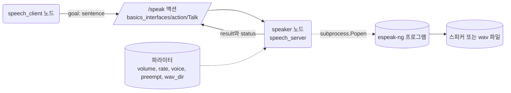
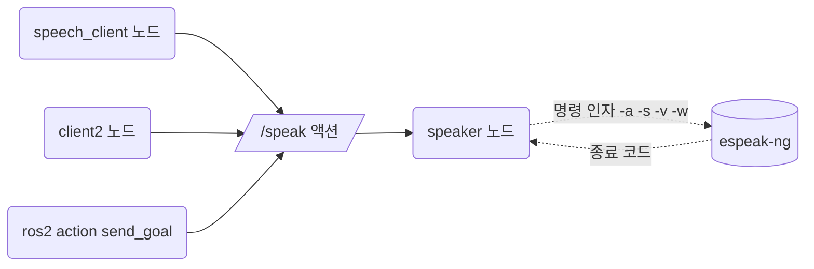
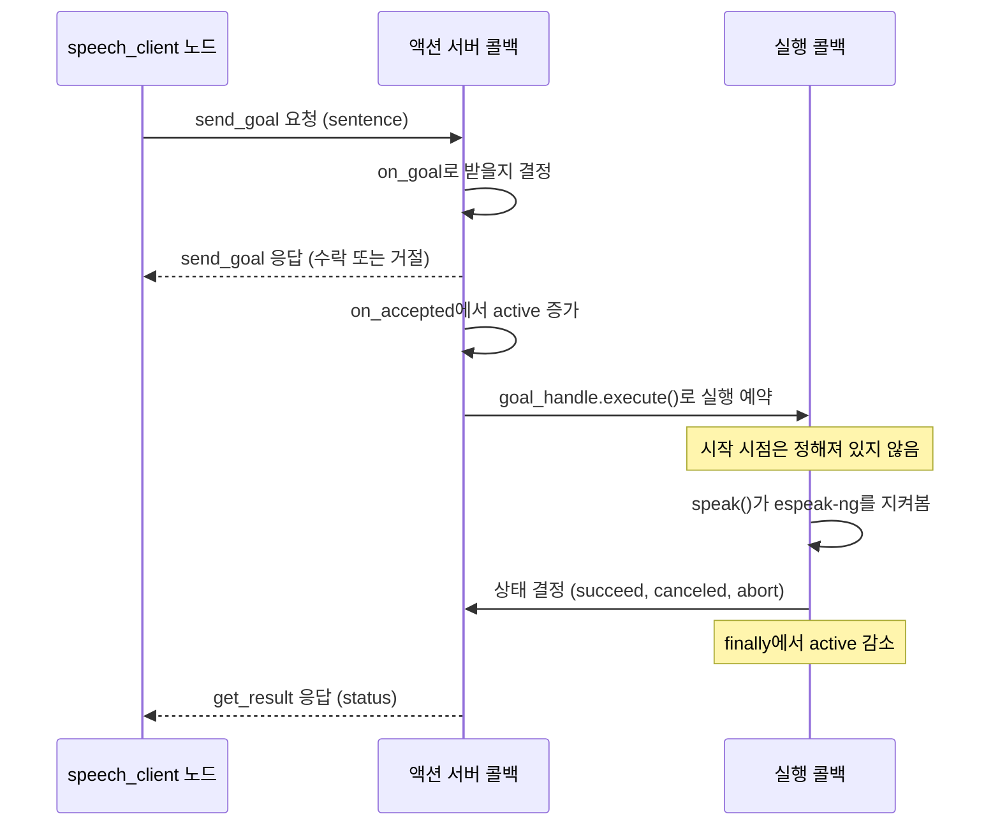
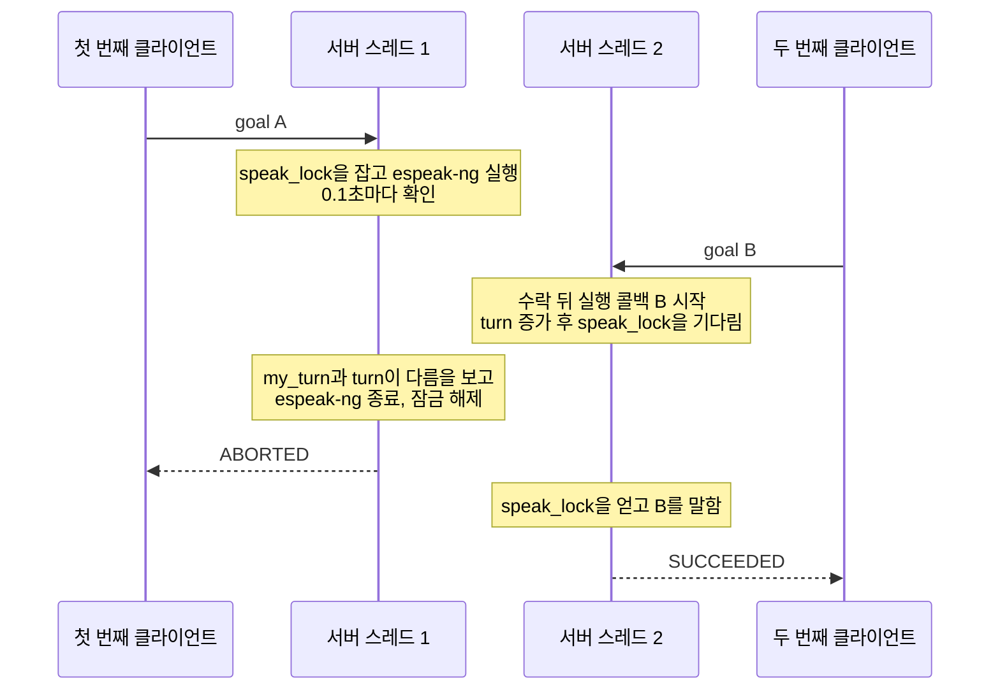

# 19장. 소프트웨어 라이브러리 붙이기

- 원서: Chapter 19. Adding a Software Library, PDF p.367~375 (인쇄 쪽 = PDF 쪽 - 20)
- 선행 조건: 5장의 `basics_interfaces` 패키지(액션 정의를 빌드해 본 상태). 5장의 액션 서버와 클라이언트 구조를 알고 있으면 좋습니다.
- 새로 설치할 것: `sudo apt install espeak-ng` (학습자가 직접 실행). 소리를 스피커로 듣고 싶으면 `sudo apt install pulseaudio-utils` 도 설치합니다.

## 이 장에서 체감할 구조

ROS를 모르는 라이브러리(여기서는 음성 합성 프로그램)를 노드 하나가 감싸고, 바깥에는 액션 인터페이스와 파라미터만 보여 줍니다.



그림에서 볼 것: 클라이언트는 `/speak` 액션만 알고, espeak-ng가 있는지조차 모릅니다. ROS 쪽(왼쪽)과 라이브러리 쪽(오른쪽)이 만나는 곳은 `speaker` 노드 하나뿐입니다.

## 1. 목표와 개념

로봇에 필요한 기능은 대부분 이미 누군가 라이브러리로 만들어 두었습니다. 이 장의 목표는 그런 라이브러리를 ROS 노드로 감싸서, 다른 노드가 ROS 방식(토픽, 서비스, 액션, 파라미터)만으로 그 기능을 쓰게 만드는 것입니다. 원서는 로봇이 말을 하게 만드는 음성 합성(TTS, text-to-speech)을 예로 듭니다 (원서 PDF p.368).

라이브러리를 감쌀 때 정해야 할 것은 세 가지입니다 (원서 PDF p.369).

1. **인터페이스**: 토픽, 서비스, 액션 중 무엇으로 받을지 정합니다. 말하기는 몇 초가 걸리고 도중에 취소할 수도 있어야 하므로 액션(action: 목표를 보내고, 진행 중에 취소할 수 있고, 끝나면 결과를 받는 통신 방식)이 알맞습니다.
2. **파라미터**: 사용자가 코드를 고치지 않고 바꾸고 싶어 할 값(음량, 속도, 목소리, 끼어들기 허용 여부)을 파라미터로 공개합니다.
3. **실행 흐름**: 라이브러리가 자기 반복문이나 오래 걸리는 호출을 가지고 있으면, ROS의 콜백 처리와 서로 막지 않도록 구조를 짜야 합니다.

비유: 외국어만 하는 전문가(라이브러리)에게 통역사(노드)를 붙여서, 팀원들은 팀 공용어(ROS 인터페이스)로만 일을 맡기게 하는 것입니다.

이 장에서는 Ubuntu 24.04 apt로 설치할 수 있는 `espeak-ng` 를 씁니다. `espeak-ng` 는 명령줄 프로그램이므로, 노드가 Python의 `subprocess` 로 이 프로그램을 실행하고 끝날 때까지 지켜봅니다. 라이브러리가 Python 모듈이든 별도 프로그램이든, 노드가 감싸는 구조는 같습니다.

**감싸는 노드는 번역기입니다.** 노드는 바깥에서 들어온 ROS 요청(goal, 파라미터)을 라이브러리가 알아듣는 형태(명령 인자)로 바꾸고, 라이브러리의 결과(프로세스 종료 코드)를 다시 ROS 형태(goal 상태)로 바꿉니다.



그림에서 볼 것: 클라이언트가 몇 개든 모두 같은 `/speak` 액션을 씁니다. 라이브러리를 원서의 pyttsx에서 espeak-ng로 바꿔도 바뀌는 것은 `speaker` 노드 안쪽뿐이고, 클라이언트 코드는 그대로입니다.

예:

```python
cmd = [self.engine,
       '-a', str(int(volume * 100)),
       '-s', str(self.get_parameter('rate').value),
       '-v', self.get_parameter('voice').value]
```

실습 19-3의 `make_command` 일부입니다. ROS 파라미터 값이 espeak-ng의 명령 인자로 바뀌는 곳이 바로 여기입니다.

**goal 하나가 거치는 콜백.** 5장의 액션 서버는 실행 콜백(`execute`)만 직접 썼습니다. 이 장의 서버는 goal을 받을지 정하는 `goal_callback`과, 수락한 뒤 불리는 `handle_accepted_callback`도 직접 씁니다. 바쁠 때 새 문장을 거절하려면 이 단계들이 필요합니다.



그림에서 볼 것: `on_goal`과 `on_accepted`는 액션 서버 쪽에서 차례로 실행되고, 실행 콜백은 그 뒤에 따로 예약됩니다. 그래서 "끝나지 않은 goal의 수"는 `on_accepted`에서 늘리고 실행 콜백의 `finally`에서 줄입니다(실습 19-3의 "목표 하나가 거치는 세 단계").

예:

```python
def on_accepted(self, goal_handle):
    with self.count_lock:
        self.active += 1
    goal_handle.execute()
```

실습 19-3의 `on_accepted` 전체입니다. 수를 늘리는 일은 잠금 안에서 하고, 실행은 `goal_handle.execute()`로 예약만 합니다.

**여러 스레드가 있어야 끼어들 수 있습니다.** 실행 콜백 하나가 espeak-ng를 지켜보며 스레드를 붙잡고 있는 동안, 다른 스레드가 새 goal과 취소 요청을 처리해야 합니다. 아래는 `preempt`가 참일 때 두 번째 문장이 첫 번째 문장을 끊는 순서입니다.



그림에서 볼 것: 스레드 1이 A를 말하는 동안 스레드 2가 B를 받아들여야 `turn`이 바뀌고, 그것을 본 A가 스스로 멈춥니다. 스레드가 하나뿐이면 B는 A가 끝난 뒤에야 처리됩니다(4절의 `SingleThreadedExecutor` 실험).

이 서버는 5장과 달리 콜백 그룹을 지정하지 않습니다. 액션 서버의 콜백(`on_goal`, `on_accepted`, `on_cancel`)은 노드의 기본 그룹에 들어가 한 번에 하나씩 실행됩니다. 실행 콜백은 rclpy 소스(`rclpy/action/server.py`)에서 `executor.create_task()`로 따로 예약되므로 그 그룹에 묶이지 않습니다. 그래서 `MultiThreadedExecutor`만으로 실행 콜백이 도는 동안에도 새 goal과 취소를 처리할 수 있습니다(7절에서 확인).

### 코드와 폴더 구조

새 패키지 `talk_bot`이 생기고, `basics_interfaces`에는 액션 정의 하나가 더해집니다.

```text
~/rosbook_ws/src/
├── basics_interfaces/
│   ├── CMakeLists.txt          "action/Talk.action" 한 줄 추가 (실습 19-2)
│   └── action/
│       ├── Timer.action        5장
│       └── Talk.action         goal에 sentence 하나, result와 feedback은 비움 (실습 19-2)
└── talk_bot/                   ros2 pkg create로 만듦 (실습 19-3)
    ├── package.xml             rclpy, basics_interfaces, action_msgs 의존
    ├── setup.py                speech_server, speech_client 등록 (실습 19-4)
    ├── setup.cfg
    ├── resource/talk_bot
    ├── test/                   ros2 pkg create가 만든 검사 파일 3개
    └── talk_bot/
        ├── __init__.py
        ├── speech_server.py    espeak-ng를 감싸는 액션 서버, 노드 이름 speaker (실습 19-3)
        └── speech_client.py    문장을 goal로 보내고 상태를 출력 (실습 19-4)
```

- `talk_bot`은 2장의 `basics`와 같은 ament_python 구조입니다. 실행 파일은 `setup.py`의 `entry_points`에 등록합니다.
- `speech_server.py`의 뼈대는 5장의 `fancy_action_server`와 다음이 다릅니다.
  - `ActionServer`에 `goal_callback`과 `handle_accepted_callback`을 더 넘겨서, 받을지 말지와 수락 뒤 처리를 직접 정합니다.
  - 공유 상태(`self.active`)와 말하기 순서를 지키려고 `threading.Lock` 두 개를 씁니다.
  - 파라미터 다섯 개를 `__init__`에서 선언하고, goal이 올 때마다 다시 읽습니다.
  - 실행 콜백은 `time.sleep()` 대신 `subprocess.Popen`으로 띄운 프로세스를 `poll()`로 지켜봅니다.

### 실무 메모

- 라이브러리를 부르는 코드와 ROS 코드를 나눠 둡니다. 이 장에서는 `make_command`와 `subprocess` 부분이 라이브러리 쪽입니다. 실제 프로젝트에서는 이런 부분을 `rclpy`를 import 하지 않는 별도 모듈로 빼 두면, ROS를 띄우지 않고 pytest만으로 시험할 수 있습니다. 실습 19-1처럼 라이브러리를 단독으로 먼저 확인하는 것도 같은 생각입니다.
- 여러 콜백이 함께 고치는 값에는 잠금을 씁니다. `MultiThreadedExecutor`를 쓰면 콜백이 서로 다른 스레드에서 동시에 돌 수 있습니다. 어떤 콜백끼리 동시에 돌 수 있는지 콜백 그룹으로 의식적으로 정하고, 그래도 공유되는 값은 `threading.Lock`으로 지킵니다.
- 외부 프로세스는 끝까지 정리합니다. 취소나 끼어들기로 멈출 때 `terminate()` 뒤에 `wait()`까지 불러서, 프로세스가 완전히 끝난 것을 확인한 뒤 goal 상태를 정합니다.
- 동작 정책(여기서는 `preempt`)은 코드에 박지 않고 파라미터로 둡니다. 실행 중에 `ros2 param set`으로 바꿔 가며 시험할 수 있습니다.
- 직접 감싸기 전에 기성 패키지가 있는지 찾아봅니다. 음성 출력은 원서가 언급한 `sound_play`가 Jazzy에도 있습니다(6절).

## 2. 원서(ROS 1)와 달라지는 점

| 원서 (ROS 1) | ROS 2 Jazzy | 이유와 주의점 |
|---|---|---|
| `pyttsx` 를 `sudo pip install` 로 설치 | `espeak-ng` 를 apt로 설치하고 `subprocess` 로 실행 | Ubuntu 24.04 apt에는 `python3-pyttsx3` 패키지가 없습니다(apt-cache policy로 확인). 시스템 Python에 pip로 설치하는 것은 Ubuntu 24.04에서 막혀 있고, 막지 않더라도 ROS가 쓰는 시스템 Python을 오염시킬 수 있습니다. |
| 라이브러리 이벤트 루프를 별도 스레드에서 `iterate()` 로 돌림 | 외부 프로세스를 띄우고 액션 실행 콜백 안에서 0.1초마다 상태를 확인 | 감싸는 대상이 달라서 방법도 다릅니다. 핵심은 같습니다: 오래 걸리는 작업이 ROS 콜백 처리를 막지 않게 하고, 종료와 취소에 반응할 수 있게 합니다. |
| `actionlib.SimpleActionServer` | `rclpy.action.ActionServer` + `MultiThreadedExecutor` | ROS 2 액션 서버는 목표를 여러 개 동시에 받을 수 있고, "새 목표가 오면 이전 목표를 끊는다" 같은 정책이 자동으로 없습니다. 받을지 말지는 `goal_callback` 에서, 끊을지는 실행 콜백에서 직접 정합니다. |
| `Talk.action` 을 `basics` 패키지의 `action/` 에 둠 | `basics_interfaces` 패키지의 `action/Talk.action` | ROS 2에서는 인터페이스 정의를 ament_cmake 패키지에서 빌드해야 하므로, Python 패키지 `basics` 대신 `basics_interfaces` 에 넣습니다. |
| `rospy.get_param('~volume', 1.0)` (비공개 파라미터) | `self.declare_parameter('volume', 1.0)` | ROS 2 파라미터는 원래 노드마다 따로 있으므로 `~` 표기가 필요 없습니다. 선언할 때 기본값의 타입이 파라미터 타입이 됩니다. |
| `rosrun basics pyttsx_server.py _volume:=0.5` | `ros2 run talk_bot speech_server --ros-args -p volume:=0.5` | 명령줄 파라미터 문법이 바뀌었습니다. |
| `client.get_state()` 숫자 출력 | `GoalStatus.STATUS_SUCCEEDED` 등 상수로 비교 | 상태 값은 `action_msgs/msg/GoalStatus` 에 정의되어 있습니다. |

## 3. 실습

### 실습 19-1. 라이브러리부터 단독으로 확인하기

**준비**: 터미널 하나. `sudo apt install espeak-ng` 를 마친 상태

**직접 입력**:

```bash
espeak-ng --version
espeak-ng -w ~/hello.wav "hello world"
ls -l ~/hello.wav
```

소리를 듣고 싶으면 다음을 이어서 입력합니다. WSL2에서는 WSLg가 Windows 쪽 스피커로 소리를 전달합니다.

```bash
echo $PULSE_SERVER
paplay ~/hello.wav
espeak-ng "hello world"
```

**관찰**:
- `-w` 옵션을 주면 소리를 내지 않고 wav 파일로 저장합니다. 파일 크기가 0보다 크면 합성은 된 것입니다.
- `PULSE_SERVER` 가 `unix:/mnt/wslg/PulseServer` 처럼 나오면 WSLg 오디오 경로가 잡혀 있는 것입니다.
- 소리가 나지 않으면 먼저 wav 파일이 만들어지는지를 확인합니다. wav가 만들어지면 문제는 라이브러리가 아니라 오디오 출력 쪽입니다.

**생각해 볼 질문**: ROS 노드를 만들기 전에 라이브러리를 단독으로 먼저 실행해 보는 이유는 무엇일까요?

### 실습 19-2. 액션 정의 추가하기

**준비**: 터미널 하나

**직접 입력**: 파일 `~/rosbook_ws/src/basics_interfaces/action/Talk.action` 을 만듭니다.

```
string sentence
---
---
```

`~/rosbook_ws/src/basics_interfaces/CMakeLists.txt` 의 `rosidl_generate_interfaces` 목록에 한 줄을 추가합니다. 5장까지 넣은 파일은 그대로 둡니다.

```cmake
rosidl_generate_interfaces(${PROJECT_NAME}
  "msg/Complex.msg"
  "srv/WordCount.srv"
  "action/Timer.action"
  "action/Talk.action"
)
```

빌드하고 확인합니다.

```bash
cd ~/rosbook_ws && colcon build --symlink-install --packages-select basics_interfaces
source ~/rosbook_ws/install/setup.bash
ros2 interface show basics_interfaces/action/Talk
ros2 interface package basics_interfaces
```

**줄 단위 해설**:

| 줄 | 설명 |
|---|---|
| `string sentence` | goal(목표) 부분입니다. 말할 문장 하나만 받습니다. |
| 첫 번째 `---` | goal과 result(결과)를 나눕니다. 결과로 돌려줄 내용이 없어서 비워 둡니다. |
| 두 번째 `---` | result와 feedback(진행 중 알림)을 나눕니다. feedback도 비워 둡니다. |
| `"action/Talk.action"` | 이 줄이 있어야 빌드할 때 Python과 C++용 `Talk` 타입이 생성됩니다. |

**관찰**: `ros2 interface show` 가 정의한 세 부분을 그대로 보여 주고, `ros2 interface package` 목록에 `basics_interfaces/action/Talk` 가 나타납니다. 결과와 feedback이 비어 있어도 액션은 성공, 취소, 중단 같은 상태를 따로 전달하므로 클라이언트는 결과를 알 수 있습니다.

**생각해 볼 질문**: result가 비어 있는데 클라이언트는 어떻게 "말하기가 끝났다"는 것을 알 수 있을까요?

### 실습 19-3. talk_bot 패키지와 speech_server 노드

**준비**: 터미널 하나

**직접 입력**: 패키지를 만듭니다. 패키지 이름을 `--dependencies` 보다 **앞에** 써야 합니다. 뒤에 쓰면 `--dependencies` 가 패키지 이름까지 의존성 목록으로 가져가서 "package_name 이 필요하다"는 오류가 납니다.

```bash
cd ~/rosbook_ws/src
ros2 pkg create --build-type ament_python --license Apache-2.0 talk_bot --dependencies rclpy basics_interfaces action_msgs
```

파일 `~/rosbook_ws/src/talk_bot/talk_bot/speech_server.py` 를 만듭니다.

```python
import os
import shutil
import subprocess
import threading
import time

from basics_interfaces.action import Talk
import rclpy
from rclpy.action import ActionServer, CancelResponse, GoalResponse
from rclpy.executors import ExternalShutdownException, MultiThreadedExecutor
from rclpy.node import Node


class SpeechServer(Node):
    def __init__(self):
        super().__init__('speaker')
        self.declare_parameter('volume', 1.0)
        self.declare_parameter('rate', 175)
        self.declare_parameter('voice', 'en')
        self.declare_parameter('preempt', False)
        self.declare_parameter('wav_dir', '')
        self.engine = shutil.which('espeak-ng')
        if self.engine is None:
            self.get_logger().error('espeak-ng not found: sudo apt install espeak-ng')
        self.speak_lock = threading.Lock()
        self.count_lock = threading.Lock()
        self.active = 0
        self.turn = 0
        self.wav_count = 0
        self.server = ActionServer(
            self, Talk, 'speak',
            execute_callback=self.execute,
            goal_callback=self.on_goal,
            handle_accepted_callback=self.on_accepted,
            cancel_callback=self.on_cancel)

    def on_goal(self, goal_request):
        if self.active > 0 and not self.get_parameter('preempt').value:
            self.get_logger().warning('busy: rejecting new sentence')
            return GoalResponse.REJECT
        return GoalResponse.ACCEPT

    def on_accepted(self, goal_handle):
        with self.count_lock:
            self.active += 1
        goal_handle.execute()

    def on_cancel(self, goal_handle):
        return CancelResponse.ACCEPT

    def make_command(self, sentence):
        volume = self.get_parameter('volume').value
        cmd = [self.engine,
               '-a', str(int(volume * 100)),
               '-s', str(self.get_parameter('rate').value),
               '-v', self.get_parameter('voice').value]
        wav_dir = self.get_parameter('wav_dir').value
        if wav_dir:
            self.wav_count += 1
            cmd += ['-w', os.path.join(wav_dir, f'talk_{self.wav_count}.wav')]
        return cmd + [sentence]

    def execute(self, goal_handle):
        try:
            return self.speak(goal_handle)
        finally:
            with self.count_lock:
                self.active -= 1

    def speak(self, goal_handle):
        self.turn += 1
        my_turn = self.turn
        if self.engine is None:
            goal_handle.abort()
            return Talk.Result()
        stopped_by = None
        with self.speak_lock:
            sentence = goal_handle.request.sentence
            self.get_logger().info(f'speaking: "{sentence}"')
            proc = subprocess.Popen(self.make_command(sentence))
            while proc.poll() is None:
                if goal_handle.is_cancel_requested:
                    stopped_by = 'cancel'
                elif my_turn != self.turn:
                    stopped_by = 'preempt'
                if stopped_by:
                    proc.terminate()
                    proc.wait()
                    break
                time.sleep(0.1)
        if stopped_by == 'cancel':
            goal_handle.canceled()
            self.get_logger().info('canceled by client')
        elif stopped_by == 'preempt':
            goal_handle.abort()
            self.get_logger().info('preempted by a newer sentence')
        elif proc.returncode == 0:
            goal_handle.succeed()
        else:
            goal_handle.abort()
            self.get_logger().error(f'espeak-ng exited with code {proc.returncode}')
        return Talk.Result()


def main(args=None):
    rclpy.init(args=args)
    node = SpeechServer()
    executor = MultiThreadedExecutor()
    executor.add_node(node)
    try:
        executor.spin()
    except (KeyboardInterrupt, ExternalShutdownException):
        pass
    finally:
        node.destroy_node()
        rclpy.try_shutdown()


if __name__ == '__main__':
    main()
```

**줄 단위 해설**:

| 줄 | 설명 |
|---|---|
| `import subprocess`, `shutil`, `threading` | 외부 프로그램 실행, 실행 파일 찾기, 동시에 두 문장을 말하지 않게 하는 잠금에 씁니다. |
| `super().__init__('speaker')` | 노드 이름은 원서와 같은 `speaker` 입니다. |
| `declare_parameter('volume', 1.0)` | 기본값이 실수이므로 이 파라미터의 타입은 double이 됩니다. 0.0~1.0 범위로 씁니다. |
| `declare_parameter('rate', 175)` | 분당 단어 수입니다. 정수 타입입니다. espeak-ng의 `-s` 옵션으로 넘깁니다. |
| `voice`, `preempt`, `wav_dir` | 목소리 이름, 새 문장이 오면 지금 문장을 끊을지 여부, wav 파일 저장 폴더(빈 문자열이면 스피커로 출력)입니다. |
| `shutil.which('espeak-ng')` | PATH에서 프로그램을 찾습니다. 없으면 노드는 뜨지만 오류 로그를 남기고, 목표가 오면 중단(abort)으로 응답합니다. |
| `threading.Lock()` 두 개 | `speak_lock` 은 한 번에 한 문장만 말하게 하는 잠금입니다. `count_lock` 은 여러 스레드가 `self.active` 를 동시에 고치지 못하게 막는 잠금입니다. |
| `self.active` | 받아들였지만 아직 끝나지 않은 목표의 수입니다. `on_accepted` 에서 늘리고, 실행 콜백이 끝날 때 줄입니다. |
| `self.turn` | 실행 콜백이 시작될 때마다 1씩 늘어나는 번호입니다. 내 번호와 현재 번호가 다르면 더 새로운 문장이 들어왔다는 뜻입니다. |
| `ActionServer(self, Talk, 'speak', ...)` | 이름이 `speak` 인 액션 서버를 만듭니다. 원서와 같은 이름입니다. |
| `on_goal` | 목표를 받을지 정합니다. 끝나지 않은 목표가 있고 `preempt` 가 거짓이면 `REJECT` 로 거절합니다. |
| `on_accepted` | 수락 응답을 보낸 뒤 rclpy가 부르는 콜백입니다(`handle_accepted_callback`). 끝나지 않은 목표 수를 늘리고, `goal_handle.execute()` 로 실행 콜백을 예약합니다. 이 콜백을 지정하지 않으면 rclpy의 기본 콜백이 `goal_handle.execute()` 만 부릅니다. 왜 여기서 세는지는 표 아래에 적었습니다. |
| `on_cancel` | 취소 요청을 모두 받아들입니다. 실제로 멈추는 일은 실행 콜백이 합니다. |
| `make_command` | `espeak-ng -a 음량 -s 속도 -v 목소리 [-w 파일] 문장` 형태의 명령 목록을 만듭니다. `-a` 는 0~200 범위라서 volume에 100을 곱합니다. 파라미터는 목표가 올 때마다 다시 읽으므로 실행 중에 `ros2 param set` 으로 바꾼 값이 다음 문장부터 반영됩니다. |
| `execute` 의 `try`/`finally` | 실제 일은 `speak` 에 맡기고, 어떻게 끝나든(성공, 취소, 중단, 예외) 마지막에 `self.active` 를 1 줄입니다. 줄이지 못하면 `self.active` 가 0으로 돌아오지 않으므로, `preempt` 가 거짓일 때 이후의 목표를 모두 거절합니다. |
| `self.turn += 1` | 이 목표의 번호를 받습니다. |
| `with self.speak_lock:` | 앞 문장이 끝날 때까지 기다렸다가 잠금을 잡습니다. |
| `subprocess.Popen(...)` | espeak-ng를 실행하고 바로 돌아옵니다. 끝날 때까지 기다리지 않으므로 그동안 취소를 확인할 수 있습니다. |
| `while proc.poll() is None:` | 프로그램이 끝나지 않은 동안 0.1초마다 취소 요청과 새 문장 도착을 확인합니다. 원서의 `isBusy()` 반복문과 같은 역할입니다. |
| `proc.terminate()`, `proc.wait()` | 말하기를 멈추고, 프로세스가 완전히 끝날 때까지 기다립니다. |
| `goal_handle.canceled()` | 클라이언트가 요청한 취소를 완료했다고 알립니다. 상태는 CANCELED가 됩니다. |
| `goal_handle.abort()` (preempt) | 새 문장 때문에 끊긴 목표는 중단(ABORTED)으로 끝냅니다. |
| `goal_handle.succeed()` | 프로그램이 정상 종료(코드 0)하면 성공으로 끝냅니다. |
| `return Talk.Result()` | 비어 있는 결과를 돌려줍니다. 상태 값은 위에서 정한 것이 전달됩니다. |
| `MultiThreadedExecutor()` | 콜백을 여러 스레드에서 실행하는 executor(콜백을 꺼내 실행하는 실행기)입니다. 실행 콜백 하나가 말하는 동안 스레드를 붙잡고 있어도, 다른 스레드가 새 목표 요청과 취소 요청을 처리합니다. rclpy 액션 서버는 실행 콜백을 따로 예약해서 돌리므로, 이 서버에서는 콜백 그룹을 따로 지정하지 않아도 끼어들기와 취소가 동작했습니다(7절). |

**목표 하나가 거치는 세 단계**: rclpy 액션 서버는 목표 요청 하나를 `on_goal`(받을지 결정), 수락 응답 전송, `on_accepted`(수락 뒤 처리) 순서로 처리합니다. 실행 콜백은 그다음에 따로 예약되어 다른 스레드에서 시작됩니다. 액션 서버는 노드의 기본 콜백 그룹, 즉 한 번에 콜백 하나만 실행하는 그룹에 속합니다. 그래서 앞의 세 단계가 끝나기 전에는 다음 목표 요청의 `on_goal` 이 시작되지 않습니다. 반면 예약된 실행 콜백이 언제 시작될지는 정해져 있지 않습니다.

- 바쁜지를 `speak_lock.locked()` 로 판단하면, 실행 콜백이 잠금을 잡기 전에 들어온 두 번째 목표가 받아들여질 수 있습니다. `preempt` 가 거짓인데도 두 문장이 모두 수락될 수 있고, 그러면 실행 콜백이 시작되는 순서에 따라 한 문장이 다른 문장을 끊을 수 있습니다.
- `on_goal` 에서 바로 수를 늘리면 다른 문제가 생깁니다. `on_goal` 이 수락한 뒤에도 응답을 보내지 못하면(그사이 클라이언트가 종료된 경우 등) rclpy는 `on_accepted` 와 실행 콜백을 부르지 않습니다. 그러면 수를 줄일 곳이 없어 서버가 계속 바쁜 상태로 남습니다.
- `on_accepted` 에서 늘리면 두 문제가 모두 사라집니다. 앞 목표가 아직 끝나지 않았다면 다음 목표의 `on_goal` 은 늘어난 값을 봅니다. 또 `on_accepted` 까지 온 목표는 정상적인 경우 실행 콜백이 예약되므로 `finally` 에서 수가 줄어듭니다. 노드가 종료되는 중이라 예약된 실행 콜백이 돌지 못하는 경우는 여기서 다루지 않습니다.

**생각해 볼 질문**: `MultiThreadedExecutor` 대신 `rclpy.spin(node)` (단일 스레드)를 쓰면 말하는 도중에 들어온 취소 요청은 어떻게 될까요?

### 실습 19-4. speech_client 노드와 빌드

**준비**: 터미널 하나

**직접 입력**: 파일 `~/rosbook_ws/src/talk_bot/talk_bot/speech_client.py` 를 만듭니다.

```python
from action_msgs.msg import GoalStatus
from basics_interfaces.action import Talk
import rclpy
from rclpy.action import ActionClient
from rclpy.executors import ExternalShutdownException
from rclpy.node import Node

STATUS_NAMES = {
    GoalStatus.STATUS_SUCCEEDED: 'SUCCEEDED',
    GoalStatus.STATUS_CANCELED: 'CANCELED',
    GoalStatus.STATUS_ABORTED: 'ABORTED',
}


class SpeechClient(Node):
    def __init__(self):
        super().__init__('speaker_client')
        self.declare_parameter('sentence', 'hello world, hello world, hello world')
        self.client = ActionClient(self, Talk, 'speak')

    def say(self):
        if not self.client.wait_for_server(timeout_sec=5.0):
            self.get_logger().error('action server /speak not available')
            return
        goal = Talk.Goal()
        goal.sentence = self.get_parameter('sentence').value
        send_future = self.client.send_goal_async(goal)
        rclpy.spin_until_future_complete(self, send_future)
        goal_handle = send_future.result()
        if not goal_handle.accepted:
            self.get_logger().warning('goal rejected by the server')
            return
        result_future = goal_handle.get_result_async()
        rclpy.spin_until_future_complete(self, result_future)
        status = result_future.result().status
        self.get_logger().info(f'result status: {STATUS_NAMES.get(status, status)}')


def main(args=None):
    rclpy.init(args=args)
    node = SpeechClient()
    try:
        node.say()
    except (KeyboardInterrupt, ExternalShutdownException):
        pass
    finally:
        node.destroy_node()
        rclpy.try_shutdown()


if __name__ == '__main__':
    main()
```

`~/rosbook_ws/src/talk_bot/setup.py` 의 `entry_points` 를 다음처럼 고칩니다.

```python
    entry_points={
        'console_scripts': [
            'speech_server = talk_bot.speech_server:main',
            'speech_client = talk_bot.speech_client:main',
        ],
    },
```

`package.xml` 은 `ros2 pkg create` 가 `--dependencies` 로 넣어 준 `rclpy`, `basics_interfaces`, `action_msgs` 의 `<depend>` 세 줄이 있으면 됩니다.

```bash
cd ~/rosbook_ws && colcon build --symlink-install --packages-select talk_bot
source ~/rosbook_ws/install/setup.bash
ros2 pkg executables talk_bot
```

**줄 단위 해설**:

| 줄 | 설명 |
|---|---|
| `from action_msgs.msg import GoalStatus` | 액션 목표의 상태 상수가 들어 있는 메시지입니다. `package.xml` 에 `action_msgs` 의존성이 필요한 이유입니다. |
| `STATUS_NAMES` | 상태 숫자를 읽기 쉬운 이름으로 바꾸는 표입니다. |
| `declare_parameter('sentence', ...)` | 말할 문장을 파라미터로 받아서, 코드를 고치지 않고 다른 문장을 보낼 수 있게 합니다. |
| `ActionClient(self, Talk, 'speak')` | 서버와 같은 타입, 같은 이름으로 클라이언트를 만듭니다. |
| `wait_for_server(timeout_sec=5.0)` | 서버가 보일 때까지 최대 5초 기다립니다. 시간 제한이 없으면 서버 이름을 틀렸을 때 영원히 멈춥니다. |
| `send_goal_async(goal)` | 목표를 보냅니다. 돌아오는 future는 "서버가 받았는지"에 대한 답입니다. |
| `spin_until_future_complete` | 그 답이 올 때까지 노드의 콜백을 처리합니다. |
| `goal_handle.accepted` | 서버의 `on_goal` 이 거절했으면 거짓입니다. |
| `get_result_async()` | 말하기가 끝났을 때의 결과와 상태를 기다리는 future입니다. |
| `result_future.result().status` | 성공, 취소, 중단 중 무엇으로 끝났는지 알려 줍니다. |

**관찰**: `ros2 pkg executables talk_bot` 에 `talk_bot speech_client` 와 `talk_bot speech_server` 두 줄이 나옵니다.

**생각해 볼 질문**: 실습 19-2의 질문과 연결해 보세요. 이 클라이언트는 result의 어떤 필드도 읽지 않는데 무엇으로 결과를 판단하나요?

### 실습 19-5. 실행하고 구조 확인하기

**준비**: 터미널 세 개

**직접 입력**:

터미널 1:

```bash
ros2 run talk_bot speech_server
```

터미널 2:

```bash
ros2 action list -t
ros2 action info /speak -t
ros2 node info /speaker
ros2 param list /speaker
```

터미널 3:

```bash
ros2 run talk_bot speech_client
ros2 run talk_bot speech_client --ros-args -p sentence:="the robot is ready"
```

**관찰**:
- `ros2 action list -t` 에 `/speak [basics_interfaces/action/Talk]` 가 나옵니다.
- `ros2 node info /speaker` 의 마지막 부분 `Action Servers:` 에 `/speak: basics_interfaces/action/Talk` 가 보입니다. 파라미터 서비스(`/speaker/get_parameters` 등)는 보이지만 액션 내부에서 쓰는 서비스와 토픽은 이 목록에 따로 나오지 않습니다.
- 클라이언트 터미널에 `result status: SUCCEEDED` 가 찍히고, 서버 터미널에 `speaking: "..."` 로그가 찍힙니다.
- 스피커로 소리가 나는지는 실습 19-1의 오디오 확인 결과에 달려 있습니다.

**생각해 볼 질문**: 클라이언트를 실행하는 동안 터미널 2에서 `ros2 action info /speak` 를 다시 입력하면 `Action clients:` 숫자가 어떻게 바뀔까요?

### 실습 19-6. 파라미터와 끼어들기(preempt) 시험하기

**준비**: 터미널 세 개. 터미널 1의 서버는 일단 멈춥니다(Ctrl+C).

**직접 입력**:

터미널 1: 음량을 낮추고 wav 파일로 저장하게 해서 서버를 다시 띄웁니다.

```bash
mkdir -p ~/talk_wav
ros2 run talk_bot speech_server --ros-args -p volume:=0.5 -p wav_dir:=$HOME/talk_wav
```

터미널 2:

```bash
ros2 param get /speaker volume
ros2 run talk_bot speech_client
ls -l ~/talk_wav
```

끼어들기 정책을 시험합니다. 터미널 2와 터미널 3에 아래 명령을 미리 쳐 두고, 터미널 2에서 Enter를 누른 뒤 1초 안에 터미널 3에서 Enter를 누릅니다.

터미널 2:

```bash
ros2 run talk_bot speech_client --ros-args -p sentence:="this is a fairly long first sentence for testing the server"
```

터미널 3:

```bash
ros2 run talk_bot speech_client --ros-args -p sentence:="second" -r __node:=client2
```

그다음 `preempt` 를 실행 중에 켜고 같은 순서로 다시 해 봅니다.

```bash
ros2 param set /speaker preempt true
```

마지막으로 명령줄 도구로 목표를 보내고, 말하는 도중에 Ctrl+C를 눌러 취소해 봅니다.

```bash
ros2 action send_goal /speak basics_interfaces/action/Talk "{sentence: 'a very long sentence that will take quite a while to finish speaking'}"
```

**관찰**:
- `ros2 param get` 이 `Double value is: 0.5` 를 보여 줍니다. `~/talk_wav` 에 `talk_1.wav` 가 생깁니다.
- `preempt` 가 거짓일 때: 두 번째 클라이언트는 `goal rejected by the server` 경고를 남기고 끝나고, 서버에는 `busy: rejecting new sentence` 가 찍힙니다. 첫 번째 클라이언트는 SUCCEEDED로 끝납니다.
- `preempt` 가 참일 때: 서버에 `preempted by a newer sentence` 가 찍히고, 첫 번째 클라이언트는 ABORTED, 두 번째 클라이언트는 SUCCEEDED로 끝납니다. 끊긴 문장의 wav 파일은 만들어지지 않습니다.
- `ros2 action send_goal` 도중 Ctrl+C를 누르면 `Canceling goal...` 이 찍히고 서버에 `canceled by client` 가 찍힙니다. 이때 명령줄 도구가 `Executor is already spinning` 이라는 메시지를 함께 출력할 수 있습니다. 서버 로그로 취소가 처리되었는지 확인합니다.
- `-r __node:=client2` 는 노드 이름을 바꾸는 재매핑(remapping: 실행할 때 이름을 바꿔 연결하는 기능)입니다. 같은 이름의 노드 두 개가 동시에 뜨지 않게 하려고 씁니다.

**생각해 볼 질문**: 이 장의 서버는 끼어들기를 "새 목표는 받고 이전 목표를 중단"하는 방식으로 구현했습니다. 같은 정책을 `on_goal` 에서 이전 목표를 직접 취소하는 방식으로 구현한다면 무엇이 더 필요할까요?

## 4. 일부러 망가뜨려 보기

| 바꿀 것 | 예상 증상 | 원인을 확인하는 명령 |
|---|---|---|
| espeak-ng를 설치하지 않은 상태(또는 PATH에서 빠진 상태)로 서버 실행 | 서버가 `espeak-ng not found: sudo apt install espeak-ng` 오류 로그를 남깁니다. 클라이언트는 ABORTED를 받습니다. | `which espeak-ng`, 서버 터미널 로그 |
| 클라이언트에서 액션 이름 오타: `--ros-args -r speak:=talk` | 클라이언트는 `/talk` 를 찾다가 5초 뒤 `action server /speak not available` 오류로 끝납니다. 오류 문장의 `/speak` 는 코드에 적어 둔 글자일 뿐이어서, 실제로 찾은 이름과 다릅니다. | `ros2 action list -t` 로 서버 쪽 이름이 `/speak` 인지 확인 |
| 서버 실행 시 `-p volume:=1` (정수) | 노드가 시작하자마자 `InvalidParameterTypeException: Trying to set parameter 'volume' to '1' of type 'INTEGER', expecting type 'DOUBLE'` 로 끝나고 `[ros2run]: Process exited with failure 1` 이 찍힙니다. `volume:=1.0` 으로 써야 합니다. | 서버 터미널의 예외 메시지 |
| 실행 중 `ros2 param set /speaker volume loud` | `Setting parameter failed: Wrong parameter type, expected 'Type.DOUBLE' got 'Type.STRING'` 으로 거부됩니다. 노드는 계속 돕니다. | `ros2 param describe /speaker volume` |
| `main()` 의 `MultiThreadedExecutor()` 를 `SingleThreadedExecutor()` 로 바꾸고(import도 함께) `preempt:=true` 로 실행 | 끼어들기가 동작하지 않습니다. 첫 문장이 끝까지 SUCCEEDED로 끝난 뒤에야 두 번째 문장을 말하고, `send_goal` 도중 Ctrl+C를 눌러도 서버에 `canceled by client` 가 찍히지 않습니다. | 서버 로그의 `speaking:` 시각, `preempted`/`canceled` 로그가 없는 것 |
| 서버를 Ctrl+C로 끈 상태에서 클라이언트 실행 | 5초 뒤 `action server /speak not available` 오류로 끝납니다. | `ros2 node list`, `ros2 action list` |

## 5. 확인 질문

<details><summary>Q1. 실습 19-1의 질문: 노드를 만들기 전에 라이브러리를 단독으로 실행해 보는 이유는 무엇인가요?</summary>

문제가 생겼을 때 원인을 둘로 나눌 수 있기 때문입니다. 라이브러리 단독으로 잘 되면 이후의 문제는 ROS로 감싼 코드에 있고, 단독으로도 안 되면 설치나 오디오 설정 문제입니다. 원서도 같은 순서를 권합니다 (원서 PDF p.368).

</details>

<details><summary>Q2. 실습 19-2와 19-4의 질문: result가 비어 있는데 클라이언트는 무엇으로 결과를 판단하나요?</summary>

액션은 result 메시지와 별도로 목표의 상태(status)를 전달합니다. 서버가 `succeed()`, `canceled()`, `abort()` 중 무엇을 불렀는지가 `GoalStatus` 값으로 클라이언트에 전달되므로, result 필드가 없어도 성공, 취소, 중단을 구분할 수 있습니다.

</details>

<details><summary>Q3. 실습 19-3의 질문: 단일 스레드 `rclpy.spin(node)` 을 쓰면 말하는 도중의 취소 요청은 어떻게 되나요?</summary>

실행 콜백이 `while proc.poll() is None` 반복문에서 하나뿐인 스레드를 붙잡고 있으므로, 취소 요청을 처리하는 콜백이 실행될 기회가 없습니다. 그래서 `is_cancel_requested` 가 참이 되지 않고 문장을 끝까지 말합니다. 새 목표도 같은 이유로 앞 문장이 끝난 뒤에야 처리되어 끼어들기가 일어나지 않습니다. 검증에서 `SingleThreadedExecutor` 로 바꿨을 때 실제로 이렇게 동작했습니다(4절). 원서가 라이브러리의 이벤트 루프를 별도 스레드로 뺀 것과 같은 문제를 다른 방법으로 푼 것입니다.

</details>

<details><summary>Q4. 실습 19-5의 질문: 클라이언트 실행 중 `ros2 action info /speak` 의 `Action clients:` 숫자는 어떻게 바뀌나요?</summary>

클라이언트 노드가 떠 있는 동안 1이 되고, 클라이언트가 끝나면 다시 0이 됩니다. 이 클라이언트는 결과를 받으면 바로 끝나므로, 긴 문장을 보내 놓고 그 사이에 확인해야 볼 수 있습니다.

</details>

<details><summary>Q5. 실습 19-6의 질문: `on_goal` 에서 이전 목표를 직접 취소하는 방식으로 바꾸면 무엇이 더 필요한가요?</summary>

현재 실행 중인 goal handle을 노드가 기억해 두어야 하고, 새 목표를 받을 때 그 handle에 중단을 알릴 방법이 필요합니다. 또 서버 쪽에서 스스로 목표를 끝내는 것은 클라이언트가 요청하는 취소와 다르므로, 결과 상태를 ABORTED로 할지 정해야 합니다. 이 장의 `turn` 번호 방식은 handle을 따로 보관하지 않고 같은 효과를 냅니다.

</details>

## 6. 원서 대조 메모

- 원서는 `pyttsx` 모듈을 씁니다 (원서 PDF p.368). 이 모듈은 Python 2 시절의 것이고, Ubuntu 24.04 apt에는 후속인 `pyttsx3` 도 없습니다. 이 장은 apt로 설치되는 `espeak-ng` 를 씁니다. 감싸는 대상은 달라도 인터페이스, 파라미터, 실행 흐름을 정하는 순서는 원서와 같습니다.
- 원서는 속도 기본값을 분당 200단어로 둡니다 (원서 PDF p.370). 이 장은 espeak-ng의 기본 속도로 알려진 175를 기본값으로 썼습니다.
- 원서는 `Talk.action` 에 주석으로 각 부분의 의미를 적었습니다. 이 장의 정의는 같은 구조(goal에 문장 하나, result와 feedback은 비움)를 따릅니다.
- 원서의 끼어들기 설명은 `SimpleActionServer` 가 새 목표를 받으면 이전 목표에 선점 요청을 거는 동작에 기대고 있습니다 (원서 PDF p.373~375). ROS 2 액션 서버에는 이 동작이 없으므로, 이 장은 `preempt` 가 거짓이면 새 목표를 거절하고, 참이면 새 목표를 받으면서 이전 목표를 중단하는 정책을 직접 구현했습니다.
- 원서가 언급한 기성 패키지 `sound_play` 는 Jazzy에도 apt 패키지 `ros-jazzy-sound-play` 로 있습니다(apt-cache policy로 후보 버전 확인, 설치하지 않았고 동작은 확인하지 않음).

## 7. 이 문서의 검증 상태

- 확인함 (2026-10-27, 검증용 별도 워크스페이스, `ROS_DOMAIN_ID` 분리, Fast DDS와 Cyclone DDS 각각에서 실행. 마지막 재검증은 `RMW_IMPLEMENTATION=rmw_cyclonedds_cpp`):
  - `basics_interfaces` 에 `action/Talk.action` 을 추가해 빌드되는 것(이 검증 워크스페이스의 `basics_interfaces` 에는 `WordCount.srv` 와 `Talk.action` 만 넣었고, 5장의 파일과 함께 빌드한 것은 확인하지 않음). `ros2 interface show` 출력.
  - 이 문서에 실린 코드 그대로의 `talk_bot` 빌드와 `colcon test`(3개 중 통과 2, 건너뜀 1), `ros2 action list -t`, `ros2 action info /speak -t`, `ros2 node info /speaker` 의 출력 모양.
  - espeak-ng가 PATH에 없을 때의 오류 로그.
  - `volume:=0.5`, `wav_dir` 로 실행했을 때 `ros2 param get` 값, wav 파일 생성, 명령 인자 `-a 50 -s 175 -v en -w ... 문장`.
  - `preempt` 거짓일 때 두 번째 목표 거절, 참일 때(`ros2 param set` 으로 실행 중 변경) 첫 목표 ABORTED와 두 번째 목표 SUCCEEDED.
  - `ros2 action send_goal` 도중 SIGINT로 취소했을 때 서버의 `canceled by client` 로그와 `Executor is already spinning` 메시지.
  - 콜백 그룹을 지정하지 않고 `MultiThreadedExecutor` 만으로 끼어들기와 취소가 동작하는 것, `SingleThreadedExecutor` 로 바꾸면 둘 다 동작하지 않는 것.
  - 4절의 `-p volume:=1`, 액션 이름 리매핑, 실행 중 잘못된 타입 설정의 출력.
  - (2026-10-28 수정) 3절의 "목표 하나가 거치는 세 단계". executor 없이 콜백을 직접 부르는 시험 두 가지로 확인했습니다. 첫째는 목표 A를 실행에 넘겼지만 실행 콜백이 아직 시작되지 않았을 때 목표 B가 오는 경우입니다. `speak_lock.locked()` 로 판단하는 코드는 B를 받아들였고, 지금 코드는 거절했습니다. 둘째는 A가 `on_goal` 을 통과했지만 `on_accepted` 가 불리지 않는 경우입니다. `on_goal` 에서 바로 수를 늘리는 코드는 B를 거절했고(계속 바쁜 상태), 지금 코드는 받아들였습니다. 이 동작의 근거인 rclpy의 처리 순서와 콜백 그룹은 설치된 rclpy 소스(`rclpy/action/server.py`, `rclpy/executors.py`)를 읽어 확인했습니다. 클라이언트에서 목표 두 개를 연달아 보낸 시험에서는 `speak_lock.locked()` 코드도 5번 모두 B를 거절했습니다. 실제로 첫째 경우가 얼마나 자주 생기는지는 확인하지 못했습니다. 지금 코드로 다시 확인한 것은 다음과 같습니다. `preempt` 가 거짓일 때 두 번째 목표 거절(3번), 취소 뒤 새 목표 SUCCEEDED, `preempt` 가 참일 때 첫 목표 ABORTED와 두 번째 목표 SUCCEEDED(3번), `colcon test`(3개 중 통과 2, 건너뜀 1).
- 확인 못 함:
  - 실제 espeak-ng 동작. 검증 환경에는 espeak-ng가 설치되어 있지 않아(설치 금지), 받은 인자를 기록하고 문장 길이에 비례해 기다린 뒤 빈 wav를 쓰는 가짜 `espeak-ng` 스크립트로 노드 구조만 시험했습니다. 실제 음성의 음량, 속도, 목소리 옵션(`-a`, `-s`, `-v`)의 효과와 기본 속도 175는 확인하지 않았습니다. 패키지 이름과 버전은 `apt-cache policy espeak-ng` 로 확인했습니다(1.51+dfsg-12build1, 미설치).
  - 소리 출력. 검증 중에는 소리를 재생하지 않았습니다. `paplay`(`pulseaudio-utils`)와 WSLg 오디오는 학습자가 직접 확인해야 합니다. `PULSE_SERVER=unix:/mnt/wslg/PulseServer` 환경 변수가 설정된 것만 확인했습니다.
  - 5장의 `basics_interfaces` 실제 파일 목록과 함께 빌드한 결과.
- 설명 보강(2026-10-30): "이 장에서 체감할 구조"와 1절에 그림, 코드 예시, 코드와 폴더 구조, 실무 메모를 더했습니다. 머리말과 2~6절은 바꾸지 않았습니다. 1절의 코드 예시는 따로 실행하지 않았습니다.
