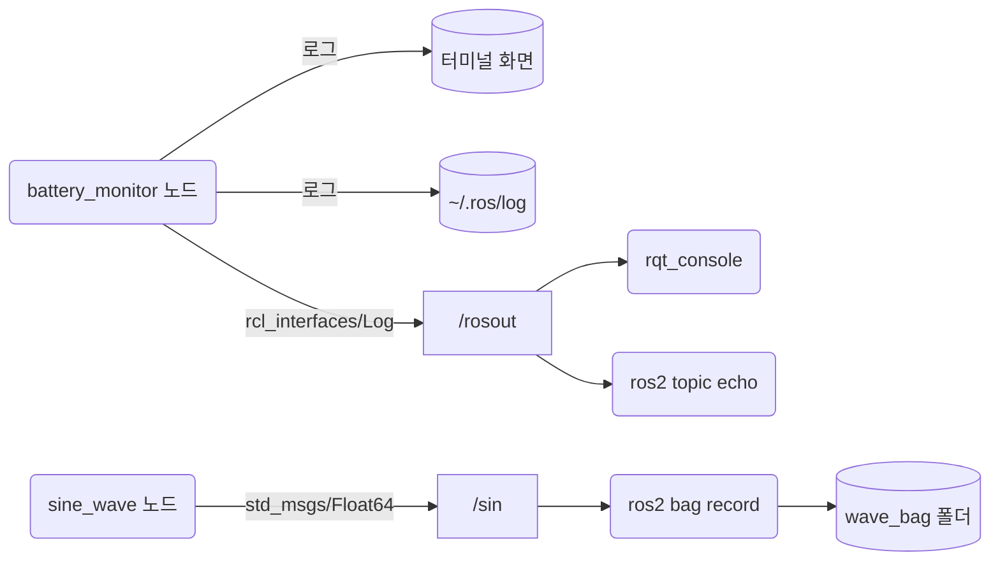
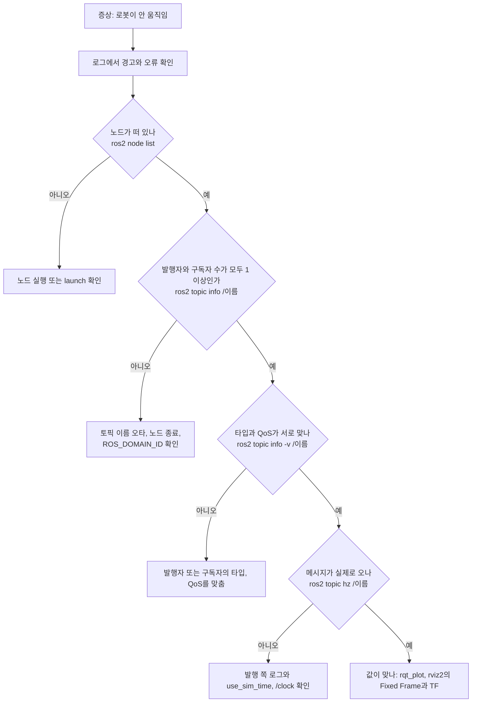
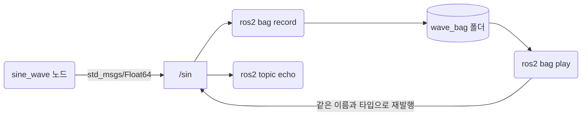

# 21장. 로봇 동작 디버깅

- 원서: Chapter 21. Debugging Robot Behavior, PDF p.395~418 (인쇄 쪽 = PDF 쪽 - 20)
- 선행 조건: 20장(`ros2 run`, `ros2 node info`, `ros2 topic info -v`, launch). 3장의 `topic_publisher`/`topic_subscriber`. 7장 이후의 TurtleBot3 시뮬레이션 실행 경험(실습 21-6에서만 씁니다).
- 새로 설치할 것: 선택 사항으로 `sudo apt install ros-jazzy-plotjuggler-ros` (학습자가 직접 실행). 나머지 도구(rqt_console, rqt_graph, rqt_plot, rqt_bag, rviz2)는 desktop 설치에 들어 있습니다.

## 이 장에서 체감할 구조

ROS 2의 로그는 각 노드가 화면, 로그 파일, `/rosout` 토픽 세 곳에 동시에 내보내므로, 로그도 결국 토픽 하나로 모입니다.
연결 문제는 "이름, 타입, QoS, 도메인" 네 가지가 모두 맞아야 이어진다는 규칙으로 좁혀 갑니다.
bag은 토픽을 그대로 저장했다가 다시 발행하므로, 받는 노드 입장에서는 실제 센서와 구별되지 않습니다.



그림에서 볼 것: 위쪽 가지는 한 번의 `get_logger()` 호출이 세 곳으로 나가고, 그중 `/rosout`만 토픽이라서 구독하는 도구라면 무엇이든 같은 로그를 받을 수 있다는 것입니다. 아래쪽 가지는 bag이 토픽 하나를 구독자처럼 받아 폴더에 쌓는 모습입니다.

## 1. 목표와 개념

로봇이 움직이지 않을 때 무엇부터 봐야 하는지, 순서를 몸에 익히는 것이 이 장의 목표입니다 (원서 PDF p.395~396).

1. **로그를 봅니다.** 어느 노드가 이미 원인을 말하고 있을 수 있습니다.
2. **연결을 봅니다.** 발행자와 구독자가 실제로 이어져 있는지 확인합니다.
3. **데이터를 봅니다.** 이어져 있다면 흐르는 값이 맞는지 그림(rviz2)과 그래프(rqt_plot)로 확인합니다.
4. **기록하고 다시 틉니다.** 문제가 난 순간의 데이터를 bag으로 저장해 두면 같은 상황을 몇 번이고 재현할 수 있습니다.

이 순서를 증상에서 원인으로 좁혀 가는 흐름으로 그리면 다음과 같습니다. 각 칸에 적은 명령은 이 장의 실습에서 모두 씁니다.



그림에서 볼 것: 로그를 먼저 보고, 그다음부터는 "이어졌나, 같은 규격인가, 데이터가 오나, 값이 맞나" 순서로 한 칸씩 좁힙니다. 이름이 틀리면(실습 21-3) 개수가 0이고, 타입이 틀리면(실습 21-4) 개수는 1 이상이지만 `-v`에서 타입이 다르게 보입니다. 그래서 개수 확인과 `-v` 확인이 서로 다른 칸입니다.

예:

```bash
ros2 topic info /countr
```

실습 21-3에서 `Publisher count: 0`, `Subscription count: 1`이 나옵니다. 한쪽이 0이면 로그에 아무것도 없어도 이름부터 의심합니다.

몇 가지 용어를 먼저 정리합니다.

- **로그 심각도(severity)**: DEBUG, INFO, WARN, ERROR, FATAL 다섯 단계입니다. 노드마다 "이 단계 이상만 출력한다"는 **로그 레벨**이 있고 기본값은 INFO입니다.
- **로거(logger)**: 로그를 내보내는 이름표입니다. 노드의 기본 로거 이름은 노드 이름과 같습니다.
- **`/rosout`**: 모든 노드가 자기 로그를 발행하는 토픽입니다. 원서의 ROS 1과 달리 중간에서 모아 주는 `rosout` 노드와 `/rosout_agg` 토픽은 없고, 로그를 보는 도구가 `/rosout` 을 직접 구독합니다.
- **bag**: 토픽 메시지를 시간과 함께 저장한 파일 묶음입니다. Jazzy의 기본 저장 형식은 MCAP입니다.

비유: 로그는 각 부서가 쓰는 업무 일지이고, `/rosout` 은 그 일지를 한 곳에 모아 보는 게시판입니다. bag은 회의를 통째로 녹화해 두었다가 나중에 다시 트는 녹화 파일입니다.

**로그가 지나가는 길.** 노드 코드에서 `self.get_logger().info(...)`를 한 번 부르면 로그 한 건이 화면, 로그 파일, `/rosout` 토픽으로 동시에 나갑니다. 로거는 먼저 심각도를 노드(또는 로거)의 로그 레벨과 비교하고, 레벨보다 낮은 로그는 세 곳 어디에도 내지 않습니다. 그래서 레벨은 코드가 아니라 실행 인자로 바꿀 수 있어야 쓸모가 있습니다.

예:

```python
log = self.get_logger()
log.debug(f'raw reading: {self.voltage:.2f} V')
```

```bash
ros2 run basics battery_monitor --ros-args --log-level battery_monitor:=debug
```

기본 레벨 INFO에서는 `log.debug` 줄이 출력되지 않고, 두 번째 명령처럼 `battery_monitor` 로거만 DEBUG로 낮추면 같은 줄이 나타납니다. `print()`는 로거를 거치지 않으므로 이 흐름 어디에도 들어가지 않고, 노드를 실행한 터미널의 표준 출력으로만 갑니다(5절 Q1).

로그 한 건은 `/rosout`에서 `rcl_interfaces/msg/Log` 메시지가 됩니다. 시각, 심각도(`level`), 로거 이름(`name`), 내용(`msg`)에 더해 로그를 남긴 파일과 함수와 줄 번호까지 담깁니다.

예:

```bash
ros2 topic echo /rosout --field msg
```

모든 노드의 로그가 한 토픽에 모이므로, 노드가 여럿이어도 터미널 하나에서 `--field msg`로 내용만 이어서 볼 수 있습니다.

**bag의 기록과 재생.** `ros2 bag record`는 지정한 토픽의 구독자가 되어 메시지를 도착 시각과 함께 폴더에 저장합니다. `ros2 bag play`는 그 폴더에서 메시지를 읽어 같은 토픽 이름과 같은 타입으로 다시 발행합니다. 받는 노드는 발행자가 실제 센서인지 bag인지 알 수 없습니다.



그림에서 볼 것: 기록할 때는 `sine_wave`가 `/sin`의 발행자이고, 재생할 때는 `sine_wave`를 끄고 `ros2 bag play`가 발행자 자리를 차지합니다(실습 21-7). `ros2 topic echo` 쪽은 달라진 것이 없습니다.

예:

```bash
ros2 bag record -o wave_bag --topics /sin /cos
ros2 bag play wave_bag
```

`-o wave_bag`은 결과를 담을 폴더 이름이고, 재생은 기록한 시간 간격을 그대로 따릅니다.

### 코드와 폴더 구조

이 장은 `basics` 패키지에 노드 두 개를 더합니다. 3장의 구조에서 달라지는 것은 `console_scripts`에 줄이 늘어난 것뿐이고, 20장의 `launch/`와 `test/`는 그대로입니다.

```text
~/rosbook_ws/src/basics/
├── setup.py                         # console_scripts에 battery_monitor, sine_wave 추가 (21-1)
└── basics/
    ├── battery_monitor.py           # 로그 심각도와 레벨, 로거 서비스 (21-1)
    └── sine_wave.py                 # 값을 그래프와 bag으로 보기 위한 발행 노드 (21-5)
```

- 설치 위치: 빌드하면 두 실행 파일이 `~/rosbook_ws/install/basics/lib/basics/battery_monitor`와 `.../sine_wave`로 만들어지고, `ros2 run basics battery_monitor`가 그것을 실행합니다.
- 실행하면서 생기는 것은 소스 폴더 밖에 있습니다. 로그 파일은 `~/.ros/log/`, bag은 `ros2 bag record -o`로 정한 폴더(실습에서는 `~/wave_bag`, 안에 `metadata.yaml`과 `.mcap` 파일), `read_bag.py`와 `wave.csv`는 홈 디렉터리입니다. 저장소에 넣을 파일과 실행 결과를 섞지 않도록 위치를 구분해 둡니다.
- 코드 뼈대의 차이: `battery_monitor`는 기본 형태의 `super().__init__()`에 `enable_logger_service=True`를 더해 로거 레벨을 묻고 바꾸는 서비스를 엽니다. `sine_wave`는 파라미터 하나(`function`)로 같은 코드가 사인과 코사인을 모두 내게 해서, 노드 이름과 토픽 이름과 파라미터를 실행 인자로 바꿔 두 벌 띄웁니다.

### 실무 메모

- **`print()` 대신 logger를 씁니다.** 로봇에서는 노드를 launch로 띄워 두고 터미널을 보지 않는 경우가 많습니다. logger 출력은 로그 파일과 `/rosout`에도 남으므로 나중에 확인할 수 있고, 레벨로 양을 조절할 수 있습니다. 평소에 자세한 값은 `debug`로 남겨 두면 비용이 거의 없습니다.
- **로그 레벨은 실행 인자로 바꿉니다.** 코드를 고치지 않고 `--log-level 로거이름:=debug`로 문제의 노드만 낮추는 습관을 둡니다. 로거 이름 없이 `--log-level debug`만 주면 ROS 내부 라이브러리의 로그까지 쏟아집니다.
- **연결 문제는 `ros2 doctor --report`와 `ros2 topic info -v`로 먼저 확인합니다.** 타입이나 도메인이 맞지 않으면 경고 없이 조용히 끊어지므로(실습 21-4), 로그에 아무것도 없다는 사실이 "문제없음"을 뜻하지 않습니다. 개수, 타입, QoS를 숫자와 글자로 확인한 다음에 코드를 의심합니다.
- **CLI가 출력 없이 멈추면 daemon부터 확인합니다.** 이 가이드의 WSL 환경에서는 daemon이 없을 때 `ros2` 명령이 2분 넘게 멈춥니다. Ctrl+C로 끊고 `ros2 daemon start`를 실행한 뒤 다시 시도합니다([부록](appendix_wsl_environment.md)의 daemon 절, 실습 21-8). `ros2 daemon stop`을 했다면 바로 이어서 `ros2 daemon start`를 입력합니다.
- **이상한 동작은 bag으로 남겨 재현합니다.** 로봇에서 문제가 생긴 순간의 토픽을 기록해 두면, 로봇 없이도 같은 입력으로 노드를 몇 번이고 다시 시험할 수 있습니다. 모든 토픽(`--all-topics`)이나 토픽과 서비스 전체(`-a`)를 기록하면 디스크와 성능 부담이 크므로 필요한 토픽만 고릅니다.

## 2. 원서(ROS 1)와 달라지는 점

| 원서 (ROS 1) | ROS 2 Jazzy | 이유와 주의점 |
|---|---|---|
| `rospy.logdebug/loginfo/logwarn/logerr/logfatal` | `self.get_logger().debug/info/warning/error/fatal` | 노드 객체의 로거를 씁니다. `warn` 도 동작하지만 `warning` 이 표준 이름입니다. |
| 심각도 값 DEBUG=1, INFO=2, WARN=4, ERROR=8, FATAL=16 | DEBUG=10, INFO=20, WARN=30, ERROR=40, FATAL=50 | Python `logging` 모듈과 같은 숫자를 씁니다. `ros2 interface show rcl_interfaces/msg/Log` 로 확인할 수 있습니다. |
| `/rosout` 메시지 타입 `rosgraph_msgs/Log` | `rcl_interfaces/msg/Log` | `header` 대신 `stamp`, 그리고 `level`, `name`, `msg`, `file`, `function`, `line` 필드가 있습니다. `topics` 필드는 없습니다. |
| `rosout` 노드가 `/rosout` 을 모아 `/rosout_agg` 로 재발행 | `/rosout_agg` 없음. `/rosout` 발행자의 QoS가 TRANSIENT_LOCAL, 깊이 1000 | 늦게 켠 도구도 각 노드가 최근 보낸 로그(10초 이내)를 받을 수 있게 했습니다. |
| `rospy.init_node(..., log_level=rospy.DEBUG)` | 실행할 때 `--ros-args --log-level debug` 또는 `--log-level battery_monitor:=debug` | 코드를 고치지 않고 바꿉니다. 로거 이름을 붙이면 그 로거만 바뀝니다. |
| `rqt_logger_level` 로 실행 중 레벨 변경 | 노드를 `enable_logger_service=True` 로 만들고 `ros2 service call .../set_logger_levels` | Jazzy apt에는 `rqt_logger_level` 패키지가 없습니다(apt 후보 없음 확인). |
| `rqt_console` | `ros2 run rqt_console rqt_console` | 같은 역할입니다. |
| `rqt_graph`, `rosnode info` 의 Connections 항목 | `rqt_graph`, `ros2 node info`, `ros2 topic info -v` | ROS 2의 `ros2 node info` 는 연결 상대를 보여 주지 않습니다. 연결 여부는 `ros2 topic info -v` 의 발행자, 구독자 목록과 QoS로 판단합니다. |
| 타입이 다르면 연결이 거절되고 경고 로그가 남음 | 타입이 다르면 조용히 연결되지 않음. `ros2 topic list -t` 에 타입이 두 개 표시됨 | 경고가 없으므로 CLI로 직접 확인해야 합니다(실습 21-4). |
| 해당 없음 | QoS가 맞지 않으면 연결되지 않고 양쪽에 `incompatible QoS` 경고 | ROS 2에 새로 생긴 연결 실패 원인입니다. |
| `ROS_MASTER_URI`, `ROS_HOSTNAME`, `ROS_IP` | `ROS_DOMAIN_ID`, `ROS_AUTOMATIC_DISCOVERY_RANGE`, `RMW_IMPLEMENTATION` | master가 없으므로 주소 대신 도메인 번호, 발견 범위, 미들웨어 종류가 네트워크 설정의 핵심입니다. |
| `rviz` | `rviz2` | 시뮬레이션과 함께 쓸 때는 `use_sim_time:=true` 를 줍니다. |
| `rqt_plot /sin/data` | `ros2 run rqt_plot rqt_plot /sin/data` 또는 PlotJuggler | PlotJuggler는 bag 파일도 바로 열 수 있습니다. |
| `rosbag record -O chatter.bag /chatter` | `ros2 bag record -o 폴더 --topics /chatter` | 결과는 파일 하나가 아니라 폴더(`metadata.yaml` + `.mcap`)입니다. 토픽을 위치 인자로 쓰면 deprecated 경고가 나옵니다. |
| `rosbag record -j` (압축), `rosbag compress` | `--compression-mode file\|message --compression-format zstd`, `ros2 bag convert` | |
| `rostopic echo -b chatter.bag -p` | `rosbag2_py` 로 직접 읽기 또는 `ros2 bag play` 하며 `ros2 topic echo --csv` | ROS 2의 `ros2 topic echo` 는 bag 파일을 직접 읽지 않습니다. |

## 3. 실습

### 실습 21-1. 로그 남기는 노드와 로그 레벨

**준비**: 터미널 두 개

**직접 입력**: 파일 `~/rosbook_ws/src/basics/basics/battery_monitor.py` 를 만듭니다. 원서의 배터리 경고 예제(원서 PDF p.397)를 1초마다 전압이 0.3 V씩 떨어지는 노드로 만든 것입니다.

```python
import rclpy
from rclpy.executors import ExternalShutdownException
from rclpy.node import Node


class BatteryMonitor(Node):
    def __init__(self):
        super().__init__('battery_monitor', enable_logger_service=True)
        self.voltage = 12.6
        self.timer = self.create_timer(1.0, self.on_timer)

    def on_timer(self):
        self.voltage -= 0.3
        log = self.get_logger()
        log.debug(f'raw reading: {self.voltage:.2f} V')
        if self.voltage < 10.0:
            log.error(f'Battery voltage critical: {self.voltage:.2f} V, swapping battery')
            self.voltage = 12.6
        elif self.voltage < 11.0:
            log.warning(f'Battery voltage low: {self.voltage:.2f} V')
        else:
            log.info(f'Battery voltage: {self.voltage:.2f} V')


def main(args=None):
    rclpy.init(args=args)
    node = BatteryMonitor()
    try:
        rclpy.spin(node)
    except (KeyboardInterrupt, ExternalShutdownException):
        pass
    finally:
        node.destroy_node()
        rclpy.try_shutdown()


if __name__ == '__main__':
    main()
```

`~/rosbook_ws/src/basics/setup.py` 의 `console_scripts` 에 두 줄을 추가합니다. `sine_wave` 는 실습 21-5에서 만듭니다.

```python
            'battery_monitor = basics.battery_monitor:main',
            'sine_wave = basics.sine_wave:main',
```

빌드하고, 레벨을 바꿔 가며 실행합니다. 각 명령은 몇 초 보고 Ctrl+C로 멈춥니다.

```bash
cd ~/rosbook_ws && colcon build --symlink-install --packages-select basics
source ~/rosbook_ws/install/setup.bash
ros2 run basics battery_monitor
ros2 run basics battery_monitor --ros-args --log-level battery_monitor:=debug
ros2 run basics battery_monitor --ros-args --log-level debug
ros2 run basics battery_monitor --ros-args --log-level warn
RCUTILS_CONSOLE_OUTPUT_FORMAT='[{severity}] [{name}] {function_name}:{line_number} {message}' ros2 run basics battery_monitor
ls -t ~/.ros/log | head -3
```

**줄 단위 해설**:

| 줄 | 설명 |
|---|---|
| `enable_logger_service=True` | 이 노드에 실행 중 로그 레벨을 묻고 바꾸는 서비스 두 개를 만듭니다(실습 21-2). 기본값은 꺼짐입니다. |
| `log = self.get_logger()` | 이 노드의 로거입니다. 이름은 노드 이름 `battery_monitor` 입니다. |
| `log.debug(...)` | 기본 레벨 INFO에서는 출력되지 않습니다. 원서 설명처럼 평소에는 비용이 거의 없으니 자세한 값을 마음껏 남겨도 됩니다 (원서 PDF p.398). |
| `log.error(...)`, `log.warning(...)`, `log.info(...)` | 전압 구간에 따라 심각도를 다르게 남깁니다. 10 V 아래로 떨어지면 배터리를 바꿨다고 보고 12.6 V로 되돌립니다. |
| `--log-level battery_monitor:=debug` | `battery_monitor` 로거만 DEBUG로 낮춥니다. |
| `--log-level debug` | 프로세스 안의 모든 로거를 DEBUG로 낮춥니다. ROS 내부 라이브러리(`rcl`, `rmw_cyclonedds_cpp`)의 로그까지 쏟아집니다. |
| `--log-level warn` | WARN 이상만 출력합니다. |
| `RCUTILS_CONSOLE_OUTPUT_FORMAT=...` | 화면 출력 형식을 바꾸는 환경 변수입니다. `{function_name}:{line_number}` 를 넣으면 로그를 남긴 함수와 줄 번호가 보입니다. |
| `ls -t ~/.ros/log` | 각 프로세스의 로그 파일이 쌓이는 곳입니다. 원서의 `~/.ros/log` 와 같은 위치입니다. |

**관찰**:
- 기본 실행: `[INFO] [시각] [battery_monitor]: Battery voltage: 12.30 V` 가 1초마다 찍힙니다. 대괄호 안이 심각도, 시각, 로거 이름입니다.
- `battery_monitor:=debug`: `[DEBUG] ... raw reading: 12.30 V` 가 INFO 줄 앞에 함께 찍힙니다.
- `debug`(로거 이름 없음): 첫 줄부터 `[DEBUG] ... [rcl]: Initializing node 'battery_monitor'`, `[rmw_cyclonedds_cpp]: Config XML is ...` 같은 내부 로그가 수십 줄 나옵니다. 내 노드의 로그만 보고 싶으면 로거 이름을 붙이는 편이 낫습니다.
- `warn`: 처음 몇 초 동안은 아무것도 찍히지 않다가 `Battery voltage low: 10.80 V` 부터 나옵니다.
- 출력 형식을 바꾸면 `[INFO] [battery_monitor] on_timer:22 Battery voltage: 12.30 V` 처럼 보입니다.
- `~/.ros/log` 에는 `python3_<pid>_<시각>.log` 같은 파일이 실행할 때마다 생깁니다.

**생각해 볼 질문**: 노드 안에서 `print()` 로 출력한 문자열은 화면, 로그 파일, `/rosout` 중 어디에 남을까요? 원서가 `print()` 를 쓰지 말라고 하는 이유와 연결해 보세요 (원서 PDF p.396).

### 실습 21-2. /rosout 과 실행 중 로그 레벨 바꾸기

> **미검증 실습**: 문서를 쓸 때 이 실습 가운데 rqt_console 창(GUI)을 실제로 띄워 확인하지 못했습니다. `/rosout`과 로거 서비스 명령의 출력은 확인했습니다. 결과가 문서와 다르면 문서가 틀렸을 수 있으니, 7절의 검증 기록과 비교해 보세요.

**준비**: 터미널 두 개. 터미널 1에서 `ros2 run basics battery_monitor` 를 실행해 둡니다.

**직접 입력**: 터미널 2:

```bash
ros2 topic info -v /rosout
ros2 topic echo /rosout --once
ros2 topic echo /rosout --field msg
ros2 service list -t | grep logger
ros2 service call /battery_monitor/get_logger_levels rcl_interfaces/srv/GetLoggerLevels "{names: [battery_monitor]}"
ros2 service call /battery_monitor/set_logger_levels rcl_interfaces/srv/SetLoggerLevels "{levels: [{name: battery_monitor, level: 10}]}"
```

GUI로도 같은 로그를 봅니다(창이 뜹니다).

```bash
ros2 run rqt_console rqt_console
```

**줄 단위 해설**:

| 줄 | 설명 |
|---|---|
| `ros2 topic info -v /rosout` | `/rosout` 의 발행자 목록과 QoS를 봅니다. |
| `ros2 topic echo /rosout --once` | 로그 메시지 하나를 통째로 봅니다. |
| `--field msg` | 메시지 중 `msg` 필드만 계속 출력합니다. Ctrl+C로 멈춥니다. |
| `ros2 service list -t \| grep logger` | `enable_logger_service=True` 로 생긴 서비스를 찾습니다. |
| `get_logger_levels` | 지정한 로거의 현재 레벨을 묻습니다. |
| `set_logger_levels ... level: 10` | 로거 레벨을 10(DEBUG)으로 바꿉니다. 원서의 `rqt_logger_level` 이 하던 일입니다. |
| `ros2 run rqt_console rqt_console` | 모든 노드의 `/rosout` 로그를 표로 모아 보여 주는 GUI입니다. |

**관찰**:
- `ros2 topic info -v /rosout` 에 `battery_monitor` 가 발행자로 있고 QoS가 `RELIABLE`, `KEEP_LAST (1000)`, `TRANSIENT_LOCAL`, `Lifespan: 10000000000 nanoseconds` 로 보입니다. 다른 노드를 띄워 두었다면 그 노드도 발행자로 잡힙니다. 모든 노드가 `/rosout` 발행자를 가진다는 뜻입니다.
- `--once` 출력에는 `level: 20`, `name: battery_monitor`, `msg: 'Battery voltage: 12.30 V'`, `file: .../battery_monitor.py`, `function: on_timer`, `line: 22` 가 있습니다. 로그 한 줄이 어느 파일 몇 번째 줄에서 왔는지까지 실려 옵니다.
- `get_logger_levels` 의 응답은 `level=0` 입니다. 0은 "따로 정하지 않아 기본값(INFO)을 따른다"는 뜻입니다.
- `set_logger_levels` 가 `successful=True` 를 돌려준 뒤부터 터미널 1에 `[DEBUG] ... raw reading:` 줄이 섞여 나옵니다. 노드를 다시 띄우면 원래 레벨로 돌아갑니다.
- rqt_console 창에는 심각도, 노드, 메시지, 파일 위치 열이 보이고, 심각도나 노드로 거를 수 있습니다. 원서 설명처럼 문제가 생기기 **전에** 켜 두어야 합니다 (원서 PDF p.402). 다만 ROS 2의 `/rosout` 은 TRANSIENT_LOCAL이라 최근 10초 이내 로그는 늦게 켜도 받을 수 있습니다.

**생각해 볼 질문**: 원서는 ROS 1에서 도구가 모든 노드에 일일이 연결하는 시간을 줄이려고 `/rosout_agg` 를 두었다고 설명합니다 (원서 PDF p.402~403). ROS 2에서는 그 노드 없이 어떻게 늦게 켠 도구도 로그를 받을 수 있을까요?

### 실습 21-3. 그래프로 연결 확인하기

> **미검증 실습**: 문서를 쓸 때 이 실습 가운데 rqt_graph 화면(GUI)을 실제로 띄워 확인하지 못했습니다. 명령줄 도구의 출력은 확인했습니다. 결과가 문서와 다르면 문서가 틀렸을 수 있으니, 7절의 검증 기록과 비교해 보세요.

**준비**: 터미널 세 개

**직접 입력**:

터미널 1:

```bash
ros2 run basics topic_publisher
```

터미널 2: 토픽 이름을 일부러 틀린 구독자를 띄웁니다.

```bash
ros2 run basics topic_subscriber --ros-args -r counter:=countr
```

터미널 3:

```bash
ros2 topic list
ros2 topic info /countr
ros2 topic info /counter
ros2 node info /topic_subscriber
ros2 run rqt_graph rqt_graph
```

**줄 단위 해설**:

| 줄 | 설명 |
|---|---|
| `-r counter:=countr` | 실제 시스템에서 흔한 이름 불일치(`laser` 와 `lidar`, `camera` 와 `head_camera`)를 오타로 흉내 냅니다 (원서 PDF p.405). |
| `ros2 topic info /countr` | 이 토픽의 발행자 수와 구독자 수를 봅니다. |
| `ros2 node info /topic_subscriber` | 구독자 노드가 실제로 어떤 이름을 구독하는지 봅니다. |
| `ros2 run rqt_graph rqt_graph` | 노드(타원)와 토픽(사각형), 메시지 흐름(화살표)을 그림으로 보여 주는 GUI입니다. |

**관찰**:
- `ros2 topic list` 에 `/counter` 와 `/countr` 가 둘 다 있습니다.
- `/countr` 는 `Publisher count: 0`, `Subscription count: 1` 입니다. 한쪽 수가 0인 토픽은 연결이 끊긴 곳을 가리킵니다.
- `ros2 node info /topic_subscriber` 의 `Subscribers:` 에 `/countr: std_msgs/msg/Int32` 가 있습니다.
- rqt_graph에서는 `/topic_publisher` 에서 나간 화살표와 `/topic_subscriber` 로 들어가는 화살표가 서로 다른 토픽 상자에 붙어 있습니다. 왼쪽 위 목록에서 "Nodes/Topics (all)"을 고르고 "Dead sinks", "Leaf topics" 숨김을 풀어야 연결 안 된 토픽까지 보입니다.

**생각해 볼 질문**: 이 실습에서 구독자 터미널에는 오류도 경고도 찍히지 않습니다. 로그만 봐서는 찾을 수 없는 문제를 찾으려면 무엇을 습관으로 삼아야 할까요?

### 실습 21-4. 연결되지 않는 세 가지 원인: 타입, QoS, 도메인

**준비**: 터미널 세 개. 터미널 1에서 `ros2 run basics topic_subscriber` 를 실행해 둡니다.

**직접 입력**:

(1) 타입이 다른 발행자. 터미널 2:

```bash
ros2 topic pub -r 2 /counter std_msgs/msg/String "{data: hello}"
```

터미널 3:

```bash
ros2 topic list -t
ros2 topic info -v /counter
ros2 topic echo /counter
```

터미널 2를 Ctrl+C로 멈춥니다.

(2) QoS가 다른 발행자. 터미널 2:

```bash
ros2 topic pub -r 2 --qos-reliability best_effort /counter std_msgs/msg/Int32 "{data: 7}"
```

터미널 2를 Ctrl+C로 멈춥니다.

(3) 도메인이 다른 발행자. 터미널 2:

```bash
ROS_DOMAIN_ID=29 ros2 run basics topic_publisher
```

**줄 단위 해설**:

| 줄 | 설명 |
|---|---|
| `ros2 topic pub ... std_msgs/msg/String` | 같은 이름 `/counter` 에 다른 타입을 발행합니다. 원서 p.406의 `talker3` 실험과 같은 생각입니다. |
| `ros2 topic list -t` | 한 토픽 이름에 여러 타입이 섞여 있으면 타입이 둘 다 표시됩니다. |
| `--qos-reliability best_effort` | 발행자를 "최선 노력(BEST_EFFORT)"으로 만듭니다. 구독자는 RELIABLE을 요구하므로 맞지 않습니다. |
| `ROS_DOMAIN_ID=29` | 이 명령 하나만 다른 도메인(서로 보이지 않는 별도의 ROS 2 네트워크 번호)에서 실행합니다. |

**관찰**:
- (1) `ros2 topic list -t` 에 `/counter [std_msgs/msg/Int32, std_msgs/msg/String]` 가 나옵니다. `ros2 topic info -v` 에서 발행자는 `std_msgs/msg/String`, 구독자는 `std_msgs/msg/Int32` 입니다. `ros2 topic echo /counter` 는 `Cannot echo topic '/counter', as it contains more than one type` 로 끝납니다. 터미널 1의 구독자는 아무것도 받지 못하고, **어느 쪽에도 경고가 찍히지 않습니다.** 원서의 ROS 1은 경고를 남겼다는 점과 다릅니다 (원서 PDF p.408). 이 가이드가 쓰는 Cyclone DDS뿐 아니라 Jazzy의 기본값인 Fast DDS에서도, 발행자와 구독자가 서로 다른 프로세스이면 경고가 없었습니다(7절).
- (2) 터미널 1에 `New publisher discovered on topic 'counter', offering incompatible QoS. No messages will be received from it. Last incompatible policy: RELIABILITY` 경고가 찍힙니다. 발행자 쪽에도 `requesting incompatible QoS` 경고가 찍힙니다. 이 경우는 로그로 찾을 수 있습니다.
- (3) 구독자는 아무것도 받지 못하고 경고도 없습니다. 터미널 3의 `ros2 node list` 에도 다른 도메인의 노드는 보이지 않습니다.

**생각해 볼 질문**: 세 경우 중 로그만으로 원인을 찾을 수 있는 것은 무엇이고, CLI로 확인해야 하는 것은 무엇인가요?

### 실습 21-5. 값을 그래프로 보기: rqt_plot과 PlotJuggler

> **미검증 실습**: 문서를 쓸 때 rqt_plot과 PlotJuggler 화면(GUI)을 실제로 띄워 확인하지 못했습니다. 두 `sine_wave` 노드와 `ros2 topic hz`, `ros2 topic echo` 출력은 확인했습니다. 결과가 문서와 다르면 문서가 틀렸을 수 있으니, 7절의 검증 기록과 비교해 보세요.

**준비**: 터미널 세 개

**직접 입력**: 파일 `~/rosbook_ws/src/basics/basics/sine_wave.py` 를 만듭니다. 원서는 사인과 코사인을 두 파일로 만들었지만(원서 PDF p.412~413), 여기서는 파라미터 하나로 고르게 해서 한 파일로 씁니다.

```python
import math

import rclpy
from rclpy.executors import ExternalShutdownException
from rclpy.node import Node
from std_msgs.msg import Float64


class SineWave(Node):
    def __init__(self):
        super().__init__('sine_wave')
        self.declare_parameter('function', 'sin')
        self.pub = self.create_publisher(Float64, 'wave', 10)
        self.timer = self.create_timer(0.05, self.on_timer)

    def on_timer(self):
        t = self.get_clock().now().nanoseconds / 1e9
        func = math.cos if self.get_parameter('function').value == 'cos' else math.sin
        msg = Float64()
        msg.data = func(2.0 * t)
        self.pub.publish(msg)


def main(args=None):
    rclpy.init(args=args)
    node = SineWave()
    try:
        rclpy.spin(node)
    except (KeyboardInterrupt, ExternalShutdownException):
        pass
    finally:
        node.destroy_node()
        rclpy.try_shutdown()


if __name__ == '__main__':
    main()
```

```bash
cd ~/rosbook_ws && colcon build --symlink-install --packages-select basics
source ~/rosbook_ws/install/setup.bash
ros2 run basics sine_wave --ros-args -r wave:=sin
```

터미널 2:

```bash
ros2 run basics sine_wave --ros-args -r __node:=cosine_wave -r wave:=cos -p function:=cos
```

터미널 3:

```bash
ros2 node list
ros2 topic hz /sin
ros2 topic echo /sin --field data
ros2 topic echo /cos --csv
ros2 run rqt_plot rqt_plot /sin/data /cos/data
```

PlotJuggler를 설치했다면:

```bash
ros2 run plotjuggler plotjuggler
```

**줄 단위 해설**:

| 줄 | 설명 |
|---|---|
| `declare_parameter('function', 'sin')` | 사인과 코사인 중 무엇을 낼지 고르는 파라미터입니다. |
| `create_timer(0.05, ...)` | 20 Hz로 발행합니다. |
| `self.get_clock().now()` | 노드의 시계로 현재 시각을 얻습니다. `use_sim_time` 이 참이면 이 시계는 `/clock` 토픽의 시각을 따릅니다(4절). |
| `func(2.0 * t)` | 주기가 약 3.1초인 파형을 만듭니다. |
| `-r __node:=cosine_wave -r wave:=cos -p function:=cos` | 같은 실행 파일을 다른 노드 이름, 다른 토픽, 다른 파라미터로 하나 더 띄웁니다. |
| `ros2 topic hz /sin` | 실제 발행 주기를 잽니다. |
| `--field data`, `--csv` | 숫자만, 또는 쉼표 구분 형식으로 출력합니다. 다른 도구로 옮기기 쉽습니다. |
| `rqt_plot /sin/data /cos/data` | 두 토픽의 `data` 필드를 한 그래프에 그립니다. |
| `ros2 run plotjuggler plotjuggler` | 더 많은 기능을 가진 그래프 도구입니다. 왼쪽 "Streaming"에서 "ROS2 Topic Subscriber"를 고르고 토픽을 선택한 뒤, 필드를 그래프 영역으로 끌어 놓습니다. |

**관찰**:
- `ros2 node list` 에 `/cosine_wave`, `/sine_wave` 가 나옵니다.
- `ros2 topic hz /sin` 은 `average rate: 20.000` 근처를 보여 줍니다.
- `--field data` 는 `0.74...` 같은 숫자만, `--csv` 는 한 줄에 값 하나씩 출력합니다.
- rqt_plot과 PlotJuggler에서는 위상이 90도 어긋난 두 파형이 함께 그려집니다.

**생각해 볼 질문**: 로봇 팔 관절 제어기의 오차를 볼 때 rviz2보다 rqt_plot이 알맞은 이유는 무엇일까요?

### 실습 21-6. 여러 센서를 rviz2에서 겹쳐 보기

> **미검증 실습**: 문서를 쓸 때 Gazebo와 rviz2를 띄우는 이 실습 전체를 실제로 실행해 확인하지 못했습니다. 결과가 문서와 다르면 문서가 틀렸을 수 있으니, 7절의 검증 기록과 비교해 보세요.

**준비**: 터미널 두 개. TurtleBot3 모델이 `waffle_pi` 로 설정된 상태(README 참고). 이 실습은 Gazebo와 rviz2 창이 뜹니다.

**직접 입력**:

터미널 1:

```bash
ros2 launch turtlebot3_gazebo turtlebot3_world.launch.py
```

터미널 2:

```bash
ros2 topic list -t
ros2 topic hz /scan
ros2 run rviz2 rviz2 --ros-args -p use_sim_time:=true
```

rviz2 창에서 다음을 차례로 합니다.

1. 왼쪽 "Global Options"의 "Fixed Frame"을 `odom` 으로 바꿉니다.
2. "Add" 버튼으로 `TF`, `LaserScan`(Topic `/scan`), `Image`(Topic `/camera/image_raw`)를 추가합니다.
3. LaserScan의 "Color Transformer"를 "FlatColor"로 바꾸고 색을 눈에 띄게 정합니다.
4. LaserScan의 "Decay Time"을 5로 올립니다.
5. 다른 터미널에서 `ros2 run turtlebot3_teleop teleop_keyboard` 로 로봇을 조금 움직여 봅니다.

**줄 단위 해설**:

| 줄 | 설명 |
|---|---|
| `ros2 topic list -t` | 시뮬레이션이 내는 센서 토픽(`/scan`, `/imu`, `/odom`, `/camera/image_raw`, `/camera/camera_info`, `/tf`)을 확인합니다. |
| `ros2 topic hz /scan` | 라이다 데이터가 실제로 오는지 먼저 숫자로 확인합니다. |
| `--ros-args -p use_sim_time:=true` | rviz2가 시뮬레이션 시각을 쓰게 합니다. 빠뜨리면 TF 변환 시각이 맞지 않아 표시가 안 되거나 경고가 납니다. |
| Fixed Frame `odom` | 모든 센서 데이터를 같은 좌표계로 옮겨 그립니다. 원서가 권하는 "여러 센서를 공통 좌표계에서 겹쳐 보기"입니다 (원서 PDF p.411). |
| Decay Time 5 | 지난 5초 동안의 스캔을 지우지 않고 남깁니다. 로봇이 움직일 때 벽이 한 자리에 겹쳐 그려지는지로 오도메트리와 라이다가 서로 맞는지 판단합니다 (원서 PDF p.412). |

**관찰**:
- 라이다 점들이 시뮬레이션 세계의 기둥과 벽 위치에 그려지고, 카메라 화면이 별도 패널에 보입니다.
- 로봇이 움직이는 동안 Decay Time으로 남은 스캔이 한 벽 위에 얇게 겹치면 정상입니다. 벽이 여러 겹으로 번지면 오도메트리, TF, 시각 중 하나를 의심합니다.

**생각해 볼 질문**: rviz2를 `use_sim_time:=true` 없이 띄우면 어떤 일이 생길지 예상해 보세요. 실습 21-8의 실험과 연결됩니다.

### 실습 21-7. bag으로 기록하고 다시 틀기

> **미검증 실습**: 문서를 쓸 때 이 실습 가운데 rqt_bag 화면(GUI)을 실제로 띄워 확인하지 못했습니다. `ros2 bag` 명령의 출력은 확인했습니다. 결과가 문서와 다르면 문서가 틀렸을 수 있으니, 7절의 검증 기록과 비교해 보세요.

**준비**: 터미널 세 개. 실습 21-5의 두 노드(`sine_wave`, `cosine_wave`)를 띄워 둡니다.

**직접 입력**: 터미널 3:

```bash
cd ~
ros2 bag record -o wave_bag --topics /sin /cos
```

5초쯤 뒤 Ctrl+C로 멈춥니다. 터미널 1과 2의 노드도 Ctrl+C로 멈춥니다.

```bash
ls wave_bag
ros2 bag info wave_bag
```

터미널 1에서 받을 준비를 합니다. 아직 발행자가 없으므로 타입을 직접 적습니다.

```bash
ros2 topic echo /sin std_msgs/msg/Float64 --field data
```

터미널 3에서 틉니다.

```bash
ros2 bag play wave_bag
ros2 bag play -r 2 wave_bag
ros2 bag play -l wave_bag
```

마지막 반복 재생은 Ctrl+C로 멈춥니다. 원서의 `rostopic echo -b` 처럼 bag을 파일로 직접 읽으려면 파일 `~/read_bag.py` 를 만듭니다.

```python
import os

from rclpy.serialization import deserialize_message
import rosbag2_py
from rosidl_runtime_py.utilities import get_message

path = os.path.expanduser('~/wave_bag')
reader = rosbag2_py.SequentialReader()
reader.open(rosbag2_py.StorageOptions(uri=path), rosbag2_py.ConverterOptions('', ''))
types = {t.name: t.type for t in reader.get_all_topics_and_types()}
print(types)
print('topic,time_ns,data')
while reader.has_next():
    topic, raw, t = reader.read_next()
    msg = deserialize_message(raw, get_message(types[topic]))
    print(f'{topic},{t},{msg.data}')
```

```bash
python3 ~/read_bag.py | head -5
python3 ~/read_bag.py > ~/wave.csv
```

GUI로 bag 내용을 보려면(창이 뜹니다):

```bash
ros2 run rqt_bag rqt_bag ~/wave_bag
```

**줄 단위 해설**:

| 줄 | 설명 |
|---|---|
| `ros2 bag record -o wave_bag --topics /sin /cos` | 두 토픽을 `wave_bag` 폴더에 기록합니다. 모든 토픽을 기록하려면 `--all-topics` 를 씁니다. `-a` 는 `--all` 의 줄임이라 토픽과 함께 서비스까지 기록합니다. 어느 쪽이든 원서 경고처럼 큰 시스템에서는 디스크와 성능 부담이 큽니다 (원서 PDF p.416). |
| `ros2 bag info` | 기간, 메시지 수, 토픽별 타입과 개수, 저장 형식을 보여 줍니다. |
| `ros2 topic echo /sin std_msgs/msg/Float64` | 타입을 직접 주면 발행자가 생기기 전부터 기다릴 수 있습니다. |
| `ros2 bag play wave_bag` | 기록한 메시지를 원래 시간 간격대로 다시 발행합니다. |
| `-r 2` | 두 배 속도로 틉니다. |
| `-l` | 끝나면 처음부터 반복합니다. 처리 파이프라인을 시험할 때 씁니다. |
| `rosbag2_py.SequentialReader()` | bag을 처음부터 순서대로 읽는 Python 객체입니다. |
| `get_all_topics_and_types()` | bag 안의 토픽 이름과 타입 목록입니다. |
| `read_next()` | (토픽 이름, 직렬화된 바이트, 기록 시각 ns)를 돌려줍니다. |
| `deserialize_message(raw, get_message(...))` | 바이트를 원래 메시지 객체로 되돌립니다. |
| `rqt_bag` | 토픽별 메시지가 시간 축에 어떻게 분포하는지 보여 주고, 구간을 골라 틀거나 저장할 수 있는 GUI입니다. |

**관찰**:
- `ls wave_bag` 에 `metadata.yaml` 과 `wave_bag_0.mcap` 이 있습니다. bag은 파일 하나가 아니라 폴더입니다.
- `ros2 bag info` 는 `Storage id: mcap`, `Messages:` (5초에 약 200개), 토픽별 `Type: std_msgs/msg/Float64 | Count:` 를 보여 줍니다.
- 재생하는 동안 터미널 1에 숫자가 다시 흐릅니다. 받는 쪽은 실제 노드가 보낸 것인지 bag이 보낸 것인지 구별하지 못합니다.
- `-r 2` 로 틀면 5초 남짓 기록한 bag이 3초 안팎에 끝납니다.
- `read_bag.py` 는 `{'/cos': 'std_msgs/msg/Float64', '/sin': 'std_msgs/msg/Float64'}` 다음에 `/sin,1793...,0.748...` 같은 줄을 출력합니다.

**생각해 볼 질문**: 원서는 `--clock` 으로 bag의 시각을 `/clock` 에 발행할 수 있지만, 그 시각이 과거라서 다루기 까다롭다고 경고합니다 (원서 PDF p.416). 이 시각을 따르게 하려면 노드 쪽에 무엇을 설정해야 할까요?

### 실습 21-8. 사례 연구: 출력 없이 멈추는 CLI

**준비**: 읽기 실습입니다. 이 가이드를 만드는 동안 실제로 겪은 문제를 원서의 순서(로그, 연결, 데이터)로 좁혀 간 기록입니다.

**증상**: WSL2(`networkingMode=mirrored`)에서 `ros2 node list`, `ros2 action list` 같은 명령이 아무것도 출력하지 않고 멈췄습니다. 기다리면 약 2분 17초 뒤에 Python Traceback을 내고 끝났습니다. 같은 시간에 노드끼리의 통신은 정상이었습니다.

**좁혀 간 과정**:

1. 로그: 멈춘 명령은 오류를 남기지 않았습니다. 로그로는 단서가 없었습니다.
2. 비교 실험: 같은 명령에 `--no-daemon --spin-time 3` 을 붙이면 정상으로 끝났습니다. 문제는 노드나 DDS가 아니라 CLI와 daemon 사이에 있다고 좁혔습니다.
3. 소스 확인: CLI가 daemon에 연결되는지 판단하는 함수 `DaemonNode.connected` (`/opt/ros/jazzy/lib/python3.12/site-packages/ros2cli/node/daemon.py`)를 읽었습니다. 이 함수는 daemon 포트(11511 + `ROS_DOMAIN_ID`)에 접속을 시도하고, **접속이 거절(`ConnectionRefusedError`)되면** "daemon 없음"으로 판단해 다음 단계로 넘어갑니다.
4. 포트 실험: 이 WSL 설정에서는 닫힌 localhost 포트에 접속하면 거절되지 않고 응답 없이 시간이 흘렀습니다. 그래서 CLI는 "daemon 없음"을 알아채지 못하고 계속 기다렸습니다. 접속 시도는 운영체제의 TCP 재시도 횟수(`tcp_syn_retries` 6)를 다 쓴 약 2분 17초 뒤 시간 초과로 끝나는데, 이 예외는 `ConnectionRefusedError`가 아니라서 처리되지 않고 Traceback이 됩니다.
5. 해결: 작업 전에 `ros2 daemon start` 로 daemon을 미리 띄우고, `ros2 daemon stop` 을 했다면 바로 `ros2 daemon start` 를 합니다. README와 부록(`appendix_wsl_environment.md`)의 안내가 이 결과입니다.

**직접 입력**: 소스를 직접 확인해 봅니다.

```bash
python3 -c "import ros2cli.node.daemon as d; print(d.__file__)"
grep -n -A10 "def connected" /opt/ros/jazzy/lib/python3.12/site-packages/ros2cli/node/daemon.py
grep -n "base_port" /opt/ros/jazzy/lib/python3.12/site-packages/ros2cli/daemon/__init__.py
```

**줄 단위 해설**:

| 줄 | 설명 |
|---|---|
| `python3 -c "import ...; print(d.__file__)"` | 명령줄 도구가 실제로 실행하는 Python 파일의 위치를 찾습니다. 문서보다 설치된 코드가 정확합니다. |
| `grep -A10 "def connected"` | 연결 판단 함수와 그 뒤 10줄을 봅니다. `except ConnectionRefusedError: return False` 가 핵심입니다. |
| `grep "base_port"` | daemon 포트의 기준값 `base_port = 11511` 을 확인합니다. |

**관찰**: `connected` 함수는 거절 예외 하나만 "연결 안 됨"으로 처리합니다. 응답이 없는 경우는 따로 처리하지 않습니다.

**생각해 볼 질문**: 22장에서 질문 글을 쓸 때, 이 문제를 처음 겪은 사람이 반드시 적어야 할 환경 정보는 무엇일까요?

## 4. 일부러 망가뜨려 보기

| 바꿀 것 | 예상 증상 | 원인을 확인하는 명령 |
|---|---|---|
| `--log-level battery:=debug` (로거 이름 오타) | 오류 없이 실행되지만 DEBUG 줄이 하나도 나오지 않습니다. 없는 로거의 레벨을 바꾼 것입니다. | `ros2 service call /battery_monitor/get_logger_levels ...` 로 실제 로거 이름 확인 |
| `--log-level loud` (없는 레벨) | `[ERROR] ... [rcl]: Failed to parse global arguments` 와 트레이스백을 남기고 노드가 시작하지 못합니다. | 오류 메시지의 첫 줄 |
| 코드에서 `enable_logger_service=True` 를 빼고 실행 | `ros2 service list` 에 `get_logger_levels`, `set_logger_levels` 가 없어서 실행 중 레벨을 바꿀 수 없습니다. (미검증) | `ros2 service list -t \| grep logger` |
| 구독자 토픽 이름 오타 | 오류 없이 아무것도 받지 못합니다(실습 21-3). | `ros2 topic info /이름` 의 발행자 또는 구독자 수 0 |
| 같은 토픽에 다른 타입 발행 | 경고 없이 받지 못합니다. `ros2 topic echo` 는 타입이 둘이라며 거부합니다(실습 21-4). | `ros2 topic list -t` |
| 발행자를 BEST_EFFORT로 | 양쪽에 `incompatible QoS` 경고가 찍히고 받지 못합니다(실습 21-4). | `ros2 topic info -v /counter` 의 Reliability |
| 한쪽 터미널만 `ROS_DOMAIN_ID` 가 다름 | 서로 보이지 않습니다. 경고도 없습니다. | 양쪽 터미널에서 `echo $ROS_DOMAIN_ID`, `ros2 doctor --report` 의 네트워크 항목 |
| 노드를 Ctrl+C로 죽인 뒤 토픽 확인 | 발행자가 사라져 `Publisher count: 0` 이 되고 구독자는 조용히 기다립니다. (미검증) | `ros2 node list`, `ros2 topic info /counter` |
| `ros2 run basics sine_wave --ros-args -r wave:=sin -p use_sim_time:=true` 를 `/clock` 없이 실행 | 노드는 떠 있지만 `/sin` 에 메시지가 하나도 나오지 않습니다. 시뮬레이션 시각이 흐르지 않아 타이머가 한 번도 실행되지 않기 때문입니다. 다른 터미널에서 `ros2 bag play ~/wave_bag --topics /cos --clock 50` 으로 `/clock` 을 공급하면 그때부터 값이 나옵니다. | `ros2 topic hz /sin`, `ros2 topic echo /clock --once` |
| 시뮬레이션 노드는 `use_sim_time:=true`, 내가 띄운 노드는 기본값 | 두 노드의 시각이 크게 달라 TF 변환이나 시각 비교가 실패합니다. rviz2에서는 표시가 안 되거나 TF 경고가 납니다. (미검증) | `ros2 param get /노드 use_sim_time` |
| `ros2 topic echo /sin` 을 발행자보다 먼저 실행(타입 생략) | `WARNING: topic [/sin] does not appear to be published yet`, `Could not determine the type for the passed topic` 으로 끝납니다. | 타입을 직접 주거나 발행자를 먼저 띄움 |

## 5. 확인 질문

<details><summary>Q1. 실습 21-1의 질문: `print()` 로 출력한 문자열은 어디에 남나요?</summary>

그 노드를 실행한 터미널(표준 출력)에만 남습니다. 로그 파일과 `/rosout` 에는 가지 않으므로, launch로 여러 노드를 띄웠거나 로봇에서 자동 실행된 노드라면 아무도 보지 못합니다. `get_logger()` 로 남긴 로그는 화면, 로그 파일, `/rosout` 세 곳에 모두 가므로 rqt_console이나 `ros2 topic echo /rosout` 으로 어디서든 볼 수 있습니다.

</details>

<details><summary>Q2. 실습 21-2의 질문: `/rosout_agg` 없이 늦게 켠 도구도 로그를 받는 방법은 무엇인가요?</summary>

각 노드의 `/rosout` 발행자가 QoS를 TRANSIENT_LOCAL(늦게 온 구독자에게 최근 메시지를 다시 보내 줌), 깊이 1000, 수명 10초로 설정하고 있습니다. 그래서 도구가 늦게 연결되어도 각 노드가 최근 10초 안에 보낸 로그를 받습니다. 연결 수의 문제는 DDS discovery가 모든 노드에 대해 자동으로 처리합니다.

</details>

<details><summary>Q3. 실습 21-3의 질문: 로그로 찾을 수 없는 문제를 찾는 습관은 무엇인가요?</summary>

"받아야 할 토픽"마다 `ros2 topic info` 로 발행자 수와 구독자 수를 확인하고, 하나라도 0이면 이름부터 의심하는 습관입니다. 큰 시스템에서는 rqt_graph로 한 번에 보고, 끊긴 토픽 상자를 찾습니다.

</details>

<details><summary>Q4. 실습 21-4의 질문: 로그로 찾을 수 있는 것과 CLI로 확인해야 하는 것은?</summary>

QoS 불일치는 양쪽에 경고가 찍히므로 로그로 찾을 수 있습니다. 타입 불일치와 도메인 불일치는 경고가 없으므로 `ros2 topic list -t`, `ros2 topic info -v`, `echo $ROS_DOMAIN_ID` 로 직접 확인해야 합니다.

</details>

<details><summary>Q5. 실습 21-5의 질문: 관절 제어기 오차를 볼 때 rqt_plot이 알맞은 이유는?</summary>

rviz2는 공간에서의 모양(위치, 점, 좌표계)을 보여 주는 도구이고, 제어기 오차는 시간에 따라 변하는 숫자 하나입니다. 진동, 오버슈트, 수렴 속도 같은 성질은 시간 축 그래프에서만 보입니다.

</details>

<details><summary>Q6. 실습 21-6의 질문: rviz2를 `use_sim_time:=true` 없이 띄우면?</summary>

rviz2는 컴퓨터의 현재 시각을 쓰고, 시뮬레이션이 보내는 센서 메시지와 TF는 시뮬레이션 시각(0초부터 시작)을 씁니다. 시각 차이가 커서 TF 변환을 찾지 못하고, 센서 데이터가 표시되지 않거나 오래된 데이터라는 경고가 납니다. 실습 21-8과 4절의 `use_sim_time` 실험에서 본 것처럼, 시계가 다르면 같은 시스템 안에서도 서로 다른 시간을 삽니다.

</details>

<details><summary>Q7. 실습 21-7의 질문: bag의 `/clock` 을 따르게 하려면?</summary>

받는 노드를 `use_sim_time:=true` 로 띄우고, `ros2 bag play ... --clock` 으로 `/clock` 을 함께 발행합니다. 4절의 실험에서 `sine_wave` 를 이렇게 띄우면 `/clock` 이 없을 때는 아무것도 내지 않다가, bag이 `/clock` 을 발행하기 시작하면 그 시각으로 값을 냅니다. 기록할 때 이미 시뮬레이션 시각을 쓰고 있었다면 `ros2 bag record --use-sim-time` 도 함께 고려합니다.

</details>

<details><summary>Q8. 실습 21-8의 질문: 이 문제를 질문할 때 적어야 할 환경 정보는?</summary>

ROS 배포판(Jazzy), OS(Ubuntu 24.04 on WSL2), WSL 네트워크 모드(`networkingMode=mirrored`), RMW 구현(`RMW_IMPLEMENTATION`), `ROS_DOMAIN_ID`, `ROS_AUTOMATIC_DISCOVERY_RANGE`, 그리고 `--no-daemon` 을 붙이면 되는지 여부입니다. RMW와 네트워크 모드를 함께 적지 않으면 다른 사람이 재현할 수 없습니다. `ros2 doctor --report` 출력을 붙이면 이 중 상당수가 한 번에 들어갑니다.

</details>

## 6. 원서 대조 메모

- 원서 p.398의 함수 목록에 `rospy.logerror()` 가 있지만 실제 rospy 함수 이름은 `rospy.logerr()` 입니다.
- 원서 p.409의 `export ROS_MASTER_URI=192.168.1.2` 는 형식이 틀렸습니다. ROS 1에서는 `http://192.168.1.2:11311` 처럼 스킴과 포트까지 적어야 합니다. ROS 2에는 이 변수가 없습니다.
- 원서 p.405의 "토픽 이름을 틀리게 쓴다"는 예제는 명령에 여전히 `/chatter` 를 씁니다. 그림 설명과 맞추려면 이름을 실제로 바꿔야 합니다. 이 장의 실습 21-3은 `countr` 로 실제로 틀리게 했습니다.
- 원서 p.402의 `/rosout Versus /rosout_agg` 절 첫머리에 본문과 상관없는 숫자 조각이 섞여 있습니다(조판 오류로 보입니다).
- 원서 p.399~400의 `rqt_logger_level` 은 Jazzy apt에서 설치 후보가 없습니다. 이 장은 로거 서비스로 같은 일을 했습니다.
- 원서의 sine_wave와 cosine_wave는 10 Hz, 각속도 4 rad/s입니다 (원서 PDF p.412~413). 이 장은 20 Hz, 2 rad/s로 바꾸고 한 파일로 합쳤습니다.
- 원서의 네트워크 설정 절(`ROS_HOSTNAME`, `ROS_IP`, 방화벽, VPN, 원서 PDF p.409~411)은 ROS 1의 master 구조에 묶인 내용입니다. ROS 2에서 같은 위치의 문제는 도메인, 발견 범위, RMW, 그리고 실습 21-8 같은 환경 특유의 문제로 바뀝니다. 여러 컴퓨터 사이의 DDS 설정은 이 장에서 다루지 않습니다.

## 7. 이 문서의 검증 상태

<details><summary>검증 기록 펼치기</summary>

- 확인함 (2026-10-27, 검증용 별도 워크스페이스, `ROS_DOMAIN_ID` 분리, `RMW_IMPLEMENTATION=rmw_cyclonedds_cpp`, daemon 미리 실행 또는 `--no-daemon`):
  - 실습 21-1의 모든 레벨 실행 결과(기본, 로거별 debug, 전체 debug의 `rcl`/`rmw_cyclonedds_cpp` 로그, warn), 출력 형식 환경 변수, `~/.ros/log/python3_<pid>_<시각>.log` 파일 생성.
  - `/rosout` 의 QoS(RELIABLE, KEEP_LAST 1000, TRANSIENT_LOCAL, Lifespan 10 s), `echo --once` 필드 내용, `--field msg`, 로거 서비스 두 개와 get/set 호출 결과, set 후 DEBUG 출력.
  - `rcl_interfaces/msg/Log` 의 심각도 상수(DEBUG=10, INFO=20 등).
  - 토픽 이름 오타, 타입 불일치(`Cannot echo topic ... more than one type`, 구독자 무수신, 경고 없음), QoS 불일치 경고 문구, 도메인 분리 무수신.
  - `sine_wave` 두 개 실행, `ros2 topic hz` 20 Hz, `--field`, `--csv`.
  - `ros2 bag record`(위치 인자 deprecated 경고 포함), `ros2 bag info` 내용, `-s sqlite3` 로 `.db3` 생성, 재생 중 `echo` 수신(218줄), `-r 2` 재생 시간(약 3.5초), `read_bag.py` 와 같은 코드의 출력, `ros2 bag` 하위 명령과 record/play 옵션 목록.
  - `use_sim_time:=true` 인데 `/clock` 이 없을 때 `/sin` 무발행, bag `--clock 50` 재생 중에는 발행되는 것.
  - 로거 이름 오타 시 DEBUG 0줄, 없는 레벨 `loud` 의 `Failed to parse global arguments`.
  - TurtleBot3 waffle_pi의 카메라 토픽이 `ros_gz_image` 의 `image_bridge` 로 `/camera/image_raw` 에 나온다는 것과 브리지 설정의 토픽 목록(launch 파일과 설정 파일을 읽어 확인).
  - `rqt_console`, `rqt_graph`, `rqt_plot`, `rqt_bag`, `rqt_bag_plugins`, `rviz2` 패키지 설치 상태. `rqt_logger_level` 은 설치되어 있지 않고 apt 후보도 없음. `ros-jazzy-plotjuggler-ros` 는 미설치, apt 후보 2.3.1.
  - 실습 21-8의 `DaemonNode.connected` 소스(`except ConnectionRefusedError: return False`)와 `base_port = 11511`.
- 확인 못 함(GUI): rqt_console, rqt_graph, rqt_plot, rqt_bag, rviz2, PlotJuggler 화면과 조작 방법, Gazebo 실행과 실습 21-6 전체. 창을 띄우는 프로그램은 검증 환경에서 실행하지 않았습니다. rqt_graph 체크박스 이름, PlotJuggler 메뉴 이름, rviz2 표시 항목 이름은 일반적인 화면 구성을 바탕으로 적었으므로 화면과 다를 수 있습니다.
- 확인 못 함: `enable_logger_service=True` 를 뺐을 때의 서비스 목록, `print()` 출력 위치(Q1), 노드를 죽인 뒤의 발행자 수 변화, 시각이 다른 노드 사이의 TF 오류 문구, PlotJuggler의 `plotjuggler` 패키지 실행 파일 이름(설치하지 않음), 실습 21-8의 포트 실험(조정자가 확인한 결과를 옮겼습니다).
- 설명 보강(2026-10-30): "이 장에서 체감할 구조"와 1절에 그림, 코드 예시, 코드와 폴더 구조, 실무 메모를 더했습니다. 머리말과 2~6절은 바꾸지 않았습니다. 1절의 코드 예시는 따로 실행하지 않았습니다.
- 결함 수정(2026-10-31):
  - 실습 21-7 해설과 1절 실무 메모의 `--all-topics`(줄여서 `-a`)를 고쳤습니다. 설치된 `ros2bag/verb/record.py` 에서 `-a` 는 토픽과 서비스를 모두 기록하는 `--all` 의 줄임이고, `--all-topics` 에는 줄임 옵션이 없습니다.
  - 실습 21-4 (1)의 "경고 없음"을 두 RMW에서 다시 확인했습니다. `checks/type_mismatch_warning.sh` 에서 String 발행자와 Int32 구독자를 다른 프로세스로 띄우자 Cyclone DDS와 Fast DDS 모두 `incompatible type` 경고가 0줄, 수신이 0건이었습니다. 두 경우 모두 그래프 조회에는 발행자 `std_msgs/msg/String`, 구독자 `std_msgs/msg/Int32` 가 보였으므로, 서로를 발견하지 못해서 생긴 결과는 아닙니다. 같은 프로세스 안에서 둘을 만들면 Cyclone DDS는 역시 조용했고, Fast DDS는 구독을 만드는 단계에서 `create_subscription() called for existing topic name rt/tm with incompatible type` 오류를 냈습니다.
  - README에 있던 환경 설명이 `appendix_wsl_environment.md` 로 옮겨져서 1절과 실습 21-8의 참조를 바꿨습니다.
  - 실습 21-3의 rqt_graph 체크 상자 이름("Dead sinks", "Leaf topics")과 처음에 켜져 있는 상태는 설치된 `rqt_graph/resource/RosGraph.ui` 와 `rqt_graph/ros_graph.py` 에서 확인했습니다. 화면을 띄워 보지는 않았습니다.
- 미검증 표시(2026-10-31): GUI를 띄워야 하는 실습 21-2(rqt_console), 21-3(rqt_graph), 21-5(rqt_plot, PlotJuggler), 21-6(Gazebo, rviz2), 21-7(rqt_bag)에 미검증 실습 표시를 붙였고, 4절의 `enable_logger_service` 삭제 행, 노드 종료 행, `use_sim_time` 불일치 행에 (미검증)을 붙였습니다.

</details>
