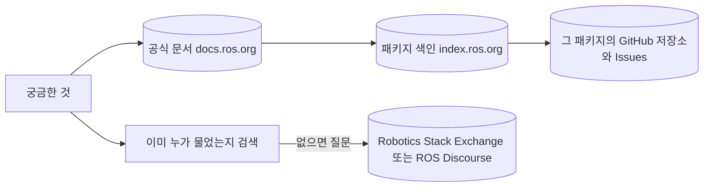
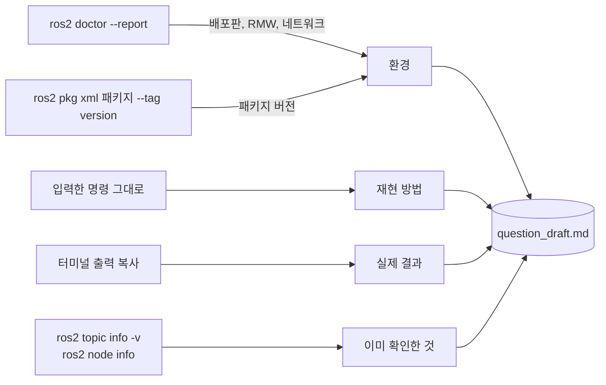

# 22장. ROS 커뮤니티

- 원서: Chapter 22. The ROS Community: Online Resources, PDF p.419~424 (인쇄 쪽 = PDF 쪽 - 20)
- 선행 조건: 없음. 21장까지 실습하면서 막혔던 문제가 하나 있으면 이 장의 질문 쓰기 실습 재료로 씁니다.
- 새로 설치할 것: 없음

## 이 장에서 체감할 구조

ROS에는 중앙 저장소도, 중앙 이슈 트래커도 없습니다. 패키지마다 저장소와 이슈 트래커가 따로 있고, 문서와 색인 사이트가 그 위치를 알려 줍니다.



## 1. 목표와 개념

원서는 이 장에서 기술 내용 대신 사람과 자료를 소개합니다. 어디에서 문서를 찾고, 어디에 질문하고, 버그는 어디에 보고하고, 내가 만든 패키지는 어떻게 알리는지를 다룹니다. 예절에 관한 조언(상대의 선의를 가정하기, 같은 질문을 반복해서 올리지 않기, 마감을 내세워 재촉하지 않기)도 함께 나옵니다 (원서 PDF p.419~420).

원서가 쓰인 2015년 이후로 사이트 구성이 많이 바뀌었습니다. 이 장에서는 원서가 소개한 자원이 지금 어디에 해당하는지 대응시키고, 좋은 질문을 쓰는 연습을 합니다. 신입 엔지니어에게 질문을 잘 쓰는 능력은 코드 실력만큼 자주 평가받는 능력입니다.

**어디에 쓸지 고르기.** 같은 문제라도 올릴 곳이 다르면 답이 오지 않습니다. 문서와 검색으로 먼저 찾아보고, 그래도 없으면 글의 성격으로 곳을 고릅니다. 사용법 질문은 Robotics Stack Exchange, 패키지의 버그는 그 패키지 저장소의 Issues, 공지나 새 패키지 소개와 일반 토론은 ROS Discourse입니다(2절 표).

이슈를 올릴 때도 그 저장소의 기존 이슈부터 검색합니다(실습 22-4). 위 그림의 "없으면 질문" 칸이 이 세 갈래로 나뉜다고 보면 됩니다.

**좋은 질문의 재료.** 실습 22-3의 틀은 "하려는 것, 환경, 재현 방법, 기대한 결과, 실제 결과, 이미 확인한 것" 순서입니다. 이 중 환경, 재현 방법, 실제 결과, 이미 확인한 것은 말로 쓰는 것이 아니라 명령 출력을 복사해서 채웁니다. 기억에 의존하면 철자가 달라지고 빠지는 정보가 생기기 때문입니다(4절).



그림에서 볼 것: 질문의 각 항목마다 그 내용을 만들어 주는 명령이 있습니다. 항목을 채우는 일이 곧 환경과 증상을 점검하는 일입니다.

예:

```bash
ros2 pkg xml rclpy --tag version
ros2 doctor --report | head -60
```

첫 줄은 질문의 "관련 패키지 버전" 칸에, 둘째 줄은 `RMW MIDDLEWARE`와 `ROS 2 INFORMATION` 절을 찾아 "환경" 칸에 옮깁니다.

예:

```bash
ros2 topic info -v /cmd_vel
```

실습 22-3의 예시 상황에서 이 출력의 publisher 쪽 타입과 subscription 쪽 타입이 다른 것이 바로 보이면, 질문을 올리기 전에 답을 얻은 것입니다.

### 실무 메모

- **문제를 보고할 때는 배포판, RMW, 재현 명령, 전체 출력을 함께 붙입니다.** 같은 코드도 배포판이나 RMW에 따라 동작이 다를 수 있고, 이 가이드의 21장 실습 21-8처럼 WSL 네트워크 모드까지 필요한 경우도 있습니다. 출력은 다시 치지 말고 복사하며(필요하면 `2>&1 | tee log.txt`), 네트워크 주소 같은 개인 정보는 지우고 올립니다.
- **패키지를 고르기 전에 ROS Index에서 내 배포판 탭이 있는지 봅니다.** 실습 22-1처럼 jazzy 탭의 버전과 저장소의 `jazzy` 브랜치를 확인하면 배포판 지원 여부를 알 수 있습니다. 저장소의 최근 변경과 열린 이슈가 오래 방치되어 있는지도 함께 보면 유지 상태를 짐작할 수 있습니다.
- **검색에서 나온 옛 글은 ROS 1 기준인지 먼저 확인합니다.** ROS Answers와 Wiki 글은 ROS 1 시절 자료가 많습니다. 글의 날짜와 명령 이름(`rosrun`인지 `ros2 run`인지)을 보고 내 배포판에 맞는지 판단합니다.
- **이슈는 저장소를 정확히 골라 올립니다.** 문제가 어느 패키지의 실행 파일에서 나왔는지 `ros2 pkg executables`와 `package.xml`의 `<url>`로 확인합니다. 같은 질문을 여러 곳에 올렸다면 서로 링크를 남깁니다.

## 2. 원서(ROS 1)와 달라지는 점

| 원서 (ROS 1) | 지금 (ROS 2 Jazzy 기준) | 이유와 주의점 |
|---|---|---|
| ROS Wiki (`wiki.ros.org`) | 공식 문서 `https://docs.ros.org/en/jazzy/` | Wiki는 ROS 1 시절 자료입니다. ROS 2의 설치, 튜토리얼, 개념 설명은 배포판별 문서 사이트에 있습니다. 주소의 `jazzy`를 다른 배포판 이름으로 바꾸면 그 배포판 문서가 나옵니다. |
| Wiki의 패키지 페이지 (`wiki.ros.org/<패키지>`) | ROS Index `https://index.ros.org/p/<패키지>/` | 배포판별 버전, 저장소 주소, API 문서 링크가 한 페이지에 모여 있습니다. 예: `https://index.ros.org/p/rclpy/` |
| 패키지 API 문서 | `https://docs.ros.org/en/jazzy/p/<패키지>/` | ROS Index의 rclpy 페이지가 Jazzy API 문서로 이 형태의 주소를 안내합니다. |
| ROS Answers (`answers.ros.org`) | Robotics Stack Exchange (`https://robotics.stackexchange.com/`) | 질문과 답변은 Stack Exchange 형식의 사이트로 옮겨 갔습니다. 질문에 `ros2`, `ros-jazzy` 같은 태그를 붙입니다. 옛 ROS Answers 글은 검색으로 여전히 자주 걸리지만 ROS 1 기준인 경우가 많습니다. |
| 메일링 리스트 `ros-users@` | ROS Discourse (Open Robotics Discourse, `https://discourse.openrobotics.org/`) | 공지, 새 패키지 소개, 일반 토론은 Discourse 포럼에서 합니다. 문제 해결 질문은 Stack Exchange 쪽이 더 알맞습니다. |
| SIG (Special Interest Group) | Discourse의 분야별 카테고리와 워킹 그룹 | ROS 카테고리 아래에 아이디어, 패키징과 릴리스, 공지, 일반 토론 같은 하위 카테고리가 있습니다. |
| 패키지별 이슈 트래커 | 대부분 GitHub 저장소의 Issues | 구조는 원서와 같습니다. 중앙 트래커가 없으므로, ROS Index에서 패키지의 저장소를 찾아 그 저장소에 이슈를 올립니다. |
| REP (ROS Enhancement Proposal) | REP (Robotics Enhancement Proposals) | 패키지 구조, 좌표계 이름, 단위 같은 공통 규약 문서입니다. 23장에서 다루는 디렉터리 구조 규약도 REP에서 나왔습니다. 소스 저장소가 `https://github.com/openrobotics/reps` 로 옮겨졌습니다. |
| 패키지 공개: 저장소를 Wiki 색인에 등록 | 저장소를 공개하고 rosdistro에 등록하면 ROS Index에 나타나고 bloom으로 바이너리 릴리스 가능 | 등록과 릴리스 절차는 문서 사이트의 릴리스 안내를 따릅니다. 이 가이드에서는 실습하지 않습니다. |

## 3. 실습

### 실습 22-1. 문서에서 답 찾기: 패키지 하나를 끝까지 따라가기

**준비**: 웹 브라우저 하나와 터미널 하나

**직접 입력**: 터미널에서 이 가이드가 계속 써 온 패키지의 설치 위치와 버전을 먼저 확인합니다.

```bash
ros2 pkg prefix rclpy
ros2 pkg xml rclpy --tag version
```

그다음 브라우저에서 다음 순서로 따라갑니다.

1. `https://index.ros.org/p/rclpy/` 에서 jazzy 탭을 고릅니다.
2. 페이지에 적힌 버전이 터미널에서 본 버전과 같은지 비교합니다.
3. 페이지의 저장소 링크(GitHub `ros2/rclpy`)로 이동해서, 브랜치 목록에 `jazzy` 가 있는지 확인합니다.
4. 페이지의 API 문서 링크로 이동해서 `Node.create_timer` 설명을 찾습니다.

**관찰**: 설치본의 버전과 색인 사이트의 버전이 다를 수 있습니다. 색인은 최신 릴리스를, 내 컴퓨터는 마지막으로 `apt upgrade` 한 시점의 버전을 보여 주기 때문입니다. 질문할 때 내 설치본의 버전을 직접 적어야 하는 이유가 여기에 있습니다.

**생각해 볼 질문**: rclpy 저장소에 `jazzy` 브랜치가 따로 있는 이유는 무엇일까요?

### 실습 22-2. 질문에 붙일 환경 정보 모으기: `ros2 doctor`

**준비**: 터미널 하나. 아무 노드도 실행하지 않아도 됩니다.

**직접 입력**:

```bash
ros2 doctor
ros2 doctor --report | head -60
```

**관찰**:
- `ros2 doctor` 는 환경을 점검해서 문제가 있는 항목만 경고로 보여 주고, 마지막에 `All 5 checks passed` 처럼 점검 통과 개수를 출력합니다. 설치본보다 새 버전이 나온 패키지마다 `UserWarning: <패키지> has been updated to a new version.` 로 시작하는 경고(설치 버전과 최신 버전 표시)가 줄줄이 나오고, 직접 만든 패키지(`basics` 등)는 `Cannot find the latest versions of packages` 로 표시됩니다. 둘 다 고장이 아니라 정보입니다.
- `--report` 는 `NETWORK CONFIGURATION`, `PACKAGE VERSIONS`, `PLATFORM INFORMATION`, `QOS COMPATIBILITY LIST`, `RMW MIDDLEWARE`(`middleware name : rmw_cyclonedds_cpp` 같은 줄), `ROS 2 INFORMATION`(`distribution name : jazzy`), `TOPIC LIST` 절을 출력합니다. 질문에 붙일 환경 정보는 이 출력에서 골라 옵니다.
- 실패한 점검만 보고 싶으면 `ros2 doctor --report-failed` 를 씁니다.
- 출력에는 네트워크 주소 같은 정보도 들어 있습니다. 공개 게시판에 올릴 때는 필요한 절만 골라 붙이고, 개인 정보가 있으면 지웁니다.

**생각해 볼 질문**: 원서는 질문에 배포판 이름을 꼭 적으라고 합니다. ROS 2에서는 배포판 이름 외에 어떤 정보가 특히 중요할까요? (힌트: `--report` 의 절 제목을 보세요.)

### 실습 22-3. 최소 재현 예제로 질문 쓰기

**준비**: 21장까지 하면서 막혔던 문제 하나. 없다면 아래 예시 상황을 씁니다.

예시 상황: 7장에서 만든 노드가 `/cmd_vel` 에 `geometry_msgs/msg/Twist` 를 발행했는데 TurtleBot3 시뮬 로봇이 움직이지 않았습니다.

**직접 입력**: 아래 틀을 텍스트 파일 `~/question_draft.md` 에 직접 채워 봅니다.

````markdown
## 하려는 것
(목표 한두 줄)

## 환경
- ROS 2 배포판: jazzy
- OS: Ubuntu 24.04 (WSL2)
- RMW: (ros2 doctor --report 의 middleware 절에서 복사)
- 네트워크: ROS_DOMAIN_ID, ROS_AUTOMATIC_DISCOVERY_RANGE, WSL 네트워크 모드(예: mirrored)
- 관련 패키지 버전: (ros2 pkg xml <패키지> --tag version)

## 재현 방법
1. 터미널 1: (명령 그대로)
2. 터미널 2: (명령 그대로)

최소 코드 (문제와 상관없는 부분은 지운 것):
```python
(30줄 이내)
```

## 기대한 결과
## 실제 결과
(오류와 경고는 다시 치지 말고 복사해서 붙임)

## 이미 확인한 것
- ros2 topic info -v /cmd_vel 출력: ...
- ros2 node info /<노드> 출력: ...
````

**관찰**: 틀을 채우다 보면 "이미 확인한 것"을 쓰는 단계에서 답을 찾는 경우가 많습니다. 예시 상황이라면 `ros2 topic info -v /cmd_vel` 의 publisher 쪽 타입(`Twist`)과 subscription 쪽 타입(`TwistStamped`)이 다르다는 것이 출력에 그대로 보입니다. 최소 재현 예제를 만드는 과정 자체가 디버깅입니다.

**생각해 볼 질문**: 질문 본문에 코드 전체(수백 줄)를 붙이지 말고 최소 예제로 줄여야 하는 이유는 무엇일까요?

### 실습 22-4. 이슈를 올릴 저장소 찾기

**준비**: 터미널 하나

**직접 입력**: 어떤 실행 파일이 어느 패키지에서 왔는지부터 찾습니다.

```bash
ros2 pkg executables turtlebot3_gazebo
ros2 pkg xml turtlebot3_gazebo | grep -E 'url|maintainer'
```

**관찰**: `package.xml` 의 `<url>` 태그에 저장소나 이슈 트래커 주소가 들어 있는 경우가 많습니다. 없으면 ROS Index에서 같은 패키지를 찾아 저장소 링크를 따라갑니다. 이슈를 올리기 전에 그 저장소의 기존 이슈를 먼저 검색합니다.

**생각해 볼 질문**: 이슈를 TurtleBot3 저장소에 올려야 할지 Gazebo 브리지(`ros_gz`) 저장소에 올려야 할지 헷갈린다면, 무엇으로 판단할 수 있을까요?

## 4. 일부러 망가뜨려 보기

이 장은 코드가 없으므로 "나쁜 질문"을 일부러 써 보고 무엇이 빠졌는지 확인합니다.

| 바꿀 것 | 예상 증상 | 원인을 확인하는 명령 |
|---|---|---|
| 질문에서 배포판과 RMW 정보를 지움 | 답하는 사람이 "어떤 배포판인가요?"부터 되묻습니다. 답이 하루 늦어집니다. | `ros2 doctor --report` 의 platform, middleware 절 |
| 오류 메시지를 기억나는 대로 다시 쳐서 적음 | 오류 문자열로 검색해도 같은 사례가 나오지 않습니다. 철자 하나 차이로 다른 문제처럼 보입니다. | 터미널 출력을 그대로 복사, 필요하면 `2>&1 \| tee log.txt` |
| "로봇이 안 움직여요"만 적음 | 원인 후보가 너무 많아 아무도 답하지 않습니다. | `ros2 node info`, `ros2 topic info -v` 출력을 함께 첨부 |
| 같은 질문을 여러 사이트에 동시에 올리고 링크를 걸지 않음 | 여러 곳에서 같은 답을 반복하게 만들어 신뢰를 잃습니다. | 올렸던 곳의 링크를 서로 적어 둠 |

## 5. 확인 질문

<details><summary>Q1. ROS 1의 Wiki 패키지 페이지에 해당하는 ROS 2의 자원은 무엇이고, 거기서 무엇을 찾을 수 있나요?</summary>

ROS Index(`index.ros.org/p/<패키지>/`)입니다. 배포판별 버전, 저장소 주소, 의존성, API 문서 링크를 찾을 수 있습니다. 개념 설명과 튜토리얼은 `docs.ros.org/en/<배포판>/` 에 있습니다.

</details>

<details><summary>Q2. 실습 22-1의 질문: rclpy 저장소에 `jazzy` 브랜치가 따로 있는 이유는 무엇인가요?</summary>

배포판마다 API와 동작이 조금씩 다르고, 이미 나온 배포판에는 호환성을 깨지 않는 수정만 들어가기 때문입니다. 그래서 배포판별 브랜치를 따로 유지합니다. 같은 이유로 질문과 이슈에는 배포판 이름이 꼭 필요합니다.

</details>

<details><summary>Q3. 실습 22-2의 질문: 배포판 이름 외에 ROS 2에서 특히 중요한 환경 정보는 무엇인가요?</summary>

미들웨어(RMW) 구현, 네트워크 설정(`ROS_DOMAIN_ID`, `ROS_AUTOMATIC_DISCOVERY_RANGE`), 실행 환경(WSL2, Docker 등)입니다. 노드가 서로 보이지 않는 문제는 대부분 이 정보에서 원인이 나옵니다. 21장의 실습 21-4와 21-8을 참고하세요. 21-8의 "CLI가 출력 없이 멈춤" 문제는 RMW와 WSL 네트워크 모드(mirrored)가 함께 적혀 있어야 다른 사람이 재현할 수 있는 좋은 예입니다.

</details>

<details><summary>Q4. 실습 22-3의 질문: 최소 재현 예제로 줄여야 하는 이유는 무엇인가요?</summary>

답하는 사람이 자기 컴퓨터에서 그대로 실행해 볼 수 있어야 원인을 확인할 수 있습니다. 또 줄이는 과정에서 문제와 상관없는 부분이 빠지므로, 원인이 어디에 있는지 질문자 스스로 좁히게 됩니다.

</details>

<details><summary>Q5. 실습 22-4의 질문: 이슈를 어느 저장소에 올릴지 무엇으로 판단하나요?</summary>

문제를 일으키는 노드나 설정 파일이 어느 패키지에 들어 있는지로 판단합니다. `ros2 node info` 로 문제 노드를 찾고, `ros2 pkg prefix`, `ros2 pkg executables` 로 그 노드가 어느 패키지에서 왔는지 확인합니다. 확신이 없으면 가장 가능성 높은 곳에 올리고, 관리자가 옮겨 줄 수 있다는 점은 원서의 조언과 같습니다.

</details>

## 6. 원서 대조 메모

- 원서가 소개하는 ROS Wiki, ROS Answers, `ros-users@` 메일링 리스트는 ROS 1 시절의 중심 자원입니다. ROS 2에서는 2절 표의 자원으로 바뀌었습니다. 원서의 주소를 그대로 따라가면 ROS 1 자료가 나오므로 주의합니다.
- 원서의 예절 조언과 좋은 질문의 조건(구체적으로, 재현 방법, 버전 정보, 출력은 복사해서 붙이기)은 지금도 그대로 유효합니다 (원서 PDF p.419~423). 이 장의 실습 22-3은 그 조언을 ROS 2 명령으로 실천하는 틀입니다.
- 원서의 "중앙 저장소도 중앙 트래커도 없다"는 구조 설명은 ROS 2에서도 같습니다.

## 7. 이 문서의 검증 상태

<details><summary>검증 기록 펼치기</summary>

- 확인함 (2026-10-27, 웹 페이지 직접 조회): `https://index.ros.org/p/rclpy/` 가 배포판별(jazzy 포함) 버전, 저장소 `https://github.com/ros2/rclpy.git`, Jazzy API 문서 `docs.ros.org/en/jazzy/p/rclpy` 링크를 보여 주는 것. `https://discourse.openrobotics.org/` 가 Open Robotics의 토론 포럼이고 ROS 카테고리 아래에 Ideas, Packaging and Release Management, Announcements and News, General, PMC 하위 카테고리가 있는 것. REP 소스 저장소가 `https://github.com/openrobotics/reps` 로 옮겨졌고 옛 저장소(`ros-infrastructure/rep`)는 보관 처리된 것, 새 저장소 README가 렌더링 사이트로 `reps.openrobotics.org` 를 안내하는 것.
- 확인함 (설치본): `ros2 doctor --help` 의 `--report`, `--report-failed`, `--include-warnings` 옵션과 `hello` 하위 명령. `ros2 doctor` 의 `UserWarning` 줄, `Cannot find the latest versions of packages`, `All 5 checks passed`. `ros2 doctor --report` 의 일곱 절 제목과 `middleware name : rmw_cyclonedds_cpp`, `distribution name : jazzy` (Cyclone DDS 설정 상태에서 실행).
- 확인함 (2026-10-31, 설치본): 실습 22-1의 `ros2 pkg prefix rclpy` 는 `/opt/ros/jazzy`, `ros2 pkg xml rclpy --tag version` 은 `7.1.12` 를 출력했습니다. 실습 22-4의 `ros2 pkg executables turtlebot3_gazebo` 는 `turtlebot3_gazebo turtlebot3_drive` 를 출력했고, `package.xml` 에는 `<url type="website">`, `<url type="repository">`(`https://github.com/ROBOTIS-GIT/turtlebot3_simulations`), `<url type="bugtracker">` 세 태그가 있었습니다. 실습 22-1의 브라우저 단계 가운데 GitHub 브랜치 목록과 API 문서의 `Node.create_timer` 설명은 따라가 보지 않았습니다.
- 확인 못 함: `docs.ros.org/en/jazzy/`, `answers.ros.org`, `www.ros.org/reps/` 는 봇 차단 페이지가 응답해서 내용을 확인하지 못했습니다. `robotics.stackexchange.com` 은 조회 도구가 접근하지 못했습니다. 이 주소들은 작성자가 알고 있는 주소이며, 브라우저에서 직접 열어 확인하세요. 특히 ROS Answers가 지금 어떤 상태(보관, 이전 안내)인지는 확인하지 못했습니다.
- 확인 못 함: rosdistro 등록과 bloom 릴리스 절차는 실습하지 않았습니다.
- 설명 보강(2026-10-30): "이 장에서 체감할 구조"와 1절에 그림, 코드 예시, 코드와 폴더 구조, 실무 메모를 더했습니다. 머리말과 2~6절은 바꾸지 않았습니다. 1절의 코드 예시는 따로 실행하지 않았습니다.

</details>
